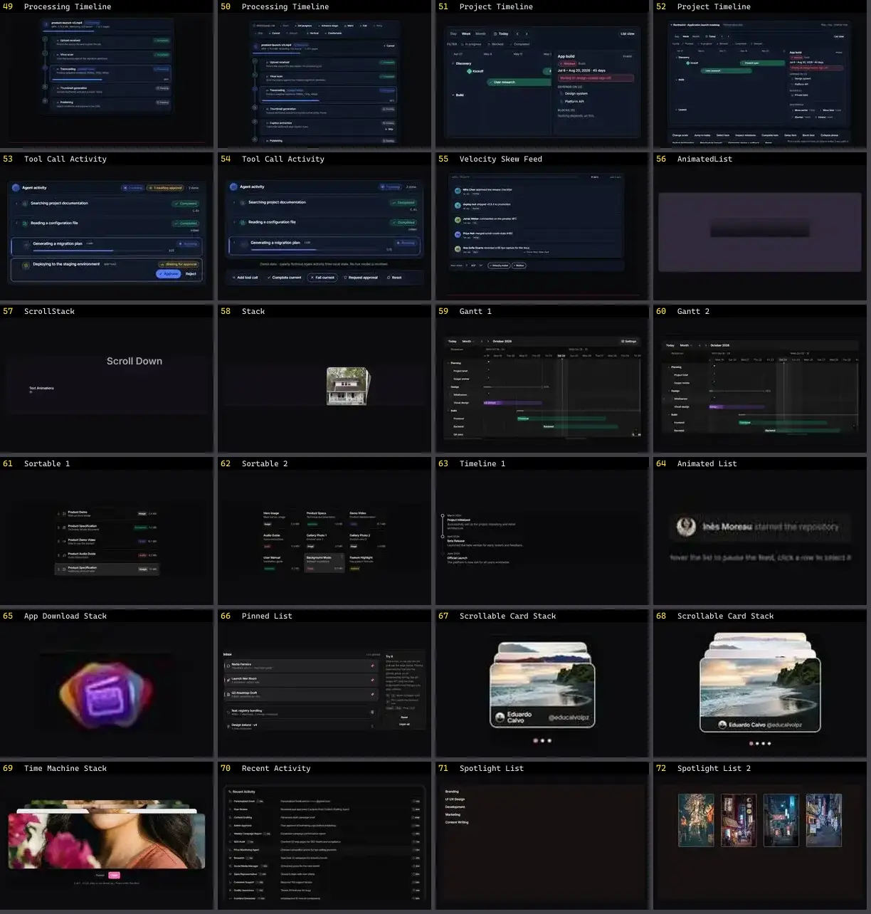

# Lista & Timeline — folha 3

| nº | nome | uid | tipo de aplicação |
|---|---|---|---|
| 49 | Processing Timeline | `motiq:catalog/processing-timeline` | UI base |
| 50 | Processing Timeline | `motiq:processing-timeline` | UI base |
| 51 | Project Timeline | `motiq:catalog/project-timeline` | UI base |
| 52 | Project Timeline | `motiq:project-timeline` | UI base |
| 53 | Tool Call Activity | `motiq:catalog/tool-call-activity` | UI base |
| 54 | Tool Call Activity | `motiq:tool-call-activity` | UI base |
| 55 | Velocity Skew Feed | `motiq:velocity-skew-feed` | UI base |
| 56 | AnimatedList | `reactbits:Components/AnimatedListDemo` | UI base |
| 57 | ScrollStack | `reactbits:Components/ScrollStackDemo` | UI base |
| 58 | Stack | `reactbits:Components/StackDemo` | UI base |
| 59 | Gantt 1 | `reui:gantt/c-gantt-1` | UI base |
| 60 | Gantt 2 | `reui:gantt/c-gantt-2` | UI base |
| 61 | Sortable 1 | `reui:sortable/c-sortable-1` | UI base |
| 62 | Sortable 2 | `reui:sortable/c-sortable-2` | UI base |
| 63 | Timeline 1 | `reui:timeline/c-timeline-1` | UI base |
| 64 | Animated List | `smoothui:animated-list` | UI base |
| 65 | App Download Stack | `smoothui:app-download-stack` | UI base |
| 66 | Pinned List | `smoothui:pinned-list` | UI base |
| 67 | Scrollable Card Stack | `smoothui:canvas/scrollable-card-stack` | UI base |
| 68 | Scrollable Card Stack | `smoothui:scrollable-card-stack` | UI base |
| 69 | Time Machine Stack | `smoothui:time-machine-stack` | UI base |
| 70 | Recent Activity | `spectrumui:recent-activity` | UI base |
| 71 | Spotlight List | `systaliko:components/spotlight-list` | UI base |
| 72 | Spotlight List 2 | `systaliko:components/spotlight-list-2` | UI base |
