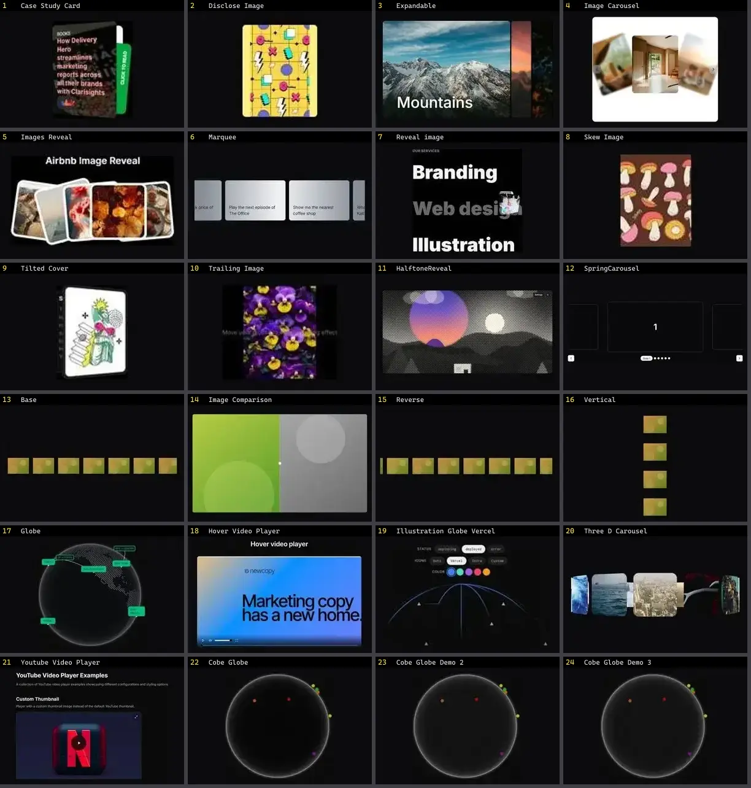

# Mídia & Galeria — folha 1

| nº | nome | uid | tipo de aplicação |
|---|---|---|---|
| 1 | Case Study Card | `animata:card/case-study-card` | Portfólio & Mídia |
| 2 | Disclose Image | `animata:image/disclose-image` | Portfólio & Mídia |
| 3 | Expandable | `animata:carousel/expandable` | Portfólio & Mídia |
| 4 | Image Carousel | `animata:carousel/image-carousel` | Portfólio & Mídia |
| 5 | Images Reveal | `animata:image/images-reveal` | Portfólio & Mídia |
| 6 | Marquee | `animata:container/marquee` | Portfólio & Mídia |
| 7 | Reveal image | `animata:list/reveal-image` | Portfólio & Mídia |
| 8 | Skew Image | `animata:image/skew-image` | Portfólio & Mídia |
| 9 | Tilted Cover | `animata:image/tilted-cover` | Portfólio & Mídia |
| 10 | Trailing Image | `animata:image/trailing-image` | Portfólio & Mídia |
| 11 | HalftoneReveal | `atlas:Media/HalftoneReveal` | Portfólio & Mídia |
| 12 | SpringCarousel | `atlas:Media/SpringCarousel` | Portfólio & Mídia |
| 13 | Base | `bundui:marquee-effect/base` | Portfólio & Mídia |
| 14 | Image Comparison | `bundui:image-comparison` | Portfólio & Mídia |
| 15 | Reverse | `bundui:marquee-effect/reverse` | Portfólio & Mídia |
| 16 | Vertical | `bundui:marquee-effect/vertical` | Portfólio & Mídia |
| 17 | Globe | `cultui:globe-demo` | Portfólio & Mídia |
| 18 | Hover Video Player | `cultui:hover-video-player-demo` | Portfólio & Mídia |
| 19 | Illustration Globe Vercel | `cultui:illustration-globe-vercel-demo` | Portfólio & Mídia |
| 20 | Three D Carousel | `cultui:three-d-carousel-demo` | Portfólio & Mídia |
| 21 | Youtube Video Player | `cultui:youtube-video-player-demo` | Portfólio & Mídia |
| 22 | Cobe Globe | `eldoraui:cobe-globe-demo` | Portfólio & Mídia |
| 23 | Cobe Globe Demo 2 | `eldoraui:cobe-globe-demo-2` | Portfólio & Mídia |
| 24 | Cobe Globe Demo 3 | `eldoraui:cobe-globe-demo-3` | Portfólio & Mídia |
