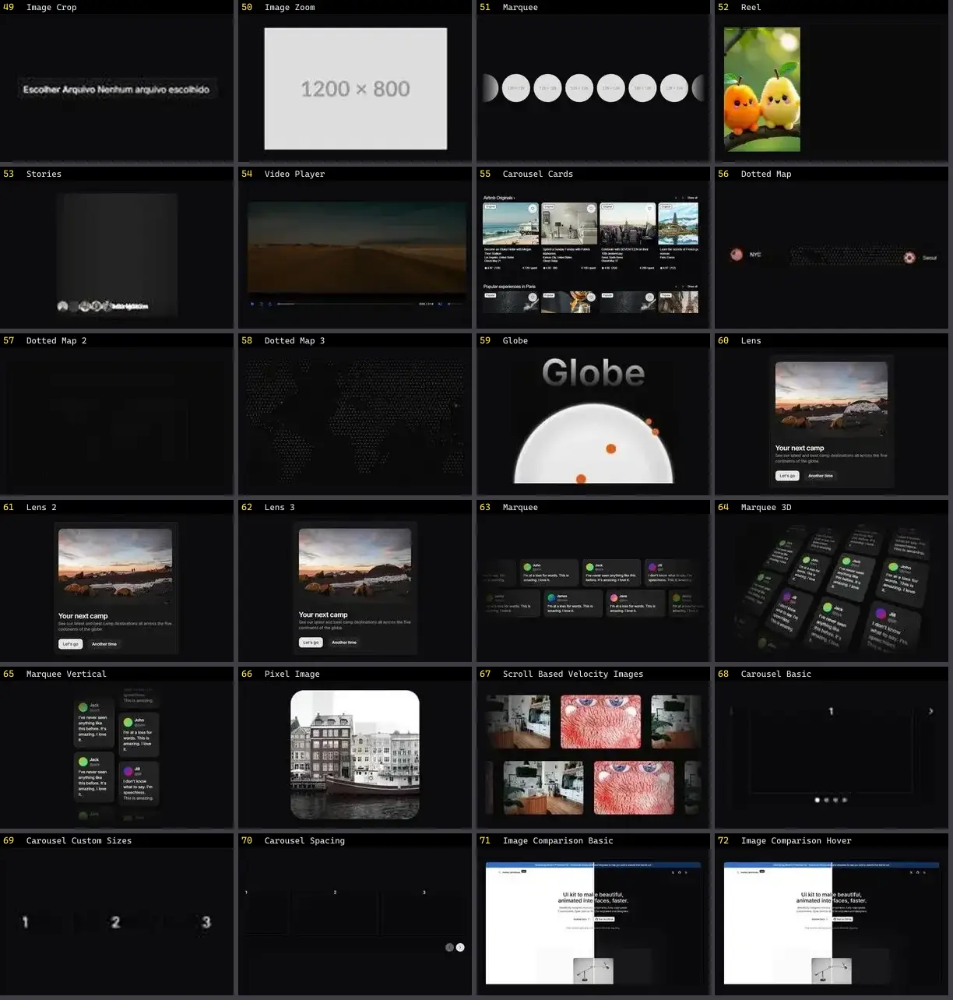

# Mídia & Galeria — folha 3

| nº | nome | uid | tipo de aplicação |
|---|---|---|---|
| 49 | Image Crop | `kibo:image-crop` | Portfólio & Mídia |
| 50 | Image Zoom | `kibo:image-zoom` | Portfólio & Mídia |
| 51 | Marquee | `kibo:marquee` | Portfólio & Mídia |
| 52 | Reel | `kibo:reel` | Portfólio & Mídia |
| 53 | Stories | `kibo:stories` | Portfólio & Mídia |
| 54 | Video Player | `kibo:video-player` | Portfólio & Mídia |
| 55 | Carousel Cards | `kokonutui:carousel-cards` | Portfólio & Mídia |
| 56 | Dotted Map | `magicui:dotted-map-demo` | Portfólio & Mídia |
| 57 | Dotted Map 2 | `magicui:dotted-map-demo-2` | Portfólio & Mídia |
| 58 | Dotted Map 3 | `magicui:dotted-map-demo-3` | Portfólio & Mídia |
| 59 | Globe | `magicui:globe-demo` | Portfólio & Mídia |
| 60 | Lens | `magicui:lens-demo` | Portfólio & Mídia |
| 61 | Lens 2 | `magicui:lens-demo-2` | Portfólio & Mídia |
| 62 | Lens 3 | `magicui:lens-demo-3` | Portfólio & Mídia |
| 63 | Marquee | `magicui:marquee-demo` | Portfólio & Mídia |
| 64 | Marquee 3D | `magicui:marquee-3d` | Portfólio & Mídia |
| 65 | Marquee Vertical | `magicui:marquee-demo-vertical` | Portfólio & Mídia |
| 66 | Pixel Image | `magicui:pixel-image-demo` | Portfólio & Mídia |
| 67 | Scroll Based Velocity Images | `magicui:scroll-based-velocity-images-demo` | Portfólio & Mídia |
| 68 | Carousel Basic | `motionprimitives:carousel/carousel-basic` | Portfólio & Mídia |
| 69 | Carousel Custom Sizes | `motionprimitives:carousel/carousel-custom-sizes` | Portfólio & Mídia |
| 70 | Carousel Spacing | `motionprimitives:carousel/carousel-spacing` | Portfólio & Mídia |
| 71 | Image Comparison Basic | `motionprimitives:image-comparison/image-comparison-basic` | Portfólio & Mídia |
| 72 | Image Comparison Hover | `motionprimitives:image-comparison/image-comparison-hover` | Portfólio & Mídia |
