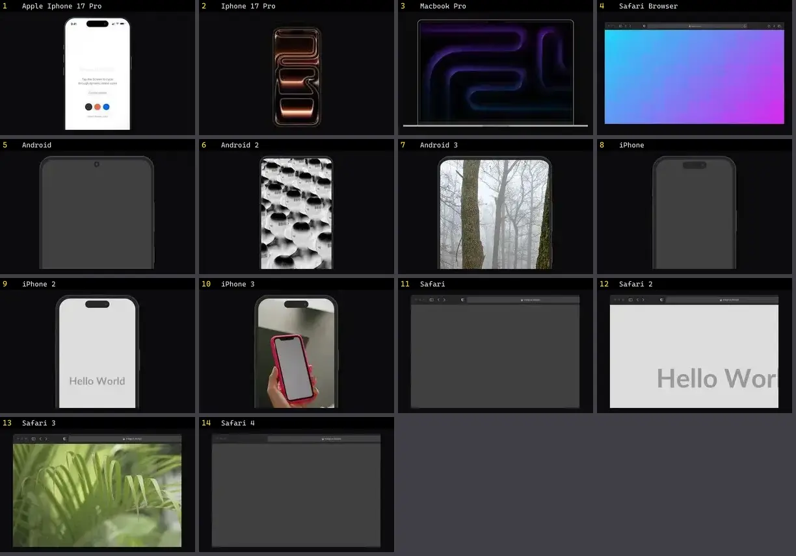

# Mockup — folha 1

| nº | nome | uid | tipo de aplicação |
|---|---|---|---|
| 1 | Apple Iphone 17 Pro | `cultui:apple-iphone-17-pro-demo` | Mobile & App |
| 2 | Iphone 17 Pro | `eldoraui:iphone-17-pro-demo` | Mobile & App |
| 3 | Macbook Pro | `eldoraui:macbook-pro-demo` | Mobile & App |
| 4 | Safari Browser | `eldoraui:safari-browser-demo` | Mobile & App |
| 5 | Android | `magicui:android-demo` | Mobile & App |
| 6 | Android 2 | `magicui:android-demo-2` | Mobile & App |
| 7 | Android 3 | `magicui:android-demo-3` | Mobile & App |
| 8 | iPhone | `magicui:iphone-demo` | Mobile & App |
| 9 | iPhone 2 | `magicui:iphone-demo-2` | Mobile & App |
| 10 | iPhone 3 | `magicui:iphone-demo-3` | Mobile & App |
| 11 | Safari | `magicui:safari-demo` | Mobile & App |
| 12 | Safari 2 | `magicui:safari-demo-2` | Mobile & App |
| 13 | Safari 3 | `magicui:safari-demo-3` | Mobile & App |
| 14 | Safari 4 | `magicui:safari-demo-4` | Mobile & App |
