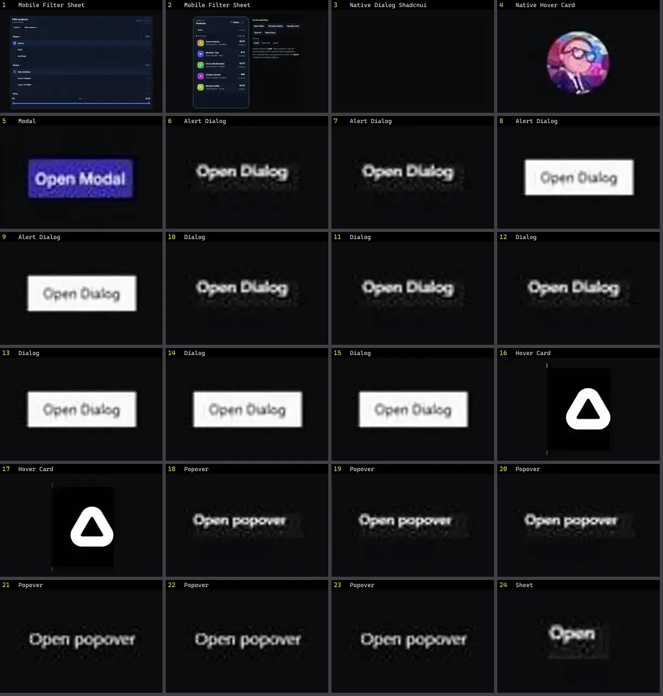

# Modal & Overlay — folha 1

| nº | nome | uid | tipo de aplicação |
|---|---|---|---|
| 1 | Mobile Filter Sheet | `motiq:catalog/mobile-filter-sheet` | Mobile & App |
| 2 | Mobile Filter Sheet | `motiq:mobile-filter-sheet` | Mobile & App |
| 3 | Native Dialog Shadcnui | `uitripled:native/native-dialog-shadcnui` | Mobile & App |
| 4 | Native Hover Card | `uitripled:native/demo/native-hover-card-demo` | Mobile & App |
| 5 | Modal | `animata:overlay/modal` | UI base |
| 6 | Alert Dialog | `animateui:components/base/alert-dialog` | UI base |
| 7 | Alert Dialog | `animateui:components/radix/alert-dialog` | UI base |
| 8 | Alert Dialog | `animateui:primitives/base/alert-dialog` | UI base |
| 9 | Alert Dialog | `animateui:primitives/radix/alert-dialog` | UI base |
| 10 | Dialog | `animateui:components/base/dialog` | UI base |
| 11 | Dialog | `animateui:components/headless/dialog` | UI base |
| 12 | Dialog | `animateui:components/radix/dialog` | UI base |
| 13 | Dialog | `animateui:primitives/base/dialog` | UI base |
| 14 | Dialog | `animateui:primitives/headless/dialog` | UI base |
| 15 | Dialog | `animateui:primitives/radix/dialog` | UI base |
| 16 | Hover Card | `animateui:components/radix/hover-card` | UI base |
| 17 | Hover Card | `animateui:primitives/radix/hover-card` | UI base |
| 18 | Popover | `animateui:components/base/popover` | UI base |
| 19 | Popover | `animateui:components/headless/popover` | UI base |
| 20 | Popover | `animateui:components/radix/popover` | UI base |
| 21 | Popover | `animateui:primitives/base/popover` | UI base |
| 22 | Popover | `animateui:primitives/headless/popover` | UI base |
| 23 | Popover | `animateui:primitives/radix/popover` | UI base |
| 24 | Sheet | `animateui:components/radix/sheet` | UI base |
