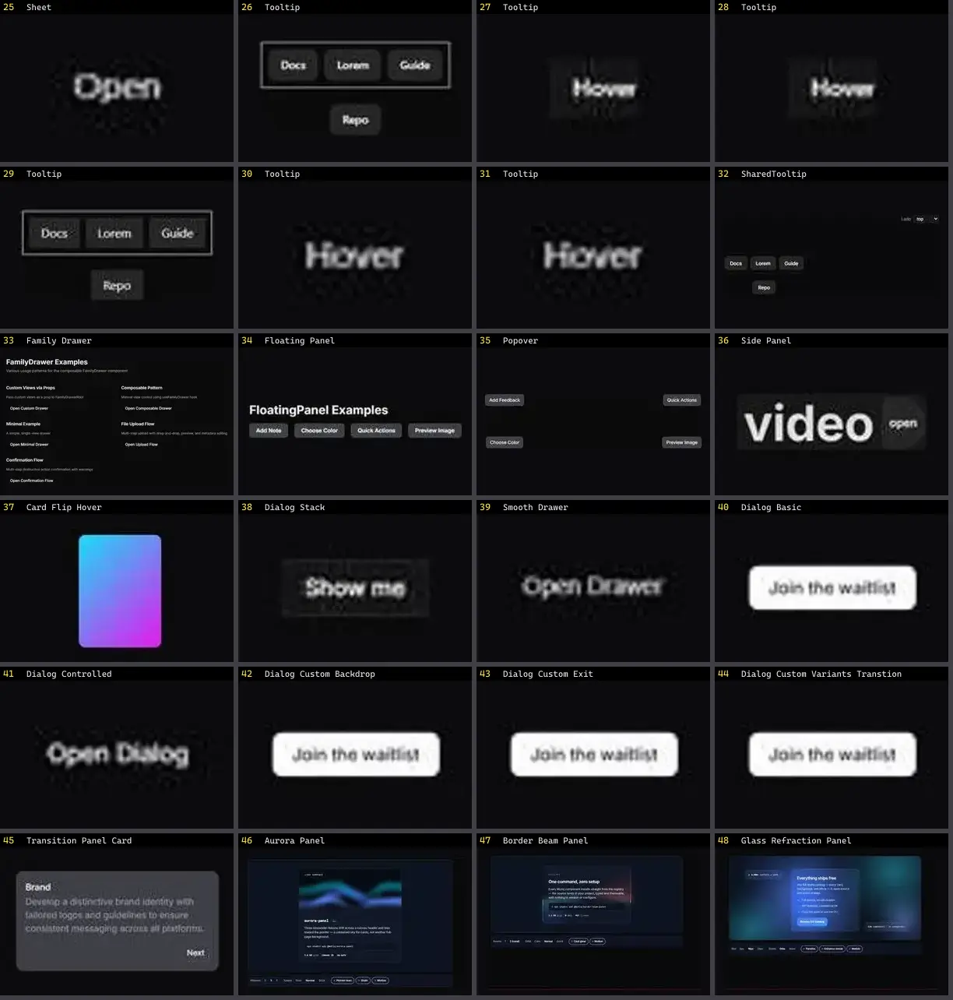

# Modal & Overlay — folha 2

| nº | nome | uid | tipo de aplicação |
|---|---|---|---|
| 25 | Country Dialog | `smoothui:country-dialog` | UI base |
| 26 | Dialog | `smoothui:dialog` | UI base |
| 27 | Drawer | `smoothui:drawer` | UI base |
| 28 | Glow Hover Card | `smoothui:glow-hover-card` | UI base |
| 29 | Gooey Popover | `smoothui:gooey-popover` | UI base |
| 30 | Image Generation Panel | `smoothui:image-generation-panel` | UI base |
| 31 | Rich Popover | `smoothui:rich-popover` | UI base |
| 32 | Social Hover Card | `smoothui:social-hover-card` | UI base |
| 33 | Swap Panel | `smoothui:swap-panel` | UI base |
| 34 | Video Modal | `smoothui:video-modal` | UI base |
| 35 | Diagnostics Panel · Flowing Mesh | `threeui:diagnostics-panel/flow` | UI base |
| 36 | Diagnostics Panel · Layered Planes | `threeui:diagnostics-panel/layers` | UI base |
| 37 | Diagnostics Panel · Node Cubes | `threeui:diagnostics-panel/nodes` | UI base |
| 38 | Animated Dialog | `uitripled:modals/animated-dialog` | UI base |
| 39 | Animated Tooltip | `uitripled:tooltips/animated-tooltip` | UI base |
| 40 | Bottom Modal | `uitripled:modals/bottom-modal` | UI base |
| 41 | Fade Slide | `uitripled:components/modal/fade-slide` | UI base |
| 42 | Fluid Modal Transition | `uitripled:motion-core/fluid-modal-transition` | UI base |
| 43 | Smart Hover Card | `uitripled:motion-core/smart-hover-card` | UI base |
| 44 | Angry Dragonfly · iammar99 | `uiverse:Tooltips/iammar99_angry-dragonfly-22` | UI base |
| 45 | Average Earwig · Yaya12085 | `uiverse:Tooltips/Yaya12085_average-earwig-11` | UI base |
| 46 | Hard Starfish · Mohammad-Rahme-576 | `uiverse:Tooltips/Mohammad-Rahme-576_hard-starfish-64` | UI base |
| 47 | Plastic Dolphin · barisdogansutcu | `uiverse:Tooltips/barisdogansutcu_plastic-dolphin-67` | UI base |
| 48 | Serious Termite · Cobp | `uiverse:Tooltips/Cobp_serious-termite-83` | UI base |
