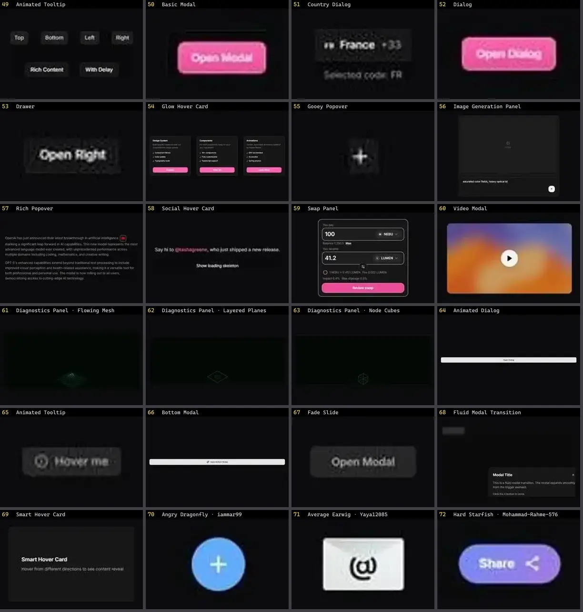

# Modal & Overlay — folha 3

| nº | nome | uid | tipo de aplicação |
|---|---|---|---|
| 49 | Animated Tooltip | `smoothui:animated-tooltip` | UI base |
| 50 | Basic Modal | `smoothui:basic-modal` | UI base |
| 51 | Country Dialog | `smoothui:country-dialog` | UI base |
| 52 | Dialog | `smoothui:dialog` | UI base |
| 53 | Drawer | `smoothui:drawer` | UI base |
| 54 | Glow Hover Card | `smoothui:glow-hover-card` | UI base |
| 55 | Gooey Popover | `smoothui:gooey-popover` | UI base |
| 56 | Image Generation Panel | `smoothui:image-generation-panel` | UI base |
| 57 | Rich Popover | `smoothui:rich-popover` | UI base |
| 58 | Social Hover Card | `smoothui:social-hover-card` | UI base |
| 59 | Swap Panel | `smoothui:swap-panel` | UI base |
| 60 | Video Modal | `smoothui:video-modal` | UI base |
| 61 | Diagnostics Panel · Flowing Mesh | `threeui:diagnostics-panel/flow` | UI base |
| 62 | Diagnostics Panel · Layered Planes | `threeui:diagnostics-panel/layers` | UI base |
| 63 | Diagnostics Panel · Node Cubes | `threeui:diagnostics-panel/nodes` | UI base |
| 64 | Animated Dialog | `uitripled:modals/animated-dialog` | UI base |
| 65 | Animated Tooltip | `uitripled:tooltips/animated-tooltip` | UI base |
| 66 | Bottom Modal | `uitripled:modals/bottom-modal` | UI base |
| 67 | Fade Slide | `uitripled:components/modal/fade-slide` | UI base |
| 68 | Fluid Modal Transition | `uitripled:motion-core/fluid-modal-transition` | UI base |
| 69 | Smart Hover Card | `uitripled:motion-core/smart-hover-card` | UI base |
| 70 | Angry Dragonfly · iammar99 | `uiverse:Tooltips/iammar99_angry-dragonfly-22` | UI base |
| 71 | Average Earwig · Yaya12085 | `uiverse:Tooltips/Yaya12085_average-earwig-11` | UI base |
| 72 | Hard Starfish · Mohammad-Rahme-576 | `uiverse:Tooltips/Mohammad-Rahme-576_hard-starfish-64` | UI base |
