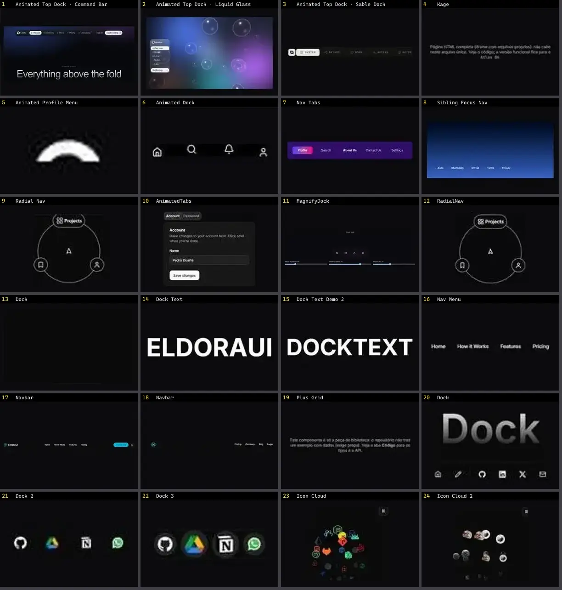

# Navbar & Header — folha 1

| nº | nome | uid | tipo de aplicação |
|---|---|---|---|
| 1 | Animated Top Dock · Command Bar | `threeui:animated-top-dock/modern` | Login & Conta |
| 2 | Animated Top Dock · Liquid Glass | `threeui:animated-top-dock/glass` | Login & Conta |
| 3 | Animated Top Dock · Sable Dock | `threeui:animated-top-dock/sable` | Login & Conta |
| 4 | Kage | `threeui:kage-landing-page` | Login & Conta |
| 5 | Animated Profile Menu | `uitripled:navigation/animated-profile-menu` | Login & Conta |
| 6 | Animated Dock | `animata:container/animated-dock` | UI base |
| 7 | Nav Tabs | `animata:container/nav-tabs` | UI base |
| 8 | Sibling Focus Nav | `animata:container/sibling-focus-nav` | UI base |
| 9 | AnimatedTabs | `atlas:Navigation/AnimatedTabs` | UI base |
| 10 | MagnifyDock | `atlas:Navigation/MagnifyDock` | UI base |
| 11 | RadialNav | `atlas:Navigation/RadialNav` | UI base |
| 12 | Dock | `cultui:dock-demo` | UI base |
| 13 | Dock Text | `eldoraui:dock-text-demo` | UI base |
| 14 | Dock Text Demo 2 | `eldoraui:dock-text-demo-2` | UI base |
| 15 | Nav Menu | `eldoraui:header-01/components/nav-menu` | UI base |
| 16 | Navbar | `eldoraui:header-01/components/navbar` | UI base |
| 17 | Navbar | `eldoraui:header-02/components/navbar` | UI base |
| 18 | Plus Grid | `eldoraui:header-02/components/plus-grid` | UI base |
| 19 | Dock | `magicui:dock-demo` | UI base |
| 20 | Dock 2 | `magicui:dock-demo-2` | UI base |
| 21 | Dock 3 | `magicui:dock-demo-3` | UI base |
| 22 | Icon Cloud | `magicui:icon-cloud-demo` | UI base |
| 23 | Icon Cloud 2 | `magicui:icon-cloud-demo-2` | UI base |
| 24 | Icon Cloud 3 | `magicui:icon-cloud-demo-3` | UI base |
