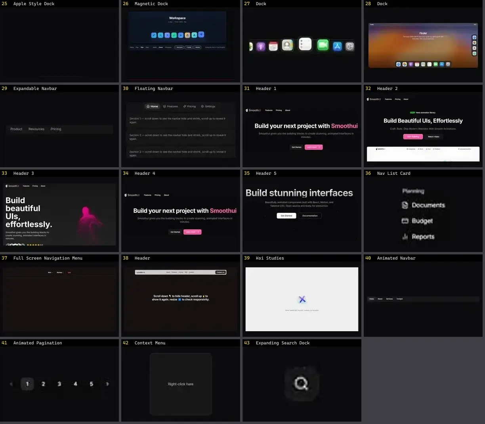

# Navbar & Header — folha 2

| nº | nome | uid | tipo de aplicação |
|---|---|---|---|
| 25 | Icon Cloud 3 | `magicui:icon-cloud-demo-3` | UI base |
| 26 | Apple Style Dock | `motionprimitives:dock/apple-style-dock` | UI base |
| 27 | Magnetic Dock | `motiq:magnetic-dock` | UI base |
| 28 | CardNav | `reactbits:Components/CardNavDemo` | UI base |
| 29 | Dock | `reactbits:Components/DockDemo` | UI base |
| 30 | GooeyNav | `reactbits:Components/GooeyNavDemo` | UI base |
| 31 | PillNav | `reactbits:Components/PillNavDemo` | UI base |
| 32 | Dock | `smoothui:canvas/dock` | UI base |
| 33 | Dock | `smoothui:dock` | UI base |
| 34 | Expandable Navbar | `smoothui:expandable-navbar` | UI base |
| 35 | Floating Navbar | `smoothui:floating-navbar` | UI base |
| 36 | Header 1 | `smoothui:header-1` | UI base |
| 37 | Header 2 | `smoothui:header-2` | UI base |
| 38 | Header 3 | `smoothui:header-3` | UI base |
| 39 | Header 4 | `smoothui:header-4` | UI base |
| 40 | Header 5 | `smoothui:header-5` | UI base |
| 41 | Nav List Card | `spectrumui:nav-list-card` | UI base |
| 42 | Full Screen Navigation Menu | `systaliko:blocks/full-screen-navigation-menu` | UI base |
| 43 | Header | `systaliko:blocks/header` | UI base |
| 44 | Koi Studies | `threeui:koi-studies` | UI base |
| 45 | Animated Navbar | `uitripled:navigation/animated-navbar` | UI base |
| 46 | Animated Pagination | `uitripled:navigation/animated-pagination` | UI base |
| 47 | Context Menu | `uitripled:navigation/context-menu` | UI base |
| 48 | Expanding Search Dock | `uitripled:motion-core/expanding-search-dock` | UI base |
