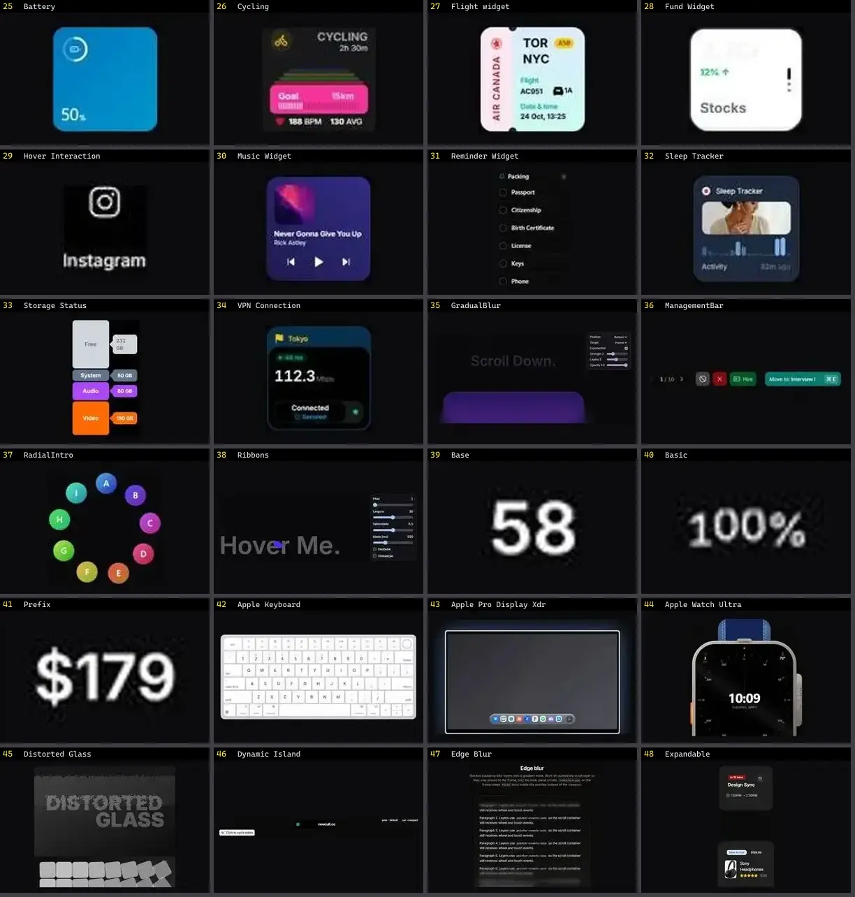

# Outros — folha 2

| nº | nome | uid | tipo de aplicação |
|---|---|---|---|
| 25 | Battery | `animata:widget/battery` | UI base |
| 26 | Cycling | `animata:widget/cycling` | UI base |
| 27 | Flight widget | `animata:widget/flight-widget` | UI base |
| 28 | Fund Widget | `animata:widget/fund-widget` | UI base |
| 29 | Hover Interaction | `animata:icon/hover-interaction` | UI base |
| 30 | Music Widget | `animata:widget/music-widget` | UI base |
| 31 | Reminder Widget | `animata:widget/reminder-widget` | UI base |
| 32 | Sleep Tracker | `animata:widget/sleep-tracker` | UI base |
| 33 | Storage Status | `animata:widget/storage-status` | UI base |
| 34 | VPN Connection | `animata:widget/vpn-widget` | UI base |
| 35 | GradualBlur | `atlas:Misc/GradualBlur` | UI base |
| 36 | ManagementBar | `atlas:Interactions/ManagementBar` | UI base |
| 37 | RadialIntro | `atlas:Misc/RadialIntro` | UI base |
| 38 | Ribbons | `atlas:Interactions/Ribbons` | UI base |
| 39 | Base | `bundui:count-animation/base` | UI base |
| 40 | Basic | `bundui:sliding-number/basic` | UI base |
| 41 | Prefix | `bundui:count-animation/prefix` | UI base |
| 42 | Apple Keyboard | `cultui:apple-keyboard-demo` | UI base |
| 43 | Apple Pro Display Xdr | `cultui:apple-pro-display-xdr-demo` | UI base |
| 44 | Apple Watch Ultra | `cultui:apple-watch-ultra-demo` | UI base |
| 45 | Distorted Glass | `cultui:distorted-glass-demo` | UI base |
| 46 | Dynamic Island | `cultui:dynamic-island-demo` | UI base |
| 47 | Edge Blur | `cultui:edge-blur-demo` | UI base |
| 48 | Expandable | `cultui:expandable-demo` | UI base |
