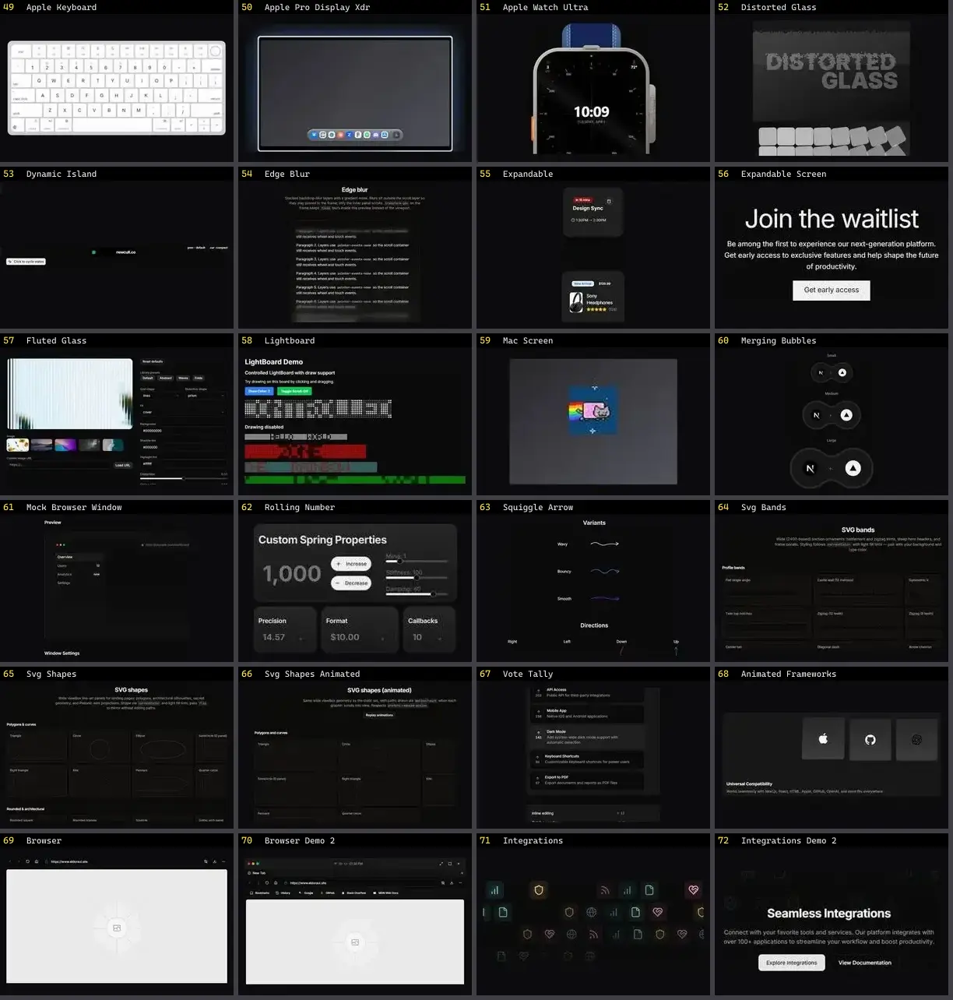

# Outros — folha 3

| nº | nome | uid | tipo de aplicação |
|---|---|---|---|
| 49 | Expandable Screen | `cultui:expandable-screen-demo` | UI base |
| 50 | Fluted Glass | `cultui:fluted-glass-demo` | UI base |
| 51 | Lightboard | `cultui:lightboard-demo` | UI base |
| 52 | Mac Screen | `cultui:mac-screen-demo` | UI base |
| 53 | Merging Bubbles | `cultui:merging-bubbles-demo` | UI base |
| 54 | Mock Browser Window | `cultui:mock-browser-window-demo` | UI base |
| 55 | Rolling Number | `cultui:rolling-number-demo` | UI base |
| 56 | Squiggle Arrow | `cultui:squiggle-arrow-demo` | UI base |
| 57 | Svg Bands | `cultui:svg-bands-demo` | UI base |
| 58 | Svg Shapes | `cultui:svg-shapes-demo` | UI base |
| 59 | Svg Shapes Animated | `cultui:svg-shapes-animated-demo` | UI base |
| 60 | Vote Tally | `cultui:vote-tally-demo` | UI base |
| 61 | Animated Frameworks | `eldoraui:animated-frameworks-demo` | UI base |
| 62 | Browser | `eldoraui:browser-demo` | UI base |
| 63 | Browser Demo 2 | `eldoraui:browser-demo-2` | UI base |
| 64 | Integrations | `eldoraui:integrations-demo` | UI base |
| 65 | Integrations Demo 2 | `eldoraui:integrations-demo-2` | UI base |
| 66 | Ipad | `eldoraui:ipad-demo` | UI base |
| 67 | Circling Elements | `fancy:blocks/circling-elements-demo` | UI base |
| 68 | Circling Elements Easing | `fancy:blocks/circling-elements-easing-demo` | UI base |
| 69 | Css Box | `fancy:blocks/css-box-demo` | UI base |
| 70 | Css Box Hover | `fancy:blocks/css-box-hover-demo` | UI base |
| 71 | Css Box Non Uniform | `fancy:blocks/css-box-non-uniform-demo` | UI base |
| 72 | Element Along Svg Path | `fancy:blocks/element-along-svg-path-demo` | UI base |
