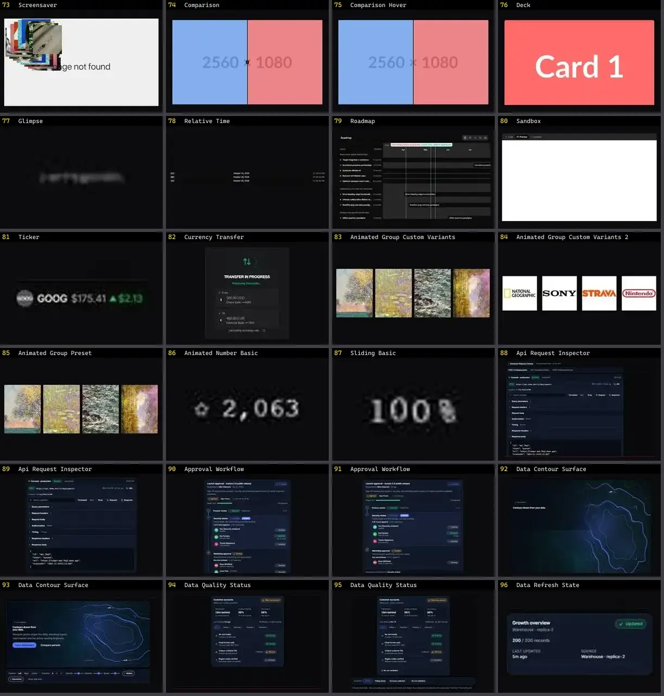

# Outros — folha 4

| nº | nome | uid | tipo de aplicação |
|---|---|---|---|
| 73 | Screensaver | `fancy:blocks/screensaver-demo` | UI base |
| 74 | Comparison | `kibo:comparison` | UI base |
| 75 | Comparison Hover | `kibo:comparison-hover` | UI base |
| 76 | Deck | `kibo:deck` | UI base |
| 77 | Glimpse | `kibo:glimpse` | UI base |
| 78 | Relative Time | `kibo:relative-time` | UI base |
| 79 | Roadmap | `kibo:roadmap` | UI base |
| 80 | Sandbox | `kibo:sandbox` | UI base |
| 81 | Ticker | `kibo:ticker` | UI base |
| 82 | Currency Transfer | `kokonutui:currency-transfer` | UI base |
| 83 | Animated Group Custom Variants | `motionprimitives:animated-group/animated-group-custom-variants` | UI base |
| 84 | Animated Group Custom Variants 2 | `motionprimitives:animated-group/animated-group-custom-variants-2` | UI base |
| 85 | Animated Group Preset | `motionprimitives:animated-group/animated-group-preset` | UI base |
| 86 | Animated Number Basic | `motionprimitives:animated-number/animated-number-basic` | UI base |
| 87 | Sliding Basic | `motionprimitives:sliding-number/sliding-basic` | UI base |
| 88 | Api Request Inspector | `motiq:api-request-inspector` | UI base |
| 89 | Api Request Inspector | `motiq:catalog/api-request-inspector` | UI base |
| 90 | Approval Workflow | `motiq:approval-workflow` | UI base |
| 91 | Approval Workflow | `motiq:catalog/approval-workflow` | UI base |
| 92 | Data Contour Surface | `motiq:catalog/data-contour-surface` | UI base |
| 93 | Data Contour Surface | `motiq:data-contour-surface` | UI base |
| 94 | Data Quality Status | `motiq:catalog/data-quality-status` | UI base |
| 95 | Data Quality Status | `motiq:data-quality-status` | UI base |
| 96 | Data Refresh State | `motiq:catalog/data-refresh-state` | UI base |
