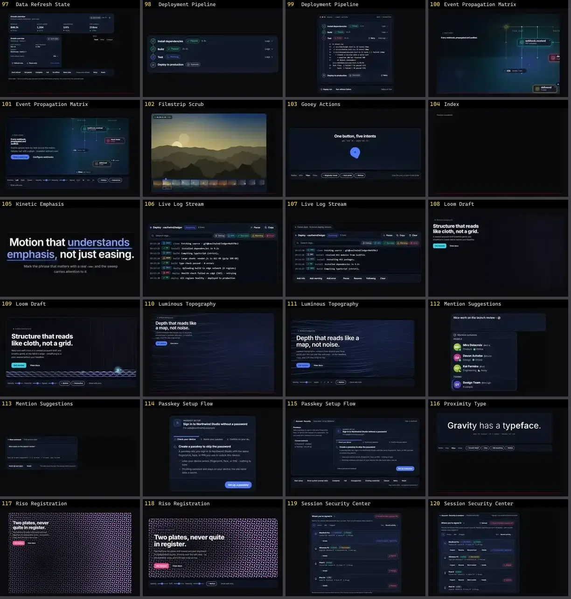

# Outros — folha 5

| nº | nome | uid | tipo de aplicação |
|---|---|---|---|
| 97 | Approval Workflow | `motiq:approval-workflow` | UI base |
| 98 | Approval Workflow | `motiq:catalog/approval-workflow` | UI base |
| 99 | Data Contour Surface | `motiq:catalog/data-contour-surface` | UI base |
| 100 | Data Contour Surface | `motiq:data-contour-surface` | UI base |
| 101 | Data Quality Status | `motiq:catalog/data-quality-status` | UI base |
| 102 | Data Quality Status | `motiq:data-quality-status` | UI base |
| 103 | Data Refresh State | `motiq:catalog/data-refresh-state` | UI base |
| 104 | Data Refresh State | `motiq:data-refresh-state` | UI base |
| 105 | Deployment Pipeline | `motiq:catalog/deployment-pipeline` | UI base |
| 106 | Deployment Pipeline | `motiq:deployment-pipeline` | UI base |
| 107 | Event Propagation Matrix | `motiq:catalog/event-propagation-matrix` | UI base |
| 108 | Event Propagation Matrix | `motiq:event-propagation-matrix` | UI base |
| 109 | Filmstrip Scrub | `motiq:filmstrip-scrub` | UI base |
| 110 | Gooey Actions | `motiq:gooey-actions` | UI base |
| 111 | Index | `motiq:index` | UI base |
| 112 | Kinetic Emphasis | `motiq:catalog/kinetic-emphasis` | UI base |
| 113 | Live Log Stream | `motiq:catalog/live-log-stream` | UI base |
| 114 | Live Log Stream | `motiq:live-log-stream` | UI base |
| 115 | Loom Draft | `motiq:catalog/loom-draft` | UI base |
| 116 | Loom Draft | `motiq:loom-draft` | UI base |
| 117 | Luminous Topography | `motiq:catalog/luminous-topography` | UI base |
| 118 | Luminous Topography | `motiq:luminous-topography` | UI base |
| 119 | Mention Suggestions | `motiq:catalog/mention-suggestions` | UI base |
| 120 | Mention Suggestions | `motiq:mention-suggestions` | UI base |
