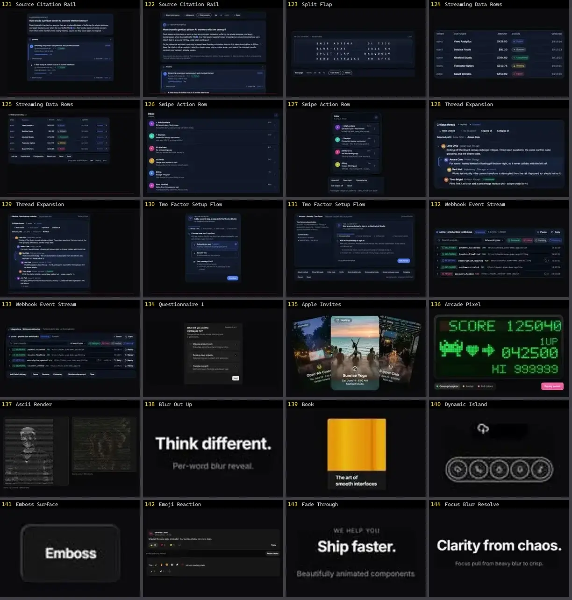

# Outros — folha 6

| nº | nome | uid | tipo de aplicação |
|---|---|---|---|
| 121 | Passkey Setup Flow | `motiq:catalog/passkey-setup-flow` | UI base |
| 122 | Passkey Setup Flow | `motiq:passkey-setup-flow` | UI base |
| 123 | Proximity Type | `motiq:proximity-type` | UI base |
| 124 | Riso Registration | `motiq:catalog/riso-registration` | UI base |
| 125 | Riso Registration | `motiq:riso-registration` | UI base |
| 126 | Session Security Center | `motiq:catalog/session-security-center` | UI base |
| 127 | Session Security Center | `motiq:session-security-center` | UI base |
| 128 | Source Citation Rail | `motiq:catalog/source-citation-rail` | UI base |
| 129 | Source Citation Rail | `motiq:source-citation-rail` | UI base |
| 130 | Split Flap | `motiq:split-flap` | UI base |
| 131 | Streaming Data Rows | `motiq:catalog/streaming-data-rows` | UI base |
| 132 | Streaming Data Rows | `motiq:streaming-data-rows` | UI base |
| 133 | Swipe Action Row | `motiq:catalog/swipe-action-row` | UI base |
| 134 | Swipe Action Row | `motiq:swipe-action-row` | UI base |
| 135 | Thread Expansion | `motiq:catalog/thread-expansion` | UI base |
| 136 | Thread Expansion | `motiq:thread-expansion` | UI base |
| 137 | Two Factor Setup Flow | `motiq:catalog/two-factor-setup-flow` | UI base |
| 138 | Two Factor Setup Flow | `motiq:two-factor-setup-flow` | UI base |
| 139 | Webhook Event Stream | `motiq:catalog/webhook-event-stream` | UI base |
| 140 | Webhook Event Stream | `motiq:webhook-event-stream` | UI base |
| 141 | BorderGlow | `reactbits:Components/BorderGlowDemo` | UI base |
| 142 | DriftWall | `reactbits:Components/DriftWallDemo` | UI base |
| 143 | FluidGlass | `reactbits:Components/FluidGlassDemo` | UI base |
| 144 | FlyingPosters | `reactbits:Components/FlyingPostersDemo` | UI base |
