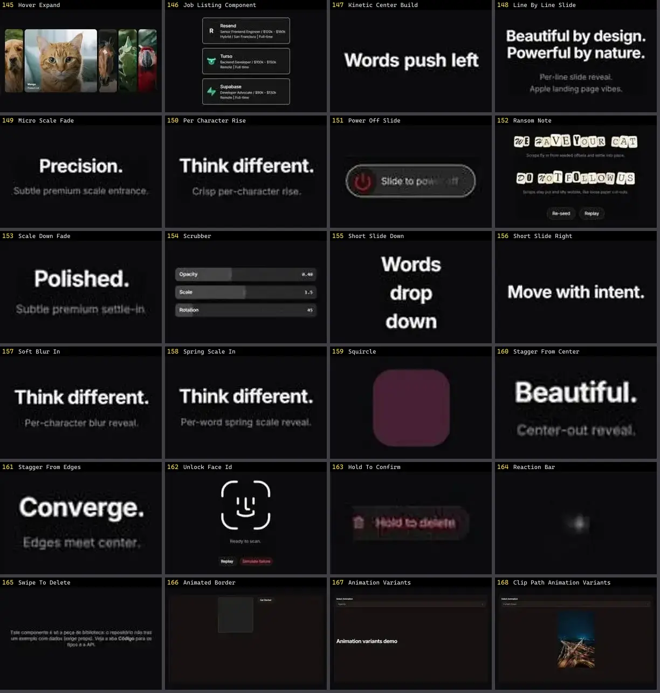

# Outros — folha 7

| nº | nome | uid | tipo de aplicação |
|---|---|---|---|
| 145 | Hover Expand | `smoothui:hover-expand` | UI base |
| 146 | Job Listing Component | `smoothui:job-listing-component` | UI base |
| 147 | Kinetic Center Build | `smoothui:kinetic-center-build` | UI base |
| 148 | Line By Line Slide | `smoothui:line-by-line-slide` | UI base |
| 149 | Micro Scale Fade | `smoothui:micro-scale-fade` | UI base |
| 150 | Per Character Rise | `smoothui:per-character-rise` | UI base |
| 151 | Power Off Slide | `smoothui:power-off-slide` | UI base |
| 152 | Ransom Note | `smoothui:ransom-note` | UI base |
| 153 | Scale Down Fade | `smoothui:scale-down-fade` | UI base |
| 154 | Scrubber | `smoothui:scrubber` | UI base |
| 155 | Short Slide Down | `smoothui:short-slide-down` | UI base |
| 156 | Short Slide Right | `smoothui:short-slide-right` | UI base |
| 157 | Soft Blur In | `smoothui:soft-blur-in` | UI base |
| 158 | Spring Scale In | `smoothui:spring-scale-in` | UI base |
| 159 | Squircle | `smoothui:squircle` | UI base |
| 160 | Stagger From Center | `smoothui:stagger-from-center` | UI base |
| 161 | Stagger From Edges | `smoothui:stagger-from-edges` | UI base |
| 162 | Unlock Face Id | `smoothui:unlock-face-id` | UI base |
| 163 | Hold To Confirm | `spectrumui:hold-to-confirm` | UI base |
| 164 | Reaction Bar | `spectrumui:reaction-bar` | UI base |
| 165 | Swipe To Delete | `spectrumui:swipe-to-delete` | UI base |
| 166 | Animated Border | `systaliko:components/animated-border` | UI base |
| 167 | Animation Variants | `systaliko:utils/animation-variants` | UI base |
| 168 | Clip Path Animation Variants | `systaliko:utils/clip-path-animation-variants` | UI base |
