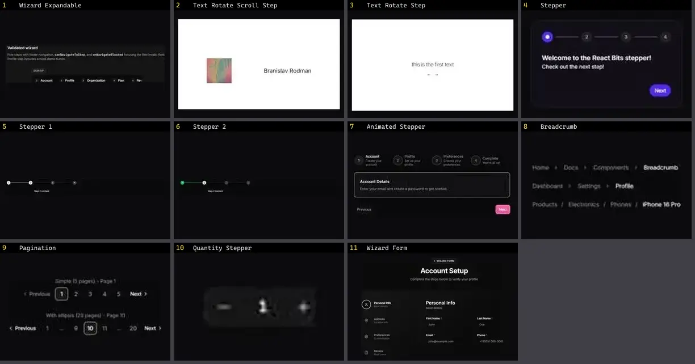

# Paginação & Breadcrumb — folha 1

| nº | nome | uid | tipo de aplicação |
|---|---|---|---|
| 1 | Wizard Expandable | `cultui:wizard-expandable-demo` | UI base |
| 2 | Text Rotate Scroll Step | `fancy:text/text-rotate-scroll-step-demo` | UI base |
| 3 | Text Rotate Step | `fancy:text/text-rotate-step-demo` | UI base |
| 4 | Stepper 1 | `reui:stepper/c-stepper-1` | UI base |
| 5 | Stepper 2 | `reui:stepper/c-stepper-2` | UI base |
| 6 | Animated Stepper | `smoothui:animated-stepper` | UI base |
| 7 | Breadcrumb | `smoothui:breadcrumb` | UI base |
| 8 | Pagination | `smoothui:pagination` | UI base |
| 9 | Quantity Stepper | `spectrumui:quantity-stepper` | UI base |
| 10 | Wizard Form | `uitripled:forms/wizard-form` | UI base |
