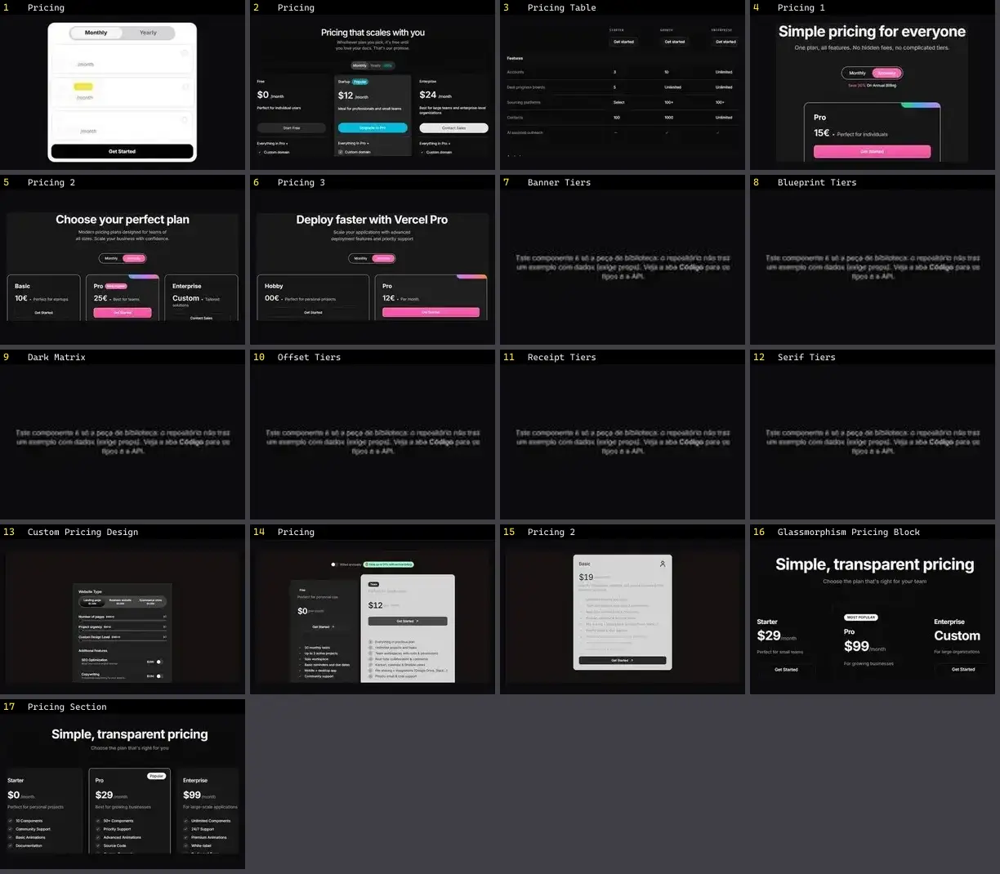

# Pricing — folha 1

| nº | nome | uid | tipo de aplicação |
|---|---|---|---|
| 1 | Pricing | `animata:section/pricing` | Landing & Marketing |
| 2 | Pricing | `eldoraui:pricing-01/components/pricing` | Landing & Marketing |
| 3 | Pricing Table | `eldoraui:pricing-02/components/pricing-table` | Landing & Marketing |
| 4 | Pricing 1 | `smoothui:pricing-1` | Landing & Marketing |
| 5 | Pricing 2 | `smoothui:pricing-2` | Landing & Marketing |
| 6 | Pricing 3 | `smoothui:pricing-3` | Landing & Marketing |
| 7 | Banner Tiers | `spectrumui:blocks/pricing/banner-tiers` | Landing & Marketing |
| 8 | Blueprint Tiers | `spectrumui:blocks/pricing/blueprint-tiers` | Landing & Marketing |
| 9 | Dark Matrix | `spectrumui:blocks/pricing/dark-matrix` | Landing & Marketing |
| 10 | Offset Tiers | `spectrumui:blocks/pricing/offset-tiers` | Landing & Marketing |
| 11 | Receipt Tiers | `spectrumui:blocks/pricing/receipt-tiers` | Landing & Marketing |
| 12 | Serif Tiers | `spectrumui:blocks/pricing/serif-tiers` | Landing & Marketing |
| 13 | Custom Pricing Design | `systaliko:ecommerce/custom-pricing-design` | Landing & Marketing |
| 14 | Pricing | `systaliko:ecommerce/pricing` | Landing & Marketing |
| 15 | Pricing 2 | `systaliko:ecommerce/pricing-2` | Landing & Marketing |
| 16 | Glassmorphism Pricing Block | `uitripled:sections/glassmorphism-pricing-block` | Landing & Marketing |
| 17 | Pricing Section | `uitripled:sections/pricing-section` | Landing & Marketing |
