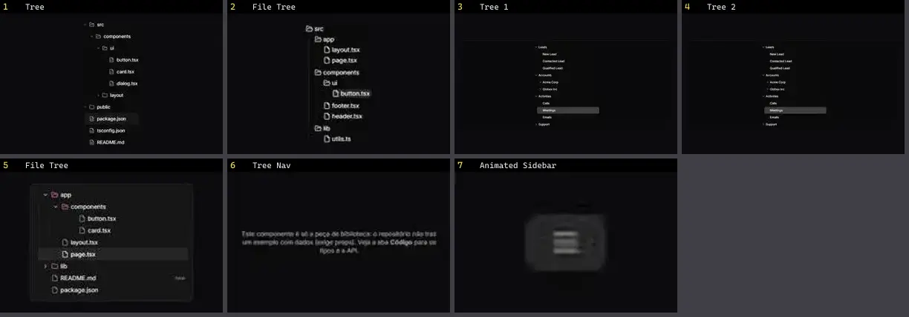

# Sidebar & Menu — folha 1

| nº | nome | uid | tipo de aplicação |
|---|---|---|---|
| 1 | Sidebar | `animateui:components/radix/sidebar` | Dashboard & Admin |
| 2 | Tree | `kibo:tree` | Dashboard & Admin |
| 3 | File Tree | `magicui:file-tree-demo` | Dashboard & Admin |
| 4 | LineSidebar | `reactbits:Components/LineSidebarDemo` | Dashboard & Admin |
| 5 | Tree 1 | `reui:tree/c-tree-1` | Dashboard & Admin |
| 6 | Tree 2 | `reui:tree/c-tree-2` | Dashboard & Admin |
| 7 | File Tree | `smoothui:file-tree` | Dashboard & Admin |
| 8 | Tree Nav | `spectrumui:tree-nav` | Dashboard & Admin |
| 9 | Animated Sidebar | `uitripled:navigation/animated-sidebar` | Dashboard & Admin |
