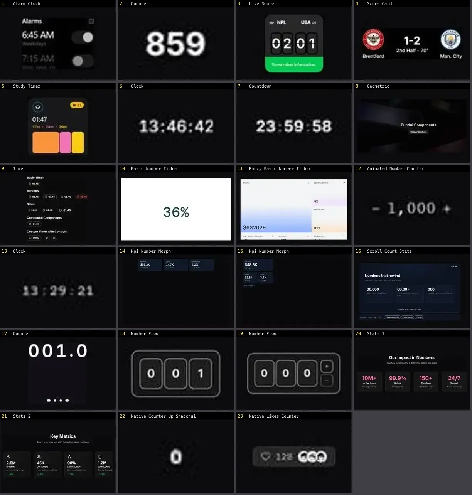

# Stats & KPI — folha 1

| nº | nome | uid | tipo de aplicação |
|---|---|---|---|
| 1 | Alarm Clock | `animata:widget/alarm-clock` | Dashboard & Admin |
| 2 | Counter | `animata:text/counter` | Dashboard & Admin |
| 3 | Live Score | `animata:widget/live-score` | Dashboard & Admin |
| 4 | Score Card | `animata:card/score-card` | Dashboard & Admin |
| 5 | Study Timer | `animata:widget/study-timer` | Dashboard & Admin |
| 6 | Clock | `bundui:sliding-number/clock` | Dashboard & Admin |
| 7 | Countdown | `bundui:countdown` | Dashboard & Admin |
| 8 | Geometric | `bundui:backgrounds/geometric` | Dashboard & Admin |
| 9 | Timer | `cultui:timer-demo` | Dashboard & Admin |
| 10 | Basic Number Ticker | `fancy:text/basic-number-ticker-demo` | Dashboard & Admin |
| 11 | Fancy Basic Number Ticker | `fancy:text/fancy-basic-number-ticker-demo` | Dashboard & Admin |
| 12 | Animated Number Counter | `motionprimitives:animated-number/animated-number-counter` | Dashboard & Admin |
| 13 | Clock | `motionprimitives:sliding-number/clock` | Dashboard & Admin |
| 14 | Kpi Number Morph | `motiq:catalog/kpi-number-morph` | Dashboard & Admin |
| 15 | Kpi Number Morph | `motiq:kpi-number-morph` | Dashboard & Admin |
| 16 | Scroll Count Stats | `motiq:scroll-count-stats` | Dashboard & Admin |
| 17 | Number Flow | `smoothui:canvas/number-flow` | Dashboard & Admin |
| 18 | Number Flow | `smoothui:number-flow` | Dashboard & Admin |
| 19 | Stats 1 | `smoothui:stats-1` | Dashboard & Admin |
| 20 | Stats 2 | `smoothui:stats-2` | Dashboard & Admin |
| 21 | Native Counter Up Shadcnui | `uitripled:native/native-counter-up-shadcnui` | Dashboard & Admin |
| 22 | Native Likes Counter | `uitripled:native/demo/native-likes-counter-demo` | Dashboard & Admin |
