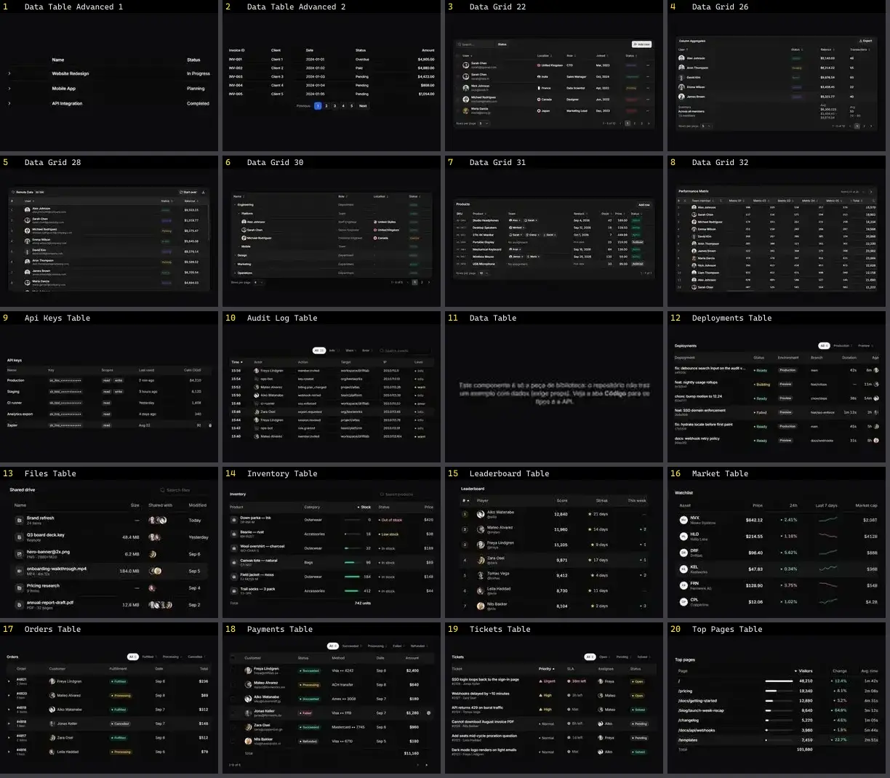

# Tabela & Data grid — folha 1

| nº | nome | uid | tipo de aplicação |
|---|---|---|---|
| 1 | Data Table Advanced 1 | `kibo:pattern/data-table/advanced/data-table-advanced-1` | Dashboard & Admin |
| 2 | Data Table Advanced 2 | `kibo:pattern/data-table/advanced/data-table-advanced-2` | Dashboard & Admin |
| 3 | Data Grid 22 | `reui:data-grid/c-data-grid-22` | Dashboard & Admin |
| 4 | Data Grid 26 | `reui:data-grid/c-data-grid-26` | Dashboard & Admin |
| 5 | Data Grid 28 | `reui:data-grid/c-data-grid-28` | Dashboard & Admin |
| 6 | Data Grid 30 | `reui:data-grid/c-data-grid-30` | Dashboard & Admin |
| 7 | Data Grid 31 | `reui:data-grid/c-data-grid-31` | Dashboard & Admin |
| 8 | Data Grid 32 | `reui:data-grid/c-data-grid-32` | Dashboard & Admin |
| 9 | Api Keys Table | `spectrumui:blocks/tables/api-keys-table` | Dashboard & Admin |
| 10 | Audit Log Table | `spectrumui:blocks/tables/audit-log-table` | Dashboard & Admin |
| 11 | Data Table | `spectrumui:data-table` | Dashboard & Admin |
| 12 | Deployments Table | `spectrumui:blocks/tables/deployments-table` | Dashboard & Admin |
| 13 | Files Table | `spectrumui:blocks/tables/files-table` | Dashboard & Admin |
| 14 | Inventory Table | `spectrumui:blocks/tables/inventory-table` | Dashboard & Admin |
| 15 | Leaderboard Table | `spectrumui:blocks/tables/leaderboard-table` | Dashboard & Admin |
| 16 | Market Table | `spectrumui:blocks/tables/market-table` | Dashboard & Admin |
| 17 | Orders Table | `spectrumui:blocks/tables/orders-table` | Dashboard & Admin |
| 18 | Payments Table | `spectrumui:blocks/tables/payments-table` | Dashboard & Admin |
| 19 | Tickets Table | `spectrumui:blocks/tables/tickets-table` | Dashboard & Admin |
| 20 | Top Pages Table | `spectrumui:blocks/tables/top-pages-table` | Dashboard & Admin |
