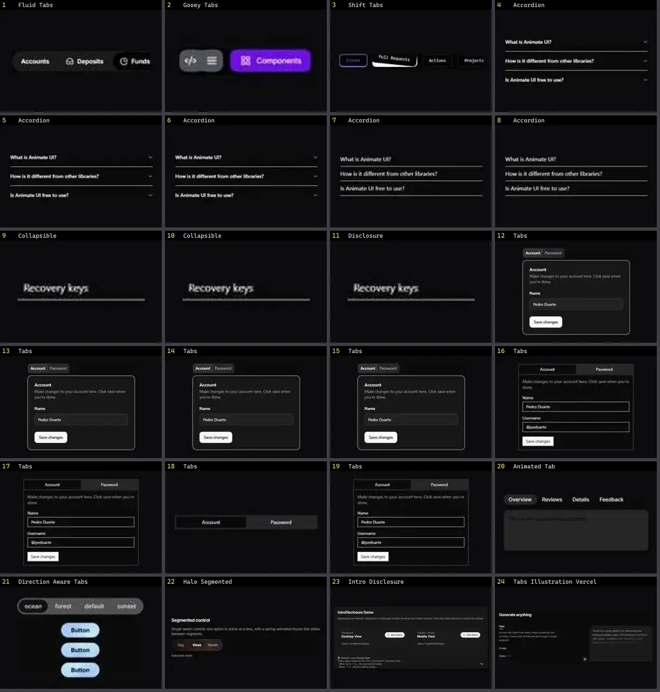

# Tabs & Accordion — folha 1

| nº | nome | uid | tipo de aplicação |
|---|---|---|---|
| 1 | Fluid Tabs | `animata:tabs/fluid-tabs` | UI base |
| 2 | Gooey Tabs | `animata:tabs/gooey-tabs` | UI base |
| 3 | Shift Tabs | `animata:tabs/shift-tabs` | UI base |
| 4 | Animated Tab | `bundui:animated-tab` | UI base |
| 5 | Direction Aware Tabs | `cultui:direction-aware-tabs-demo` | UI base |
| 6 | Halo Segmented | `cultui:halo-segmented-demo` | UI base |
| 7 | Intro Disclosure | `cultui:intro-disclosure-demo` | UI base |
| 8 | Tabs Illustration Vercel | `cultui:tabs-illustration-vercel-demo` | UI base |
| 9 | Smooth Tab | `kokonutui:smooth-tab` | UI base |
| 10 | Accordion Basic | `motionprimitives:accordion/accordion-basic` | UI base |
| 11 | Accordion Icons | `motionprimitives:accordion/accordion-icons` | UI base |
| 12 | Accordion Variant | `motionprimitives:accordion/accordion-variant` | UI base |
| 13 | Disclosure Basic | `motionprimitives:disclosure/disclosure-basic` | UI base |
| 14 | Disclosure Card | `motionprimitives:disclosure/disclosure-card` | UI base |
| 15 | Transition Panel Tabs | `motionprimitives:transition-panel/transition-panel-tabs` | UI base |
| 16 | Animated Tabs | `smoothui:animated-tabs` | UI base |
| 17 | Basic Accordion | `smoothui:basic-accordion` | UI base |
| 18 | Animated Accordion | `uitripled:disclosure/animated-accordion` | UI base |
| 19 | Animated Tabs | `uitripled:components/tabs/animated-tabs` | UI base |
