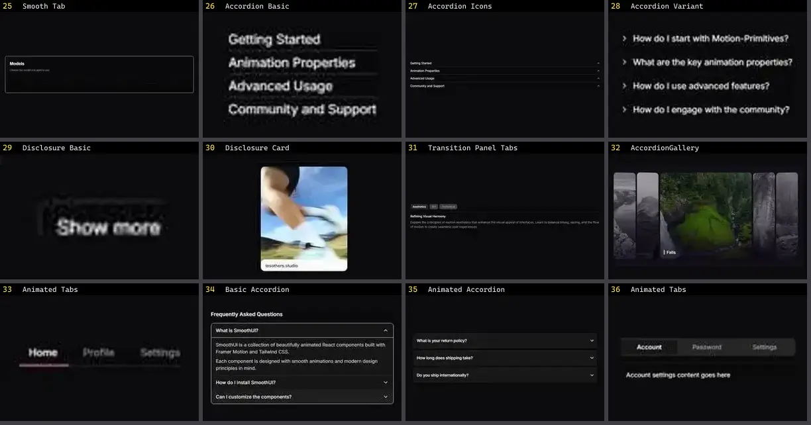

# Tabs & Accordion — folha 2

| nº | nome | uid | tipo de aplicação |
|---|---|---|---|
| 25 | Smooth Tab | `kokonutui:smooth-tab` | UI base |
| 26 | Accordion Basic | `motionprimitives:accordion/accordion-basic` | UI base |
| 27 | Accordion Icons | `motionprimitives:accordion/accordion-icons` | UI base |
| 28 | Accordion Variant | `motionprimitives:accordion/accordion-variant` | UI base |
| 29 | Disclosure Basic | `motionprimitives:disclosure/disclosure-basic` | UI base |
| 30 | Disclosure Card | `motionprimitives:disclosure/disclosure-card` | UI base |
| 31 | Transition Panel Tabs | `motionprimitives:transition-panel/transition-panel-tabs` | UI base |
| 32 | AccordionGallery | `reactbits:Components/AccordionGalleryDemo` | UI base |
| 33 | Animated Tabs | `smoothui:animated-tabs` | UI base |
| 34 | Basic Accordion | `smoothui:basic-accordion` | UI base |
| 35 | Animated Accordion | `uitripled:disclosure/animated-accordion` | UI base |
| 36 | Animated Tabs | `uitripled:components/tabs/animated-tabs` | UI base |
