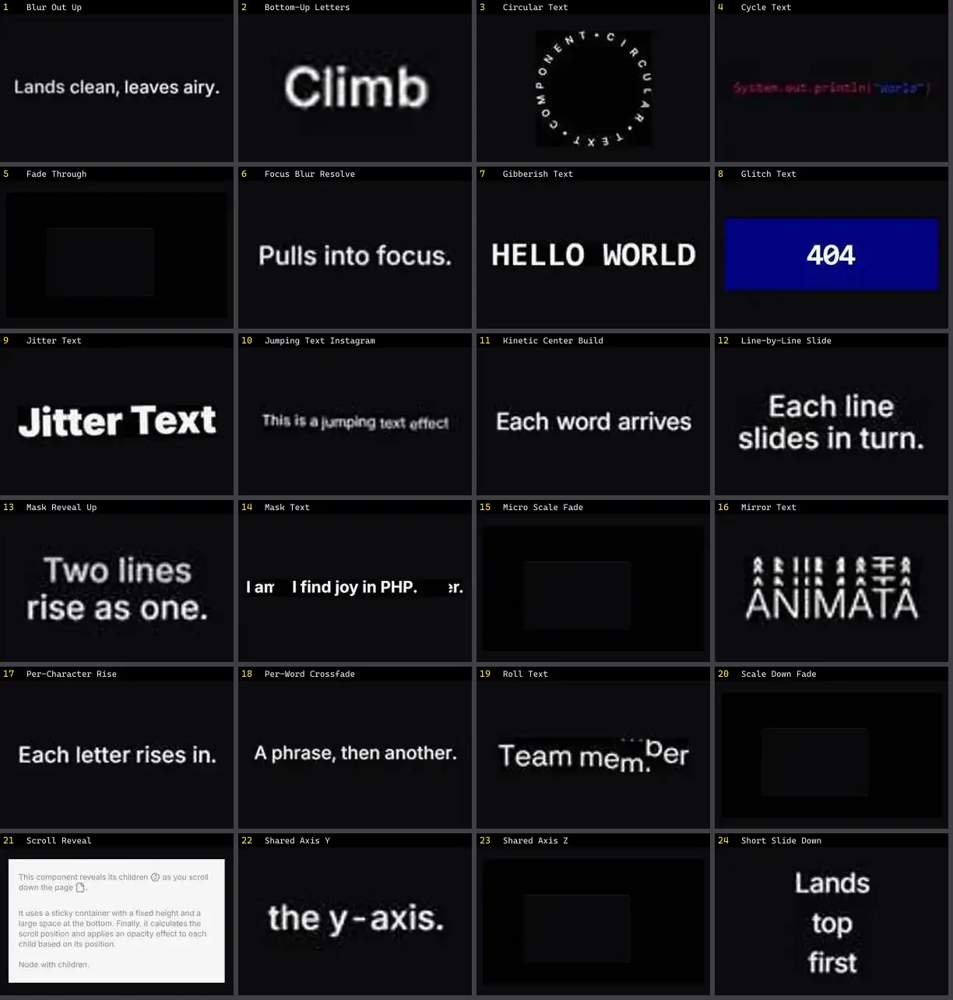

# Texto & Tipografia — folha 1

| nº | nome | uid | tipo de aplicação |
|---|---|---|---|
| 1 | Blur Out Up | `animata:text/blur-out-up` | Efeitos & Animação |
| 2 | Bottom-Up Letters | `animata:text/bottom-up-letters` | Efeitos & Animação |
| 3 | Circular Text | `animata:text/circular-text` | Efeitos & Animação |
| 4 | Cycle Text | `animata:text/cycle-text` | Efeitos & Animação |
| 5 | Fade Through | `animata:text/fade-through` | Efeitos & Animação |
| 6 | Focus Blur Resolve | `animata:text/focus-blur-resolve` | Efeitos & Animação |
| 7 | Gibberish Text | `animata:text/gibberish-text` | Efeitos & Animação |
| 8 | Glitch Text | `animata:text/glitch-text` | Efeitos & Animação |
| 9 | Jitter Text | `animata:text/jitter-text` | Efeitos & Animação |
| 10 | Jumping Text Instagram | `animata:text/jumping-text-instagram` | Efeitos & Animação |
| 11 | Kinetic Center Build | `animata:text/kinetic-center-build` | Efeitos & Animação |
| 12 | Line-by-Line Slide | `animata:text/line-by-line-slide` | Efeitos & Animação |
| 13 | Mask Reveal Up | `animata:text/mask-reveal-up` | Efeitos & Animação |
| 14 | Mask Text | `animata:text/mask-text` | Efeitos & Animação |
| 15 | Micro Scale Fade | `animata:text/micro-scale-fade` | Efeitos & Animação |
| 16 | Mirror Text | `animata:text/mirror-text` | Efeitos & Animação |
| 17 | Per-Character Rise | `animata:text/per-character-rise` | Efeitos & Animação |
| 18 | Per-Word Crossfade | `animata:text/per-word-crossfade` | Efeitos & Animação |
| 19 | Roll Text | `animata:text/roll-text` | Efeitos & Animação |
| 20 | Scale Down Fade | `animata:text/scale-down-fade` | Efeitos & Animação |
| 21 | Scroll Reveal | `animata:text/scroll-reveal` | Efeitos & Animação |
| 22 | Shared Axis Y | `animata:text/shared-axis-y` | Efeitos & Animação |
| 23 | Shared Axis Z | `animata:text/shared-axis-z` | Efeitos & Animação |
| 24 | Short Slide Down | `animata:text/short-slide-down` | Efeitos & Animação |
