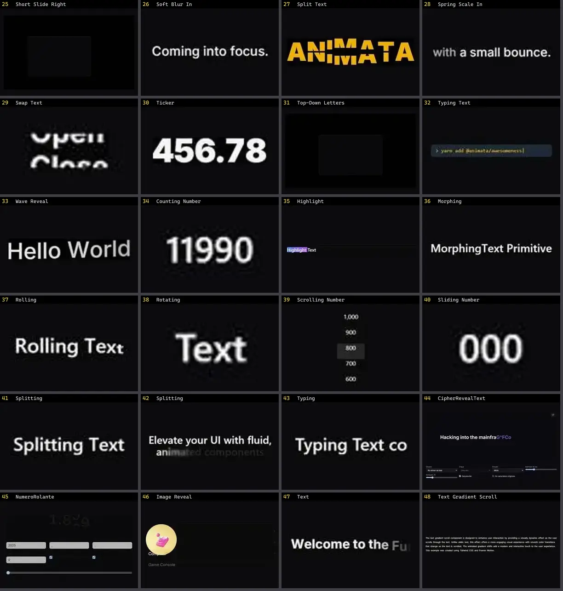

# Texto & Tipografia — folha 2

| nº | nome | uid | tipo de aplicação |
|---|---|---|---|
| 25 | Short Slide Right | `animata:text/short-slide-right` | Efeitos & Animação |
| 26 | Soft Blur In | `animata:text/soft-blur-in` | Efeitos & Animação |
| 27 | Split Text | `animata:text/split-text` | Efeitos & Animação |
| 28 | Spring Scale In | `animata:text/spring-scale-in` | Efeitos & Animação |
| 29 | Swap Text | `animata:text/swap-text` | Efeitos & Animação |
| 30 | Ticker | `animata:text/ticker` | Efeitos & Animação |
| 31 | Top-Down Letters | `animata:text/top-down-letters` | Efeitos & Animação |
| 32 | Typing Text | `animata:text/typing-text` | Efeitos & Animação |
| 33 | Wave Reveal | `animata:text/wave-reveal` | Efeitos & Animação |
| 34 | Counting Number | `animateui:primitives/texts/counting-number` | Efeitos & Animação |
| 35 | Highlight | `animateui:primitives/texts/highlight` | Efeitos & Animação |
| 36 | Morphing | `animateui:primitives/texts/morphing` | Efeitos & Animação |
| 37 | Rolling | `animateui:primitives/texts/rolling` | Efeitos & Animação |
| 38 | Rotating | `animateui:primitives/texts/rotating` | Efeitos & Animação |
| 39 | Scrolling Number | `animateui:primitives/texts/scrolling-number` | Efeitos & Animação |
| 40 | Sliding Number | `animateui:primitives/texts/sliding-number` | Efeitos & Animação |
| 41 | Splitting | `animateui:primitives/texts/splitting` | Efeitos & Animação |
| 42 | Splitting | `animateui:primitives/texts/splitting-example` | Efeitos & Animação |
| 43 | Typing | `animateui:primitives/texts/typing` | Efeitos & Animação |
| 44 | CipherRevealText | `atlas:Text/CipherRevealText` | Efeitos & Animação |
| 45 | NumeroRolante | `atlas:Text/NumeroRolante` | Efeitos & Animação |
| 46 | Image Reveal | `bundui:image-reveal` | Efeitos & Animação |
| 47 | Text | `bundui:animated-text/text` | Efeitos & Animação |
| 48 | Text Gradient Scroll | `bundui:text-gradient-scroll` | Efeitos & Animação |
