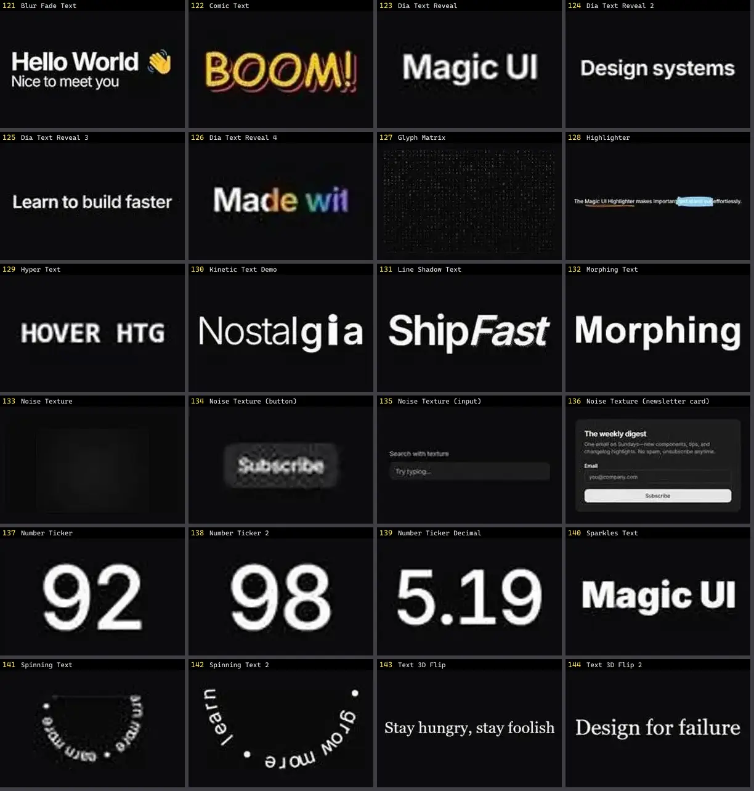

# Texto & Tipografia — folha 6

| nº | nome | uid | tipo de aplicação |
|---|---|---|---|
| 121 | Dynamic Text | `kokonutui:dynamic-text` | Efeitos & Animação |
| 122 | Glitch Text | `kokonutui:glitch-text` | Efeitos & Animação |
| 123 | Matrix Text | `kokonutui:matrix-text` | Efeitos & Animação |
| 124 | Morphic Navbar | `kokonutui:morphic-navbar` | Efeitos & Animação |
| 125 | Scroll Text | `kokonutui:scroll-text` | Efeitos & Animação |
| 126 | Sliced Text | `kokonutui:sliced-text` | Efeitos & Animação |
| 127 | Swoosh Text | `kokonutui:swoosh-text` | Efeitos & Animação |
| 128 | Type Writer | `kokonutui:type-writer` | Efeitos & Animação |
| 129 | Animated Shiny Text | `magicui:animated-shiny-text-demo` | Efeitos & Animação |
| 130 | Aurora Text | `magicui:aurora-text-demo` | Efeitos & Animação |
| 131 | Blur Fade Text | `magicui:blur-fade-text-demo` | Efeitos & Animação |
| 132 | Comic Text | `magicui:comic-text-demo` | Efeitos & Animação |
| 133 | Dia Text Reveal | `magicui:dia-text-reveal-demo` | Efeitos & Animação |
| 134 | Dia Text Reveal 2 | `magicui:dia-text-reveal-demo-2` | Efeitos & Animação |
| 135 | Dia Text Reveal 3 | `magicui:dia-text-reveal-demo-3` | Efeitos & Animação |
| 136 | Dia Text Reveal 4 | `magicui:dia-text-reveal-demo-4` | Efeitos & Animação |
| 137 | Glyph Matrix | `magicui:glyph-matrix-demo` | Efeitos & Animação |
| 138 | Highlighter | `magicui:highlighter-demo` | Efeitos & Animação |
| 139 | Hyper Text | `magicui:hyper-text-demo` | Efeitos & Animação |
| 140 | Kinetic Text Demo | `magicui:kinetic-text-demo` | Efeitos & Animação |
| 141 | Line Shadow Text | `magicui:line-shadow-text-demo` | Efeitos & Animação |
| 142 | Morphing Text | `magicui:morphing-text-demo` | Efeitos & Animação |
| 143 | Noise Texture | `magicui:noise-texture-demo` | Efeitos & Animação |
| 144 | Noise Texture (button) | `magicui:noise-texture-demo-3` | Efeitos & Animação |
