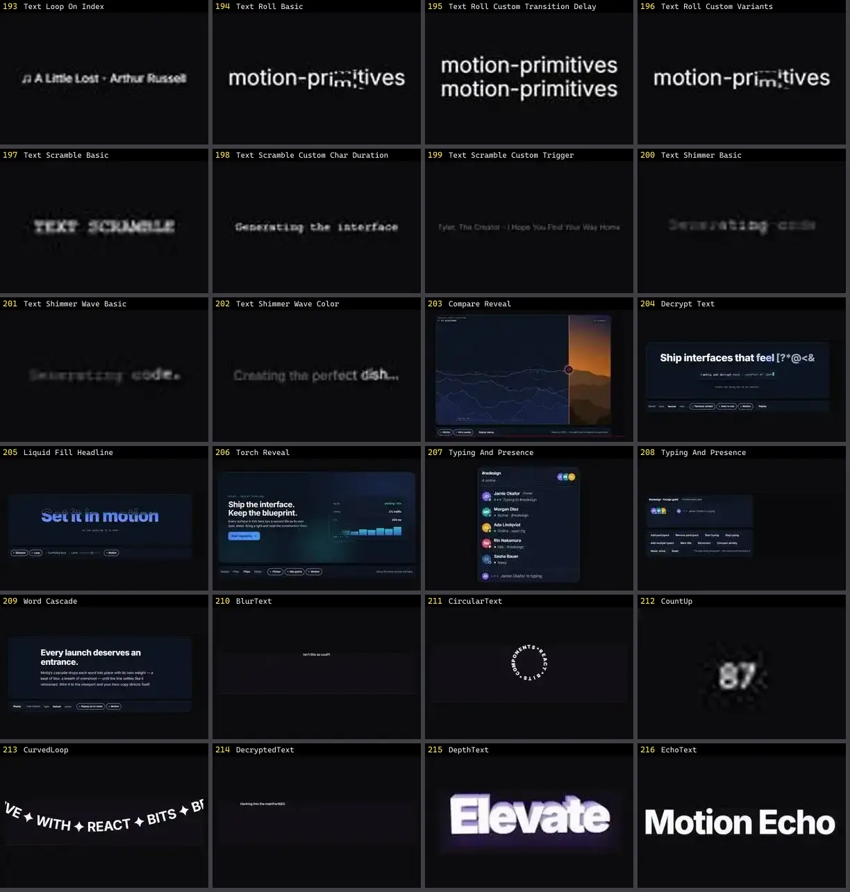

# Texto & Tipografia — folha 9

| nº | nome | uid | tipo de aplicação |
|---|---|---|---|
| 193 | Compare Reveal | `motiq:compare-reveal` | Efeitos & Animação |
| 194 | Decrypt Text | `motiq:decrypt-text` | Efeitos & Animação |
| 195 | Liquid Fill Headline | `motiq:liquid-fill-headline` | Efeitos & Animação |
| 196 | Torch Reveal | `motiq:torch-reveal` | Efeitos & Animação |
| 197 | Typing And Presence | `motiq:catalog/typing-and-presence` | Efeitos & Animação |
| 198 | Typing And Presence | `motiq:typing-and-presence` | Efeitos & Animação |
| 199 | Word Cascade | `motiq:word-cascade` | Efeitos & Animação |
| 200 | Bottom Up Letters | `smoothui:bottom-up-letters` | Efeitos & Animação |
| 201 | Context Menu | `smoothui:context-menu` | Efeitos & Animação |
| 202 | Depth Parallax Words | `smoothui:depth-parallax-words` | Efeitos & Animação |
| 203 | Folder Reveal | `smoothui:canvas/folder-reveal` | Efeitos & Animação |
| 204 | Folder Reveal | `smoothui:folder-reveal` | Efeitos & Animação |
| 205 | Gravity Letters | `smoothui:gravity-letters` | Efeitos & Animação |
| 206 | Mask Reveal Up | `smoothui:mask-reveal-up` | Efeitos & Animação |
| 207 | Morph Icon | `smoothui:morph-icon` | Efeitos & Animação |
| 208 | Morph Surface | `smoothui:canvas/morph-surface` | Efeitos & Animação |
| 209 | Morph Surface | `smoothui:morph-surface` | Efeitos & Animação |
| 210 | Per Word Crossfade | `smoothui:per-word-crossfade` | Efeitos & Animação |
| 211 | Perspective Text 3d | `smoothui:perspective-text-3d` | Efeitos & Animação |
| 212 | Reveal Text | `smoothui:reveal-text` | Efeitos & Animação |
| 213 | Rolling Text | `smoothui:rolling-text` | Efeitos & Animação |
| 214 | Scramble Hover | `smoothui:scramble-hover` | Efeitos & Animação |
| 215 | Scroll Image Reveal | `smoothui:scroll-image-reveal` | Efeitos & Animação |
| 216 | Scroll Reveal Paragraph | `smoothui:scroll-reveal-paragraph` | Efeitos & Animação |
