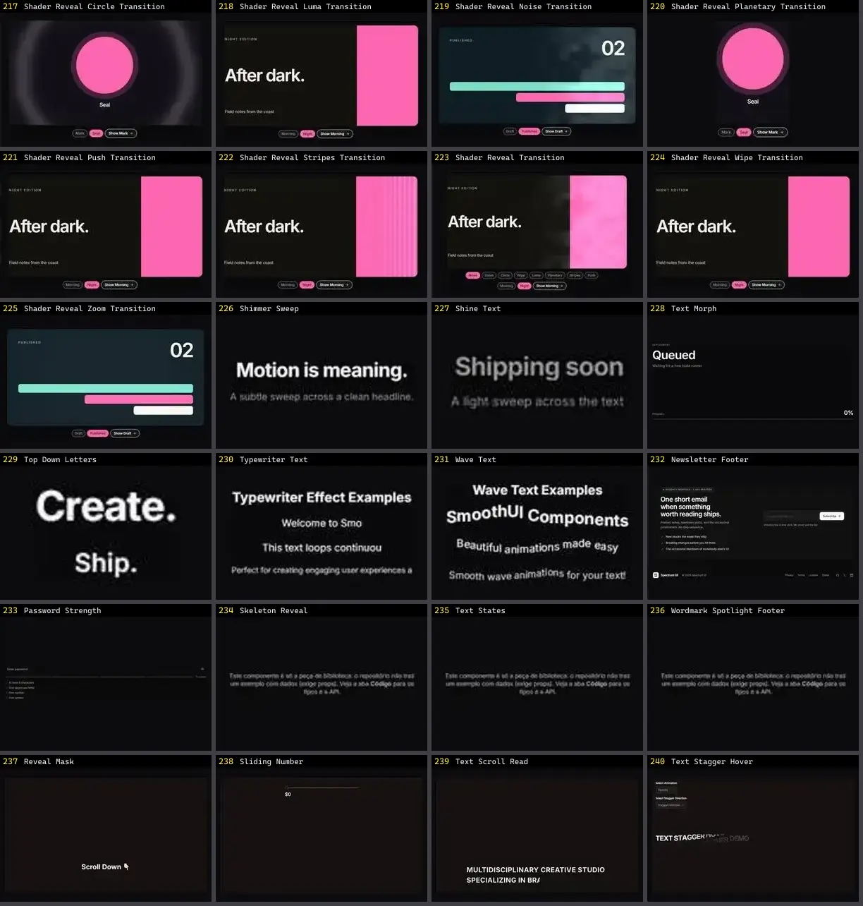

# Texto & Tipografia — folha 10

| nº | nome | uid | tipo de aplicação |
|---|---|---|---|
| 217 | FallingText | `reactbits:TextAnimations/FallingTextDemo` | Efeitos & Animação |
| 218 | FoldText | `reactbits:TextAnimations/FoldTextDemo` | Efeitos & Animação |
| 219 | FuzzyText | `reactbits:TextAnimations/FuzzyTextDemo` | Efeitos & Animação |
| 220 | GlitchText | `reactbits:TextAnimations/GlitchTextDemo` | Efeitos & Animação |
| 221 | GradientText | `reactbits:TextAnimations/GradientTextDemo` | Efeitos & Animação |
| 222 | MaskedHeading | `reactbits:TextAnimations/MaskedHeadingDemo` | Efeitos & Animação |
| 223 | ParticleText | `reactbits:TextAnimations/ParticleTextDemo` | Efeitos & Animação |
| 224 | RotatingText | `reactbits:TextAnimations/RotatingTextDemo` | Efeitos & Animação |
| 225 | ScrambledText | `reactbits:TextAnimations/ScrambledTextDemo` | Efeitos & Animação |
| 226 | ScrollFloat | `reactbits:TextAnimations/ScrollFloatDemo` | Efeitos & Animação |
| 227 | ScrollReveal | `reactbits:TextAnimations/ScrollRevealDemo` | Efeitos & Animação |
| 228 | ScrollVelocity | `reactbits:TextAnimations/ScrollVelocityDemo` | Efeitos & Animação |
| 229 | ShinyText | `reactbits:TextAnimations/ShinyTextDemo` | Efeitos & Animação |
| 230 | Shuffle | `reactbits:TextAnimations/ShuffleDemo` | Efeitos & Animação |
| 231 | SplitFlapText | `reactbits:TextAnimations/SplitFlapTextDemo` | Efeitos & Animação |
| 232 | SplitText | `reactbits:TextAnimations/SplitTextDemo` | Efeitos & Animação |
| 233 | StrokeText | `reactbits:TextAnimations/StrokeTextDemo` | Efeitos & Animação |
| 234 | TechText | `reactbits:TextAnimations/TechTextDemo` | Efeitos & Animação |
| 235 | TextCursor | `reactbits:TextAnimations/TextCursorDemo` | Efeitos & Animação |
| 236 | TextLoop | `reactbits:TextAnimations/TextLoopDemo` | Efeitos & Animação |
| 237 | TextPressure | `reactbits:TextAnimations/TextPressureDemo` | Efeitos & Animação |
| 238 | TextType | `reactbits:TextAnimations/TextTypeDemo` | Efeitos & Animação |
| 239 | TrueFocus | `reactbits:TextAnimations/TrueFocusDemo` | Efeitos & Animação |
| 240 | VariableProximity | `reactbits:TextAnimations/VariableProximityDemo` | Efeitos & Animação |
