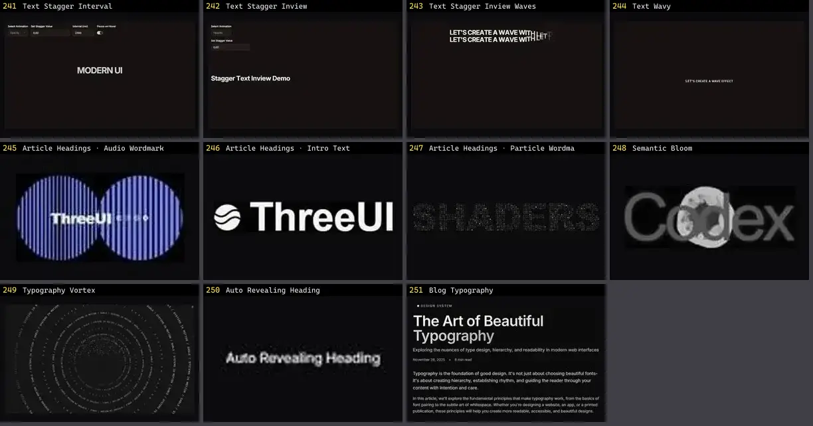

# Texto & Tipografia — folha 11

| nº | nome | uid | tipo de aplicação |
|---|---|---|---|
| 241 | Text Stagger Interval | `systaliko:text/text-stagger-interval` | Efeitos & Animação |
| 242 | Text Stagger Inview | `systaliko:text/text-stagger-inview` | Efeitos & Animação |
| 243 | Text Stagger Inview Waves | `systaliko:text/text-stagger-inview-waves` | Efeitos & Animação |
| 244 | Text Wavy | `systaliko:text/text-wavy` | Efeitos & Animação |
| 245 | Article Headings · Audio Wordmark | `threeui:article-headings/audio-wordmark` | Efeitos & Animação |
| 246 | Article Headings · Intro Text | `threeui:article-headings/threeui-intro` | Efeitos & Animação |
| 247 | Article Headings · Particle Wordmark | `threeui:article-headings/particle-wordmark` | Efeitos & Animação |
| 248 | Semantic Bloom | `threeui:semantic-bloom` | Efeitos & Animação |
| 249 | Typography Vortex | `threeui:typography-vortex` | Efeitos & Animação |
| 250 | Auto Revealing Heading | `uitripled:motion-core/auto-revealing-heading` | Efeitos & Animação |
| 251 | Blog Typography | `uitripled:components/blog/blog-typography` | Efeitos & Animação |
