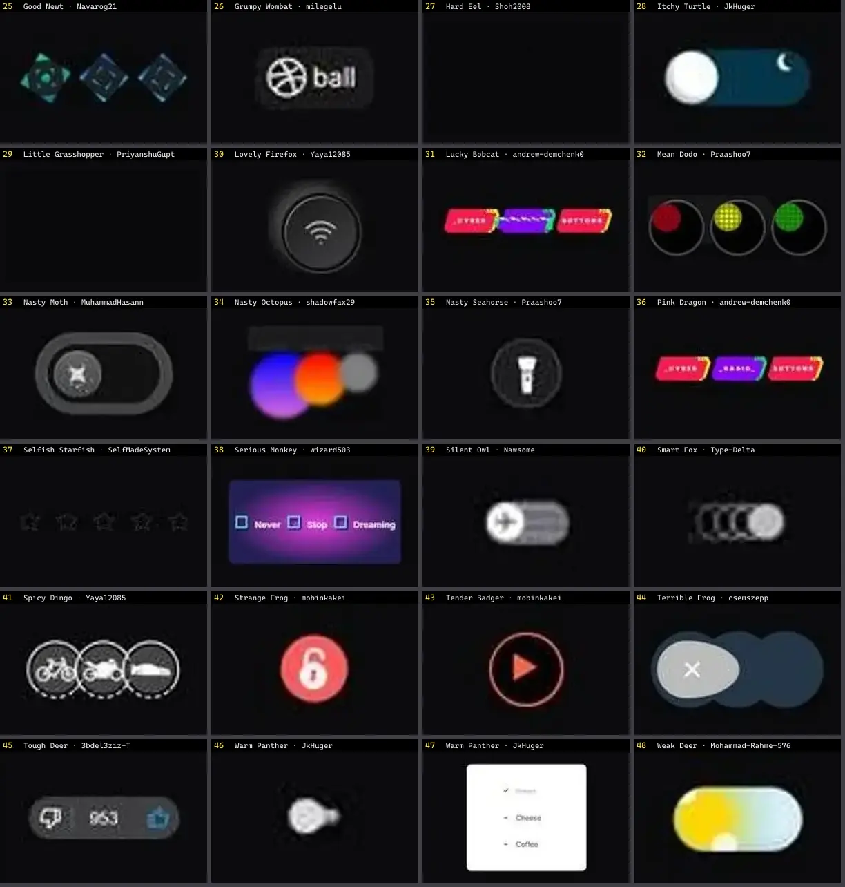

# Toggle & Checkbox — folha 2

| nº | nome | uid | tipo de aplicação |
|---|---|---|---|
| 25 | Good Newt · Navarog21 | `uiverse:Radio-buttons/Navarog21_good-newt-78` | UI base |
| 26 | Grumpy Wombat · milegelu | `uiverse:Checkboxes/milegelu_grumpy-wombat-18` | UI base |
| 27 | Hard Eel · Shoh2008 | `uiverse:Checkboxes/Shoh2008_hard-eel-52` | UI base |
| 28 | Itchy Turtle · JkHuger | `uiverse:Toggle-switches/JkHuger_itchy-turtle-45` | UI base |
| 29 | Little Grasshopper · PriyanshuGupta28 | `uiverse:Toggle-switches/PriyanshuGupta28_little-grasshopper-46` | UI base |
| 30 | Lovely Firefox · Yaya12085 | `uiverse:Toggle-switches/Yaya12085_lovely-firefox-94` | UI base |
| 31 | Lucky Bobcat · andrew-demchenk0 | `uiverse:Radio-buttons/andrew-demchenk0_lucky-bobcat-25` | UI base |
| 32 | Mean Dodo · Praashoo7 | `uiverse:Radio-buttons/Praashoo7_mean-dodo-99` | UI base |
| 33 | Nasty Moth · MuhammadHasann | `uiverse:Toggle-switches/MuhammadHasann_nasty-moth-15` | UI base |
| 34 | Nasty Octopus · shadowfax29 | `uiverse:Radio-buttons/shadowfax29_nasty-octopus-47` | UI base |
| 35 | Nasty Seahorse · Praashoo7 | `uiverse:Toggle-switches/Praashoo7_nasty-seahorse-26` | UI base |
| 36 | Pink Dragon · andrew-demchenk0 | `uiverse:Radio-buttons/andrew-demchenk0_pink-dragon-17` | UI base |
| 37 | Selfish Starfish · SelfMadeSystem | `uiverse:Radio-buttons/SelfMadeSystem_selfish-starfish-40` | UI base |
| 38 | Serious Monkey · wizard503 | `uiverse:Radio-buttons/wizard503_serious-monkey-58` | UI base |
| 39 | Silent Owl · Nawsome | `uiverse:Toggle-switches/Nawsome_silent-owl-45` | UI base |
| 40 | Smart Fox · Type-Delta | `uiverse:Toggle-switches/Type-Delta_smart-fox-47` | UI base |
| 41 | Spicy Dingo · Yaya12085 | `uiverse:Radio-buttons/Yaya12085_spicy-dingo-98` | UI base |
| 42 | Strange Frog · mobinkakei | `uiverse:Checkboxes/mobinkakei_strange-frog-14` | UI base |
| 43 | Tender Badger · mobinkakei | `uiverse:Checkboxes/mobinkakei_tender-badger-3` | UI base |
| 44 | Terrible Frog · csemszepp | `uiverse:Toggle-switches/csemszepp_terrible-frog-94` | UI base |
| 45 | Tough Deer · 3bdel3ziz-T | `uiverse:Radio-buttons/3bdel3ziz-T_tough-deer-65` | UI base |
| 46 | Warm Panther · JkHuger | `uiverse:Toggle-switches/JkHuger_warm-panther-53` | UI base |
| 47 | Warm Panther · JkHuger | `uiverse:Checkboxes/JkHuger_warm-panther-74` | UI base |
| 48 | Weak Deer · Mohammad-Rahme-576 | `uiverse:Toggle-switches/Mohammad-Rahme-576_weak-deer-13` | UI base |
