# Alerta & Toast (23)

Prévia: estado normal | com o cursor em cima. Código: `node scripts/atlas-find.mjs code <uid>` ou os arquivos em `catalog.jsonl → files`.

| prévia | componente | tipo de aplicação | biblioteca · licença | dependências npm |
|---|---|---|---|---|
| 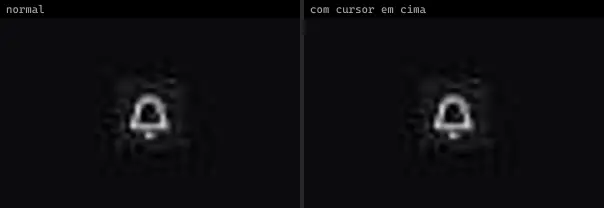 | **Native Notification Bell Shadcnui** `uitripled:native/native-notification-bell-shadcnui` | Mobile & App | uitripled · MIT | framer-motion, lucide-react |
| 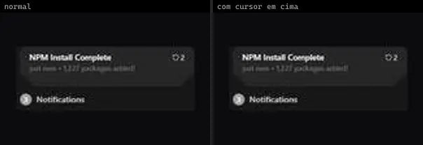 | **Notification List** `animateui:components/community/notification-list` | UI base | animateui · MIT + Commons Clause | lucide-react, motion |
| 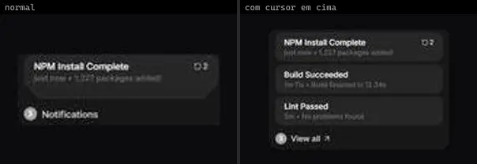 | **StackedNotifications** `atlas:Lists/StackedNotifications` | UI base | atlas (própria) · Proprietária (Atlas) | lucide-react, motion |
| 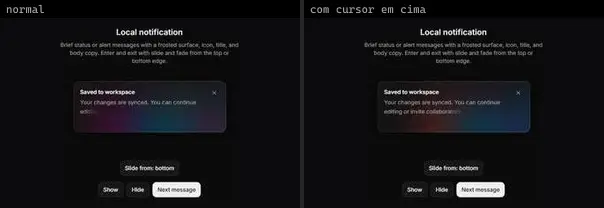 | **Halo Notification** `cultui:halo-notification-demo` | UI base | cultui · MIT | @base-ui/react, lucide-react, motion |
| 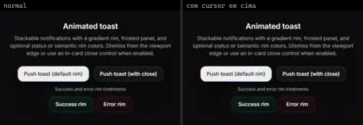 | **Halo Toast** `cultui:halo-toast-demo` | UI base | cultui · MIT | lucide-react, motion, sonner |
|  | **Glare Hover — Alerts** `magicui:glare-hover-demo-alert` | UI base | magicui · MIT | lucide-react |
| 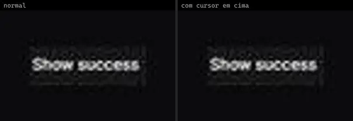 | **Basic Toast** `smoothui:basic-toast` | UI base | smoothui · MIT | @radix-ui/react-slot, @repo/shadcn-ui, @repo/smoothui, class-variance-authority, lucide-react, motion |
| 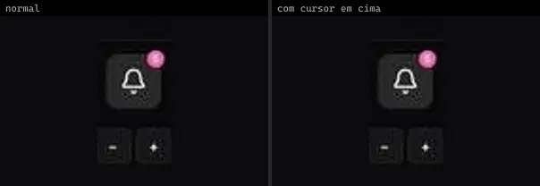 | **Notification Badge** `smoothui:notification-badge` | UI base | smoothui · MIT | @radix-ui/react-slot, @repo/shadcn-ui, @repo/smoothui, class-variance-authority, lucide-react, motion |
| 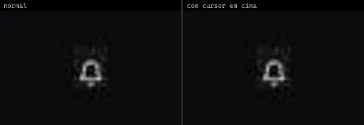 | **Notification Bell** `spectrumui:notification-bell` | UI base | spectrumui · Apache-2.0 | clsx, framer-motion, tailwind-merge |
| 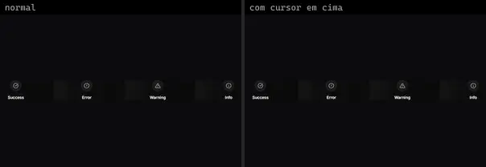 | **Notification Center** `uitripled:components/notifications/notification-center` | UI base | uitripled · MIT | @radix-ui/react-slot, class-variance-authority, framer-motion, lucide-react |
| 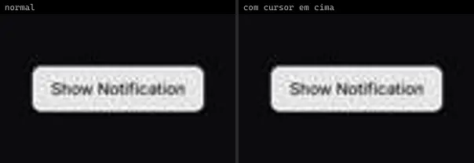 | **Toast Notification** `uitripled:page/notifications/toast-notification` | UI base | uitripled · MIT | @radix-ui/react-slot, class-variance-authority, framer-motion, lucide-react |
| 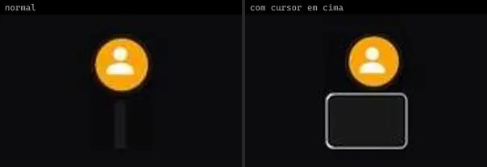 | **Gentle Octopus · alexruix** `uiverse:Notifications/alexruix_gentle-octopus-87` | UI base | uiverse · MIT | — |
| 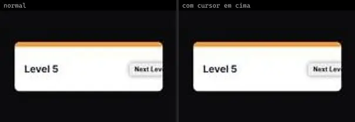 | **Nervous Zebra · WittyHydra** `uiverse:Notifications/WittyHydra_nervous-zebra-0` | UI base | uiverse · MIT | — |
|  | **Quiet Liger · andrew-demchenk0** `uiverse:Notifications/andrew-demchenk0_quiet-liger-31` | UI base | uiverse · MIT | — |
|  | **Quiet Puma · John-CFO** `uiverse:Notifications/John-CFO_quiet-puma-22` | UI base | uiverse · MIT | — |
|  | **Stupid Shrimp · yaroslavas2001** `uiverse:Notifications/yaroslavas2001_stupid-shrimp-89` | UI base | uiverse · MIT | — |
| 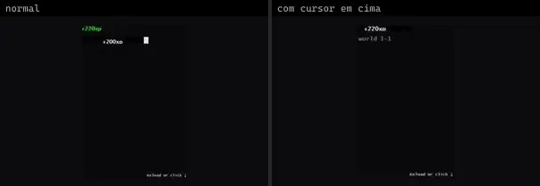 | **Swift Fireant · MijailVillegas** `uiverse:Notifications/MijailVillegas_swift-fireant-79` | UI base | uiverse · MIT | — |
| 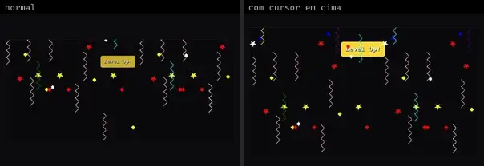 | **Tasty Ape · JkHuger** `uiverse:Notifications/JkHuger_tasty-ape-73` | UI base | uiverse · MIT | — |
| 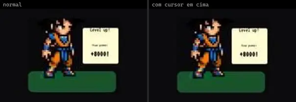 | **Tiny Mayfly · M4NT** `uiverse:Notifications/M4NT_tiny-mayfly-20` | UI base | uiverse · MIT | — |
| 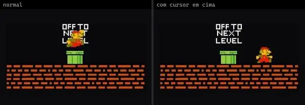 | **Ugly Walrus · Praashoo7** `uiverse:Notifications/Praashoo7_ugly-walrus-48` | UI base | uiverse · MIT | — |
| 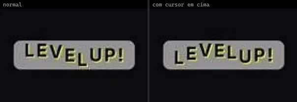 | **Warm Deer · newbiners** `uiverse:Notifications/newbiners_warm-deer-90` | UI base | uiverse · MIT | — |
| 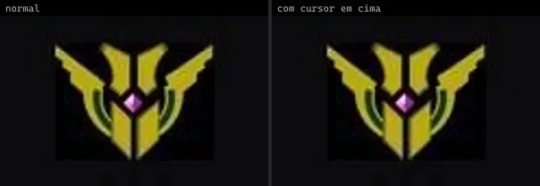 | **Weak Rattlesnake · StealthWorm** `uiverse:Notifications/StealthWorm_weak-rattlesnake-4` | UI base | uiverse · MIT | — |
|  | **White Eagle · Sameer2244** `uiverse:Notifications/Sameer2244_white-eagle-79` | UI base | uiverse · MIT | — |
