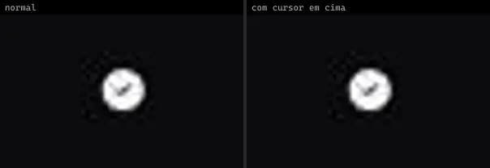
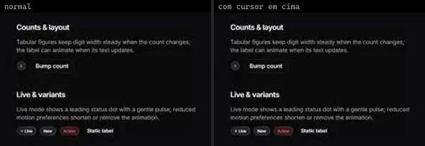
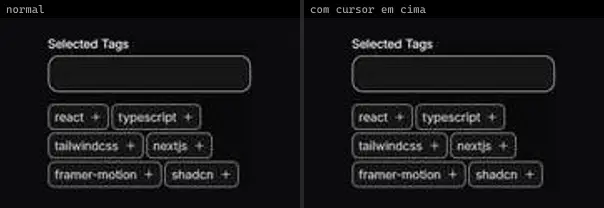
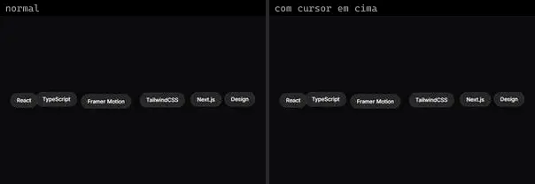

# Badge & Avatar (21)

Prévia: estado normal | com o cursor em cima. Código: `node scripts/atlas-find.mjs code <uid>` ou os arquivos em `catalog.jsonl → files`.

| prévia | componente | tipo de aplicação | biblioteca · licença | dependências npm |
|---|---|---|---|---|
|  | **UserPresenceAvatar** `atlas:Misc/UserPresenceAvatar` | Login & Conta | atlas (própria) · Proprietária (Atlas) | motion |
|  | **User Account Avatar** `smoothui:user-account-avatar` | Login & Conta | smoothui · MIT | @radix-ui/react-popover, @repo/smoothui, @smoothui/data, lucide-react, motion |
|  | **Native Avatar Expand** `uitripled:native/demo/native-avatar-expand-demo` | Mobile & App | uitripled · MIT | — |
|  | **Native Verified Badge** `uitripled:native/demo/native-verified-badge-demo` | Mobile & App | uitripled · MIT | lucide-react |
|  | **Native Verified Badge Shadcnui** `uitripled:native/native-verified-badge-shadcnui` | Mobile & App | uitripled · MIT | @radix-ui/react-tooltip |
|  | **Avatar List** `animata:list/avatar-list` | UI base | animata · MIT | — |
|  | **AvatarGroup** `atlas:Lists/AvatarGroup` | UI base | atlas (própria) · Proprietária (Atlas) | motion |
|  | **Halo Badge** `cultui:halo-badge-demo` | UI base | cultui · MIT | class-variance-authority, motion |
|  | **Animated Badge** `eldoraui:animated-badge-demo` | UI base | eldoraui · MIT | lucide-react, motion |
|  | **Tags** `kibo:tags` | UI base | kibo · MIT | @repo/tags, lucide-react |
|  | **Carousel Custom Indicator** `motionprimitives:carousel/carousel-custom-indicator` | UI base | motionprimitives · MIT | lucide-react, motion |
|  | **Animated Avatar Group** `smoothui:animated-avatar-group` | UI base | smoothui · MIT | @repo/shadcn-ui, @repo/smoothui, @smoothui/data, motion |
|  | **Animated Tags** `smoothui:animated-tags` | UI base | smoothui · MIT | @repo/smoothui, lucide-react, motion |
|  | **Breakpoint Indicator** `smoothui:breakpoint-indicator` | UI base | smoothui · MIT | @repo/shadcn-ui, @repo/smoothui, motion |
|  | **Tweet Card Avatars** `smoothui:tweet-card-avatars` | UI base | smoothui · MIT · ⚠needs-network | @repo/smoothui |
|  | **Avatar Stack** `spectrumui:avatar-stack` | UI base | spectrumui · Apache-2.0 · ⚠needs-props | clsx, framer-motion, tailwind-merge |
|  | **Kbd Key** `spectrumui:kbd-key` | UI base | spectrumui · Apache-2.0 · ⚠needs-props | clsx, framer-motion, tailwind-merge |
|  | **Undo Pill** `spectrumui:undo-pill` | UI base | spectrumui · Apache-2.0 | clsx, framer-motion, tailwind-merge |
|  | **Avatar Group** `uitripled:avatars/avatar-group` | UI base | uitripled · MIT | framer-motion, lucide-react |
|  | **Dynamic Tag Cloud** `uitripled:motion-core/dynamic-tag-cloud` | UI base | uitripled · MIT | framer-motion |
|  | **Magnetic Avatar Group** `uitripled:motion-core/magnetic-avatar-group` | UI base | uitripled · MIT | framer-motion |
