# Botão (208)

Prévia: estado normal | com o cursor em cima. Código: `node scripts/atlas-find.mjs code <uid>` ou os arquivos em `catalog.jsonl → files`.

| prévia | componente | tipo de aplicação | biblioteca · licença | dependências npm |
|---|---|---|---|---|
| 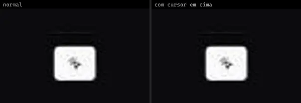 | **Particle Button** `kokonutui:particle-button` | Blog & Conteúdo | kokonutui · MIT | @radix-ui/react-slot, class-variance-authority, clsx, lucide-react, motion, tailwind-merge |
| 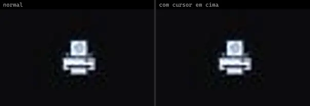 | **Cold Dodo · Admin12121** `uiverse:Buttons/Admin12121_cold-dodo-65` | Dashboard & Admin | uiverse · MIT | — |
| 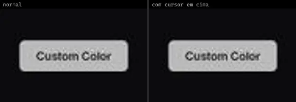 | **Native Liquid Button** `uitripled:native/demo/native-liquid-button-demo` | Mobile & App | uitripled · MIT | — |
|  | **Native Liquid Button** `uitripled:native/native-liquid-button` | Mobile & App | uitripled · MIT | framer-motion, lucide-react |
| 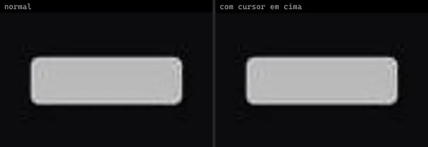 | **Native Liquid Button Shadcnui** `uitripled:native/native-liquid-button-shadcnui` | Mobile & App | uitripled · MIT | framer-motion, lucide-react |
| 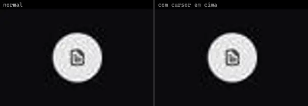 | **Native Morphing Button** `uitripled:native/demo/native-morphing-button-demo` | Mobile & App | uitripled · MIT | lucide-react |
| 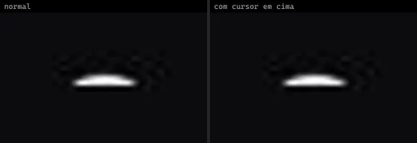 | **Native Morphing Button Shadcnui** `uitripled:native/native-morphing-button-shadcnui` | Mobile & App | uitripled · MIT | framer-motion, lucide-react |
|  | **Animated Follow Button** `animata:button/animated-follow-button` | UI base | animata · MIT | motion |
|  | **Ripple Button** `animata:button/ripple-button` | UI base | animata · MIT | — |
| 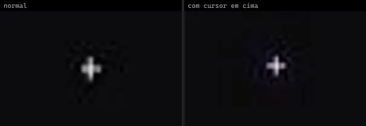 | **Speed Dial** `animata:fabs/speed-dial` | UI base | animata · MIT | lucide-react |
|  | **Status Button** `animata:button/status-button` | UI base | animata · MIT | lucide-react, motion |
| 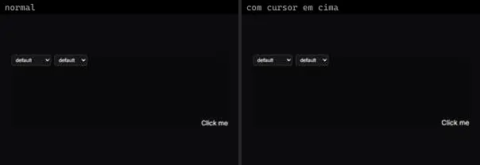 | **AnimatedButton** `atlas:Buttons/AnimatedButton` | UI base | atlas (própria) · Proprietária (Atlas) | lucide-react, motion |
| 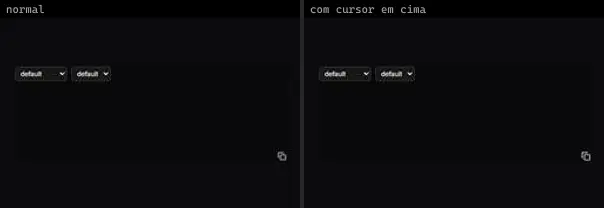 | **CopyButton** `atlas:Buttons/CopyButton` | UI base | atlas (própria) · Proprietária (Atlas) | lucide-react, motion |
| 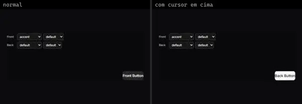 | **FlipButton** `atlas:Buttons/FlipButton` | UI base | atlas (própria) · Proprietária (Atlas) | lucide-react, motion |
| 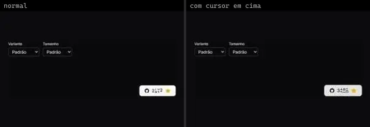 | **GithubStarsButton** `atlas:Buttons/GithubStarsButton` | UI base | atlas (própria) · Proprietária (Atlas) | motion |
|  | **IconBurstButton** `atlas:Buttons/IconBurstButton` | UI base | atlas (própria) · Proprietária (Atlas) | lucide-react, motion |
| 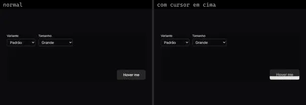 | **LiquidButton** `atlas:Buttons/LiquidButton` | UI base | atlas (própria) · Proprietária (Atlas) | lucide-react, motion, tailwind-merge |
|  | **RippleButton** `atlas:Buttons/RippleButton` | UI base | atlas (própria) · Proprietária (Atlas) | lucide-react, motion |
| 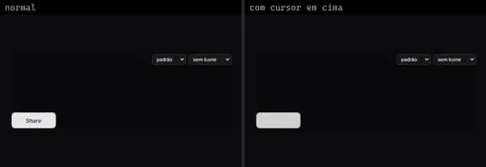 | **ShareButton** `atlas:Buttons/ShareButton` | UI base | atlas (própria) · Proprietária (Atlas) | motion |
|  | **Button** `bundui:ripple-effect/button` | UI base | bundui · MIT | @radix-ui/react-slot, class-variance-authority, motion |
| 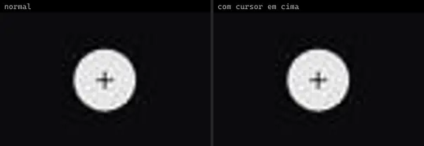 | **Floating Button** `bundui:floating-button` | UI base | bundui · MIT | @radix-ui/react-slot, class-variance-authority, lucide-react, motion, usehooks-ts |
| 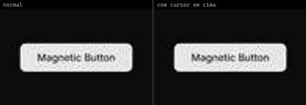 | **Magnetic Button** `bundui:magnetic-button` | UI base | bundui · MIT | @radix-ui/react-slot, class-variance-authority, motion |
| 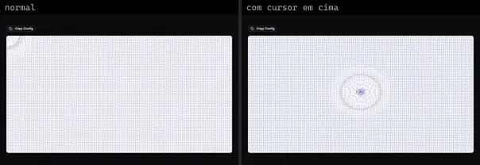 | **Bg Animated Fractal Dot Grid** `cultui:bg-animated-fractal-dot-grid-demo` | UI base | cultui · MIT | lucide-react, motion |
| 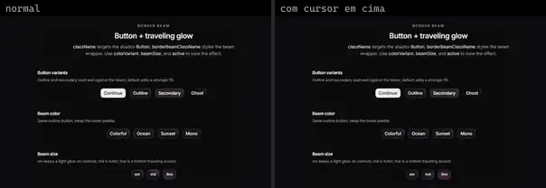 | **Border Beam Button** `cultui:border-beam-button-demo` | UI base | cultui · MIT | border-beam, lucide-react |
|  | **Canvas Fractal Grid** `cultui:canvas-fractal-grid-demo` | UI base | cultui · MIT | lucide-react, motion |
| 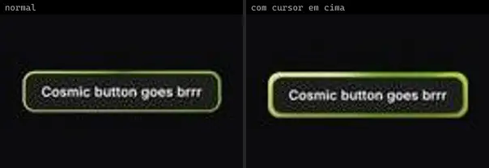 | **Cosmic Button** `cultui:cosmic-button-demo` | UI base | cultui · MIT | — |
| 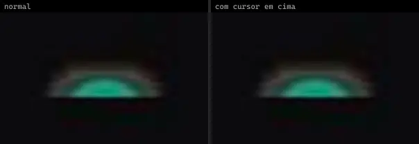 | **Family Button** `cultui:family-button-demo` | UI base | cultui · MIT | lucide-react, motion, react-use-measure |
|  | **Halo Button** `cultui:halo-button-demo` | UI base | cultui · MIT | @base-ui/react, lucide-react, motion |
| 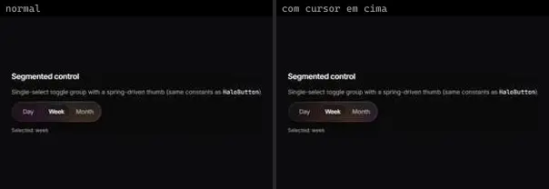 | **Halo Toggle Group** `cultui:halo-toggle-group-demo` | UI base | cultui · MIT | @base-ui/react, motion |
| 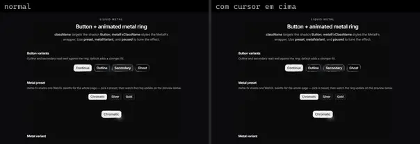 | **Metal Button** `cultui:metal-button-demo` | UI base | cultui · MIT | class-variance-authority, lucide-react, metal-fx |
| 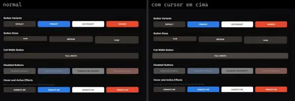 | **Neumorph Button** `cultui:neumorph-button-demo` | UI base | cultui · MIT | class-variance-authority, lucide-react, motion |
| 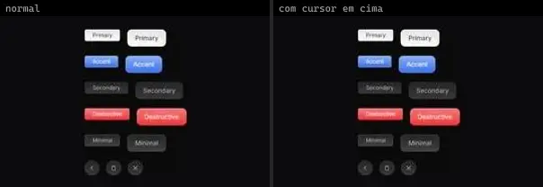 | **Texture Button** `cultui:texture-button-demo` | UI base | cultui · MIT | @radix-ui/react-slot, class-variance-authority, lucide-react |
|  | **Animated Shiny Button** `eldoraui:animated-shiny-button-demo` | UI base | eldoraui · MIT · ⚠needs-network | lucide-react |
| 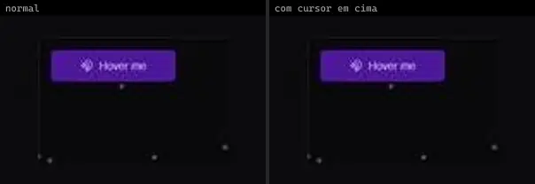 | **Attract Button** `kokonutui:attract-button` | UI base | kokonutui · MIT | @radix-ui/react-slot, class-variance-authority, clsx, lucide-react, motion, tailwind-merge |
| 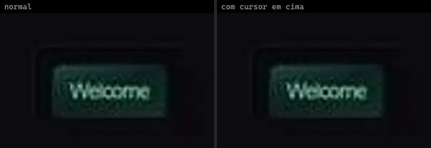 | **Gradient Button** `kokonutui:gradient-button` | UI base | kokonutui · MIT | @radix-ui/react-slot, class-variance-authority, clsx, tailwind-merge |
| 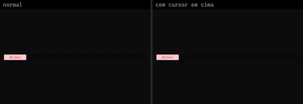 | **Hold Button** `kokonutui:hold-button` | UI base | kokonutui · MIT | @radix-ui/react-slot, class-variance-authority, clsx, lucide-react, motion, tailwind-merge |
|  | **Slide Text Button** `kokonutui:slide-text-button` | UI base | kokonutui · MIT | clsx, motion, tailwind-merge |
| 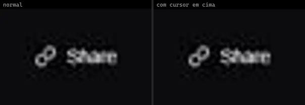 | **Social Button** `kokonutui:social-button` | UI base | kokonutui · MIT | @radix-ui/react-slot, class-variance-authority, clsx, lucide-react, motion, tailwind-merge |
| 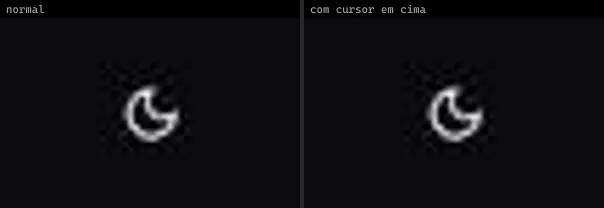 | **Animated Theme Toggler** `magicui:animated-theme-toggler-demo` | UI base | magicui · MIT | lucide-react |
|  | **Animated Theme Toggler — Diamond** `magicui:animated-theme-toggler-diamond-demo` | UI base | magicui · MIT | lucide-react |
|  | **Animated Theme Toggler — Hexagon** `magicui:animated-theme-toggler-hexagon-demo` | UI base | magicui · MIT | lucide-react |
| 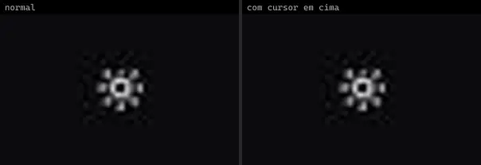 | **Animated Theme Toggler — next-themes** `magicui:animated-theme-toggler-next-themes-demo` | UI base | magicui · MIT | lucide-react, next-themes |
|  | **Animated Theme Toggler — Rectangle** `magicui:animated-theme-toggler-rectangle-demo` | UI base | magicui · MIT | lucide-react |
|  | **Animated Theme Toggler — Square** `magicui:animated-theme-toggler-square-demo` | UI base | magicui · MIT | lucide-react |
|  | **Animated Theme Toggler — Star** `magicui:animated-theme-toggler-star-demo` | UI base | magicui · MIT | lucide-react |
|  | **Animated Theme Toggler — Triangle** `magicui:animated-theme-toggler-triangle-demo` | UI base | magicui · MIT | lucide-react |
|  | **Cool Mode** `magicui:cool-mode-demo` | UI base | magicui · MIT | — |
|  | **Interactive Hover Button** `magicui:interactive-hover-button-demo` | UI base | magicui · MIT | lucide-react |
|  | **Pulsating Button** `magicui:pulsating-button-demo` | UI base | magicui · MIT | — |
|  | **Pulsating Button 2** `magicui:pulsating-button-demo-2` | UI base | magicui · MIT | — |
|  | **Rainbow Button** `magicui:rainbow-button-demo` | UI base | magicui · MIT | @radix-ui/react-slot, class-variance-authority |
|  | **Rainbow Button 2** `magicui:rainbow-button-demo-2` | UI base | magicui · MIT | @radix-ui/react-slot, class-variance-authority |
|  | **Ripple Button** `magicui:ripple-button-demo` | UI base | magicui · MIT | — |
| 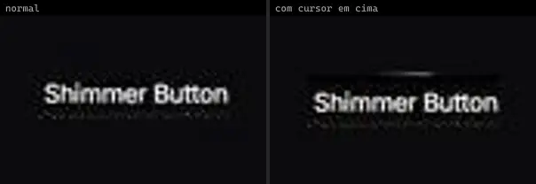 | **Shimmer Button** `magicui:shimmer-button-demo` | UI base | magicui · MIT | — |
| 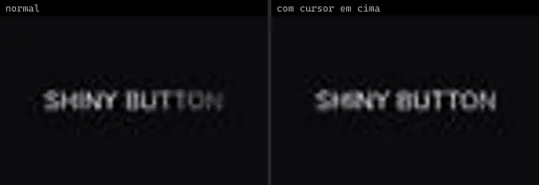 | **Shiny Button** `magicui:shiny-button-demo` | UI base | magicui · MIT | motion |
| 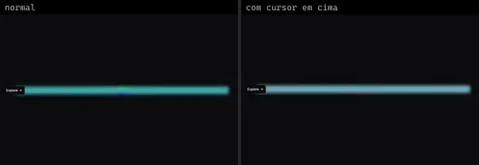 | **Glow Effect Button** `motionprimitives:glow-effect/glow-effect-button` | UI base | motionprimitives · MIT | lucide-react, motion |
|  | **Text Morph Button** `motionprimitives:text-morph/text-morph-button` | UI base | motionprimitives · MIT | motion |
| 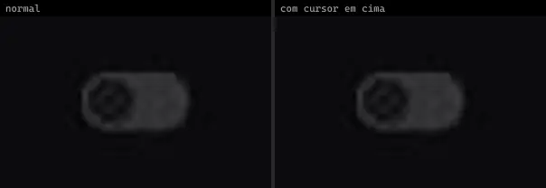 | **Animated Toggle** `smoothui:animated-toggle` | UI base | smoothui · MIT | @repo/shadcn-ui, @repo/smoothui, motion |
| 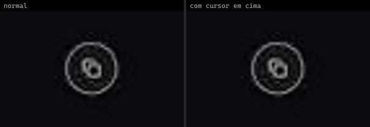 | **Button Copy** `smoothui:button-copy` | UI base | smoothui · MIT | @repo/smoothui, lucide-react, motion |
|  | **Clip Corners Button** `smoothui:clip-corners-button` | UI base | smoothui · MIT | @repo/smoothui, motion |
|  | **Cta 2** `smoothui:cta-2` | UI base | smoothui · MIT | @repo/smoothui, @smoothui/data, motion |
|  | **Dot Morph Button** `smoothui:dot-morph-button` | UI base | smoothui · MIT | @repo/smoothui, motion |
|  | **Magnetic Button** `smoothui:magnetic-button` | UI base | smoothui · MIT | @radix-ui/react-slot, @repo/shadcn-ui, @repo/smoothui, class-variance-authority, motion |
|  | **Music Toggle** `smoothui:music-toggle` | UI base | smoothui · MIT | @repo/shadcn-ui, @repo/smoothui, lucide-react, motion |
| 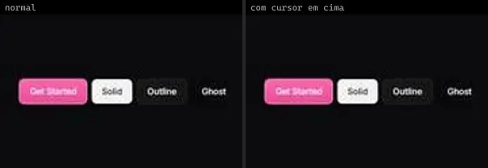 | **Smooth Button** `smoothui:smooth-button` | UI base | smoothui · MIT | @radix-ui/react-slot, @repo/shadcn-ui, @repo/smoothui, class-variance-authority, lucide-react, motion |
| 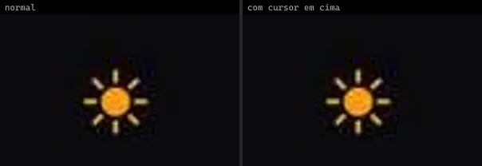 | **Theme Toggle** `smoothui:theme-toggle` | UI base | smoothui · MIT | @repo/shadcn-ui, @repo/smoothui, lucide-react, motion |
| 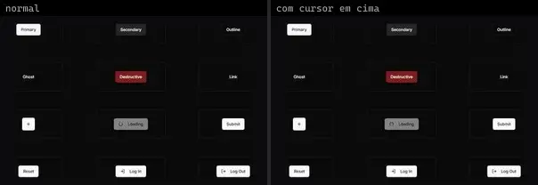 | **ButtonCollection** `spectrumui:ButtonCollection` | UI base | spectrumui · Apache-2.0 | @radix-ui/react-slot, @remixicon/react, class-variance-authority, lucide-react |
| 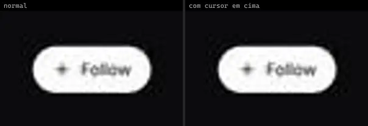 | **Follow Button** `spectrumui:follow-button` | UI base | spectrumui · Apache-2.0 | clsx, framer-motion, lucide-react, tailwind-merge |
| 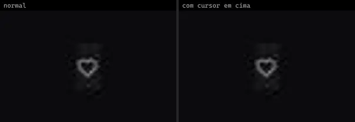 | **Like Button** `spectrumui:like-button` | UI base | spectrumui · Apache-2.0 | clsx, framer-motion, tailwind-merge |
| 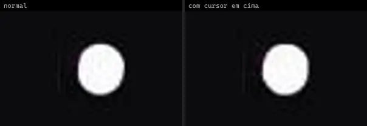 | **Metal Button** `spectrumui:metal-button` | UI base | spectrumui · Apache-2.0 | clsx, metal-fx, tailwind-merge |
| 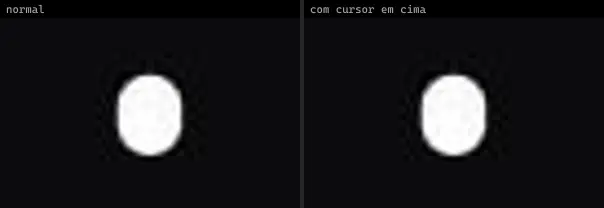 | **Morph Button** `spectrumui:morph-button` | UI base | spectrumui · Apache-2.0 | clsx, framer-motion, tailwind-merge |
|  | **Sales Cta Footer** `spectrumui:blocks/footers/sales-cta-footer` | UI base | spectrumui · Apache-2.0 | @radix-ui/react-slot, class-variance-authority, clsx, tailwind-merge |
| 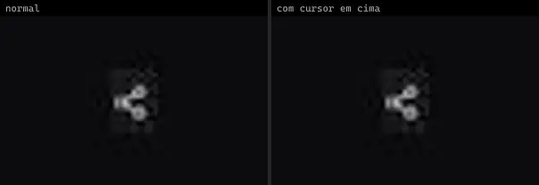 | **Share Button** `spectrumui:share-button` | UI base | spectrumui · Apache-2.0 | clsx, framer-motion, lucide-react, tailwind-merge |
| 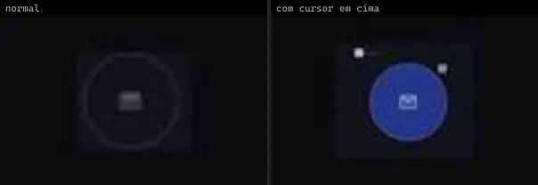 | **Circle Buttons · Mail** `threeui:circle-buttons/mail` | UI base | threeui · MIT | — |
| 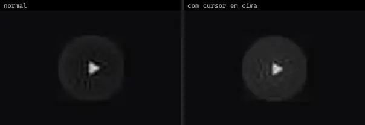 | **Circle Buttons · Play** `threeui:circle-buttons/play` | UI base | threeui · MIT | — |
| 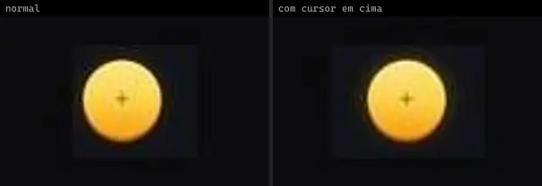 | **Circle Buttons · Plus** `threeui:circle-buttons/plus` | UI base | threeui · MIT | — |
| 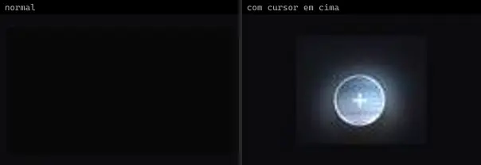 | **Liquid Metal Button · Liquid Orb** `threeui:liquid-metal-button/circle` | UI base | threeui · MIT | — |
| 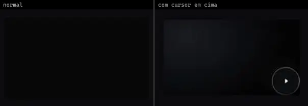 | **Liquid Metal Button · Play Circle** `threeui:liquid-metal-button/play-circle` | UI base | threeui · MIT | — |
| 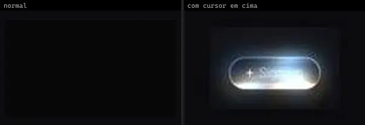 | **Liquid Metal Button · Sign up Pill** `threeui:liquid-metal-button/pill` | UI base | threeui · MIT | — |
| 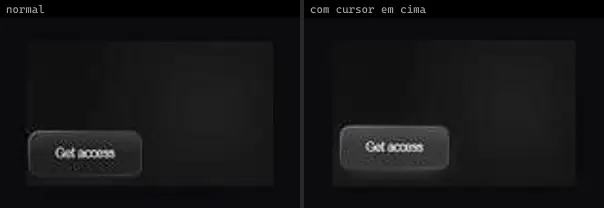 | **Rectangle Buttons · Aster Glass Access** `threeui:rectangle-buttons/aster-glass-access` | UI base | threeui · MIT | — |
|  | **Rectangle Buttons · Aster Glass Arrow** `threeui:rectangle-buttons/aster-glass-arrow` | UI base | threeui · MIT | — |
|  | **Rectangle Buttons · Attune Thermal** `threeui:rectangle-buttons/attune-thermal` | UI base | threeui · MIT | — |
|  | **Rectangle Buttons · Dark Glass** `threeui:rectangle-buttons/dark-pill` | UI base | threeui · MIT | — |
|  | **Rectangle Buttons · Dot Border Button** `threeui:rectangle-buttons/dot-border-button` | UI base | threeui · MIT | — |
| 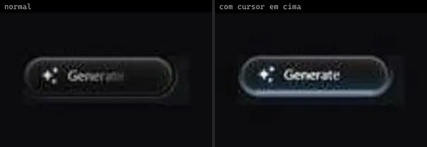 | **Rectangle Buttons · Generate Button** `threeui:rectangle-buttons/generate-button` | UI base | threeui · MIT | — |
|  | **Rectangle Buttons · Gradient Pill Button** `threeui:rectangle-buttons/gradient-pill-button` | UI base | threeui · MIT | — |
|  | **Rectangle Buttons · Halvorsen Arrow Pill** `threeui:rectangle-buttons/halvorsen-arrow-pill` | UI base | threeui · MIT | — |
|  | **Rectangle Buttons · Launch Button** `threeui:rectangle-buttons/launch-button` | UI base | threeui · MIT | — |
|  | **Rectangle Buttons · Meridian Keycap Primary** `threeui:rectangle-buttons/meridian-keycap-primary` | UI base | threeui · MIT | — |
|  | **Rectangle Buttons · Meridian Keycap Secondary** `threeui:rectangle-buttons/meridian-keycap-secondary` | UI base | threeui · MIT | — |
|  | **Rectangle Buttons · Spinning Border Button** `threeui:rectangle-buttons/spinning-border-button` | UI base | threeui · MIT | — |
|  | **Rectangle Buttons · Tideform Outline** `threeui:rectangle-buttons/tideform-outline` | UI base | threeui · MIT | — |
|  | **Rectangle Buttons · Trochil Signal** `threeui:rectangle-buttons/trochil-signal` | UI base | threeui · MIT | — |
|  | **Rectangle Buttons · Understory Arrow Pill** `threeui:rectangle-buttons/understory-arrow-pill` | UI base | threeui · MIT | — |
|  | **Shader Buttons · Ignition** `threeui:star-portal/ignition-button` | UI base | threeui · MIT | — |
|  | **Shader Buttons · Induction** `threeui:star-portal/induction-button` | UI base | threeui · MIT | — |
|  | **Shader Buttons · Plasma** `threeui:star-portal/plasma-button` | UI base | threeui · MIT | — |
|  | **Shader Buttons · Star Portal** `threeui:star-portal/star-portal` | UI base | threeui · MIT · ⚠needs-network | — |
|  | **Shader Buttons · Tactile** `threeui:star-portal/tactile-button` | UI base | threeui · MIT | — |
|  | **Mood Gradient Button** `uitripled:motion-core/mood-gradient-button` | UI base | uitripled · MIT | framer-motion |
|  | **Afraid Lion · VashonG** `uiverse:Buttons/VashonG_afraid-lion-76` | UI base | uiverse · MIT | — |
|  | **Ancient Starfish · r7chardgh** `uiverse:Buttons/r7chardgh_ancient-starfish-5` | UI base | uiverse · MIT | — |
|  | **Average Falcon · gharsh11032000** `uiverse:Buttons/gharsh11032000_average-falcon-37` | UI base | uiverse · MIT | — |
|  | **Big Ape · adamgiebl** `uiverse:Buttons/adamgiebl_big-ape-36` | UI base | uiverse · MIT | — |
|  | **Big Chipmunk · ArturCodeCraft** `uiverse:Buttons/ArturCodeCraft_big-chipmunk-22` | UI base | uiverse · MIT | — |
|  | **Big Dolphin · Amir10Amir** `uiverse:Buttons/Amir10Amir_big-dolphin-56` | UI base | uiverse · MIT | — |
|  | **Big Horse · JaydipPrajapati1910** `uiverse:Buttons/JaydipPrajapati1910_big-horse-30` | UI base | uiverse · MIT | — |
|  | **Bitter Dragon · barisdogansutcu** `uiverse:Buttons/barisdogansutcu_bitter-dragon-16` | UI base | uiverse · MIT | — |
|  | **Bitter Snail · seyed-mohsen-mousavi** `uiverse:Buttons/seyed-mohsen-mousavi_bitter-snail-5` | UI base | uiverse · MIT | — |
|  | **Blue Badger · barisdogansutcu** `uiverse:Buttons/barisdogansutcu_blue-badger-94` | UI base | uiverse · MIT | — |
|  | **Brave Horse · EddyBel** `uiverse:Buttons/EddyBel_brave-horse-21` | UI base | uiverse · MIT | — |
|  | **Breezy Liger · elijahgummer** `uiverse:Buttons/elijahgummer_breezy-liger-35` | UI base | uiverse · MIT | — |
|  | **Breezy Tiger · wizard503** `uiverse:Buttons/wizard503_breezy-tiger-28` | UI base | uiverse · MIT | — |
|  | **Chatty Snake · barisdogansutcu** `uiverse:Buttons/barisdogansutcu_chatty-snake-91` | UI base | uiverse · MIT | — |
|  | **Chilly Goat · Lakshay-art** `uiverse:Buttons/Lakshay-art_chilly-goat-78` | UI base | uiverse · MIT | — |
|  | **Chilly Sloth · ilkhoeri** `uiverse:Buttons/ilkhoeri_chilly-sloth-36` | UI base | uiverse · MIT | — |
|  | **Clever Lizard · jdm-encompass** `uiverse:Buttons/jdm-encompass_clever-lizard-42` | UI base | uiverse · MIT | — |
|  | **Cold Ape · ahmedyasserdev** `uiverse:Buttons/ahmedyasserdev_cold-ape-21` | UI base | uiverse · MIT | — |
|  | **Curly Cheetah · KitoC** `uiverse:Buttons/KitoC_curly-cheetah-59` | UI base | uiverse · MIT | — |
|  | **Curly Rat · Tsiangana** `uiverse:Buttons/Tsiangana_curly-rat-7` | UI base | uiverse · MIT | — |
|  | **Curvy Rat · satyamchaudharydev** `uiverse:Buttons/satyamchaudharydev_curvy-rat-14` | UI base | uiverse · MIT | — |
|  | **Dry Gecko · d3uceY** `uiverse:Buttons/d3uceY_dry-gecko-28` | UI base | uiverse · MIT | — |
|  | **Dry Panther · Yashwanthnaini** `uiverse:Buttons/Yashwanthnaini_dry-panther-24` | UI base | uiverse · MIT | — |
|  | **Dull Mole · Pradeepsaranbishnoi** `uiverse:Buttons/Pradeepsaranbishnoi_dull-mole-49` | UI base | uiverse · MIT | — |
|  | **Evil Ape · Codecite** `uiverse:Buttons/Codecite_evil-ape-86` | UI base | uiverse · MIT | — |
|  | **Evil Wolverine · AmIt-DasIT** `uiverse:Buttons/AmIt-DasIT_evil-wolverine-68` | UI base | uiverse · MIT | — |
|  | **Fat Bat · JkHuger** `uiverse:Buttons/JkHuger_fat-bat-0` | UI base | uiverse · MIT | — |
|  | **Fat Rabbit · reyvaxreecded** `uiverse:Buttons/reyvaxreecded_fat-rabbit-45` | UI base | uiverse · MIT | — |
|  | **Fat Zebra · marcelodolza** `uiverse:Buttons/marcelodolza_fat-zebra-11` | UI base | uiverse · MIT | — |
|  | **Fluffy Fly · andrew-demchenk0** `uiverse:Buttons/andrew-demchenk0_fluffy-fly-35` | UI base | uiverse · MIT | — |
|  | **Fluffy Gecko · elijahgummer** `uiverse:Buttons/elijahgummer_fluffy-gecko-12` | UI base | uiverse · MIT | — |
|  | **Fresh Impala · Philibert-JF** `uiverse:Buttons/Philibert-JF_fresh-impala-20` | UI base | uiverse · MIT | — |
|  | **Friendly Wasp · elijahgummer** `uiverse:Buttons/elijahgummer_friendly-wasp-61` | UI base | uiverse · MIT | — |
|  | **Friendly Wasp · Sameer2244** `uiverse:Buttons/Sameer2244_friendly-wasp-57` | UI base | uiverse · MIT | — |
|  | **Great Ape · vinodjangid07** `uiverse:Buttons/vinodjangid07_great-ape-33` | UI base | uiverse · MIT | — |
|  | **Great Dragonfly · SmookyDev** `uiverse:Buttons/SmookyDev_great-dragonfly-65` | UI base | uiverse · MIT | — |
|  | **Great Fish · MuhammadHasann** `uiverse:Buttons/MuhammadHasann_great-fish-88` | UI base | uiverse · MIT | — |
|  | **Green Cow · HecktorViegas** `uiverse:Buttons/HecktorViegas_green-cow-45` | UI base | uiverse · MIT | — |
|  | **Green Rabbit · John-CFO** `uiverse:Buttons/John-CFO_green-rabbit-93` | UI base | uiverse · MIT | — |
|  | **Happy Elephant · Lucaasbre** `uiverse:Buttons/Lucaasbre_happy-elephant-36` | UI base | uiverse · MIT | — |
|  | **Happy Emu · Yaya12085** `uiverse:Buttons/Yaya12085_happy-emu-100` | UI base | uiverse · MIT | — |
|  | **Hard Pig · wang3616359git** `uiverse:Buttons/wang3616359git_hard-pig-94` | UI base | uiverse · MIT | — |
|  | **Hard Wasp · albertofanini-prog** `uiverse:Buttons/albertofanini-prog_hard-wasp-8` | UI base | uiverse · MIT | — |
|  | **Honest Falcon · vikas7754** `uiverse:Buttons/vikas7754_honest-falcon-30` | UI base | uiverse · MIT | — |
|  | **Hot Baboon · VashonG** `uiverse:Buttons/VashonG_hot-baboon-9` | UI base | uiverse · MIT | — |
|  | **Hungry Lizard · pradipkaityuiux** `uiverse:Buttons/pradipkaityuiux_hungry-lizard-38` | UI base | uiverse · MIT | — |
|  | **Jolly Sloth · Pradeepsaranbishnoi** `uiverse:Buttons/Pradeepsaranbishnoi_jolly-sloth-57` | UI base | uiverse · MIT | — |
|  | **Lazy Fish · Wasim-Rana** `uiverse:Buttons/Wasim-Rana_lazy-fish-83` | UI base | uiverse · MIT | — |
|  | **Lazy Owl · htwarriors108** `uiverse:Buttons/htwarriors108_lazy-owl-9` | UI base | uiverse · MIT | — |
|  | **Lazy Starfish · gustavofusco** `uiverse:Buttons/gustavofusco_lazy-starfish-84` | UI base | uiverse · MIT | — |
|  | **Light Panther · tarantino421** `uiverse:Buttons/tarantino421_light-panther-5` | UI base | uiverse · MIT | — |
|  | **Little Penguin · barisdogansutcu** `uiverse:Buttons/barisdogansutcu_little-penguin-13` | UI base | uiverse · MIT | — |
|  | **Loud Husky · simontheonlyone** `uiverse:Buttons/simontheonlyone_loud-husky-46` | UI base | uiverse · MIT | — |
|  | **Lovely Bullfrog · n-jaisabai** `uiverse:Buttons/n-jaisabai_lovely-bullfrog-53` | UI base | uiverse · MIT | — |
|  | **Lovely Fox · yaroslavas2001** `uiverse:Buttons/yaroslavas2001_lovely-fox-50` | UI base | uiverse · MIT | — |
|  | **Lucky Mouse · MuhammadHasann** `uiverse:Buttons/MuhammadHasann_lucky-mouse-99` | UI base | uiverse · MIT | — |
|  | **Mean Mayfly · VashonG** `uiverse:Buttons/VashonG_mean-mayfly-77` | UI base | uiverse · MIT | — |
|  | **Mighty Stingray · LuisEgan** `uiverse:Buttons/LuisEgan_mighty-stingray-31` | UI base | uiverse · MIT | — |
|  | **Mighty Warthog · Praashoo7** `uiverse:Buttons/Praashoo7_mighty-warthog-35` | UI base | uiverse · MIT | — |
|  | **Modern Bear · vinodjangid07** `uiverse:Buttons/vinodjangid07_modern-bear-96` | UI base | uiverse · MIT | — |
|  | **Moody Moth · Shashvhat** `uiverse:Buttons/Shashvhat_moody-moth-69` | UI base | uiverse · MIT | — |
|  | **Nervous Insect · NguyenHaiNam24082000** `uiverse:Buttons/NguyenHaiNam24082000_nervous-insect-23` | UI base | uiverse · MIT | — |
|  | **Old Wombat · MuhammadHasann** `uiverse:Buttons/MuhammadHasann_old-wombat-33` | UI base | uiverse · MIT | — |
|  | **Ordinary Rat · Navarog21** `uiverse:Buttons/Navarog21_ordinary-rat-19` | UI base | uiverse · MIT | — |
|  | **Pink Zebra · ShrinilDhorda** `uiverse:Buttons/ShrinilDhorda_pink-zebra-4` | UI base | uiverse · MIT | — |
|  | **Polite Mole · StealthWorm** `uiverse:Buttons/StealthWorm_polite-mole-15` | UI base | uiverse · MIT | — |
|  | **Polite Tiger · Lakshay-art** `uiverse:Buttons/Lakshay-art_polite-tiger-43` | UI base | uiverse · MIT | — |
|  | **Pretty Lion · StealthWorm** `uiverse:Buttons/StealthWorm_pretty-lion-68` | UI base | uiverse · MIT | — |
|  | **Purple Gecko · cssbuttons-io** `uiverse:Buttons/cssbuttons-io_purple-gecko-91` | UI base | uiverse · MIT | — |
|  | **Purple Otter · reshades** `uiverse:Buttons/reshades_purple-otter-7` | UI base | uiverse · MIT | — |
|  | **Purple Treefrog · csemszepp** `uiverse:Buttons/csemszepp_purple-treefrog-92` | UI base | uiverse · MIT | — |
|  | **Quick Fish · Praashoo7** `uiverse:Buttons/Praashoo7_quick-fish-43` | UI base | uiverse · MIT | — |
|  | **Quick Husky · Yaya12085** `uiverse:Buttons/Yaya12085_quick-husky-74` | UI base | uiverse · MIT | — |
|  | **Quiet Panda · SelfMadeSystem** `uiverse:Buttons/SelfMadeSystem_quiet-panda-44` | UI base | uiverse · MIT | — |
|  | **Rotten Yak · mRcOol7** `uiverse:Buttons/mRcOol7_rotten-yak-63` | UI base | uiverse · MIT | — |
|  | **Shaggy Donkey · TemRevil** `uiverse:Buttons/TemRevil_shaggy-donkey-83` | UI base | uiverse · MIT | — |
|  | **Sharp Gecko · pminedev** `uiverse:Buttons/pminedev_sharp-gecko-68` | UI base | uiverse · MIT | — |
|  | **Shy Octopus · zanina-yassine** `uiverse:Buttons/zanina-yassine_shy-octopus-85` | UI base | uiverse · MIT | — |
|  | **Slimy Dingo · hnguyentrung20** `uiverse:Buttons/hnguyentrung20_slimy-dingo-46` | UI base | uiverse · MIT | — |
|  | **Slimy Fish · MuhammadHasann** `uiverse:Buttons/MuhammadHasann_slimy-fish-99` | UI base | uiverse · MIT | — |
|  | **Slimy Jellyfish · mrhyddenn** `uiverse:Buttons/mrhyddenn_slimy-jellyfish-95` | UI base | uiverse · MIT | — |
|  | **Slimy Lionfish · SanthoshSJ-Dev** `uiverse:Buttons/SanthoshSJ-Dev_slimy-lionfish-25` | UI base | uiverse · MIT | — |
|  | **Slimy Newt · tarantino421** `uiverse:Buttons/tarantino421_slimy-newt-73` | UI base | uiverse · MIT | — |
|  | **Slippery Fox · TemRevil** `uiverse:Buttons/TemRevil_slippery-fox-2` | UI base | uiverse · MIT | — |
|  | **Smart Otter · misaraadel** `uiverse:Buttons/misaraadel_smart-otter-53` | UI base | uiverse · MIT | — |
|  | **Smooth Bat · escannord** `uiverse:Buttons/escannord_smooth-bat-37` | UI base | uiverse · MIT | — |
|  | **Smooth Crab · Praashoo7** `uiverse:Buttons/Praashoo7_smooth-crab-52` | UI base | uiverse · MIT | — |
|  | **Smooth Swan · Boosterrohit** `uiverse:Buttons/Boosterrohit_smooth-swan-20` | UI base | uiverse · MIT | — |
|  | **Spicy Grasshopper · Mohammad-Rahme-576** `uiverse:Buttons/Mohammad-Rahme-576_spicy-grasshopper-17` | UI base | uiverse · MIT | — |
|  | **Spotty Chipmunk · Pradeepsaranbishnoi** `uiverse:Buttons/Pradeepsaranbishnoi_spotty-chipmunk-79` | UI base | uiverse · MIT | — |
|  | **Spotty Horse · StealthWorm** `uiverse:Buttons/StealthWorm_spotty-horse-48` | UI base | uiverse · MIT | — |
|  | **Spotty Lion · csozidev** `uiverse:Buttons/csozidev_spotty-lion-8` | UI base | uiverse · MIT | — |
|  | **Stale Wombat · r7chardgh** `uiverse:Buttons/r7chardgh_stale-wombat-66` | UI base | uiverse · MIT | — |
|  | **Strong Panther · KSAplay** `uiverse:Buttons/KSAplay_strong-panther-58` | UI base | uiverse · MIT | — |
|  | **Stupid Impala · dvirpro** `uiverse:Buttons/dvirpro_stupid-impala-26` | UI base | uiverse · MIT | — |
|  | **Swift Bullfrog · ercnersoy** `uiverse:Buttons/ercnersoy_swift-bullfrog-99` | UI base | uiverse · MIT | — |
|  | **Swift Warthog · Manish-Tamang** `uiverse:Buttons/Manish-Tamang_swift-warthog-30` | UI base | uiverse · MIT | — |
|  | **Tame Elephant · misaraadel** `uiverse:Buttons/misaraadel_tame-elephant-97` | UI base | uiverse · MIT | — |
|  | **Tasty Warthog · MINOTAURO18** `uiverse:Buttons/MINOTAURO18_tasty-warthog-50` | UI base | uiverse · MIT | — |
|  | **Tidy Moose · Spacious74** `uiverse:Buttons/Spacious74_tidy-moose-60` | UI base | uiverse · MIT | — |
|  | **Ugly Parrot · Peary74** `uiverse:Buttons/Peary74_ugly-parrot-58` | UI base | uiverse · MIT | — |
|  | **Unlucky Elephant · mi-series** `uiverse:Buttons/mi-series_unlucky-elephant-56` | UI base | uiverse · MIT | — |
|  | **Unlucky Pug · nhfiz** `uiverse:Buttons/nhfiz_unlucky-pug-80` | UI base | uiverse · MIT | — |
|  | **Wet Cobra · mrhyddenn** `uiverse:Buttons/mrhyddenn_wet-cobra-49` | UI base | uiverse · MIT | — |
|  | **Wise Shrimp · himanshu9682** `uiverse:Buttons/himanshu9682_wise-shrimp-26` | UI base | uiverse · MIT | — |
|  | **Witty Bullfrog · kennyotsu** `uiverse:Buttons/kennyotsu_witty-bullfrog-54` | UI base | uiverse · MIT | — |
|  | **Wonderful Penguin · benjimich** `uiverse:Buttons/benjimich_wonderful-penguin-4` | UI base | uiverse · MIT | — |
|  | **Wonderful Walrus · JaydipPrajapati1910** `uiverse:Buttons/JaydipPrajapati1910_wonderful-walrus-87` | UI base | uiverse · MIT | — |
