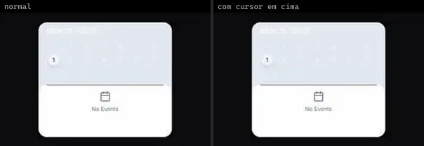
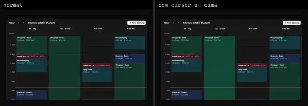
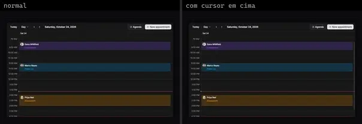
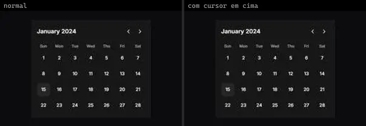

# Calendário & Data (7)

Prévia: estado normal | com o cursor em cima. Código: `node scripts/atlas-find.mjs code <uid>` ou os arquivos em `catalog.jsonl → files`.

| prévia | componente | tipo de aplicação | biblioteca · licença | dependências npm |
|---|---|---|---|---|
|  | **Calendar Event** `animata:widget/calendar-event` | Dashboard & Admin | animata · MIT | — |
|  | **Calendar Widget** `animata:widget/calendar-widget` | Dashboard & Admin | animata · MIT | lucide-react, motion |
|  | **Reminder Scheduler** `animata:card/reminder-scheduler` | Dashboard & Admin | animata · MIT | — |
|  | **Event Calendar 1** `reui:event-calendar/c-event-calendar-1` | Dashboard & Admin | reui · MIT | cn, date-fns, radix-ui |
|  | **Event Calendar 2** `reui:event-calendar/c-event-calendar-2` | Dashboard & Admin | reui · MIT | class-variance-authority, cn, date-fns, radix-ui |
|  | **Event Calendar 5** `reui:event-calendar/c-event-calendar-5` | Dashboard & Admin | reui · MIT | class-variance-authority, cn, date-fns, radix-ui |
|  | **Simple Calendar** `uitripled:forms/simple-calendar` | Dashboard & Admin | uitripled · MIT | framer-motion, lucide-react |
