# Card (226)

Prévia: estado normal | com o cursor em cima. Código: `node scripts/atlas-find.mjs code <uid>` ou os arquivos em `catalog.jsonl → files`.

| prévia | componente | tipo de aplicação | biblioteca · licença | dependências npm |
|---|---|---|---|---|
|  | **Card Comment** `animata:card/card-comment` | Blog & Conteúdo | animata · MIT | — |
|  | **Comment Reply Card** `animata:card/comment-reply-card` | Blog & Conteúdo | animata · MIT | lucide-react, motion |
| 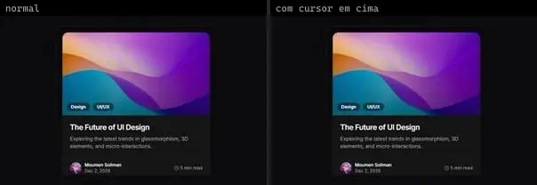 | **Glass Blog Card** `uitripled:components/cards/shadcnui/glass-blog-card` | Blog & Conteúdo | uitripled · MIT | @radix-ui/react-avatar, class-variance-authority, framer-motion, lucide-react |
|  | **Brown Bird · Admin12121** `uiverse:Cards/Admin12121_brown-bird-6` | Dashboard & Admin | uiverse · MIT | — |
|  | **Plastic Goose · Admin12121** `uiverse:Cards/Admin12121_plastic-goose-38` | Dashboard & Admin | uiverse · MIT | — |
|  | **Credit Card** `kibo:credit-card` | E-commerce | kibo · MIT | @repo/credit-card, react-svg-credit-card-payment-icons |
|  | **Deck Product Cards** `kibo:deck-product-cards` | E-commerce | kibo · MIT | @radix-ui/react-use-controllable-state, @repo/deck, @repo/shadcn-ui, class-variance-authority, clsx, lucide-react, motion, radix-ui, tailwind-merge |
|  | **Product Card** `smoothui:product-card` | E-commerce | smoothui · MIT | @repo/shadcn-ui, @repo/smoothui, @smoothui/data, motion |
|  | **Credit Card** `uitripled:components/cards/shadcnui/credit-card` | E-commerce | uitripled · MIT | framer-motion, lucide-react |
|  | **Ecommerce Highlight Card** `uitripled:components/cards/shadcnui/ecommerce-highlight-card` | E-commerce | uitripled · MIT | @radix-ui/react-separator, @radix-ui/react-slot, class-variance-authority, framer-motion, lucide-react |
|  | **Glass Order Summary** `uitripled:components/cards/shadcnui/glass-order-summary` | E-commerce | uitripled · MIT | @radix-ui/react-separator, @radix-ui/react-slot, class-variance-authority, framer-motion, lucide-react |
|  | **Funny Sloth · Smit-Prajapati** `uiverse:Cards/Smit-Prajapati_funny-sloth-75` | E-commerce | uiverse · MIT | — |
|  | **Silent Sheep · Praashoo7** `uiverse:Cards/Praashoo7_silent-sheep-14` | E-commerce | uiverse · MIT | — |
|  | **Notify User Info** `animata:card/notify-user-info` | Login & Conta | animata · MIT | motion |
| 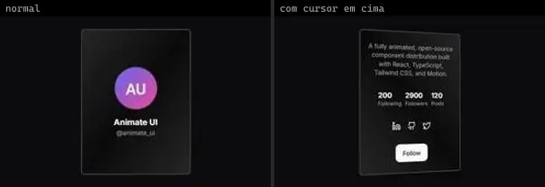 | **ProfileFlipCard** `atlas:Cards/ProfileFlipCard` | Login & Conta | atlas (própria) · Proprietária (Atlas) | lucide-react, motion |
|  | **Account Access Card** `spectrumui:account-access-card` | Login & Conta | spectrumui · Apache-2.0 | clsx, lucide-react, motion, tailwind-merge |
|  | **Github Profile Card** `spectrumui:github-profile-card` | Login & Conta | spectrumui · Apache-2.0 | @radix-ui/react-avatar, @radix-ui/react-slot, class-variance-authority, lucide-react |
|  | **Silent Quail · Spacious74** `uiverse:Cards/Spacious74_silent-quail-90` | Mobile & App | uiverse · MIT | — |
| 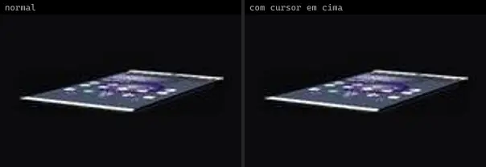 | **Tender Deer · escannord** `uiverse:Cards/escannord_tender-deer-30` | Mobile & App | uiverse · MIT | — |
|  | **Card Spread** `animata:card/card-spread` | UI base | animata · MIT | — |
| 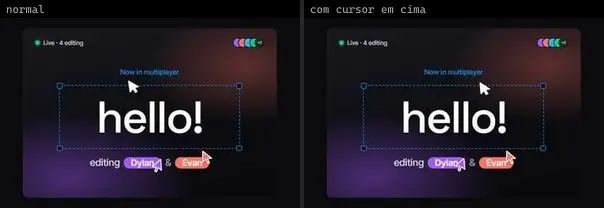 | **Collab Card** `animata:card/collab-card` | UI base | animata · MIT | — |
| 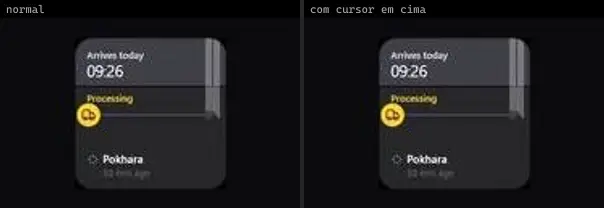 | **Delivery Card** `animata:widget/delivery-card` | UI base | animata · MIT | lucide-react |
| 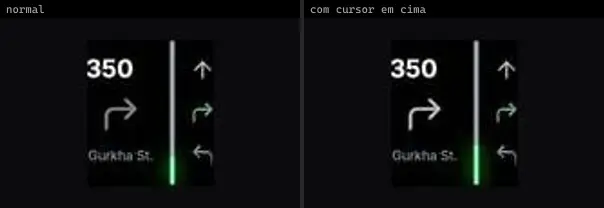 | **Direction Card** `animata:widget/direction-card` | UI base | animata · MIT | lucide-react |
|  | **Flip Card** `animata:card/flip-card` | UI base | animata · MIT | — |
|  | **Github Card Shiny** `animata:card/github-card-shiny` | UI base | animata · MIT | lucide-react |
|  | **Github Card Skew** `animata:card/github-card-skew` | UI base | animata · MIT | — |
| 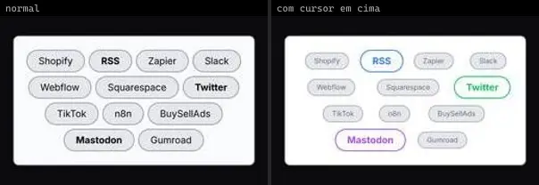 | **Integration pills** `animata:card/integration-pills` | UI base | animata · MIT | — |
|  | **Notice Card** `animata:card/notice-card` | UI base | animata · MIT | motion |
|  | **Staggered Card** `animata:card/staggered-card` | UI base | animata · MIT | motion |
| 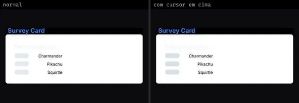 | **Survey Card** `animata:card/survey-card` | UI base | animata · MIT | — |
| 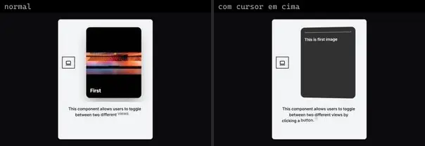 | **Swap Card** `animata:card/swap-card` | UI base | animata · MIT | lucide-react |
|  | **Text Flip** `animata:text/text-flip` | UI base | animata · MIT | — |
| 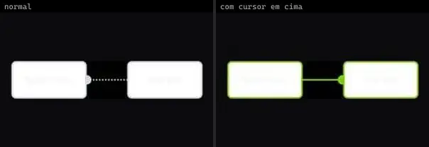 | **Web Hooks** `animata:card/webhooks-card` | UI base | animata · MIT | — |
| 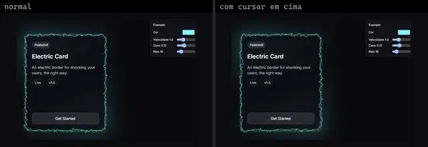 | **ElectricBorder** `atlas:Cards/ElectricBorder` | UI base | atlas (própria) · Proprietária (Atlas) | — |
|  | **GlareCard** `atlas:Cards/GlareCard` | UI base | atlas (própria) · Proprietária (Atlas) | — |
| 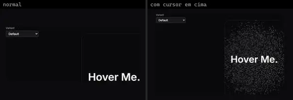 | **PixelCard** `atlas:Cards/PixelCard` | UI base | atlas (própria) · Proprietária (Atlas) | tailwind-merge |
| 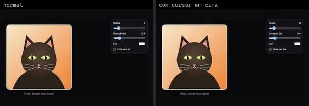 | **PixelTransition** `atlas:Cards/PixelTransition` | UI base | atlas (própria) · Proprietária (Atlas) | — |
|  | **SpotlightPanel** `atlas:Cards/SpotlightPanel` | UI base | atlas (própria) · Proprietária (Atlas) | clsx, lucide-react, tailwind-merge |
| 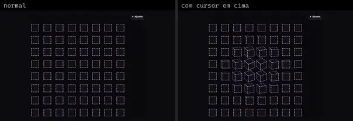 | **TiltCubes** `atlas:Interactions/TiltCubes` | UI base | atlas (própria) · Proprietária (Atlas) | — |
|  | **Flip Card** `bundui:flip-card` | UI base | bundui · MIT | motion |
|  | **Parallax Cards** `bundui:parallax-cards` | UI base | bundui · MIT | @radix-ui/react-slot, class-variance-authority, lenis, lucide-react, motion |
| 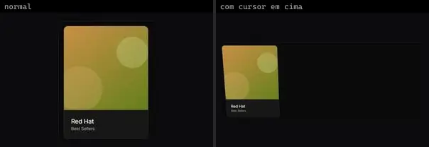 | **Tilt Effect** `bundui:tilt-effect` | UI base | bundui · MIT | motion |
|  | **Cutout Card** `cultui:cutout-card-demo` | UI base | cultui · MIT | @radix-ui/react-use-controllable-state, motion |
|  | **Folded Card** `cultui:folded-card-demo` | UI base | cultui · MIT | lucide-react |
|  | **Halo Card** `cultui:halo-card-demo` | UI base | cultui · MIT | @base-ui/react, lucide-react, motion |
| 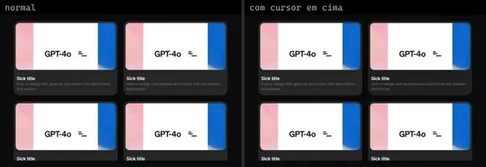 | **Minimal Card** `cultui:minimal-card-demo` | UI base | cultui · MIT | — |
| 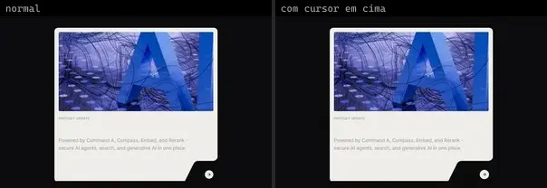 | **Organic Card** `cultui:organic-card-demo` | UI base | cultui · MIT | lucide-react |
|  | **Shadow Card** `cultui:shadow-card-demo` | UI base | cultui · MIT | @radix-ui/react-slot |
| 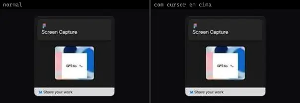 | **Shift Card** `cultui:shift-card-demo` | UI base | cultui · MIT | @radix-ui/react-slot, class-variance-authority, motion |
|  | **Holographic Card** `eldoraui:holographic-card-demo` | UI base | eldoraui · MIT | motion |
|  | **Holographic Card Demo 2** `eldoraui:holographic-card-demo-2` | UI base | eldoraui · MIT | motion |
|  | **Holographic Card Demo 3** `eldoraui:holographic-card-demo-3` | UI base | eldoraui · MIT | motion |
|  | **Stacking Cards** `fancy:blocks/stacking-cards-demo` | UI base | fancy · MIT | clsx, motion, tailwind-merge |
| 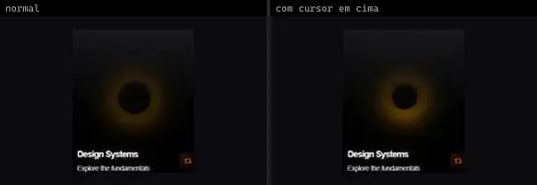 | **Card Flip** `kokonutui:card-flip` | UI base | kokonutui · MIT | clsx, lucide-react, tailwind-merge |
| 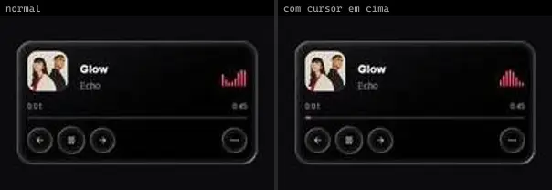 | **Liquid Glass Card** `kokonutui:liquid-glass-card` | UI base | kokonutui · MIT | @radix-ui/react-slot, class-variance-authority, clsx, lucide-react, tailwind-merge |
|  | **Mouse Effect Card** `kokonutui:mouse-effect-card` | UI base | kokonutui · MIT | @radix-ui/react-slot, class-variance-authority, clsx, motion, tailwind-merge |
|  | **Spotlight Cards** `kokonutui:spotlight-cards` | UI base | kokonutui · MIT | clsx, lucide-react, motion, tailwind-merge |
|  | **Tweet Card** `kokonutui:tweet-card` | UI base | kokonutui · MIT | clsx, lucide-react, tailwind-merge |
|  | **Glare Hover** `magicui:glare-hover-demo` | UI base | magicui · MIT | — |
|  | **Magic Card** `magicui:magic-card-demo` | UI base | magicui · MIT | motion, next-themes |
|  | **Magic Card 2** `magicui:magic-card-demo2` | UI base | magicui · MIT | motion, next-themes |
| 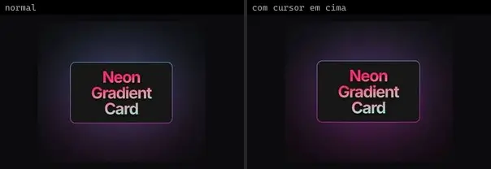 | **Neon Gradient Card** `magicui:neon-gradient-card-demo` | UI base | magicui · MIT | — |
|  | **Border Trail Card 1** `motionprimitives:border-trail/border-trail-card-1` | UI base | motionprimitives · MIT | motion |
|  | **Border Trail Card 2** `motionprimitives:border-trail/border-trail-card-2` | UI base | motionprimitives · MIT | clsx, motion, tailwind-merge |
|  | **Glow Effect Card Mode** `motionprimitives:glow-effect/glow-effect-card-mode` | UI base | motionprimitives · MIT | motion |
| 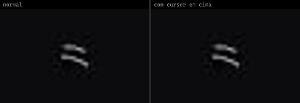 | **Spotlight Basic** `motionprimitives:spotlight/spotlight-basic` | UI base | motionprimitives · MIT | motion |
| 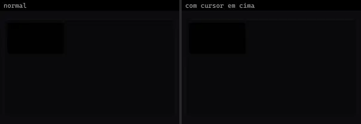 | **Spotlight Border** `motionprimitives:spotlight/spotlight-border` | UI base | motionprimitives · MIT | motion |
|  | **Spotlight Custom Color** `motionprimitives:spotlight/spotlight-custom-color` | UI base | motionprimitives · MIT | motion |
|  | **Tilt Card 1** `motionprimitives:tilt/tilt-card-1` | UI base | motionprimitives · MIT | motion |
|  | **Tilt Spotlight** `motionprimitives:tilt/tilt-spotlight` | UI base | motionprimitives · MIT | motion |
|  | **Holo Card** `motiq:holo-card` | UI base | motiq · MIT | — |
|  | **Card Swipe Deck** `smoothui:card-swipe-deck` | UI base | smoothui · MIT | @radix-ui/react-slot, @repo/shadcn-ui, @repo/smoothui, @smoothui/data, class-variance-authority, lucide-react, motion |
| 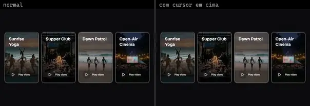 | **Expandable Cards** `smoothui:expandable-cards` | UI base | smoothui · MIT | @docs/examples, @repo/smoothui, @smoothui/data, lucide-react, motion |
| 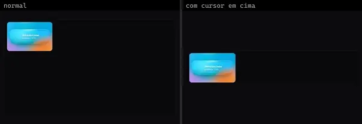 | **Glass Card** `smoothui:canvas/glass-card` | UI base | smoothui · MIT | @repo/shadcn-ui, @repo/smoothui, motion |
|  | **Glass Card** `smoothui:glass-card` | UI base | smoothui · MIT | @radix-ui/react-slot, @repo/shadcn-ui, @repo/smoothui, class-variance-authority, lucide-react, motion |
| 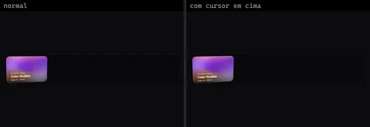 | **Tilt Card** `smoothui:canvas/tilt-card` | UI base | smoothui · MIT | @docs/examples, @repo/shadcn-ui, @repo/smoothui, motion |
| 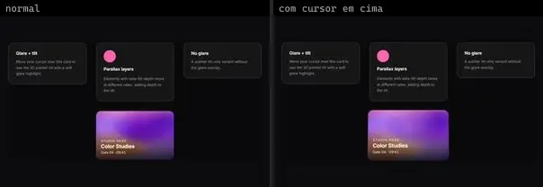 | **Tilt Card** `smoothui:tilt-card` | UI base | smoothui · MIT | @docs/examples, @repo/shadcn-ui, @repo/smoothui, motion |
|  | **Tweet Card** `smoothui:tweet-card` | UI base | smoothui · MIT | @repo/smoothui |
|  | **Tweet Card Top** `smoothui:tweet-card-top` | UI base | smoothui · MIT · ⚠needs-network | @repo/smoothui |
|  | **Wallet Card** `smoothui:canvas/wallet-card` | UI base | smoothui · MIT | @repo/shadcn-ui, @repo/smoothui, @smoothui/data, lucide-react, motion |
|  | **Wallet Card** `smoothui:wallet-card` | UI base | smoothui · MIT | @radix-ui/react-slot, @repo/shadcn-ui, @repo/smoothui, @smoothui/data, class-variance-authority, lucide-react, motion |
|  | **Card Customizer** `spectrumui:card-customizer` | UI base | spectrumui · Apache-2.0 | @radix-ui/react-slot, class-variance-authority, lucide-react |
|  | **Cards** `spectrumui:cards` | UI base | spectrumui · Apache-2.0 | @radix-ui/react-avatar, @radix-ui/react-label, @radix-ui/react-slot, @remixicon/react, @tabler/icons-react, class-variance-authority, lucide-react |
|  | **Scratch Card** `spectrumui:scratch-card` | UI base | spectrumui · Apache-2.0 · ⚠needs-props | clsx, framer-motion, tailwind-merge |
|  | **Tilt Card** `spectrumui:tilt-card` | UI base | spectrumui · Apache-2.0 · ⚠needs-props | clsx, framer-motion, tailwind-merge |
|  | **Transfer Funds Card** `spectrumui:transfer-funds-card` | UI base | spectrumui · Apache-2.0 | clsx, lucide-react, motion, tailwind-merge |
| 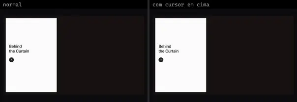 | **Card Curtain Reveal** `systaliko:cards/card-curtain-reveal` | UI base | systaliko · MIT | @radix-ui/react-slot, class-variance-authority, clsx, lucide-react |
|  | **Card Flip** `systaliko:cards/card-flip` | UI base | systaliko · MIT | @radix-ui/react-slot, class-variance-authority, motion |
|  | **Card Hover Reveal** `systaliko:cards/card-hover-reveal` | UI base | systaliko · MIT | — |
|  | **Card Hover Reveal Full** `systaliko:cards/card-hover-reveal-full` | UI base | systaliko · MIT | @radix-ui/react-slot, class-variance-authority, lucide-react |
| 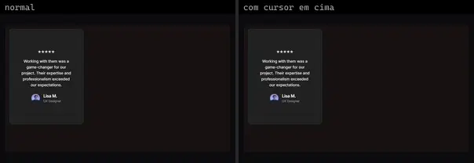 | **Card Testimonial** `systaliko:cards/card-testimonial` | UI base | systaliko · MIT | class-variance-authority |
|  | **Card Testimonial 2** `systaliko:cards/card-testimonial-2` | UI base | systaliko · MIT | class-variance-authority, lucide-react |
| 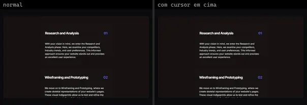 | **Cards Stack** `systaliko:cards/cards-stack` | UI base | systaliko · MIT | class-variance-authority, motion |
| 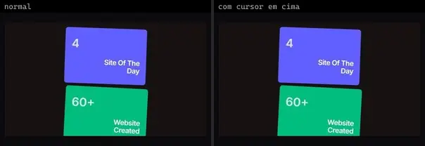 | **Cards Stack Achievements** `systaliko:cards/cards-stack-achievements` | UI base | systaliko · MIT | class-variance-authority, motion |
|  | **Cards Stack Rotated** `systaliko:cards/cards-stack-rotated` | UI base | systaliko · MIT | class-variance-authority, motion |
|  | **Cards Stack Rotated Recognitions** `systaliko:cards/cards-stack-rotated-recognitions` | UI base | systaliko · MIT | class-variance-authority, motion |
| 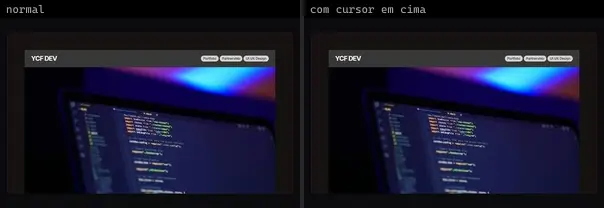 | **Cards Stack Work** `systaliko:cards/cards-stack-work` | UI base | systaliko · MIT | @radix-ui/react-slot, class-variance-authority, motion |
| 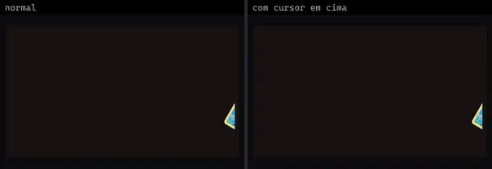 | **Circle Cards** `systaliko:scroll-animations/circle-cards` | UI base | systaliko · MIT | clsx, motion |
| 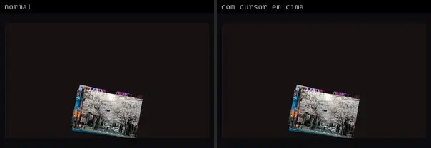 | **Distributed Cards** `systaliko:scroll-animations/distributed-cards` | UI base | systaliko · MIT | clsx, motion |
| 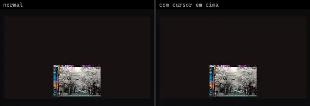 | **Distributed Cards 2** `systaliko:scroll-animations/distributed-cards-2` | UI base | systaliko · MIT | clsx, motion |
| 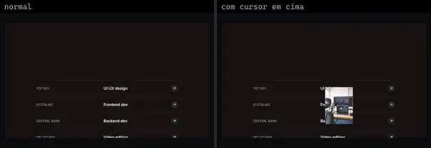 | **Hover Preview** `systaliko:cards/hover-preview` | UI base | systaliko · MIT | lucide-react, motion |
| 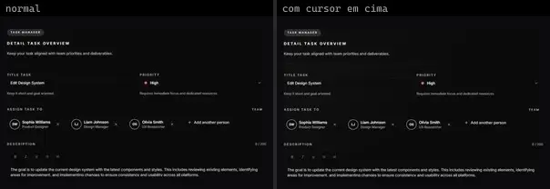 | **Detail Task** `uitripled:components/cards/shadcnui/detail-task` | UI base | uitripled · MIT | @radix-ui/react-dropdown-menu, @radix-ui/react-slot, class-variance-authority, framer-motion, lucide-react |
|  | **Glass Wallet Card** `uitripled:components/cards/shadcnui/glass-wallet-card` | UI base | uitripled · MIT | class-variance-authority, framer-motion, lucide-react |
|  | **Project Card** `uitripled:components/cards/shadcnui/project-card` | UI base | uitripled · MIT | class-variance-authority, framer-motion, lucide-react |
|  | **Resume Card** `uitripled:components/resumes/shadcnui/resume-card` | UI base | uitripled · MIT | @radix-ui/react-avatar, @radix-ui/react-separator, @radix-ui/react-slot, class-variance-authority, framer-motion, lucide-react |
|  | **Afraid Bulldog · Na3ar-17** `uiverse:Cards/Na3ar-17_afraid-bulldog-66` | UI base | uiverse · MIT | — |
|  | **Ancient Pug · Toseef-Ahmad** `uiverse:Cards/Toseef-Ahmad_ancient-pug-90` | UI base | uiverse · MIT | — |
| 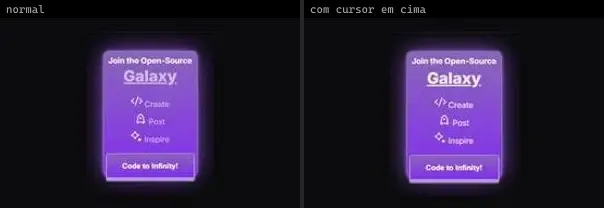 | **Angry Ladybug · ZeroKaarma** `uiverse:Cards/ZeroKaarma_angry-ladybug-41` | UI base | uiverse · MIT | — |
| 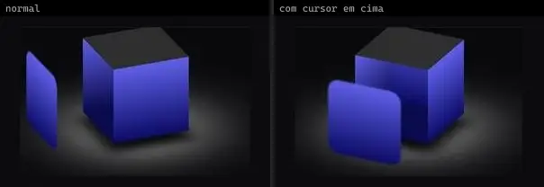 | **Angry Wombat · Saad3092003** `uiverse:Cards/Saad3092003_angry-wombat-84` | UI base | uiverse · MIT | — |
| 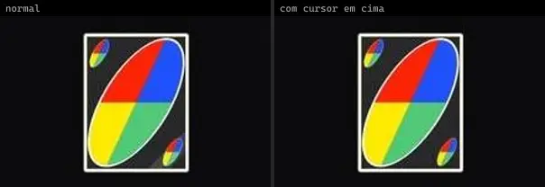 | **Average Goat · nanda248** `uiverse:Cards/nanda248_average-goat-70` | UI base | uiverse · MIT | — |
| 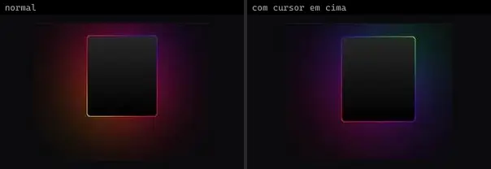 | **Bitter Fireant · JaydipPrajapati1910** `uiverse:Cards/JaydipPrajapati1910_bitter-fireant-97` | UI base | uiverse · MIT | — |
|  | **Black Lizard · Praashoo7** `uiverse:Cards/Praashoo7_black-lizard-62` | UI base | uiverse · MIT | — |
|  | **Black Rabbit · JohnnyCSilva** `uiverse:Cards/JohnnyCSilva_black-rabbit-68` | UI base | uiverse · MIT | — |
| 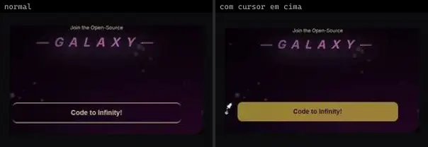 | **Blue Wombat · krokettenkoal** `uiverse:Cards/krokettenkoal_blue-wombat-33` | UI base | uiverse · MIT | — |
| 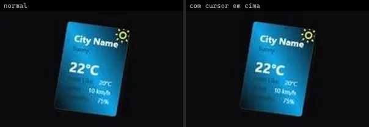 | **Brave Fireant · Javierrocadev** `uiverse:Cards/Javierrocadev_brave-fireant-77` | UI base | uiverse · MIT | — |
| 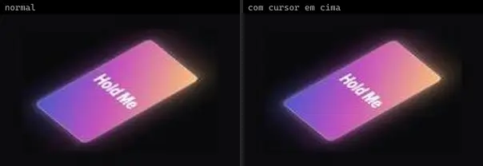 | **Brave Grasshopper · htwarriors108** `uiverse:Cards/htwarriors108_brave-grasshopper-38` | UI base | uiverse · MIT | — |
| 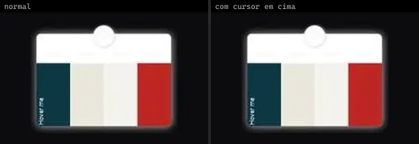 | **Brave Kangaroo · Tsiangana** `uiverse:Cards/Tsiangana_brave-kangaroo-28` | UI base | uiverse · MIT | — |
|  | **Chatty Bear · VashonG** `uiverse:Cards/VashonG_chatty-bear-22` | UI base | uiverse · MIT | — |
| 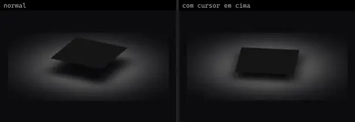 | **Chatty Rabbit · Saad3092003** `uiverse:Cards/Saad3092003_chatty-rabbit-71` | UI base | uiverse · MIT | — |
|  | **Chatty Walrus · jamik-dev** `uiverse:Cards/jamik-dev_chatty-walrus-78` | UI base | uiverse · MIT | — |
| 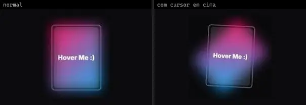 | **Clever Swan · htwarriors108** `uiverse:Cards/htwarriors108_clever-swan-80` | UI base | uiverse · MIT | — |
|  | **Cold Elephant · Yaya12085** `uiverse:Cards/Yaya12085_cold-elephant-65` | UI base | uiverse · MIT | — |
|  | **Cold Frog · IWhat1** `uiverse:Cards/IWhat1_cold-frog-10` | UI base | uiverse · MIT | — |
| 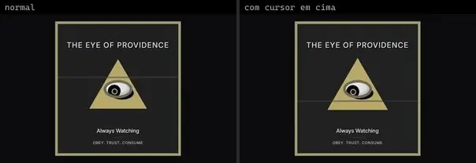 | **Cold Tiger · 0xnihilism** `uiverse:Cards/0xnihilism_cold-tiger-22` | UI base | uiverse · MIT | — |
|  | **Curvy Fox · IWhat1** `uiverse:Cards/IWhat1_curvy-fox-39` | UI base | uiverse · MIT | — |
|  | **Curvy Gecko · StealthWorm** `uiverse:Cards/StealthWorm_curvy-gecko-61` | UI base | uiverse · MIT | — |
| 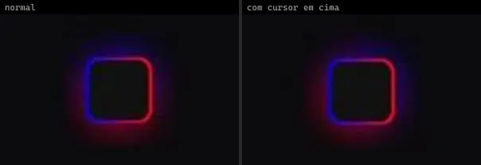 | **Dangerous Donkey · yariklnv** `uiverse:Cards/yariklnv_dangerous-donkey-85` | UI base | uiverse · MIT | — |
|  | **Dangerous Shrimp · ProgramaConPid** `uiverse:Cards/ProgramaConPid_dangerous-shrimp-68` | UI base | uiverse · MIT | — |
|  | **Dull Impala · JkHuger** `uiverse:Cards/JkHuger_dull-impala-9` | UI base | uiverse · MIT | — |
| 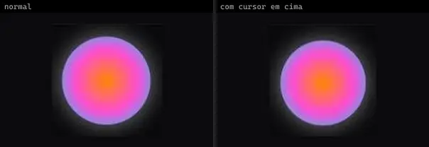 | **Empty Mule · StefanR1901** `uiverse:Cards/StefanR1901_empty-mule-38` | UI base | uiverse · MIT | — |
|  | **Empty Otter · MijailVillegas** `uiverse:Cards/MijailVillegas_empty-otter-85` | UI base | uiverse · MIT | — |
|  | **Fast Badger · MuhammadHasann** `uiverse:Cards/MuhammadHasann_fast-badger-70` | UI base | uiverse · MIT | — |
|  | **Fat Horse · Praashoo7** `uiverse:Cards/Praashoo7_fat-horse-65` | UI base | uiverse · MIT | — |
|  | **Foolish Vampirebat · aadium** `uiverse:Cards/aadium_foolish-vampirebat-5` | UI base | uiverse · MIT | — |
|  | **Fresh Wombat · ElSombrero2** `uiverse:Cards/ElSombrero2_fresh-wombat-97` | UI base | uiverse · MIT | — |
|  | **Funny Cobra · Javierrocadev** `uiverse:Cards/Javierrocadev_funny-cobra-5` | UI base | uiverse · MIT | — |
|  | **Fuzzy Bullfrog · KhaledMatalkah** `uiverse:Cards/KhaledMatalkah_fuzzy-bullfrog-8` | UI base | uiverse · MIT | — |
|  | **Giant Newt · ayman-ashine** `uiverse:Cards/ayman-ashine_giant-newt-7` | UI base | uiverse · MIT | — |
|  | **Good Crab · G4b413l** `uiverse:Cards/G4b413l_good-crab-75` | UI base | uiverse · MIT | — |
|  | **Good Sheep · Javierrocadev** `uiverse:Cards/Javierrocadev_good-sheep-89` | UI base | uiverse · MIT | — |
|  | **Great Cheetah · escannord** `uiverse:Cards/escannord_great-cheetah-66` | UI base | uiverse · MIT | — |
|  | **Great Swan · Javierrocadev** `uiverse:Cards/Javierrocadev_great-swan-88` | UI base | uiverse · MIT | — |
|  | **Grumpy Swan · vishnu1100** `uiverse:Cards/vishnu1100_grumpy-swan-28` | UI base | uiverse · MIT | — |
|  | **Happy Insect · VashonG** `uiverse:Cards/VashonG_happy-insect-24` | UI base | uiverse · MIT | — |
|  | **Heavy Goose · John-CFO** `uiverse:Cards/John-CFO_heavy-goose-49` | UI base | uiverse · MIT | — |
|  | **Heavy Horse · roroland** `uiverse:Cards/roroland_heavy-horse-27` | UI base | uiverse · MIT | — |
|  | **Helpless Fly · tofe812** `uiverse:Cards/tofe812_helpless-fly-63` | UI base | uiverse · MIT | — |
|  | **Honest Grasshopper · Pranali9922** `uiverse:Cards/Pranali9922_honest-grasshopper-12` | UI base | uiverse · MIT | — |
|  | **Hot Swan · Yaya12085** `uiverse:Cards/Yaya12085_hot-swan-8` | UI base | uiverse · MIT | — |
|  | **Itchy Starfish · Saad3092003** `uiverse:Cards/Saad3092003_itchy-starfish-99` | UI base | uiverse · MIT | — |
|  | **Jolly Bulldog · Praashoo7** `uiverse:Cards/Praashoo7_jolly-bulldog-31` | UI base | uiverse · MIT | — |
|  | **Jolly Snail · sofiapetushok** `uiverse:Cards/sofiapetushok_jolly-snail-62` | UI base | uiverse · MIT | — |
|  | **Lazy Dingo · escannord** `uiverse:Cards/escannord_lazy-dingo-11` | UI base | uiverse · MIT | — |
|  | **Lazy Goose · Lakshay-art** `uiverse:Cards/Lakshay-art_lazy-goose-42` | UI base | uiverse · MIT | — |
|  | **Lazy Jellyfish · SRIMANKS** `uiverse:Cards/SRIMANKS_lazy-jellyfish-5` | UI base | uiverse · MIT | — |
|  | **Light Monkey · escannord** `uiverse:Cards/escannord_light-monkey-9` | UI base | uiverse · MIT | — |
|  | **Light Squid · Shoh2008** `uiverse:Cards/Shoh2008_light-squid-68` | UI base | uiverse · MIT | — |
|  | **Light Termite · Lakshay-art** `uiverse:Cards/Lakshay-art_light-termite-47` | UI base | uiverse · MIT | — |
|  | **Loud Turkey · Pradeepsaranbishnoi** `uiverse:Cards/Pradeepsaranbishnoi_loud-turkey-91` | UI base | uiverse · MIT | — |
|  | **Lovely Bear · Tsiangana** `uiverse:Cards/Tsiangana_lovely-bear-22` | UI base | uiverse · MIT | — |
|  | **Lucky Cat · srinivasaiml** `uiverse:Cards/srinivasaiml_lucky-cat-7` | UI base | uiverse · MIT | — |
|  | **Lucky Lionfish · jeremyssocial** `uiverse:Cards/jeremyssocial_lucky-lionfish-47` | UI base | uiverse · MIT | — |
|  | **Mighty Goat · Nayzerftn** `uiverse:Cards/Nayzerftn_mighty-goat-69` | UI base | uiverse · MIT | — |
|  | **Modern Monkey · Tsiangana** `uiverse:Cards/Tsiangana_modern-monkey-77` | UI base | uiverse · MIT | — |
|  | **Moody Owl · Spacious74** `uiverse:Cards/Spacious74_moody-owl-18` | UI base | uiverse · MIT | — |
|  | **Nasty Zebra · SmookyDev** `uiverse:Cards/SmookyDev_nasty-zebra-5` | UI base | uiverse · MIT | — |
|  | **Neat Cobra · Peary74** `uiverse:Cards/Peary74_neat-cobra-65` | UI base | uiverse · MIT | — |
|  | **Neat Jellyfish · csozidev** `uiverse:Cards/csozidev_neat-jellyfish-86` | UI base | uiverse · MIT | — |
|  | **Neat Tiger · nanda248** `uiverse:Cards/nanda248_neat-tiger-26` | UI base | uiverse · MIT | — |
|  | **New Goose · joe-herbert** `uiverse:Cards/joe-herbert_new-goose-94` | UI base | uiverse · MIT | — |
|  | **Odd Eagle · xantha01** `uiverse:Cards/xantha01_odd-eagle-16` | UI base | uiverse · MIT | — |
|  | **Odd Turtle · htwarriors108** `uiverse:Cards/htwarriors108_odd-turtle-69` | UI base | uiverse · MIT | — |
|  | **Old Sloth · Mizohack** `uiverse:Cards/Mizohack_old-sloth-96` | UI base | uiverse · MIT | — |
|  | **Ordinary Mouse · FWDJc** `uiverse:Cards/FWDJc_ordinary-mouse-22` | UI base | uiverse · MIT | — |
|  | **Perfect Crab · andrew-demchenk0** `uiverse:Cards/andrew-demchenk0_perfect-crab-47` | UI base | uiverse · MIT | — |
|  | **Polite Cat · omar-alghaish** `uiverse:Cards/omar-alghaish_polite-cat-34` | UI base | uiverse · MIT | — |
|  | **Polite Deer · Dalyn-Liu** `uiverse:Cards/Dalyn-Liu_polite-deer-52` | UI base | uiverse · MIT | — |
|  | **Polite Puma · SmookyDev** `uiverse:Cards/SmookyDev_polite-puma-22` | UI base | uiverse · MIT | — |
|  | **Popular Lionfish · Praashoo7** `uiverse:Cards/Praashoo7_popular-lionfish-100` | UI base | uiverse · MIT | — |
|  | **Popular Starfish · ahmedgamal-hub** `uiverse:Cards/ahmedgamal-hub_popular-starfish-56` | UI base | uiverse · MIT | — |
|  | **Proud Fish · htwarriors108** `uiverse:Cards/htwarriors108_proud-fish-6` | UI base | uiverse · MIT | — |
|  | **Quick Frog · AmIt-DasIT** `uiverse:Cards/AmIt-DasIT_quick-frog-32` | UI base | uiverse · MIT | — |
|  | **Quick Panther · sabbircoder07** `uiverse:Cards/sabbircoder07_quick-panther-36` | UI base | uiverse · MIT | — |
|  | **Rare Quail · csozidev** `uiverse:Cards/csozidev_rare-quail-42` | UI base | uiverse · MIT | — |
|  | **Selfish Bobcat · eslam-hany** `uiverse:Cards/eslam-hany_selfish-bobcat-73` | UI base | uiverse · MIT | — |
|  | **Serious Lion · yaroslavas2001** `uiverse:Cards/yaroslavas2001_serious-lion-49` | UI base | uiverse · MIT | — |
|  | **Shaggy Pug · bociKond** `uiverse:Cards/bociKond_shaggy-pug-39` | UI base | uiverse · MIT | — |
|  | **Shy Cat · roroland** `uiverse:Cards/roroland_shy-cat-11` | UI base | uiverse · MIT | — |
|  | **Shy Puma · Lakshay-art** `uiverse:Cards/Lakshay-art_shy-puma-30` | UI base | uiverse · MIT | — |
|  | **Silent Rabbit · Praashoo7** `uiverse:Cards/Praashoo7_silent-rabbit-57` | UI base | uiverse · MIT | — |
|  | **Slimy Pug · iconicchandu** `uiverse:Cards/iconicchandu_slimy-pug-17` | UI base | uiverse · MIT | — |
|  | **Slippery Owl · MRez321** `uiverse:Cards/MRez321_slippery-owl-0` | UI base | uiverse · MIT | — |
|  | **Smart Liger · Smit-Prajapati** `uiverse:Cards/Smit-Prajapati_smart-liger-5` | UI base | uiverse · MIT | — |
|  | **Smooth Quail · ilkhoeri** `uiverse:Cards/ilkhoeri_smooth-quail-87` | UI base | uiverse · MIT | — |
|  | **Smooth Vampirebat · SelfMadeSystem** `uiverse:Cards/SelfMadeSystem_smooth-vampirebat-98` | UI base | uiverse · MIT | — |
|  | **Soft Dingo · Lakshay-art** `uiverse:Cards/Lakshay-art_soft-dingo-98` | UI base | uiverse · MIT | — |
|  | **Spotty Crab · Spacious74** `uiverse:Cards/Spacious74_spotty-crab-93` | UI base | uiverse · MIT | — |
|  | **Spotty Swan · JkHuger** `uiverse:Cards/JkHuger_spotty-swan-68` | UI base | uiverse · MIT | — |
|  | **Strong Earwig · EzzoHamdan** `uiverse:Cards/EzzoHamdan_strong-earwig-64` | UI base | uiverse · MIT | — |
|  | **Strong Ladybug · SanthoshSJ-Dev** `uiverse:Cards/SanthoshSJ-Dev_strong-ladybug-68` | UI base | uiverse · MIT | — |
|  | **Strong Mayfly · ShrinilDhorda** `uiverse:Cards/ShrinilDhorda_strong-mayfly-18` | UI base | uiverse · MIT | — |
|  | **Stupid Baboon · Javierrocadev** `uiverse:Cards/Javierrocadev_stupid-baboon-34` | UI base | uiverse · MIT | — |
|  | **Stupid Sloth · kennyotsu** `uiverse:Cards/kennyotsu_stupid-sloth-94` | UI base | uiverse · MIT | — |
|  | **Sweet Eel · andrew-demchenk0** `uiverse:Cards/andrew-demchenk0_sweet-eel-60` | UI base | uiverse · MIT | — |
|  | **Sweet Liger · Li-Deheng** `uiverse:Cards/Li-Deheng_sweet-liger-88` | UI base | uiverse · MIT | — |
|  | **Tame Pug · estefaniarizzo** `uiverse:Cards/estefaniarizzo_tame-pug-97` | UI base | uiverse · MIT | — |
|  | **Tasty Dodo · elijahgummer** `uiverse:Cards/elijahgummer_tasty-dodo-72` | UI base | uiverse · MIT | — |
|  | **Tasty Falcon · kennyotsu** `uiverse:Cards/kennyotsu_tasty-falcon-38` | UI base | uiverse · MIT | — |
|  | **Terrible Hound · Hoseinnaqvi** `uiverse:Cards/Hoseinnaqvi_terrible-hound-31` | UI base | uiverse · MIT | — |
|  | **Tidy Mole · sangmort** `uiverse:Cards/sangmort_tidy-mole-17` | UI base | uiverse · MIT | — |
|  | **Tiny Firefox · csemszepp** `uiverse:Cards/csemszepp_tiny-firefox-14` | UI base | uiverse · MIT | — |
|  | **Tough Fireant · Javierrocadev** `uiverse:Cards/Javierrocadev_tough-fireant-65` | UI base | uiverse · MIT | — |
|  | **Tough Impala · RozheenNM** `uiverse:Cards/RozheenNM_tough-impala-7` | UI base | uiverse · MIT | — |
|  | **Tricky Lionfish · Smit-Prajapati** `uiverse:Cards/Smit-Prajapati_tricky-lionfish-78` | UI base | uiverse · MIT | — |
|  | **Tricky Robin · ElSombrero2** `uiverse:Cards/ElSombrero2_tricky-robin-67` | UI base | uiverse · MIT | — |
|  | **Ugly Horse · sohoning** `uiverse:Cards/sohoning_ugly-horse-87` | UI base | uiverse · MIT | — |
|  | **Ugly Lion · codebykay101** `uiverse:Cards/codebykay101_ugly-lion-23` | UI base | uiverse · MIT | — |
|  | **Wet Goose · vikas7754** `uiverse:Cards/vikas7754_wet-goose-61` | UI base | uiverse · MIT | — |
|  | **Wet Treefrog · shlomo20** `uiverse:Cards/shlomo20_wet-treefrog-28` | UI base | uiverse · MIT | — |
|  | **Wicked Baboon · shadowfax29** `uiverse:Cards/shadowfax29_wicked-baboon-62` | UI base | uiverse · MIT | — |
|  | **Wise Quail · joe-watson-sbf** `uiverse:Cards/joe-watson-sbf_wise-quail-35` | UI base | uiverse · MIT | — |
|  | **Witty Deer · kennyotsu** `uiverse:Cards/kennyotsu_witty-deer-12` | UI base | uiverse · MIT | — |
|  | **Wonderful Bobcat · Javierrocadev** `uiverse:Cards/Javierrocadev_wonderful-bobcat-57` | UI base | uiverse · MIT | — |
|  | **Wonderful Liger · AnnixArt** `uiverse:Cards/AnnixArt_wonderful-liger-82` | UI base | uiverse · MIT | — |
|  | **Young Frog · david-mohseni** `uiverse:Cards/david-mohseni_young-frog-89` | UI base | uiverse · MIT | — |
|  | **Young Otter · FoxVidaan** `uiverse:Cards/FoxVidaan_young-otter-32` | UI base | uiverse · MIT | — |
