# Chat & IA (87)

Prévia: estado normal | com o cursor em cima. Código: `node scripts/atlas-find.mjs code <uid>` ou os arquivos em `catalog.jsonl → files`.

| prévia | componente | tipo de aplicação | biblioteca · licença | dependências npm |
|---|---|---|---|---|
|  | **Ai Button** `animata:button/ai-button` | IA & Chat | animata · MIT | @tsparticles/engine, @tsparticles/react, lucide-react, tsparticles |
| 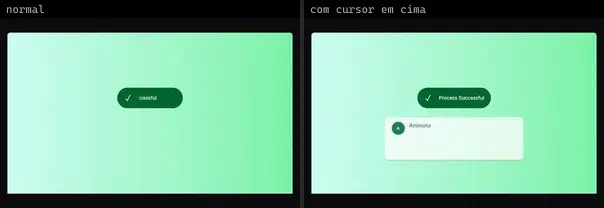 | **Confirmation Message** `animata:feature-cards/confirmation-message` | IA & Chat | animata · MIT | motion |
|  | **Text Explode Imessage** `animata:text/text-explode-imessage` | IA & Chat | animata · MIT | motion |
| 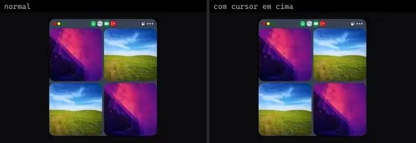 | **Video Chat** `animata:widget/video-chat` | IA & Chat | animata · MIT | lucide-react, motion |
| 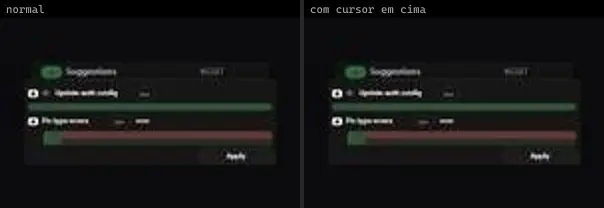 | **Agent Suggest Card Stack** `cultui:agent-suggest-card-stack-demo` | IA & Chat | cultui · MIT | — |
| 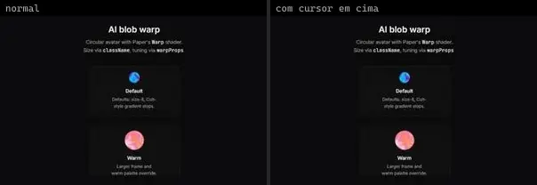 | **Ai Blob Warp** `cultui:ai-blob-warp-demo` | IA & Chat | cultui · MIT | @paper-design/shaders-react, motion |
|  | **Ai Instructions** `cultui:ai-instructions-demo` | IA & Chat | cultui · MIT | @hugeicons/core-free-icons, @hugeicons/react |
| 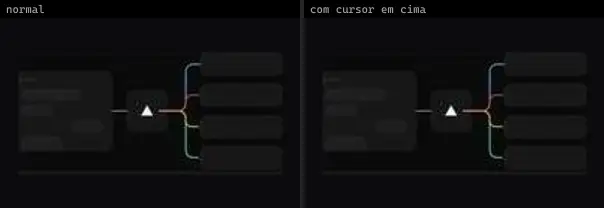 | **Fluid Ai Workloads** `cultui:fluid-ai-workloads-demo` | IA & Chat | cultui · MIT | — |
| 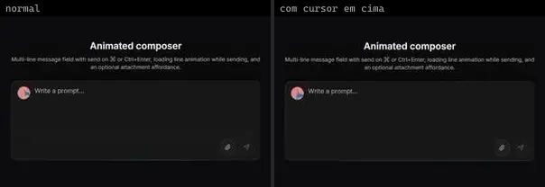 | **Prompt Composer** `cultui:prompt-composer-demo` | IA & Chat | cultui · MIT | @base-ui/react, @paper-design/shaders-react, lucide-react, motion |
| 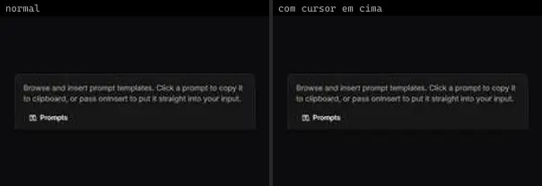 | **Prompt Library** `cultui:prompt-library-demo` | IA & Chat | cultui · MIT | @hugeicons/core-free-icons, @hugeicons/react |
| 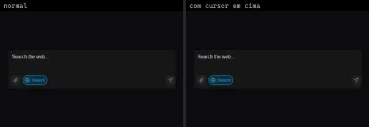 | **Ai Input Search** `kokonutui:ai-input-search` | IA & Chat | kokonutui · MIT | clsx, lucide-react, motion, tailwind-merge |
| 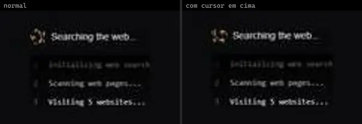 | **Ai Loading** `kokonutui:ai-loading` | IA & Chat | kokonutui · MIT | — |
|  | **Ai Prompt** `kokonutui:ai-prompt` | IA & Chat | kokonutui · MIT | @radix-ui/react-dropdown-menu, @radix-ui/react-slot, class-variance-authority, lucide-react, motion |
|  | **Ai Text Loading** `kokonutui:ai-text-loading` | IA & Chat | kokonutui · MIT | clsx, motion, tailwind-merge |
| 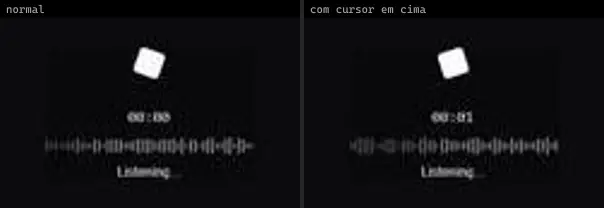 | **Ai Voice** `kokonutui:ai-voice` | IA & Chat | kokonutui · MIT | clsx, lucide-react, tailwind-merge |
|  | **Agent Operations Hero** `motiq:agent-operations-hero` | IA & Chat | motiq · MIT | — |
|  | **Agent Operations Hero** `motiq:catalog/agent-operations-hero` | IA & Chat | motiq · MIT | — |
| 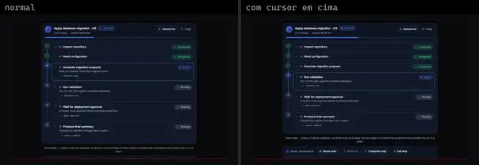 | **Agent Run Timeline** `motiq:agent-run-timeline` | IA & Chat | motiq · MIT | motion |
| 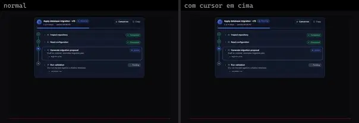 | **Agent Run Timeline** `motiq:catalog/agent-run-timeline` | IA & Chat | motiq · MIT | motion |
| 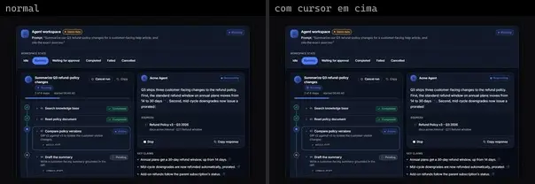 | **Ai Agent Workspace** `motiq:ai-agent-workspace` | IA & Chat | motiq · MIT | — |
| 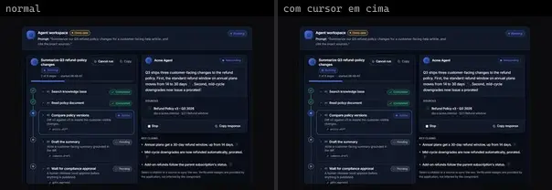 | **Ai Agent Workspace** `motiq:catalog/ai-agent-workspace` | IA & Chat | motiq · MIT | — |
| 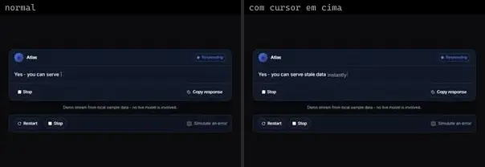 | **Ai Response Stream** `motiq:ai-response-stream` | IA & Chat | motiq · MIT | motion |
| 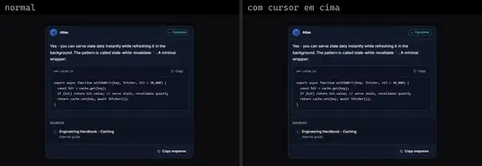 | **Ai Response Stream** `motiq:catalog/ai-response-stream` | IA & Chat | motiq · MIT | motion |
|  | **Message Delivery States** `motiq:catalog/message-delivery-states` | IA & Chat | motiq · MIT | motion |
|  | **Message Delivery States** `motiq:message-delivery-states` | IA & Chat | motiq · MIT | motion |
| 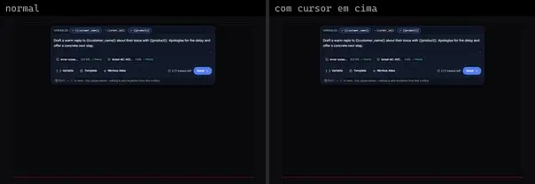 | **Prompt Composer** `motiq:catalog/prompt-composer` | IA & Chat | motiq · MIT | motion |
| 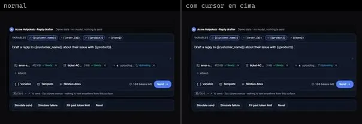 | **Prompt Composer** `motiq:prompt-composer` | IA & Chat | motiq · MIT | @radix-ui/react-dialog, motion |
| 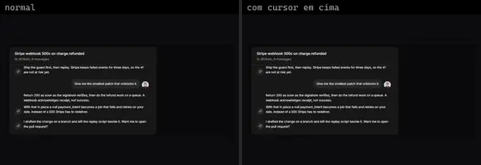 | **Message Scroller 1** `reui:message-scroller/c-message-scroller-1` | IA & Chat | reui · MIT | @shadcn/react, class-variance-authority, cn, radix-ui |
| 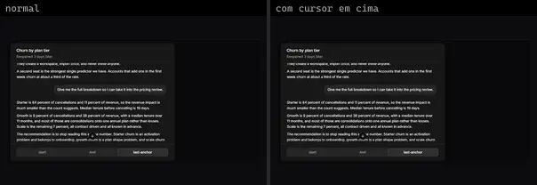 | **Message Scroller 4** `reui:message-scroller/c-message-scroller-4` | IA & Chat | reui · MIT | @shadcn/react, class-variance-authority, cn, radix-ui |
| 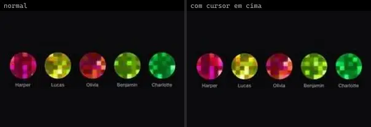 | **Agent Avatar** `smoothui:agent-avatar` | IA & Chat | smoothui · MIT | @repo/shadcn-ui, @repo/smoothui |
| 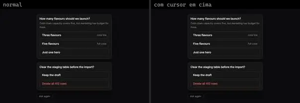 | **Ai Approval** `smoothui:ai-approval` | IA & Chat | smoothui · MIT | @repo/shadcn-ui, @repo/smoothui, lucide-react, motion |
| 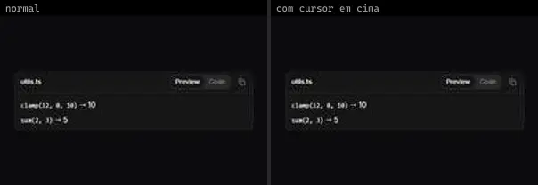 | **Ai Artifact** `smoothui:ai-artifact` | IA & Chat | smoothui · MIT | @repo/shadcn-ui, @repo/smoothui, lucide-react, motion |
| 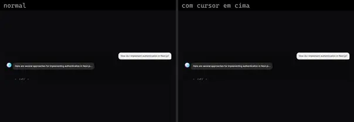 | **Ai Branch** `smoothui:ai-branch` | IA & Chat | smoothui · MIT | @repo/shadcn-ui, @repo/smoothui, lucide-react, motion |
| 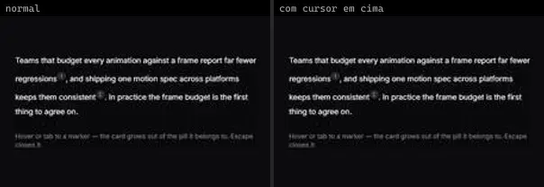 | **Ai Citation** `smoothui:ai-citation` | IA & Chat | smoothui · MIT | @repo/shadcn-ui, @repo/smoothui, lucide-react, motion |
| 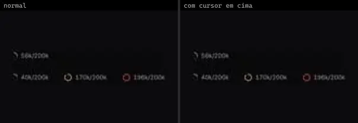 | **Ai Context Meter** `smoothui:ai-context-meter` | IA & Chat | smoothui · MIT | @repo/shadcn-ui, @repo/smoothui, motion |
| 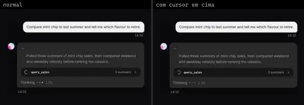 | **Ai Conversation** `smoothui:ai-conversation` | IA & Chat | smoothui · MIT | @repo/shadcn-ui, @repo/smoothui, lucide-react, motion |
| 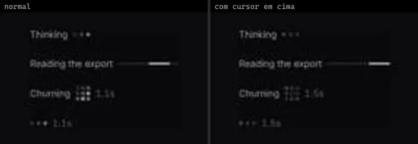 | **Ai Loader** `smoothui:ai-loader` | IA & Chat | smoothui · MIT | @repo/shadcn-ui, @repo/smoothui, motion |
|  | **Ai Message** `smoothui:ai-message` | IA & Chat | smoothui · MIT | @repo/shadcn-ui, @repo/smoothui, lucide-react, motion |
| 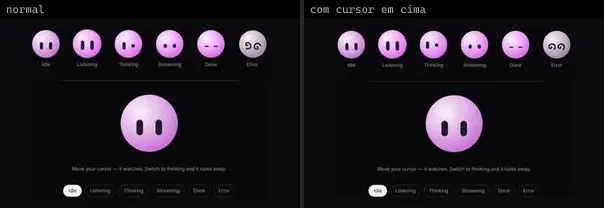 | **Ai Orb Face** `smoothui:ai-orb-face` | IA & Chat | smoothui · MIT | @repo/shadcn-ui, @repo/smoothui, motion |
|  | **Ai Orb Face** `smoothui:canvas/ai-orb-face` | IA & Chat | smoothui · MIT | @repo/shadcn-ui, @repo/smoothui, motion |
|  | **Ai Prompt Input** `smoothui:ai-prompt-input` | IA & Chat | smoothui · MIT | @repo/shadcn-ui, @repo/smoothui, lucide-react, motion |
| 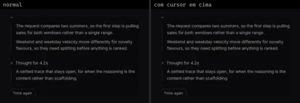 | **Ai Reasoning** `smoothui:ai-reasoning` | IA & Chat | smoothui · MIT | @repo/shadcn-ui, @repo/smoothui, lucide-react, motion |
| 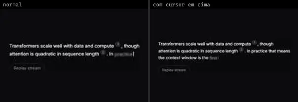 | **Ai Response** `smoothui:ai-response` | IA & Chat | smoothui · MIT | @repo/shadcn-ui, @repo/smoothui, motion |
| 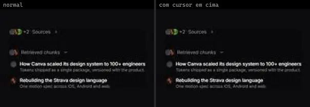 | **Ai Sources** `smoothui:ai-sources` | IA & Chat | smoothui · MIT | @repo/shadcn-ui, @repo/smoothui, lucide-react, motion |
| 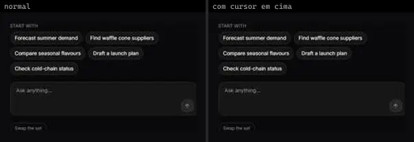 | **Ai Suggestions** `smoothui:ai-suggestions` | IA & Chat | smoothui · MIT | @repo/shadcn-ui, @repo/smoothui, lucide-react, motion |
|  | **Ai Task List** `smoothui:ai-task-list` | IA & Chat | smoothui · MIT | @repo/shadcn-ui, @repo/smoothui, motion |
| 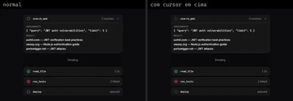 | **Ai Tool Call** `smoothui:ai-tool-call` | IA & Chat | smoothui · MIT | @repo/shadcn-ui, @repo/smoothui, lucide-react, motion |
| 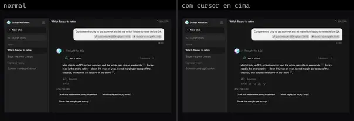 | **Chat Template** `smoothui:chat-template` | IA & Chat | smoothui · MIT | @repo/shadcn-ui, @repo/smoothui, motion |
| 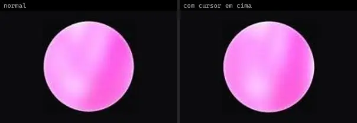 | **Orb** `smoothui:orb` | IA & Chat | smoothui · MIT | @repo/shadcn-ui, @repo/smoothui |
| 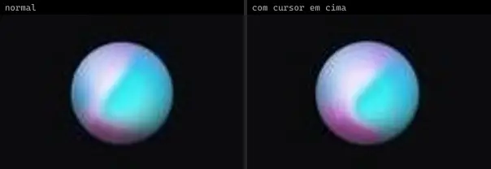 | **Siri Orb** `smoothui:siri-orb` | IA & Chat | smoothui · MIT | @repo/shadcn-ui, @repo/smoothui, motion |
|  | **Agent Plan** `spectrumui:blocks/ai-assistants/agent-plan` | IA & Chat | spectrumui · Apache-2.0 · ⚠needs-props | clsx, lucide-react, tailwind-merge |
|  | **Agent Steps** `spectrumui:blocks/ai-assistants/agent-steps` | IA & Chat | spectrumui · Apache-2.0 · ⚠needs-props | clsx, lucide-react, tailwind-merge |
| 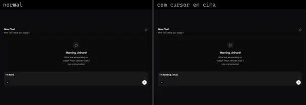 | **Ai Chat Card** `spectrumui:ai-chat-card` | IA & Chat | spectrumui · Apache-2.0 | clsx, lucide-react, motion, tailwind-merge |
|  | **Approval Card** `spectrumui:blocks/ai-assistants/approval-card` | IA & Chat | spectrumui · Apache-2.0 | clsx, lucide-react, tailwind-merge |
|  | **Citation Sources** `spectrumui:blocks/ai-assistants/citation-sources` | IA & Chat | spectrumui · Apache-2.0 · ⚠needs-props | clsx, tailwind-merge |
|  | **Conversation List** `spectrumui:blocks/ai-assistants/conversation-list` | IA & Chat | spectrumui · Apache-2.0 · ⚠needs-props | clsx, lucide-react, tailwind-merge |
|  | **Error State** `spectrumui:blocks/ai-assistants/error-state` | IA & Chat | spectrumui · Apache-2.0 | clsx, lucide-react, tailwind-merge |
|  | **Inline Edit** `spectrumui:blocks/ai-assistants/inline-edit` | IA & Chat | spectrumui · Apache-2.0 | clsx, lucide-react, tailwind-merge |
|  | **Insight Cards** `spectrumui:blocks/ai-assistants/insight-cards` | IA & Chat | spectrumui · Apache-2.0 · ⚠needs-props | clsx, lucide-react, tailwind-merge |
|  | **Invoices Table** `spectrumui:blocks/tables/invoices-table` | IA & Chat | spectrumui · Apache-2.0 | — |
| 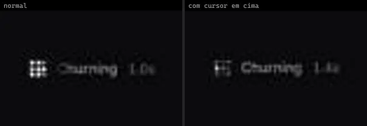 | **Loading State** `spectrumui:blocks/ai-assistants/loading-state` | IA & Chat | spectrumui · Apache-2.0 | clsx, tailwind-merge |
|  | **Memory Chips** `spectrumui:blocks/ai-assistants/memory-chips` | IA & Chat | spectrumui · Apache-2.0 · ⚠needs-props | clsx, lucide-react, tailwind-merge |
|  | **Message Actions** `spectrumui:blocks/ai-assistants/message-actions` | IA & Chat | spectrumui · Apache-2.0 | clsx, lucide-react, tailwind-merge |
| 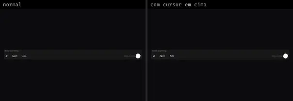 | **Metal Prompt Bar** `spectrumui:metal-prompt-bar` | IA & Chat | spectrumui · Apache-2.0 | clsx, lucide-react, metal-fx, tailwind-merge |
|  | **Model Selector** `spectrumui:blocks/ai-assistants/model-selector` | IA & Chat | spectrumui · Apache-2.0 · ⚠needs-props | clsx, tailwind-merge |
|  | **Prompt Composer** `spectrumui:blocks/ai-assistants/prompt-composer` | IA & Chat | spectrumui · Apache-2.0 | clsx, lucide-react, tailwind-merge |
|  | **Quota Banner** `spectrumui:blocks/ai-assistants/quota-banner` | IA & Chat | spectrumui · Apache-2.0 | clsx, lucide-react, tailwind-merge |
|  | **Reasoning Trace** `spectrumui:blocks/ai-assistants/reasoning-trace` | IA & Chat | spectrumui · Apache-2.0 · ⚠needs-props | clsx, lucide-react, tailwind-merge |
|  | **Status Tracker** `spectrumui:blocks/ai-assistants/status-tracker` | IA & Chat | spectrumui · Apache-2.0 · ⚠needs-props | clsx, lucide-react, tailwind-merge |
|  | **Streaming Text** `spectrumui:blocks/ai-assistants/streaming-text` | IA & Chat | spectrumui · Apache-2.0 · ⚠needs-props | clsx, lucide-react, tailwind-merge |
|  | **Suggestion Banner** `spectrumui:blocks/ai-assistants/suggestion-banner` | IA & Chat | spectrumui · Apache-2.0 | clsx, lucide-react, tailwind-merge |
|  | **Task Rows** `spectrumui:blocks/ai-assistants/task-rows` | IA & Chat | spectrumui · Apache-2.0 · ⚠needs-props | clsx, lucide-react, tailwind-merge |
|  | **Thinking Dots** `spectrumui:blocks/ai-assistants/thinking-dots` | IA & Chat | spectrumui · Apache-2.0 | clsx, tailwind-merge |
|  | **Tool Chips** `spectrumui:blocks/ai-assistants/tool-chips` | IA & Chat | spectrumui · Apache-2.0 · ⚠needs-props | clsx, tailwind-merge |
|  | **Usage Meter** `spectrumui:blocks/ai-assistants/usage-meter` | IA & Chat | spectrumui · Apache-2.0 · ⚠needs-props | clsx, tailwind-merge |
| 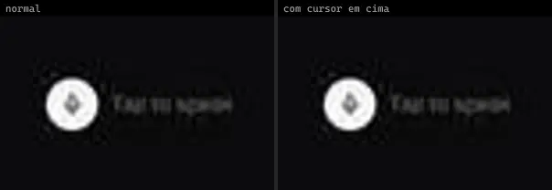 | **Voice Input** `spectrumui:blocks/ai-assistants/voice-input` | IA & Chat | spectrumui · Apache-2.0 | clsx, lucide-react, tailwind-merge |
|  | **Web Search** `spectrumui:blocks/ai-assistants/web-search` | IA & Chat | spectrumui · Apache-2.0 · ⚠needs-props | clsx, lucide-react, tailwind-merge |
| 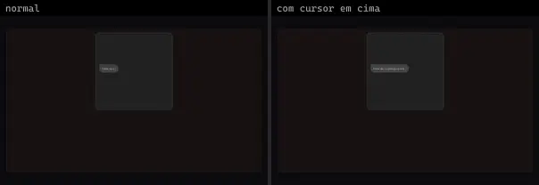 | **Ai Conversation Loop** `systaliko:blocks/ai-conversation-loop` | IA & Chat | systaliko · MIT | @radix-ui/react-slot, class-variance-authority, lucide-react, motion |
| 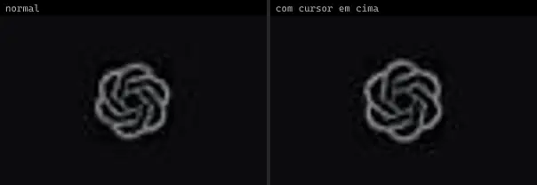 | **Brand Orbs · OpenAI** `threeui:brand-orbs/openai` | IA & Chat | threeui · MIT | — |
|  | **Shader Buttons · Thinking** `threeui:star-portal/thinking-button` | IA & Chat | threeui · MIT | — |
| 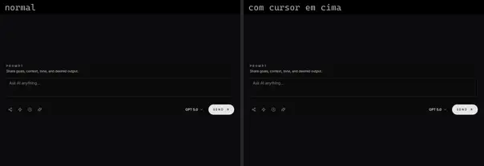 | **Ai Chat Interface** `uitripled:components/chat/ai-chat-interface` | IA & Chat | uitripled · MIT | @radix-ui/react-slot, class-variance-authority, framer-motion, lucide-react |
| 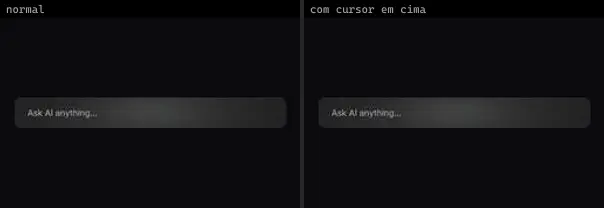 | **Ai Glow Input** `uitripled:motion-core/ai-glow-input` | IA & Chat | uitripled · MIT | framer-motion |
| 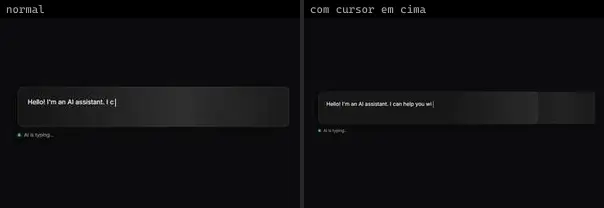 | **Ai Response Typing** `uitripled:motion-core/ai-response-typing` | IA & Chat | uitripled · MIT | framer-motion |
|  | **Ai Unlock Animation** `uitripled:motion-core/ai-unlock-animation` | IA & Chat | uitripled · MIT | framer-motion |
| 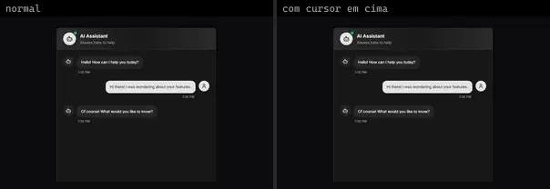 | **Chat App** `uitripled:components/chat/chat-app` | IA & Chat | uitripled · MIT | @radix-ui/react-slot, class-variance-authority, framer-motion, lucide-react |
| 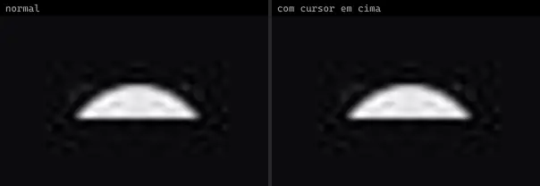 | **Floating Chat Widget** `uitripled:components/chat/floating-chat-widget` | IA & Chat | uitripled · MIT | @radix-ui/react-avatar, @radix-ui/react-select, @radix-ui/react-slot, class-variance-authority, framer-motion, lucide-react |
| 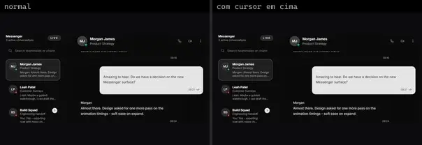 | **Messenger** `uitripled:components/chat/messenger` | IA & Chat | uitripled · MIT | @radix-ui/react-avatar, @radix-ui/react-slot, class-variance-authority, framer-motion, lucide-react |
