# Código & Terminal (30)

Prévia: estado normal | com o cursor em cima. Código: `node scripts/atlas-find.mjs code <uid>` ou os arquivos em `catalog.jsonl → files`.

| prévia | componente | tipo de aplicação | biblioteca · licença | dependências npm |
|---|---|---|---|---|
| 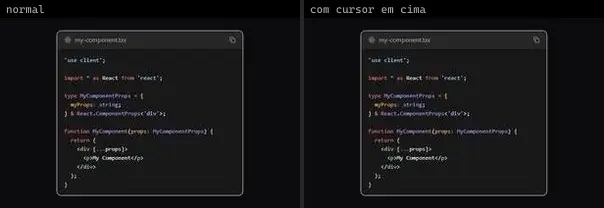 | **Code** `animateui:components/animate/code` | Docs & Dev tools | animateui · MIT + Commons Clause | @workspace/ui, lucide-react, next-themes |
| 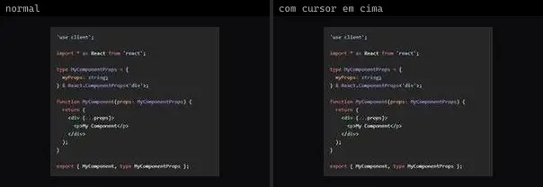 | **Code Block** `animateui:primitives/animate/code-block` | Docs & Dev tools | animateui · MIT + Commons Clause | @workspace/ui, clsx, next-themes, shiki, tailwind-merge |
| 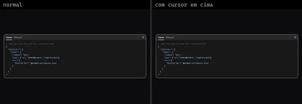 | **Code Tabs** `animateui:components/animate/code-tabs` | Docs & Dev tools | animateui · MIT + Commons Clause | @workspace/ui, next-themes, shiki |
| 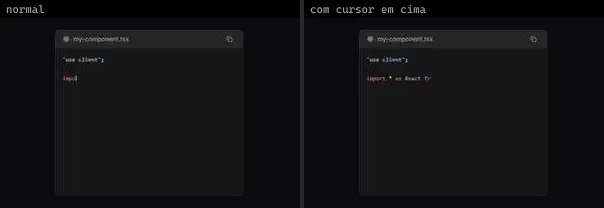 | **CodeBlock** `atlas:Text/CodeBlock` | Docs & Dev tools | atlas (própria) · Proprietária (Atlas) | lucide-react, motion |
| 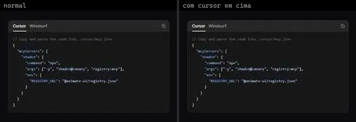 | **CodeTabs** `atlas:Misc/CodeTabs` | Docs & Dev tools | atlas (própria) · Proprietária (Atlas) | lucide-react, motion |
|  | **Terminal Animation** `cultui:terminal-animation-demo` | Docs & Dev tools | cultui · MIT | @radix-ui/react-slot, @radix-ui/react-use-controllable-state |
| 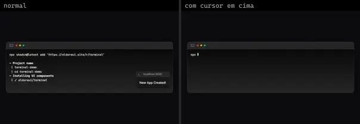 | **Terminal** `eldoraui:terminal-demo` | Docs & Dev tools | eldoraui · MIT | lucide-react, react-icons |
| 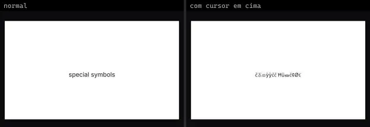 | **Scramble Hover Diff Class** `fancy:text/scramble-hover-diff-class-demo` | Docs & Dev tools | fancy · MIT | motion |
| 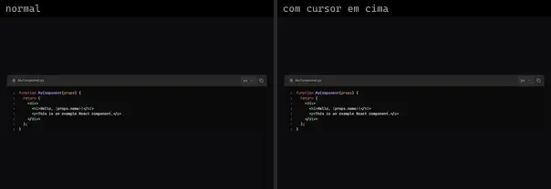 | **Code Block** `kibo:code-block` | Docs & Dev tools | kibo · MIT | @radix-ui/react-use-controllable-state, @repo/code-block, @shikijs/transformers, lucide-react, react-icons, shiki |
| 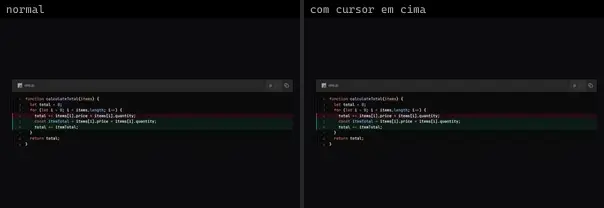 | **Code Block Diff** `kibo:code-block-diff` | Docs & Dev tools | kibo · MIT | @radix-ui/react-use-controllable-state, @repo/code-block, @shikijs/transformers, lucide-react, react-icons, shiki |
| 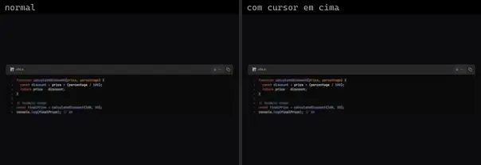 | **Code Block Focus** `kibo:code-block-focus` | Docs & Dev tools | kibo · MIT | @radix-ui/react-use-controllable-state, @repo/code-block, @shikijs/transformers, lucide-react, react-icons, shiki |
|  | **Qr Code** `kibo:qr-code` | Docs & Dev tools | kibo · MIT | @repo/qr-code, culori, qrcode |
| 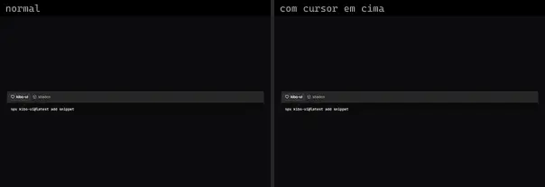 | **Snippet** `kibo:snippet` | Docs & Dev tools | kibo · MIT | @repo/snippet, lucide-react |
| 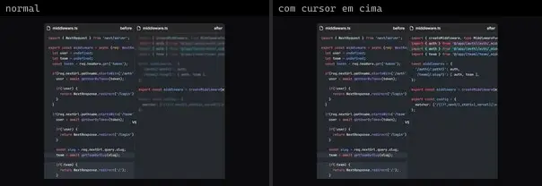 | **Code Comparison** `magicui:code-comparison-demo` | Docs & Dev tools | magicui · MIT | @app/(auth), @shikijs/transformers, lucide-react, next-themes, shiki |
| 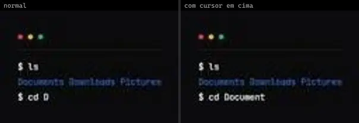 | **Terminal** `magicui:terminal-demo-2` | Docs & Dev tools | magicui · MIT | motion |
| 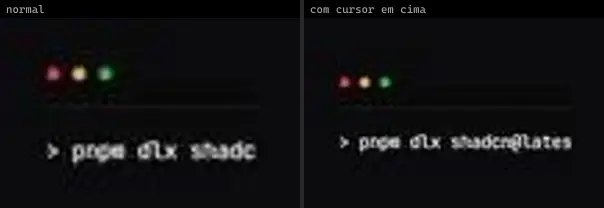 | **Terminal** `magicui:terminal-demo` | Docs & Dev tools | magicui · MIT | motion |
| 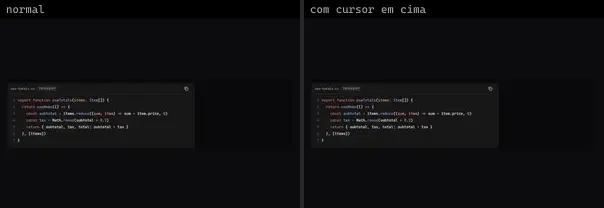 | **Code Block 1** `reui:code-block/c-code-block-1` | Docs & Dev tools | reui · MIT | cn |
| 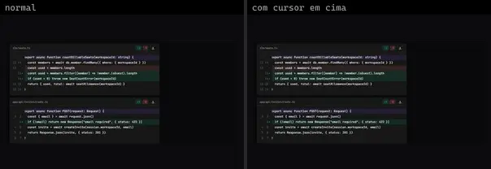 | **Code Block 18** `reui:code-block/c-code-block-18` | Docs & Dev tools | reui · MIT | class-variance-authority, cn, radix-ui |
| 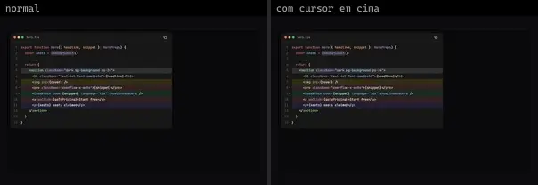 | **Code Block 20** `reui:code-block/c-code-block-20` | Docs & Dev tools | reui · MIT | cn |
| 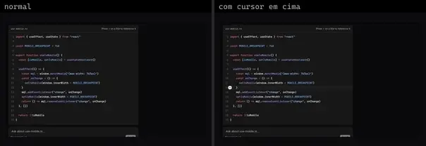 | **Code Block 25** `reui:code-block/c-code-block-25` | Docs & Dev tools | reui · MIT | class-variance-authority, cn, radix-ui |
| 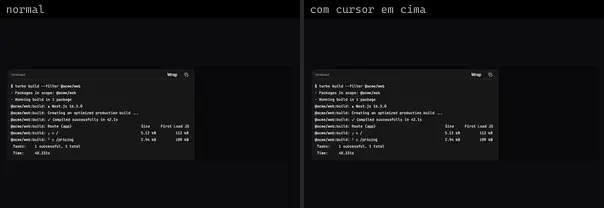 | **Code Block 9** `reui:code-block/c-code-block-9` | Docs & Dev tools | reui · MIT | cn |
| 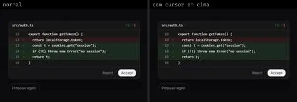 | **Ai Diff** `smoothui:ai-diff` | Docs & Dev tools | smoothui · MIT | @repo/shadcn-ui, @repo/smoothui, motion |
| 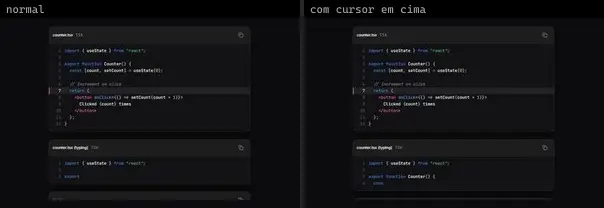 | **Code Block** `smoothui:code-block` | Docs & Dev tools | smoothui · MIT | @repo/shadcn-ui, @repo/smoothui, lucide-react, motion |
| 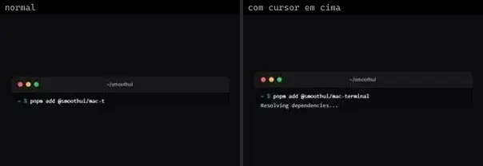 | **Mac Terminal** `smoothui:mac-terminal` | Docs & Dev tools | smoothui · MIT | @repo/shadcn-ui, @repo/smoothui, motion |
|  | **Code Block** `spectrumui:blocks/ai-assistants/code-block` | Docs & Dev tools | spectrumui · Apache-2.0 · ⚠needs-props | clsx, lucide-react, tailwind-merge |
|  | **Diff View** `spectrumui:blocks/ai-assistants/diff-view` | Docs & Dev tools | spectrumui · Apache-2.0 · ⚠needs-props | clsx, lucide-react, tailwind-merge |
| 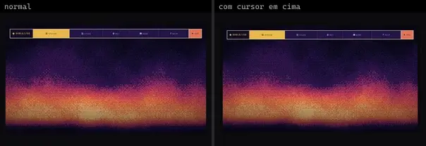 | **Animated Top Dock · Pixel Terminal** `threeui:animated-top-dock/retro` | Docs & Dev tools | threeui · MIT | — |
|  | **Brand Orbs · Claude Code** `threeui:brand-orbs/claude` | Docs & Dev tools | threeui · MIT | — |
| 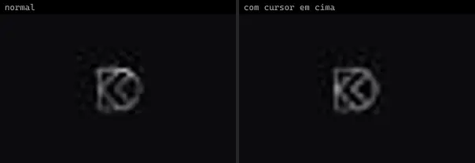 | **Brand Orbs · DesignCode** `threeui:brand-orbs/designcode` | Docs & Dev tools | threeui · MIT | — |
|  | **Glass Verification Code** `uitripled:components/forms/glass-verification-code` | Docs & Dev tools | uitripled · MIT | @radix-ui/react-slot, class-variance-authority, framer-motion |
