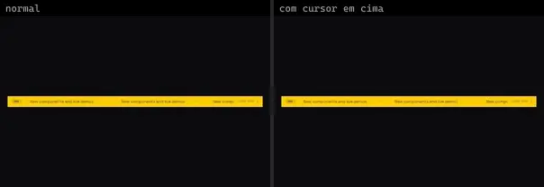
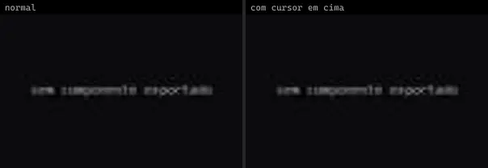
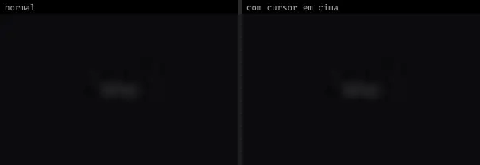
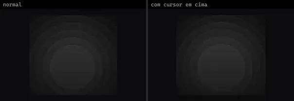
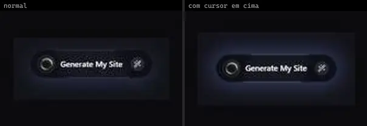
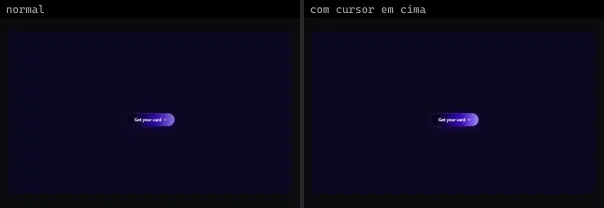
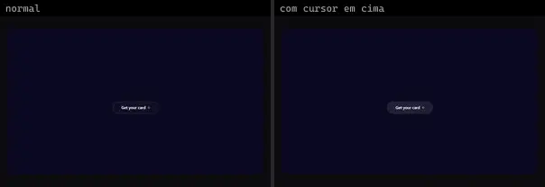
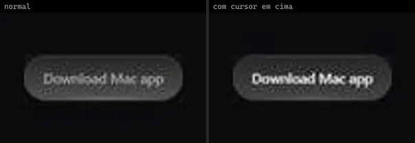
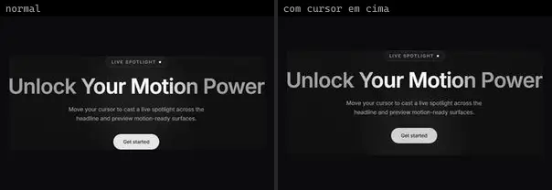
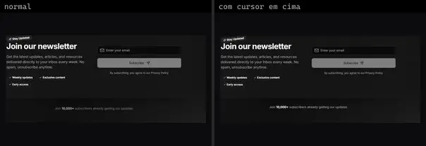

# CTA & Banner (19)

Prévia: estado normal | com o cursor em cima. Código: `node scripts/atlas-find.mjs code <uid>` ou os arquivos em `catalog.jsonl → files`.

| prévia | componente | tipo de aplicação | biblioteca · licença | dependências npm |
|---|---|---|---|---|
|  | **Announcement Ribbon** `animata:container/announcement-ribbon` | Landing & Marketing | animata · MIT | lucide-react |
|  | **Cta** `eldoraui:cta-01/components/cta` | Landing & Marketing | eldoraui · MIT | clsx, motion, next-themes, process, tailwind-merge |
|  | **Cta 02** `eldoraui:cta-02/components/cta-02` | Landing & Marketing | eldoraui · MIT | @radix-ui/react-slot, class-variance-authority, clsx, process, tailwind-merge |
|  | **Icons** `eldoraui:cta-02/components/icons` | Landing & Marketing | eldoraui · MIT | clsx, process, tailwind-merge |
|  | **Orbiting Circle** `eldoraui:cta-02/components/orbiting-circle` | Landing & Marketing | eldoraui · MIT | clsx, motion, process, tailwind-merge |
|  | **Page** `eldoraui:cta-01/page` | Landing & Marketing | eldoraui · MIT | — |
|  | **Page** `eldoraui:cta-02/page` | Landing & Marketing | eldoraui · MIT | — |
|  | **Ripple Bg** `eldoraui:cta-03/components/ripple-bg` | Landing & Marketing | eldoraui · MIT | clsx, process, tailwind-merge |
|  | **Glare Hover — CTA** `magicui:glare-hover-demo-cta` | Landing & Marketing | magicui · MIT | — |
|  | **Rectangle Buttons · Floating Dots CTA** `threeui:rectangle-buttons/floating-dots-cta` | Landing & Marketing | threeui · MIT | — |
|  | **Rectangle Buttons · Glassmorphism CTA** `threeui:rectangle-buttons/glassmorphism-cta` | Landing & Marketing | threeui · MIT | — |
|  | **Rectangle Buttons · Gradient Beam CTA** `threeui:rectangle-buttons/gradient-beam-cta` | Landing & Marketing | threeui · MIT | — |
|  | **Rectangle Buttons · Gradient CTA** `threeui:rectangle-buttons/gradient-cta` | Landing & Marketing | threeui · MIT | — |
|  | **Rectangle Buttons · Lumen CTA** `threeui:rectangle-buttons/lumen-cta` | Landing & Marketing | threeui · MIT | — |
|  | **Rectangle Buttons · Lumen CTA Ghost** `threeui:rectangle-buttons/lumen-cta-ghost` | Landing & Marketing | threeui · MIT | — |
|  | **Rectangle Buttons · Sliding Text CTA** `threeui:rectangle-buttons/sliding-text-cta` | Landing & Marketing | threeui · MIT | — |
|  | **Cta Banner Section** `uitripled:sections/cta-banner-section` | Landing & Marketing | uitripled · MIT | @radix-ui/react-slot, class-variance-authority, framer-motion, lucide-react |
|  | **Dynamic Spotlight Cta** `uitripled:motion-core/dynamic-spotlight-cta` | Landing & Marketing | uitripled · MIT | framer-motion |
|  | **Newsletter Signup Block** `uitripled:sections/newsletter-signup-block` | Landing & Marketing | uitripled · MIT | @radix-ui/react-slot, class-variance-authority, framer-motion, lucide-react |
