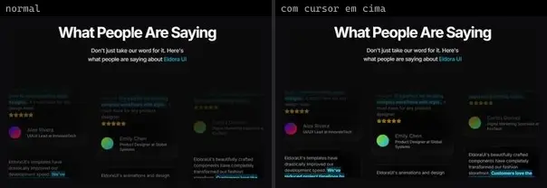
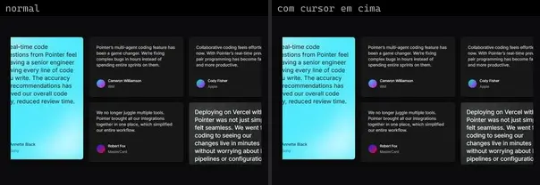
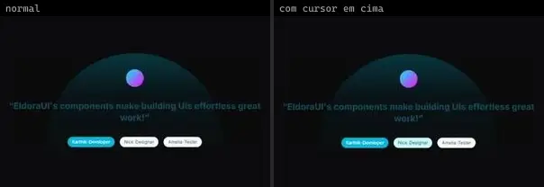
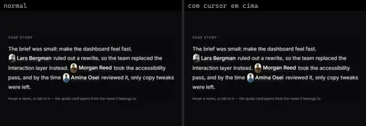
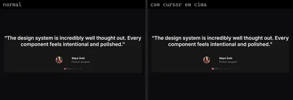
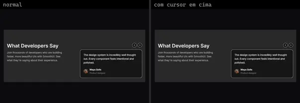
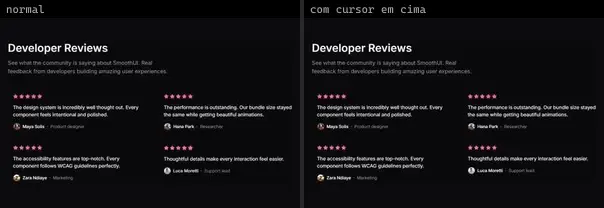
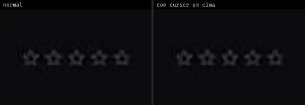
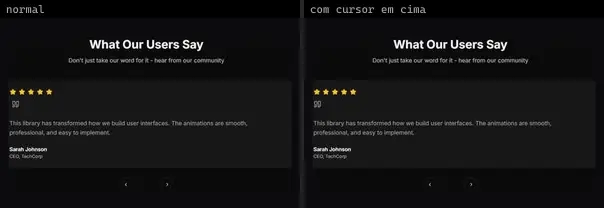

# Depoimentos & Avaliações (20)

Prévia: estado normal | com o cursor em cima. Código: `node scripts/atlas-find.mjs code <uid>` ou os arquivos em `catalog.jsonl → files`.

| prévia | componente | tipo de aplicação | biblioteca · licença | dependências npm |
|---|---|---|---|---|
|  | **Carousel** `eldoraui:testimonal-01/components/carousel` | Landing & Marketing | eldoraui · MIT · ⚠needs-props | @radix-ui/react-slot, class-variance-authority, clsx, embla-carousel-react, lucide-react, process, tailwind-merge |
|  | **Page** `eldoraui:testimonal-01/page` | Landing & Marketing | eldoraui · MIT | react-icons |
|  | **Page** `eldoraui:testimonal-02/page` | Landing & Marketing | eldoraui · MIT | — |
|  | **Testimonal 03** `eldoraui:testimonal-03/components/testimonal-03` | Landing & Marketing | eldoraui · MIT | — |
|  | **Testimonal Slider** `eldoraui:testimonal-slider-demo` | Landing & Marketing | eldoraui · MIT | @headlessui/react |
|  | **Testimonals** `eldoraui:testimonal-02/components/testimonals` | Landing & Marketing | eldoraui · MIT | clsx, lucide-react, motion, process, tailwind-merge |
|  | **Collaborative Review Workspace** `motiq:catalog/collaborative-review-workspace` | Landing & Marketing | motiq · MIT | — |
|  | **Collaborative Review Workspace** `motiq:collaborative-review-workspace` | Landing & Marketing | motiq · MIT | — |
|  | **Image Metadata Preview** `smoothui:image-metadata-preview` | Landing & Marketing | smoothui · MIT | @docs/examples, @repo/smoothui, lucide-react, motion, react-use-measure |
|  | **Inline Testimonials** `smoothui:inline-testimonials` | Landing & Marketing | smoothui · MIT | @repo/shadcn-ui, @repo/smoothui, @smoothui/data, lucide-react, motion |
|  | **Reviews Carousel** `smoothui:reviews-carousel` | Landing & Marketing | smoothui · MIT | @repo/shadcn-ui, @repo/smoothui, @smoothui/data, lucide-react, motion |
|  | **Testimonials 1** `smoothui:testimonials-1` | Landing & Marketing | smoothui · MIT | @repo/smoothui, @smoothui/data, motion |
|  | **Testimonials 2** `smoothui:testimonials-2` | Landing & Marketing | smoothui · MIT | @repo/shadcn-ui, @repo/smoothui, @smoothui/data, lucide-react, motion |
|  | **Testimonials 3** `smoothui:testimonials-3` | Landing & Marketing | smoothui · MIT | @repo/shadcn-ui, @repo/smoothui, @smoothui/data, lucide-react, motion |
|  | **Face Rating** `spectrumui:face-rating` | Landing & Marketing | spectrumui · Apache-2.0 | clsx, framer-motion, tailwind-merge |
|  | **Star Rating** `spectrumui:star-rating` | Landing & Marketing | spectrumui · Apache-2.0 | clsx, framer-motion, tailwind-merge |
|  | **Animated Quote Block** `uitripled:motion-core/animated-quote-block` | Landing & Marketing | uitripled · MIT | framer-motion |
|  | **Preview Details Card** `uitripled:micro/links/preview-details-card` | Landing & Marketing | uitripled · MIT | lucide-react |
|  | **Testimonial Section** `uitripled:sections/testimonial-section` | Landing & Marketing | uitripled · MIT | @radix-ui/react-slot, class-variance-authority, framer-motion, lucide-react |
|  | **Testimonials Block** `uitripled:sections/testimonials-block` | Landing & Marketing | uitripled · MIT | framer-motion, lucide-react |
