# Dropdown & Menu (37)

Prévia: estado normal | com o cursor em cima. Código: `node scripts/atlas-find.mjs code <uid>` ou os arquivos em `catalog.jsonl → files`.

| prévia | componente | tipo de aplicação | biblioteca · licença | dependências npm |
|---|---|---|---|---|
|  | **Product Variant Selector** `motiq:catalog/product-variant-selector` | E-commerce | motiq · MIT | motion |
|  | **Product Variant Selector** `motiq:product-variant-selector` | E-commerce | motiq · MIT | motion |
|  | **Profile Dropdown** `kokonutui:profile-dropdown` | Login & Conta | kokonutui · MIT | @radix-ui/react-dropdown-menu, clsx, lucide-react, tailwind-merge |
| 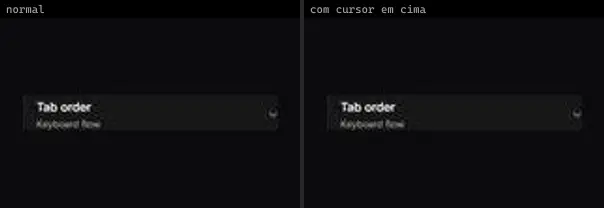 | **Native Action Dropdown** `uitripled:native/demo/native-action-dropdown-demo` | Mobile & App | uitripled · MIT | — |
| 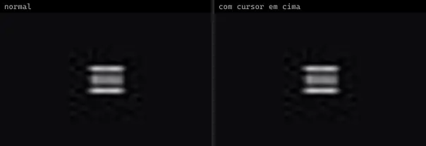 | **Flower Menu** `animata:fabs/flower-menu` | UI base | animata · MIT | lucide-react |
|  | **Dropdown Menu** `animateui:components/radix/dropdown-menu` | UI base | animateui · MIT + Commons Clause | @workspace/ui, class-variance-authority, lucide-react, radix-ui |
|  | **Dropdown Menu** `animateui:primitives/radix/dropdown-menu` | UI base | animateui · MIT + Commons Clause | lucide-react, motion, radix-ui |
|  | **Dropdown Menu Checkbox** `animateui:components/radix/dropdown-menu-checkbox` | UI base | animateui · MIT + Commons Clause | @workspace/ui, class-variance-authority, lucide-react, radix-ui |
|  | **Dropdown Menu Radio** `animateui:components/radix/dropdown-menu-radio` | UI base | animateui · MIT + Commons Clause | @workspace/ui, class-variance-authority, lucide-react, radix-ui |
|  | **Menu** `animateui:components/base/menu` | UI base | animateui · MIT + Commons Clause | @workspace/ui, class-variance-authority, lucide-react, radix-ui |
|  | **Menu** `animateui:primitives/base/menu` | UI base | animateui · MIT + Commons Clause | @base-ui-components/react, lucide-react, motion |
|  | **Menu Checkbox** `animateui:components/base/menu-checkbox` | UI base | animateui · MIT + Commons Clause | @workspace/ui, class-variance-authority, lucide-react, radix-ui |
|  | **Menu Radio** `animateui:components/base/menu-radio` | UI base | animateui · MIT + Commons Clause | @workspace/ui, class-variance-authority, lucide-react, radix-ui |
| 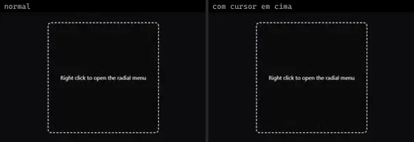 | **Radial Menu** `animateui:components/community/radial-menu` | UI base | animateui · MIT + Commons Clause | @base-ui-components/react, @workspace/ui, lucide-react, motion |
| 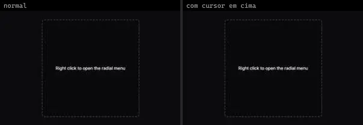 | **RadialMenu** `atlas:Menus/RadialMenu` | UI base | atlas (própria) · Proprietária (Atlas) | lucide-react, motion |
| 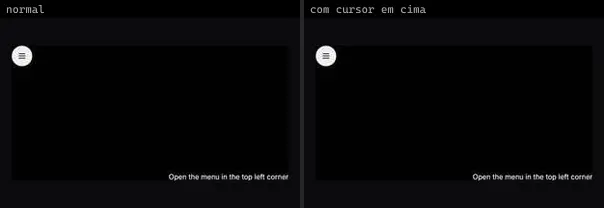 | **Gooey Svg Filter Menu** `fancy:filter/gooey-svg-filter-menu-demo` | UI base | fancy · MIT | lucide-react, motion |
| 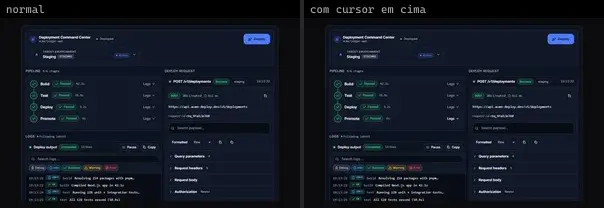 | **Deployment Command Center** `motiq:catalog/deployment-command-center` | UI base | motiq · MIT | motion |
| 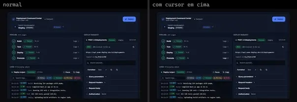 | **Deployment Command Center** `motiq:deployment-command-center` | UI base | motiq · MIT | motion |
|  | **BubbleMenu** `reactbits:Components/BubbleMenuDemo` | UI base | reactbits · MIT + Commons Clause | @chakra-ui/react, gsap |
| 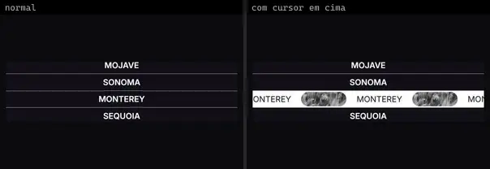 | **FlowingMenu** `reactbits:Components/FlowingMenuDemo` | UI base | reactbits · MIT + Commons Clause | @chakra-ui/react, gsap |
| 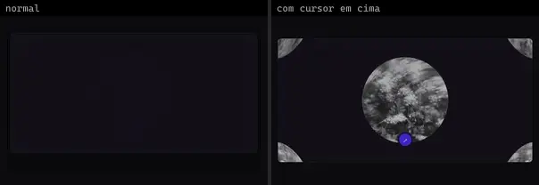 | **InfiniteMenu** `reactbits:Components/InfiniteMenuDemo` | UI base | reactbits · MIT + Commons Clause | @chakra-ui/react, gl-matrix |
| 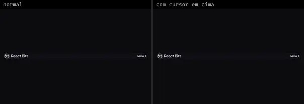 | **StaggeredMenu** `reactbits:Components/StaggeredMenuDemo` | UI base | reactbits · MIT + Commons Clause | @chakra-ui/react, @content/Components, gsap |
| 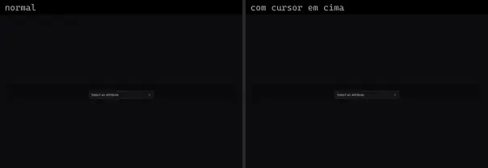 | **Cascader 1** `reui:cascader/c-cascader-1` | UI base | reui · MIT | @base-ui/react, class-variance-authority, cn, radix-ui |
| 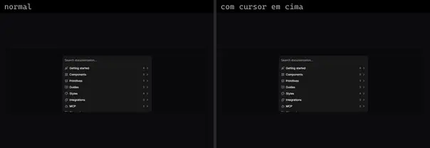 | **Cascader 7** `reui:cascader/c-cascader-7` | UI base | reui · MIT | @base-ui/react, cn, radix-ui |
| 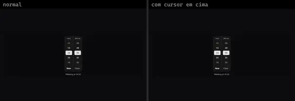 | **Time Picker 1** `reui:time-picker/c-time-picker-1` | UI base | reui · MIT | cn |
| 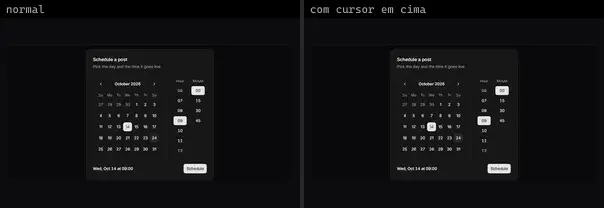 | **Time Picker 13** `reui:time-picker/c-time-picker-13` | UI base | reui · MIT | class-variance-authority, cn, radix-ui, react-day-picker |
| 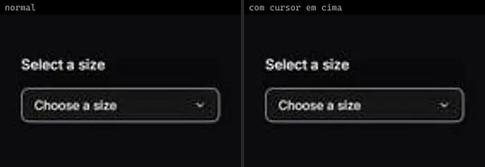 | **Basic Dropdown** `smoothui:basic-dropdown` | UI base | smoothui · MIT | @repo/smoothui, lucide-react, motion |
| 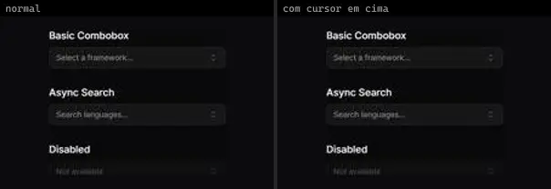 | **Combobox** `smoothui:combobox` | UI base | smoothui · MIT | @repo/shadcn-ui, @repo/smoothui, lucide-react, motion |
| 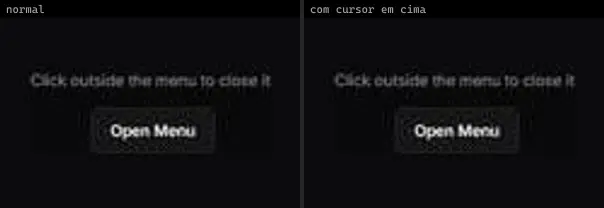 | **Dropdown Menu** `smoothui:dropdown-menu` | UI base | smoothui · MIT | @radix-ui/react-slot, @repo/shadcn-ui, @repo/smoothui, class-variance-authority, motion |
|  | **Command Palette** `spectrumui:command-palette` | UI base | spectrumui · Apache-2.0 | clsx, framer-motion, lucide-react, next-themes, tailwind-merge |
| 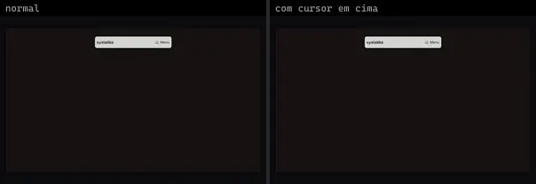 | **Animated Menu** `systaliko:blocks/animated-menu` | UI base | systaliko · MIT | class-variance-authority, motion |
| 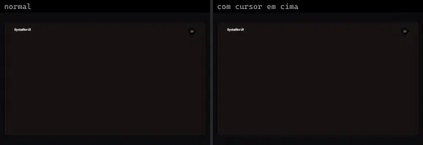 | **Animated Menu 2** `systaliko:blocks/animated-menu-2` | UI base | systaliko · MIT | class-variance-authority, motion |
| 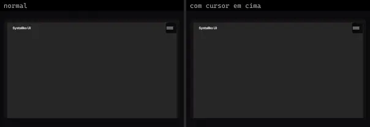 | **Animated Menu Full Screen** `systaliko:blocks/animated-menu-full-screen` | UI base | systaliko · MIT | @radix-ui/react-slot, class-variance-authority, motion |
| 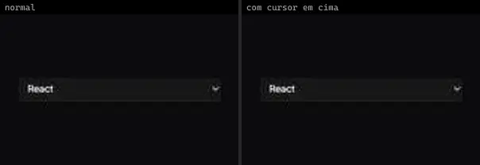 | **Animated Select** `uitripled:forms/animated-select` | UI base | uitripled · MIT | framer-motion, lucide-react |
|  | **Command Palette** `uitripled:search/command-palette` | UI base | uitripled · MIT | framer-motion, lucide-react |
| 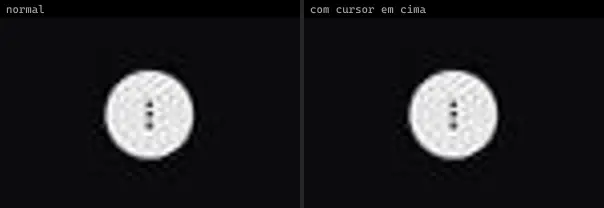 | **Context Menu Bubble** `uitripled:motion-core/context-menu-bubble` | UI base | uitripled · MIT | framer-motion, lucide-react |
|  | **Staggered Items** `uitripled:components/dropdown/staggered-items` | UI base | uitripled · MIT | framer-motion, lucide-react |
