# Equipe & Logos (39)

Prévia: estado normal | com o cursor em cima. Código: `node scripts/atlas-find.mjs code <uid>` ou os arquivos em `catalog.jsonl → files`.

| prévia | componente | tipo de aplicação | biblioteca · licença | dependências npm |
|---|---|---|---|---|
|  | **Team Clock** `animata:widget/team-clock` | Landing & Marketing | animata · MIT | motion |
|  | **Logo Carousel** `cultui:logo-carousel-demo` | Landing & Marketing | cultui · MIT | @radix-ui/react-slot, class-variance-authority, motion |
| 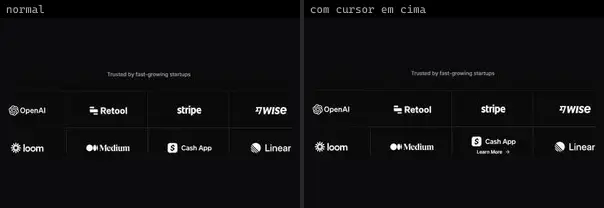 | **Logo Cloud** `eldoraui:logo-cloud-01/components/logo-cloud` | Landing & Marketing | eldoraui · MIT | lucide-react |
|  | **Logo Cloud 04** `eldoraui:logo-cloud-04/components/logo-cloud-04` | Landing & Marketing | eldoraui · MIT | clsx, process, tailwind-merge |
| 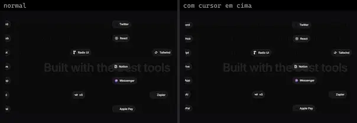 | **Logo Timeline** `eldoraui:logo-timeline-demo` | Landing & Marketing | eldoraui · MIT | motion |
|  | **Logo Timeline Demo 2** `eldoraui:logo-timeline-demo-2` | Landing & Marketing | eldoraui · MIT | motion |
|  | **Page** `eldoraui:logo-cloud-03/page` | Landing & Marketing | eldoraui · MIT | — |
| 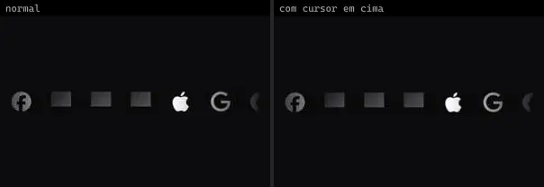 | **Marquee Logos** `magicui:marquee-logos` | Landing & Marketing | magicui · MIT | — |
| 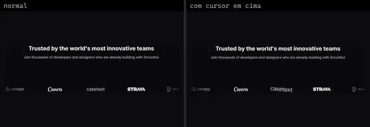 | **Logo Cloud 2** `smoothui:logo-cloud-2` | Landing & Marketing | smoothui · MIT | @repo/smoothui, motion |
|  | **Logo Cloud 3** `smoothui:logo-cloud-3` | Landing & Marketing | smoothui · MIT | @repo/smoothui |
| 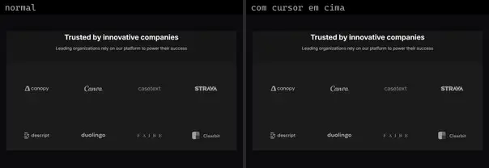 | **Logo Cloud 4** `smoothui:logo-cloud-4` | Landing & Marketing | smoothui · MIT | @repo/smoothui, motion |
|  | **Team 1** `smoothui:team-1` | Landing & Marketing | smoothui · MIT | @repo/smoothui, @smoothui/data, motion |
| 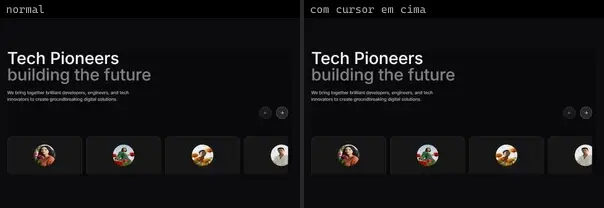 | **Team 2** `smoothui:team-2` | Landing & Marketing | smoothui · MIT | @repo/smoothui, @smoothui/data, motion |
|  | **Customers Table** `spectrumui:blocks/tables/customers-table` | Landing & Marketing | spectrumui · Apache-2.0 | — |
| 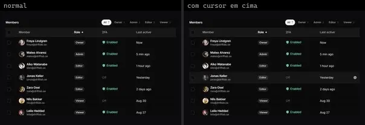 | **Team Members Table** `spectrumui:blocks/tables/team-members-table` | Landing & Marketing | spectrumui · Apache-2.0 | — |
|  | **Team** `systaliko:scroll-animations/team` | Landing & Marketing | systaliko · MIT | motion |
| 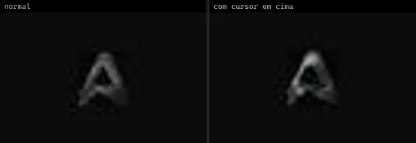 | **Brand Orbs · Aura** `threeui:brand-orbs/aura` | Landing & Marketing | threeui · MIT | — |
|  | **Brand Orbs · Codex** `threeui:brand-orbs/codex` | Landing & Marketing | threeui · MIT | — |
|  | **Brand Orbs · CSS** `threeui:brand-orbs/css` | Landing & Marketing | threeui · MIT | — |
|  | **Brand Orbs · Cursor** `threeui:brand-orbs/cursor` | Landing & Marketing | threeui · MIT | — |
| 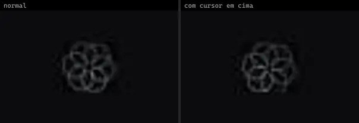 | **Brand Orbs · DreamCut** `threeui:brand-orbs/dreamcut` | Landing & Marketing | threeui · MIT | — |
| 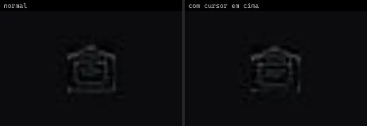 | **Brand Orbs · Email** `threeui:brand-orbs/email` | Landing & Marketing | threeui · MIT | — |
|  | **Brand Orbs · Figma** `threeui:brand-orbs/figma` | Landing & Marketing | threeui · MIT | — |
|  | **Brand Orbs · Framer** `threeui:brand-orbs/framer` | Landing & Marketing | threeui · MIT | — |
| 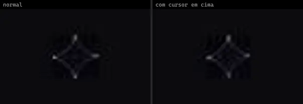 | **Brand Orbs · Gemini** `threeui:brand-orbs/gemini` | Landing & Marketing | threeui · MIT | — |
| 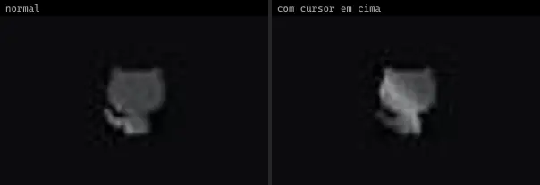 | **Brand Orbs · GitHub** `threeui:brand-orbs/github` | Landing & Marketing | threeui · MIT | — |
|  | **Brand Orbs · Instagram** `threeui:brand-orbs/instagram` | Landing & Marketing | threeui · MIT | — |
|  | **Brand Orbs · iOS** `threeui:brand-orbs/ios` | Landing & Marketing | threeui · MIT | — |
|  | **Brand Orbs · LinkedIn** `threeui:brand-orbs/linkedin` | Landing & Marketing | threeui · MIT | — |
| 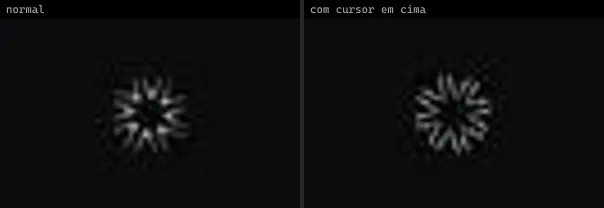 | **Brand Orbs · Neuform** `threeui:brand-orbs/neuform` | Landing & Marketing | threeui · MIT | — |
|  | **Brand Orbs · React** `threeui:brand-orbs/react` | Landing & Marketing | threeui · MIT | — |
|  | **Brand Orbs · Swift** `threeui:brand-orbs/swift` | Landing & Marketing | threeui · MIT | — |
|  | **Brand Orbs · Threads** `threeui:brand-orbs/threads` | Landing & Marketing | threeui · MIT | — |
|  | **Brand Orbs · UI** `threeui:brand-orbs/ui` | Landing & Marketing | threeui · MIT | — |
|  | **Brand Orbs · UX** `threeui:brand-orbs/ux` | Landing & Marketing | threeui · MIT | — |
| 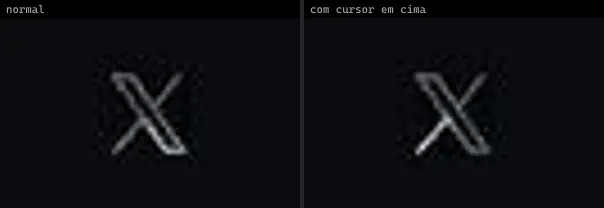 | **Brand Orbs · X** `threeui:brand-orbs/x` | Landing & Marketing | threeui · MIT | — |
|  | **Glassmorphism Logo Showcase Block** `uitripled:sections/glassmorphism-logo-showcase-block` | Landing & Marketing | uitripled · MIT · ⚠needs-network | @radix-ui/react-slot, class-variance-authority, framer-motion, lucide-react |
|  | **Our Partners Section** `uitripled:sections/our-partners-section` | Landing & Marketing | uitripled · MIT | framer-motion |
| 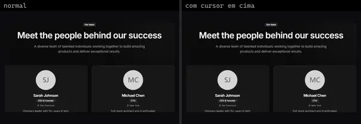 | **Team Section Block** `uitripled:sections/team-section-block` | Landing & Marketing | uitripled · MIT | @radix-ui/react-slot, class-variance-authority, framer-motion, lucide-react |
