# Estado vazio (27)

Prévia: estado normal | com o cursor em cima. Código: `node scripts/atlas-find.mjs code <uid>` ou os arquivos em `catalog.jsonl → files`.

| prévia | componente | tipo de aplicação | biblioteca · licença | dependências npm |
|---|---|---|---|---|
| 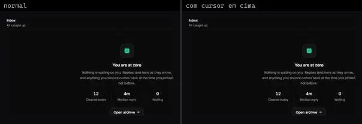 | **Inbox Empty** `spectrumui:blocks/empty-states/inbox-empty` | Dashboard & Admin | spectrumui · Apache-2.0 | clsx, motion, tailwind-merge |
|  | **Table Empty** `spectrumui:blocks/empty-states/table-empty` | Dashboard & Admin | spectrumui · Apache-2.0 | clsx, motion, tailwind-merge |
| 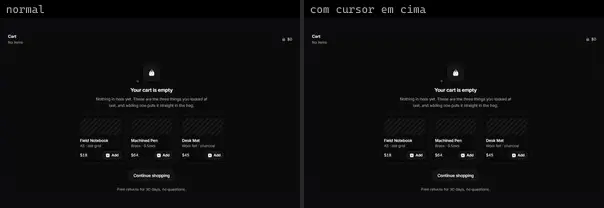 | **Cart Empty** `spectrumui:blocks/empty-states/cart-empty` | E-commerce | spectrumui · Apache-2.0 | clsx, motion, tailwind-merge |
|  | **Chat Empty State** `spectrumui:blocks/ai-assistants/chat-empty-state` | IA & Chat | spectrumui · Apache-2.0 | clsx, lucide-react, tailwind-merge |
|  | **Access Empty** `spectrumui:blocks/empty-states/access-empty` | UI base | spectrumui · Apache-2.0 | clsx, motion, tailwind-merge |
| 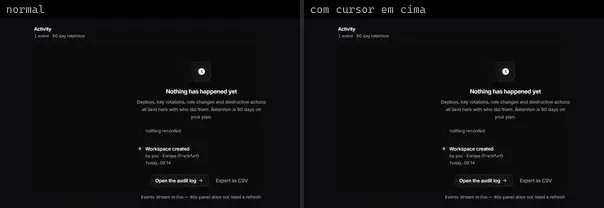 | **Activity Empty** `spectrumui:blocks/empty-states/activity-empty` | UI base | spectrumui · Apache-2.0 | clsx, motion, tailwind-merge |
| 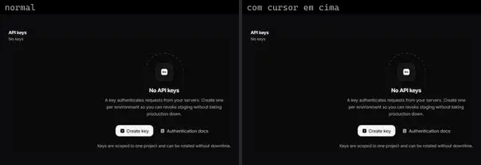 | **Api Key Empty** `spectrumui:blocks/empty-states/api-key-empty` | UI base | spectrumui · Apache-2.0 | clsx, motion, tailwind-merge |
| 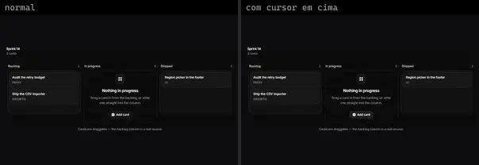 | **Board Empty** `spectrumui:blocks/empty-states/board-empty` | UI base | spectrumui · Apache-2.0 | clsx, motion, tailwind-merge |
| 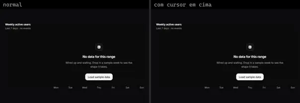 | **Chart Empty** `spectrumui:blocks/empty-states/chart-empty` | UI base | spectrumui · Apache-2.0 | motion |
| 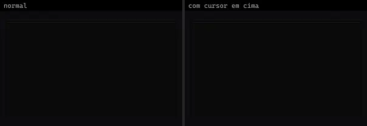 | **Empty State Kit** `spectrumui:blocks/empty-states/empty-state-kit` | UI base | spectrumui · Apache-2.0 | @radix-ui/react-slot, class-variance-authority, clsx, motion, tailwind-merge |
|  | **Error Empty** `spectrumui:blocks/empty-states/error-empty` | UI base | spectrumui · Apache-2.0 | clsx, motion, tailwind-merge |
|  | **Filter Empty** `spectrumui:blocks/empty-states/filter-empty` | UI base | spectrumui · Apache-2.0 | clsx, motion, tailwind-merge |
| 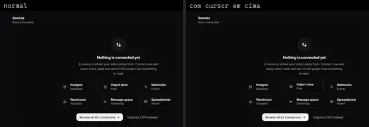 | **Integration Empty** `spectrumui:blocks/empty-states/integration-empty` | UI base | spectrumui · Apache-2.0 | clsx, motion, tailwind-merge |
|  | **Invite Empty** `spectrumui:blocks/empty-states/invite-empty` | UI base | spectrumui · Apache-2.0 | clsx, motion, tailwind-merge |
|  | **Locked Empty** `spectrumui:blocks/empty-states/locked-empty` | UI base | spectrumui · Apache-2.0 | clsx, motion, tailwind-merge |
| 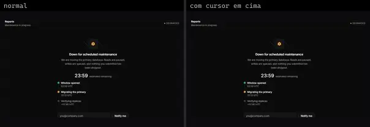 | **Maintenance Empty** `spectrumui:blocks/empty-states/maintenance-empty` | UI base | spectrumui · Apache-2.0 | clsx, motion, tailwind-merge |
| 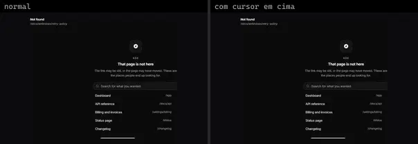 | **Not Found Empty** `spectrumui:blocks/empty-states/not-found-empty` | UI base | spectrumui · Apache-2.0 | clsx, motion, tailwind-merge |
| 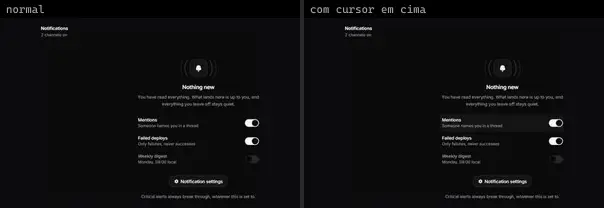 | **Notification Empty** `spectrumui:blocks/empty-states/notification-empty` | UI base | spectrumui · Apache-2.0 | @radix-ui/react-switch, clsx, motion, tailwind-merge |
| 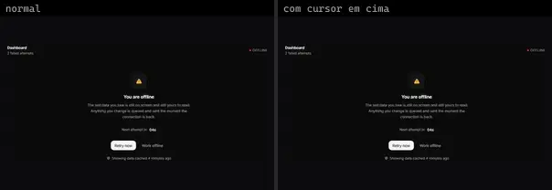 | **Offline Empty** `spectrumui:blocks/empty-states/offline-empty` | UI base | spectrumui · Apache-2.0 | clsx, motion, tailwind-merge |
| 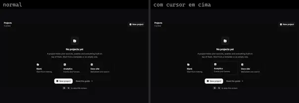 | **Project Empty** `spectrumui:blocks/empty-states/project-empty` | UI base | spectrumui · Apache-2.0 | clsx, motion, tailwind-merge |
| 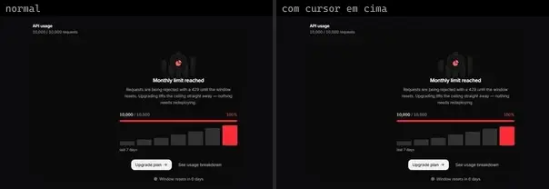 | **Quota Empty** `spectrumui:blocks/empty-states/quota-empty` | UI base | spectrumui · Apache-2.0 | clsx, motion, tailwind-merge |
| 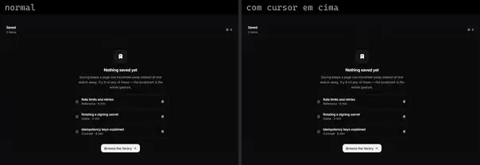 | **Saved Empty** `spectrumui:blocks/empty-states/saved-empty` | UI base | spectrumui · Apache-2.0 | clsx, motion, tailwind-merge |
| 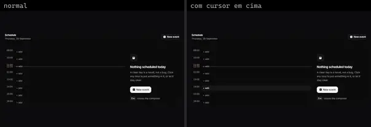 | **Schedule Empty** `spectrumui:blocks/empty-states/schedule-empty` | UI base | spectrumui · Apache-2.0 | clsx, motion, tailwind-merge |
|  | **Search Empty** `spectrumui:blocks/empty-states/search-empty` | UI base | spectrumui · Apache-2.0 | clsx, motion, tailwind-merge |
| 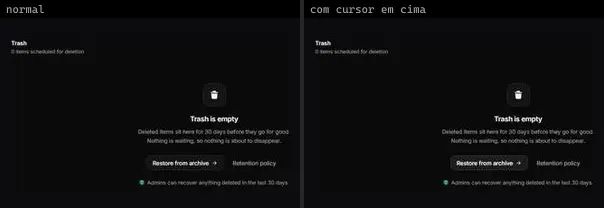 | **Trash Empty** `spectrumui:blocks/empty-states/trash-empty` | UI base | spectrumui · Apache-2.0 | motion |
| 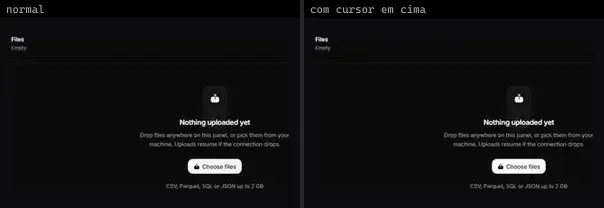 | **Upload Empty** `spectrumui:blocks/empty-states/upload-empty` | UI base | spectrumui · Apache-2.0 | clsx, motion, tailwind-merge |
| 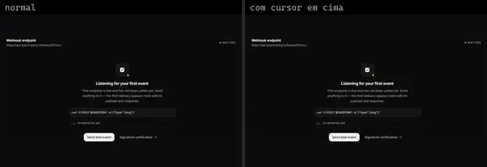 | **Webhook Empty** `spectrumui:blocks/empty-states/webhook-empty` | UI base | spectrumui · Apache-2.0 | clsx, motion, tailwind-merge |
