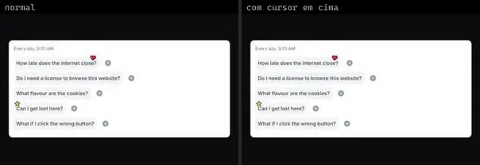
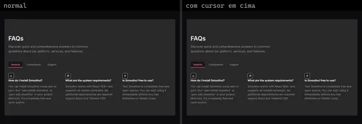
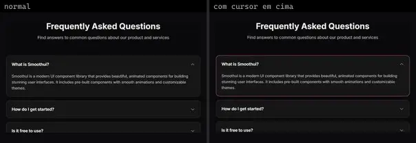
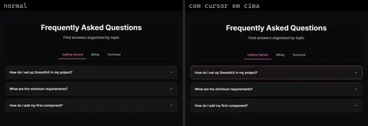
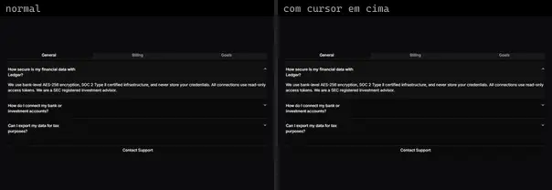

# FAQ (8)

Prévia: estado normal | com o cursor em cima. Código: `node scripts/atlas-find.mjs code <uid>` ou os arquivos em `catalog.jsonl → files`.

| prévia | componente | tipo de aplicação | biblioteca · licença | dependências npm |
|---|---|---|---|---|
|  | **Faq** `animata:accordion/faq` | Landing & Marketing | animata · MIT | @radix-ui/react-accordion, motion |
|  | **Faq 1** `smoothui:faq-1` | Landing & Marketing | smoothui · MIT | @repo/smoothui, lucide-react, motion |
|  | **Faq 2** `smoothui:faq-2` | Landing & Marketing | smoothui · MIT | @repo/smoothui, motion |
|  | **Faq 3** `smoothui:faq-3` | Landing & Marketing | smoothui · MIT | @repo/smoothui, lucide-react, motion |
|  | **Faq 4** `smoothui:faq-4` | Landing & Marketing | smoothui · MIT | @repo/smoothui, lucide-react, motion |
|  | **Faq Tabs Card** `spectrumui:faq-tabs-card` | Landing & Marketing | spectrumui · Apache-2.0 | clsx, lucide-react, motion, tailwind-merge |
|  | **Faq Accordion Block** `uitripled:sections/faq-accordion-block` | Landing & Marketing | uitripled · MIT | @radix-ui/react-slot, class-variance-authority, framer-motion, lucide-react |
|  | **Faq Section** `uitripled:sections/faq-section` | Landing & Marketing | uitripled · MIT | framer-motion, lucide-react |
