# Features & Bento (55)

Prévia: estado normal | com o cursor em cima. Código: `node scripts/atlas-find.mjs code <uid>` ou os arquivos em `catalog.jsonl → files`.

| prévia | componente | tipo de aplicação | biblioteca · licença | dependências npm |
|---|---|---|---|---|
|  | **Content Scan** `animata:feature-cards/content-scan` | Landing & Marketing | animata · MIT | motion |
|  | **Eight** `animata:bento-grid/eight` | Landing & Marketing | animata · MIT | lucide-react |
|  | **Email Feature Card** `animata:card/email-feature-card` | Landing & Marketing | animata · MIT | — |
|  | **Gradient** `animata:bento-grid/gradient` | Landing & Marketing | animata · MIT | lucide-react |
|  | **Stacked Sections** `animata:scroll/stacked-sections` | Landing & Marketing | animata · MIT | — |
|  | **Feature Carousel** `cultui:feature-carousel-demo` | Landing & Marketing | cultui · MIT | clsx, motion, react-wrap-balancer |
| 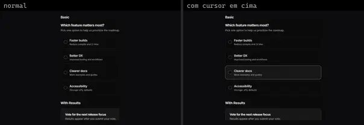 | **Feature Poll** `cultui:feature-poll-demo` | Landing & Marketing | cultui · MIT | @radix-ui/react-use-controllable-state, class-variance-authority, lucide-react |
|  | **Feature Sticky Section** `cultui:feature-sticky-section-demo` | Landing & Marketing | cultui · MIT | @radix-ui/react-slot, @radix-ui/react-use-controllable-state |
| 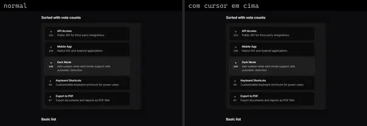 | **Feature Voting** `cultui:feature-voting-demo` | Landing & Marketing | cultui · MIT | @radix-ui/react-use-controllable-state, lucide-react |
|  | **Bento Card** `eldoraui:bento-01/components/bento-card` | Landing & Marketing | eldoraui · MIT | clsx, motion |
|  | **Features** `eldoraui:features-01/components/features` | Landing & Marketing | eldoraui · MIT | @radix-ui/react-accordion, clsx, motion, process, tailwind-merge |
| 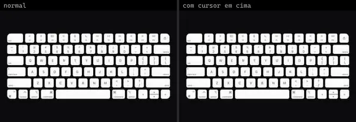 | **Keyboard** `eldoraui:bento-01/components/keyboard` | Landing & Marketing | eldoraui · MIT | clsx, motion |
|  | **Page** `eldoraui:features-01/page` | Landing & Marketing | eldoraui · MIT | lucide-react |
|  | **Bento** `magicui:bento-demo` | Landing & Marketing | magicui · MIT | @radix-ui/react-icons, lucide-react, motion |
|  | **Shine Border** `magicui:shine-border-demo` | Landing & Marketing | magicui · MIT | — |
|  | **Shine Border 2** `magicui:shine-border-demo-2` | Landing & Marketing | magicui · MIT | next-themes |
|  | **Mask Wipe Sections** `motiq:mask-wipe-sections` | Landing & Marketing | motiq · MIT | — |
| 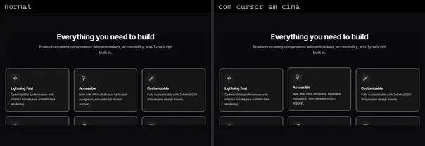 | **Features 1** `smoothui:features-1` | Landing & Marketing | smoothui · MIT | @repo/shadcn-ui, @repo/smoothui, motion |
| 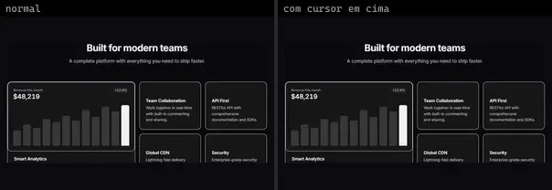 | **Features 2** `smoothui:features-2` | Landing & Marketing | smoothui · MIT | @repo/shadcn-ui, @repo/smoothui, motion |
| 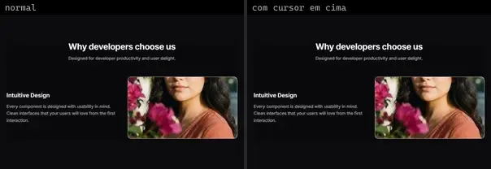 | **Features 3** `smoothui:features-3` | Landing & Marketing | smoothui · MIT | @repo/shadcn-ui, @repo/smoothui, @smoothui/data, motion |
| 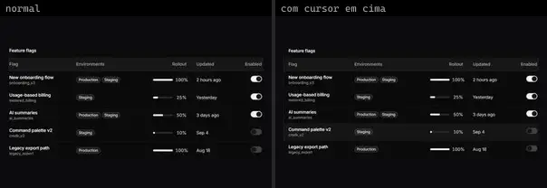 | **Feature Flags Table** `spectrumui:blocks/tables/feature-flags-table` | Landing & Marketing | spectrumui · Apache-2.0 | motion |
| 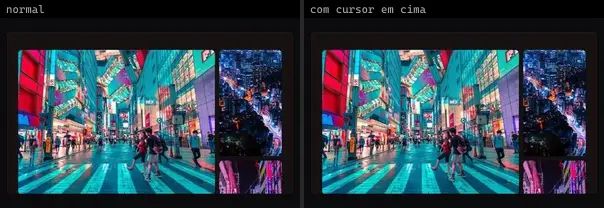 | **Grid Bento** `systaliko:blocks/grid-bento` | Landing & Marketing | systaliko · MIT | class-variance-authority |
|  | **Grid Bento Four Cells** `systaliko:blocks/grid-bento-four-cells` | Landing & Marketing | systaliko · MIT | class-variance-authority |
|  | **Grid Bento Three Cells** `systaliko:blocks/grid-bento-three-cells` | Landing & Marketing | systaliko · MIT | class-variance-authority |
|  | **Video Section** `systaliko:scroll-animations/video-section` | Landing & Marketing | systaliko · MIT · ⚠needs-network | @radix-ui/react-slot, class-variance-authority, motion |
|  | **About Us Section** `uitripled:sections/about-us-section` | Landing & Marketing | uitripled · MIT | class-variance-authority, framer-motion, lucide-react |
|  | **Bento Grid Block** `uitripled:sections/bento-grid-block` | Landing & Marketing | uitripled · MIT | @radix-ui/react-slot, class-variance-authority, framer-motion, lucide-react |
|  | **Blog Block** `uitripled:sections/blog-block` | Landing & Marketing | uitripled · MIT | @radix-ui/react-slot, class-variance-authority, framer-motion, lucide-react |
|  | **Browse Folder** `uitripled:sections/browse-folder` | Landing & Marketing | uitripled · MIT | @radix-ui/react-slot, @radix-ui/react-tabs, class-variance-authority, framer-motion, lucide-react |
|  | **Cinema Ticket** `uitripled:sections/cinema-ticket` | Landing & Marketing | uitripled · MIT | class-variance-authority, framer-motion, lucide-react |
|  | **Conference Ticket** `uitripled:sections/conference-ticket` | Landing & Marketing | uitripled · MIT | @radix-ui/react-avatar, class-variance-authority, framer-motion, lucide-react |
|  | **Contact Block** `uitripled:sections/contact-block` | Landing & Marketing | uitripled · MIT | @radix-ui/react-slot, class-variance-authority, framer-motion, lucide-react |
|  | **Contact Form Section** `uitripled:sections/contact-form-section` | Landing & Marketing | uitripled · MIT | @radix-ui/react-slot, class-variance-authority, framer-motion, lucide-react |
| 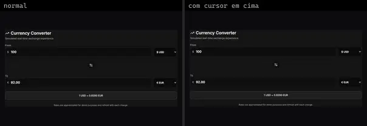 | **Currency Converter Card** `uitripled:sections/currency-converter-card` | Landing & Marketing | uitripled · MIT | framer-motion, lucide-react |
|  | **Feature Comparison Block** `uitripled:sections/feature-comparison-block` | Landing & Marketing | uitripled · MIT | @radix-ui/react-slot, class-variance-authority, framer-motion, lucide-react |
| 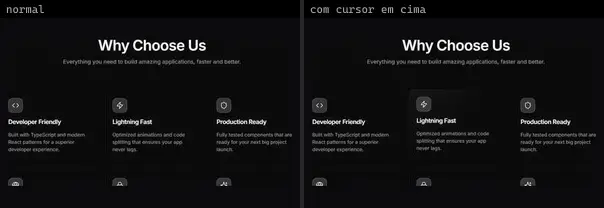 | **Feature Grid Section** `uitripled:sections/feature-grid-section` | Landing & Marketing | uitripled · MIT | framer-motion, lucide-react |
|  | **Gallery Grid Block** `uitripled:sections/gallery-grid-block` | Landing & Marketing | uitripled · MIT | @radix-ui/react-slot, class-variance-authority, framer-motion, lucide-react |
|  | **Glassmorphism Launch Timeline Block** `uitripled:sections/glassmorphism-launch-timeline-block` | Landing & Marketing | uitripled · MIT | @radix-ui/react-slot, class-variance-authority, framer-motion, lucide-react |
|  | **Glassmorphism Listen App Block** `uitripled:sections/glassmorphism-listen-app-block` | Landing & Marketing | uitripled · MIT · ⚠needs-network | @radix-ui/react-slot, class-variance-authority, lucide-react |
| 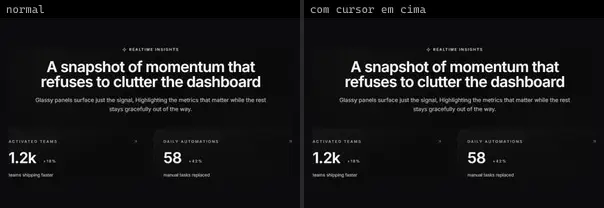 | **Glassmorphism Minimal Metrics Block** `uitripled:sections/glassmorphism-minimal-metrics-block` | Landing & Marketing | uitripled · MIT | @radix-ui/react-slot, class-variance-authority, framer-motion, lucide-react |
| 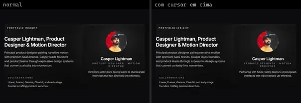 | **Glassmorphism Portfolio Block** `uitripled:sections/glassmorphism-portfolio-block` | Landing & Marketing | uitripled · MIT | @radix-ui/react-slot, class-variance-authority, framer-motion, lucide-react |
|  | **Glassmorphism Product Update Block** `uitripled:sections/glassmorphism-product-update-block` | Landing & Marketing | uitripled · MIT | @radix-ui/react-slot, class-variance-authority, framer-motion, lucide-react |
|  | **Glassmorphism Statistics Card** `uitripled:sections/glassmorphism-statistics-card` | Landing & Marketing | uitripled · MIT | framer-motion, lucide-react |
| 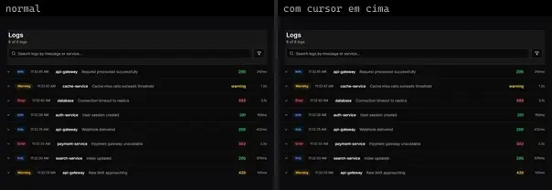 | **Interactive Logs Table** `uitripled:sections/interactive-logs-table` | Landing & Marketing | uitripled · MIT | @radix-ui/react-slot, class-variance-authority, framer-motion, lucide-react |
| 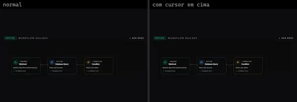 | **N8n Workflow Block** `uitripled:sections/n8n-workflow-block` | Landing & Marketing | uitripled · MIT | @radix-ui/react-slot, class-variance-authority, framer-motion, lucide-react |
|  | **Notion Blog Page** `uitripled:sections/notion-blog-page` | Landing & Marketing | uitripled · MIT | framer-motion, lucide-react |
|  | **Our Services Section** `uitripled:sections/our-services-section` | Landing & Marketing | uitripled · MIT | @radix-ui/react-slot, class-variance-authority, framer-motion, lucide-react |
|  | **Projects Block** `uitripled:sections/projects-block` | Landing & Marketing | uitripled · MIT | class-variance-authority, framer-motion, lucide-react |
| 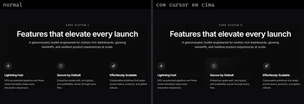 | **Scroll Reveal** `uitripled:sections/scroll-reveal` | Landing & Marketing | uitripled · MIT | framer-motion, lucide-react |
|  | **Services Grid Block** `uitripled:sections/services-grid-block` | Landing & Marketing | uitripled · MIT | @radix-ui/react-slot, class-variance-authority, framer-motion, lucide-react |
|  | **Spotlight Section** `uitripled:motion-core/spotlight-section` | Landing & Marketing | uitripled · MIT | framer-motion |
| 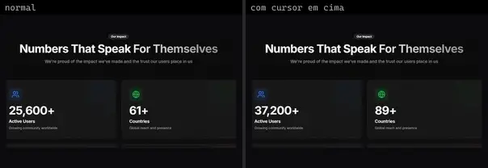 | **Stats Counter Block** `uitripled:sections/stats-counter-block` | Landing & Marketing | uitripled · MIT | class-variance-authority, framer-motion, lucide-react |
| 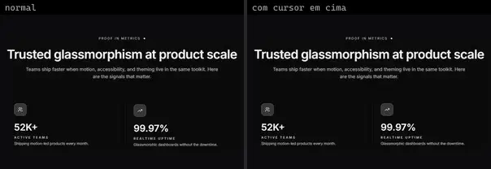 | **Stats Section** `uitripled:sections/stats-section` | Landing & Marketing | uitripled · MIT | framer-motion, lucide-react |
| 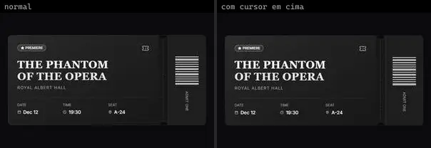 | **Theater Ticket** `uitripled:sections/theater-ticket` | Landing & Marketing | uitripled · MIT | class-variance-authority, framer-motion, lucide-react |
| 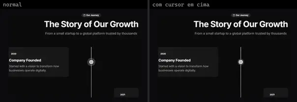 | **Timeline Block** `uitripled:sections/timeline-block` | Landing & Marketing | uitripled · MIT | class-variance-authority, framer-motion, lucide-react |
