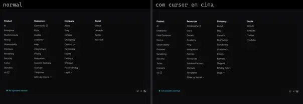
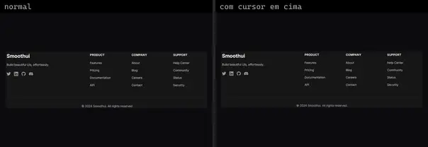
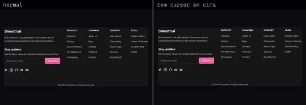
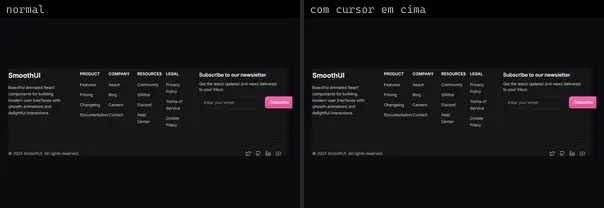
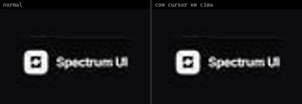
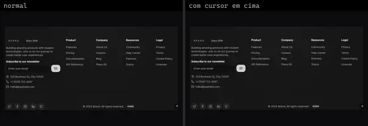

# Footer (21)

Prévia: estado normal | com o cursor em cima. Código: `node scripts/atlas-find.mjs code <uid>` ou os arquivos em `catalog.jsonl → files`.

| prévia | componente | tipo de aplicação | biblioteca · licença | dependências npm |
|---|---|---|---|---|
|  | **Footer** `eldoraui:footer-01/components/footer` | Landing & Marketing | eldoraui · MIT | @radix-ui/react-dropdown-menu, @radix-ui/react-slot, class-variance-authority, lucide-react |
|  | **Text Hover Effect** `eldoraui:footer-01/components/text-hover-effect` | Landing & Marketing | eldoraui · MIT | motion |
|  | **Sticky Footer** `fancy:blocks/sticky-footer-demo` | Landing & Marketing | fancy · MIT | — |
|  | **Footer 1** `smoothui:footer-1` | Landing & Marketing | smoothui · MIT | @repo/smoothui, motion |
|  | **Footer 2** `smoothui:footer-2` | Landing & Marketing | smoothui · MIT | @repo/smoothui, motion |
|  | **Footer 3** `smoothui:footer-3` | Landing & Marketing | smoothui · MIT | @repo/smoothui, lucide-react, motion |
|  | **Footer 4** `smoothui:footer-4` | Landing & Marketing | smoothui · MIT | @repo/smoothui, lucide-react, motion |
|  | **Ask Docs Footer** `spectrumui:blocks/footers/ask-docs-footer` | Landing & Marketing | spectrumui · Apache-2.0 · ⚠needs-props | clsx, tailwind-merge |
|  | **Careers Footer** `spectrumui:blocks/footers/careers-footer` | Landing & Marketing | spectrumui · Apache-2.0 · ⚠needs-props | clsx, tailwind-merge |
|  | **Contact Card Footer** `spectrumui:blocks/footers/contact-card-footer` | Landing & Marketing | spectrumui · Apache-2.0 | clsx, tailwind-merge |
|  | **Footer Kit** `spectrumui:blocks/footers/footer-kit` | Landing & Marketing | spectrumui · Apache-2.0 | clsx, tailwind-merge |
|  | **Mega Sitemap Footer** `spectrumui:blocks/footers/mega-sitemap-footer` | Landing & Marketing | spectrumui · Apache-2.0 · ⚠needs-props | @radix-ui/react-slot, class-variance-authority, clsx, tailwind-merge |
|  | **Minimal Footer** `spectrumui:blocks/footers/minimal-footer` | Landing & Marketing | spectrumui · Apache-2.0 · ⚠needs-props | @radix-ui/react-popover, clsx, tailwind-merge |
|  | **Policy Footer** `spectrumui:blocks/footers/policy-footer` | Landing & Marketing | spectrumui · Apache-2.0 · ⚠needs-props | @radix-ui/react-slot, @radix-ui/react-switch, class-variance-authority, clsx, tailwind-merge |
|  | **Release Feed Footer** `spectrumui:blocks/footers/release-feed-footer` | Landing & Marketing | spectrumui · Apache-2.0 · ⚠needs-props | clsx, tailwind-merge |
|  | **Service Status Footer** `spectrumui:blocks/footers/service-status-footer` | Landing & Marketing | spectrumui · Apache-2.0 · ⚠needs-props | clsx, tailwind-merge |
|  | **Social Proof Footer** `spectrumui:blocks/footers/social-proof-footer` | Landing & Marketing | spectrumui · Apache-2.0 · ⚠needs-props | clsx, tailwind-merge |
|  | **Token Stream Footer** `spectrumui:blocks/footers/token-stream-footer` | Landing & Marketing | spectrumui · Apache-2.0 · ⚠needs-props | clsx, tailwind-merge |
|  | **Trust Center Footer** `spectrumui:blocks/footers/trust-center-footer` | Landing & Marketing | spectrumui · Apache-2.0 · ⚠needs-props | @radix-ui/react-slot, @radix-ui/react-tooltip, class-variance-authority, clsx, tailwind-merge |
|  | **Waitlist Footer** `spectrumui:blocks/footers/waitlist-footer` | Landing & Marketing | spectrumui · Apache-2.0 | @radix-ui/react-slot, class-variance-authority, clsx, tailwind-merge |
|  | **Footer Block** `uitripled:sections/footer-block` | Landing & Marketing | uitripled · MIT | @radix-ui/react-slot, class-variance-authority, framer-motion, lucide-react |
