# Formulário (22)

Prévia: estado normal | com o cursor em cima. Código: `node scripts/atlas-find.mjs code <uid>` ou os arquivos em `catalog.jsonl → files`.

| prévia | componente | tipo de aplicação | biblioteca · licença | dependências npm |
|---|---|---|---|---|
| 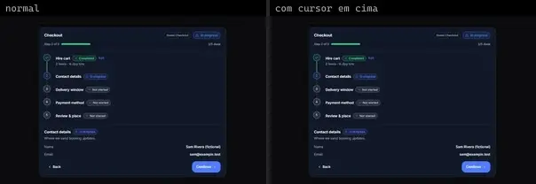 | **Checkout Progress** `motiq:catalog/checkout-progress` | E-commerce | motiq · MIT | motion |
| 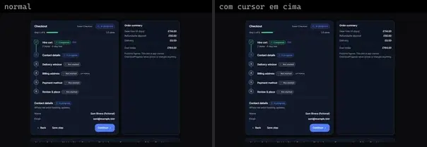 | **Checkout Progress** `motiq:checkout-progress` | E-commerce | motiq · MIT | motion |
|  | **Glass Checkout Card** `uitripled:components/cards/shadcnui/glass-checkout-card` | E-commerce | uitripled · MIT | @radix-ui/react-slot, class-variance-authority, framer-motion, lucide-react |
| 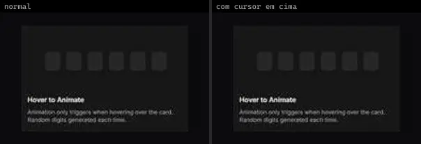 | **Clerk Otp** `eldoraui:clerk-otp-demo` | Login & Conta | eldoraui · MIT | motion |
| 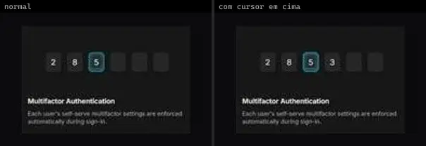 | **Clerk Otp Demo 2** `eldoraui:clerk-otp-demo-2` | Login & Conta | eldoraui · MIT | motion |
|  | **Glass Account Settings** `uitripled:components/forms/glass-account-settings` | Login & Conta | uitripled · MIT | @radix-ui/react-slot, @radix-ui/react-switch, class-variance-authority, framer-motion, lucide-react |
|  | **Glass Forgot Password** `uitripled:components/forms/glass-forgot-password` | Login & Conta | uitripled · MIT | @radix-ui/react-slot, class-variance-authority, framer-motion |
| 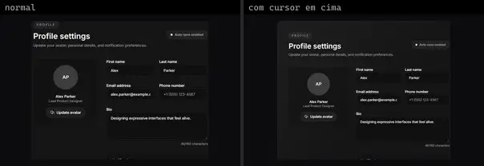 | **Glass Profile Settings** `uitripled:components/forms/glass-profile-settings` | Login & Conta | uitripled · MIT | @radix-ui/react-avatar, @radix-ui/react-slot, @radix-ui/react-switch, class-variance-authority, framer-motion, lucide-react |
|  | **Honest Lionfish · KhelVers** `uiverse:Forms/KhelVers_honest-lionfish-67` | Login & Conta | uiverse · MIT | — |
|  | **Pretty Snake · SelfMadeSystem** `uiverse:Forms/SelfMadeSystem_pretty-snake-70` | Login & Conta | uiverse · MIT | — |
| 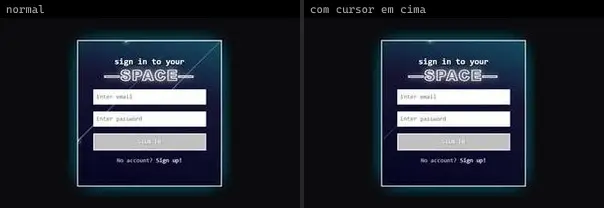 | **Spicy Horse · John-CFO** `uiverse:Forms/John-CFO_spicy-horse-10` | Login & Conta | uiverse · MIT | — |
|  | **Stale Chipmunk · glisovic01** `uiverse:Forms/glisovic01_stale-chipmunk-33` | Login & Conta | uiverse · MIT | — |
|  | **Tender Husky · kennyotsu** `uiverse:Forms/kennyotsu_tender-husky-10` | Login & Conta | uiverse · MIT | — |
| 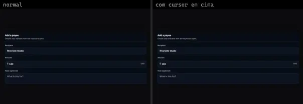 | **Keyboard Safe Form** `motiq:catalog/keyboard-safe-form` | UI base | motiq · MIT | motion |
| 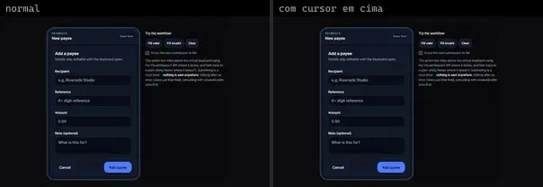 | **Keyboard Safe Form** `motiq:keyboard-safe-form` | UI base | motiq · MIT | motion |
| 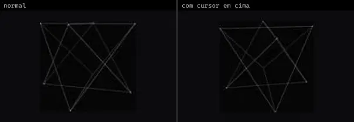 | **Wireframe Forms · Cube** `threeui:wireframe-forms/cube` | UI base | threeui · MIT | — |
| 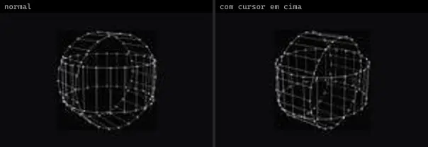 | **Wireframe Forms · Cylinders** `threeui:wireframe-forms/cylinders` | UI base | threeui · MIT | — |
| 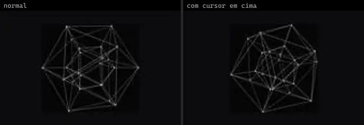 | **Wireframe Forms · Sphere** `threeui:wireframe-forms/sphere` | UI base | threeui · MIT | — |
| 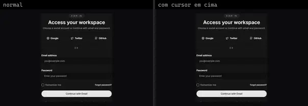 | **Glass Sign In** `uitripled:components/forms/glass-sign-in` | UI base | uitripled · MIT | @radix-ui/react-checkbox, @radix-ui/react-slot, class-variance-authority, framer-motion, lucide-react |
|  | **Glass Sign Up** `uitripled:components/forms/glass-sign-up` | UI base | uitripled · MIT | @radix-ui/react-checkbox, @radix-ui/react-slot, class-variance-authority, framer-motion, lucide-react |
| 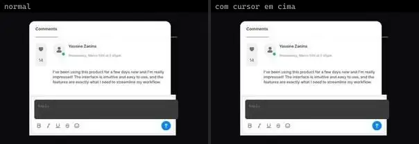 | **Quiet Turkey · zanina-yassine** `uiverse:Forms/zanina-yassine_quiet-turkey-90` | UI base | uiverse · MIT | — |
| 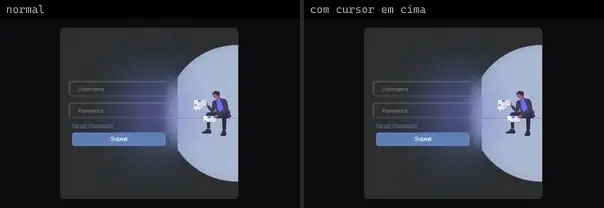 | **Serious Duck · sameer2malik** `uiverse:Forms/sameer2malik_serious-duck-16` | UI base | uiverse · MIT | — |
