# Fundo & Efeito (196)

Prévia: estado normal | com o cursor em cima. Código: `node scripts/atlas-find.mjs code <uid>` ou os arquivos em `catalog.jsonl → files`.

| prévia | componente | tipo de aplicação | biblioteca · licença | dependências npm |
|---|---|---|---|---|
| 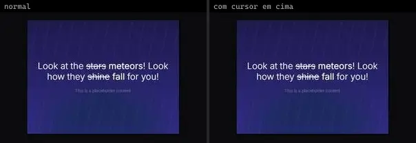 | **Animated Beam** `animata:background/animated-beam` | Efeitos & Animação | animata · MIT | — |
| 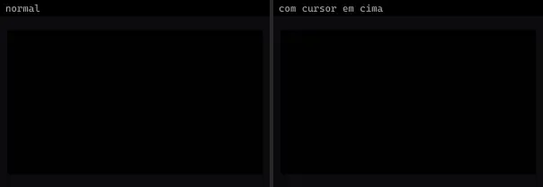 | **Blurry Blob** `animata:background/blurry-blob` | Efeitos & Animação | animata · MIT | — |
| 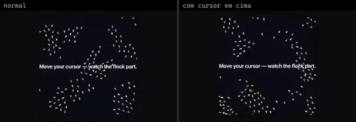 | **Boids Ecosystem** `animata:background/boids-ecosystem` | Efeitos & Animação | animata · MIT | — |
|  | **Interactive Grid** `animata:background/interactive-grid` | Efeitos & Animação | animata · MIT | — |
|  | **Shooting Stars** `animata:background/shooting-stars` | Efeitos & Animação | animata · MIT | — |
| 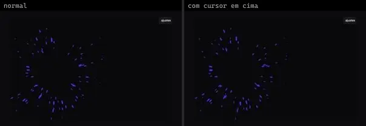 | **Antigravity** `atlas:Backgrounds/Antigravity` | Efeitos & Animação | atlas (própria) · Proprietária (Atlas) | three |
| 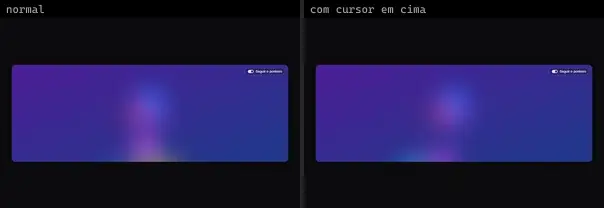 | **BubbleBackground** `atlas:Backgrounds/BubbleBackground` | Efeitos & Animação | atlas (própria) · Proprietária (Atlas) | motion |
|  | **FilmGrain** `atlas:Backgrounds/FilmGrain` | Efeitos & Animação | atlas (própria) · Proprietária (Atlas) | — |
| 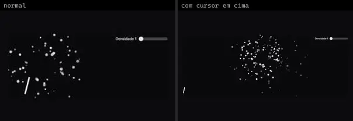 | **Fireworks** `atlas:Backgrounds/Fireworks` | Efeitos & Animação | atlas (própria) · Proprietária (Atlas) | — |
| 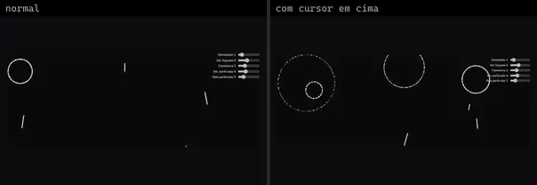 | **FireworksRing** `atlas:Backgrounds/FireworksRing` | Efeitos & Animação | atlas (própria) · Proprietária (Atlas) | — |
| 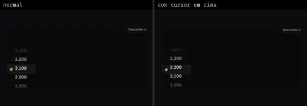 | **GithubStarsWheel** `atlas:Misc/GithubStarsWheel` | Efeitos & Animação | atlas (própria) · Proprietária (Atlas) | motion |
| 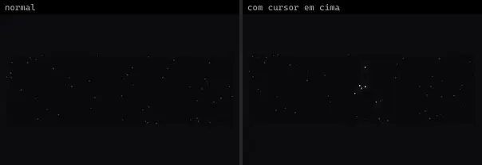 | **GravityStars** `atlas:Backgrounds/GravityStars` | Efeitos & Animação | atlas (própria) · Proprietária (Atlas) | clsx, tailwind-merge |
| 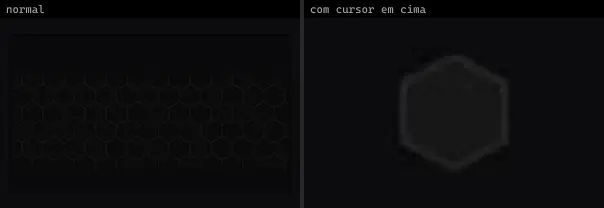 | **HoneycombGrid** `atlas:Backgrounds/HoneycombGrid` | Efeitos & Animação | atlas (própria) · Proprietária (Atlas) | — |
| 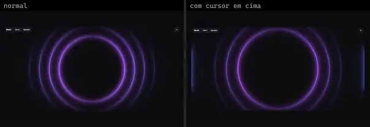 | **MagicRings** `atlas:Backgrounds/MagicRings` | Efeitos & Animação | atlas (própria) · Proprietária (Atlas) | — |
| 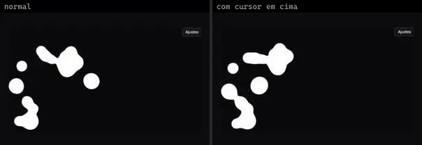 | **MetaBalls** `atlas:Backgrounds/MetaBalls` | Efeitos & Animação | atlas (própria) · Proprietária (Atlas) | — |
| 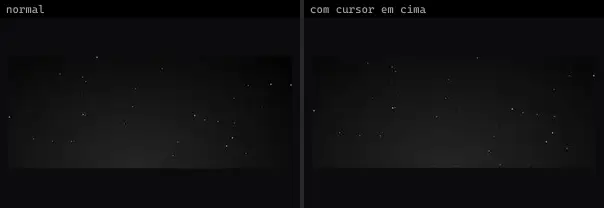 | **StarfieldBackground** `atlas:Backgrounds/StarfieldBackground` | Efeitos & Animação | atlas (própria) · Proprietária (Atlas) | motion |
| 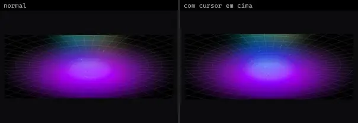 | **TunnelHole** `atlas:Backgrounds/TunnelHole` | Efeitos & Animação | atlas (própria) · Proprietária (Atlas) | — |
| 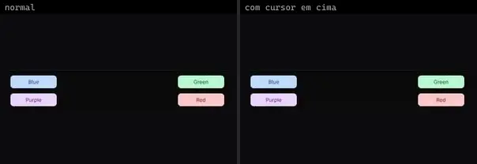 | **Colored** `bundui:ripple-effect/colored` | Efeitos & Animação | bundui · MIT | motion |
|  | **Fireworks** `bundui:backgrounds/fireworks` | Efeitos & Animação | bundui · MIT | @radix-ui/react-slot, class-variance-authority |
|  | **Floating Paths** `bundui:backgrounds/floating-paths` | Efeitos & Animação | bundui · MIT | @radix-ui/react-slot, class-variance-authority, motion |
| 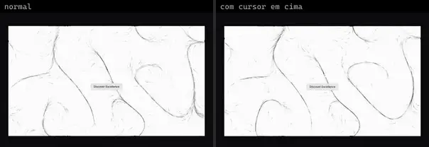 | **Fluid Particles** `bundui:backgrounds/fluid-particles` | Efeitos & Animação | bundui · MIT | @radix-ui/react-slot, class-variance-authority |
| 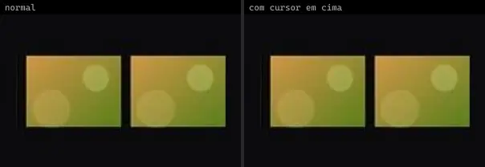 | **Image** `bundui:ripple-effect/image` | Efeitos & Animação | bundui · MIT | motion |
| 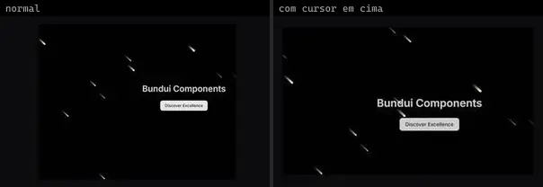 | **Meteor Shower** `bundui:backgrounds/meteor-shower` | Efeitos & Animação | bundui · MIT | @radix-ui/react-slot, class-variance-authority, next-themes |
| 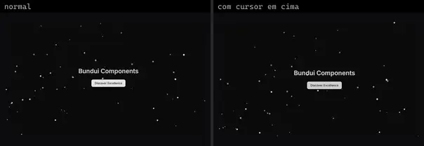 | **Snowfall** `bundui:backgrounds/snowfall` | Efeitos & Animação | bundui · MIT | @radix-ui/react-slot, class-variance-authority, next-themes |
|  | **Stars** `bundui:backgrounds/stars` | Efeitos & Animação | bundui · MIT | @radix-ui/react-slot, class-variance-authority, motion |
| 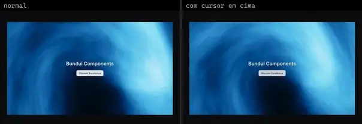 | **Wavy** `bundui:backgrounds/wavy` | Efeitos & Animação | bundui · MIT | @radix-ui/react-slot, class-variance-authority |
| 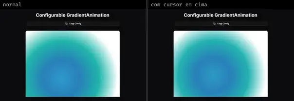 | **Bg Animated Gradient** `cultui:bg-animated-gradient-demo` | Efeitos & Animação | cultui · MIT | lucide-react, motion |
| 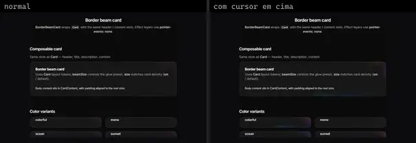 | **Border Beam Card** `cultui:border-beam-card-demo` | Efeitos & Animação | cultui · MIT | border-beam |
| 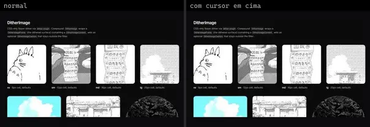 | **Dither Image** `cultui:dither-image-demo` | Efeitos & Animação | cultui · MIT | — |
| 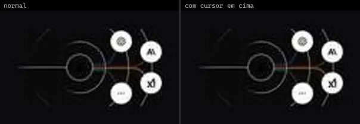 | **Gateway Endpoint Illustration** `cultui:gateway-endpoint-illustration-demo` | Efeitos & Animação | cultui · MIT | — |
| 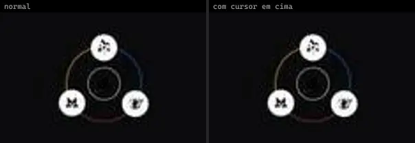 | **Gateway Route Illustration** `cultui:gateway-route-illustration-demo` | Efeitos & Animação | cultui · MIT | — |
| 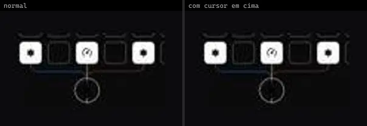 | **Gateway Svg Illustration** `cultui:gateway-svg-illustration-demo` | Efeitos & Animação | cultui · MIT | — |
| 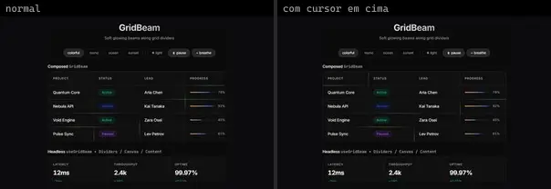 | **Grid Beam** `cultui:grid-beam-demo` | Efeitos & Animação | cultui · MIT | next-themes |
|  | **Hero Dithering** `cultui:hero-dithering-demo` | Efeitos & Animação | cultui · MIT | @paper-design/shaders-react |
| 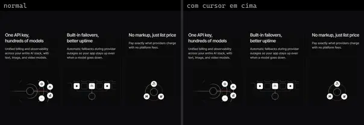 | **Illustration Card Grid** `cultui:illustration-card-grid-demo` | Efeitos & Animação | cultui · MIT · ⚠needs-network | — |
| 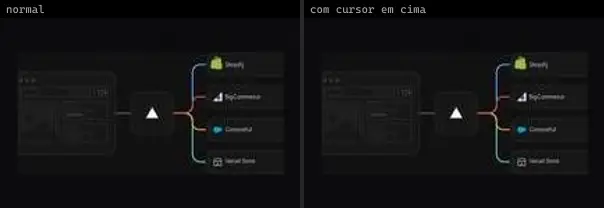 | **Illustration Fluid Rendering** `cultui:illustration-fluid-rendering-demo` | Efeitos & Animação | cultui · MIT | — |
| 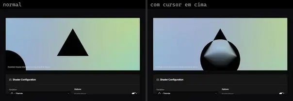 | **Shader Lens Blur** `cultui:shader-lens-blur-demo` | Efeitos & Animação | cultui · MIT | jotai, lucide-react, motion, next-themes, three |
|  | **Stripe Bg Guides** `cultui:stripe-bg-guides-demo` | Efeitos & Animação | cultui · MIT | motion |
| 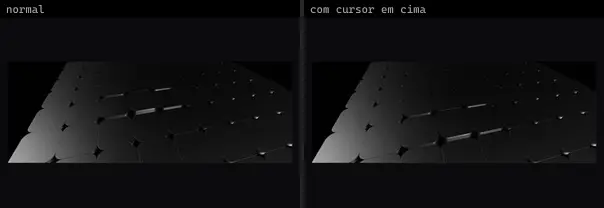 | **Animated Grid Pattern** `eldoraui:animated-grid-pattern-demo` | Efeitos & Animação | eldoraui · MIT | @react-three/fiber, next-themes, three |
| 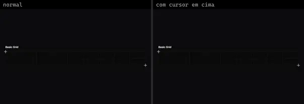 | **Grid** `eldoraui:grid-demo` | Efeitos & Animação | eldoraui · MIT | — |
| 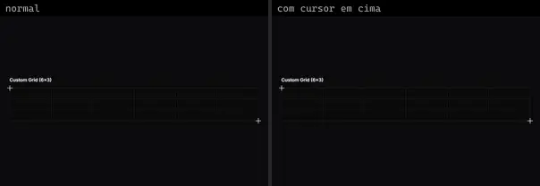 | **Grid Demo 2** `eldoraui:grid-demo-2` | Efeitos & Animação | eldoraui · MIT | — |
|  | **Grid Demo 3** `eldoraui:grid-demo-3` | Efeitos & Animação | eldoraui · MIT | — |
| 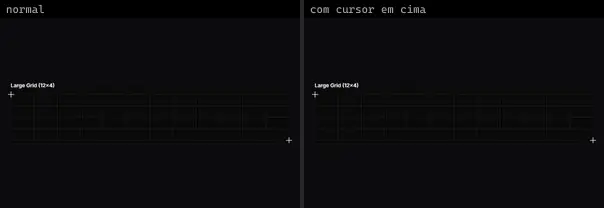 | **Grid Demo 4** `eldoraui:grid-demo-4` | Efeitos & Animação | eldoraui · MIT | — |
| 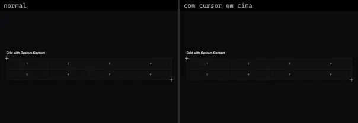 | **Grid Demo 5** `eldoraui:grid-demo-5` | Efeitos & Animação | eldoraui · MIT | — |
| 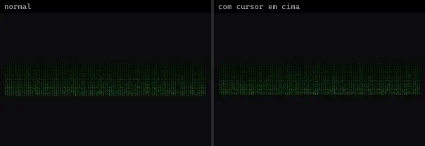 | **Hacker Background** `eldoraui:hacker-background-demo` | Efeitos & Animação | eldoraui · MIT | — |
| 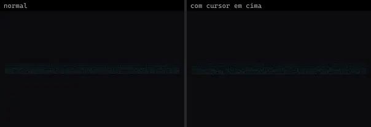 | **Hacker Background Demo 2** `eldoraui:hacker-background-demo-2` | Efeitos & Animação | eldoraui · MIT | — |
| 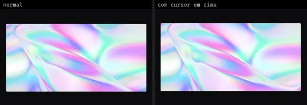 | **Novatrix Background** `eldoraui:novatrix-background-demo` | Efeitos & Animação | eldoraui · MIT | ogl |
| 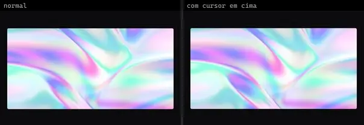 | **Novatrix Background Demo 2** `eldoraui:novatrix-background-demo-2` | Efeitos & Animação | eldoraui · MIT | ogl |
| 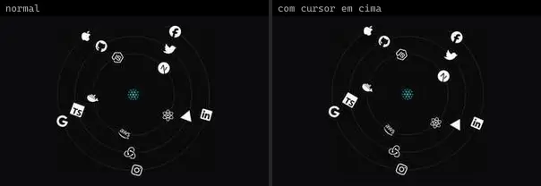 | **Orbit Rotation** `eldoraui:orbit-rotation-demo` | Efeitos & Animação | eldoraui · MIT | react-icons |
| 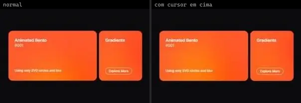 | **Animated Gradient** `fancy:background/animated-gradient-demo` | Efeitos & Animação | fancy · MIT | — |
| 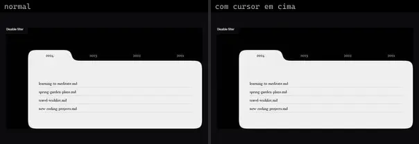 | **Gooey Svg Filter** `fancy:filter/gooey-svg-filter-demo` | Efeitos & Animação | fancy · MIT · ⚠needs-network | @radix-ui/react-slot, class-variance-authority, motion |
|  | **Pixelate Svg Filter** `fancy:filter/pixelate-svg-filter-demo` | Efeitos & Animação | fancy · MIT · ⚠needs-network | — |
|  | **Collaborative Canvas** `kibo:collaborative-canvas` | Efeitos & Animação | kibo · MIT | @repo/avatar-stack, @repo/cursor, @repo/shadcn-ui, clsx, radix-ui, tailwind-merge |
| 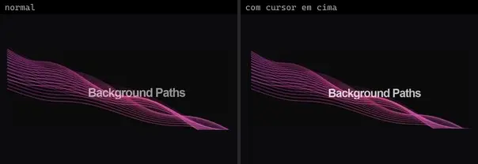 | **Background Paths** `kokonutui:background-paths` | Efeitos & Animação | kokonutui · MIT | motion |
|  | **Beams Background** `kokonutui:beams-background` | Efeitos & Animação | kokonutui · MIT | clsx, motion, tailwind-merge |
|  | **Bento Grid** `kokonutui:bento-grid` | Efeitos & Animação | kokonutui · MIT | lucide-react, motion |
| 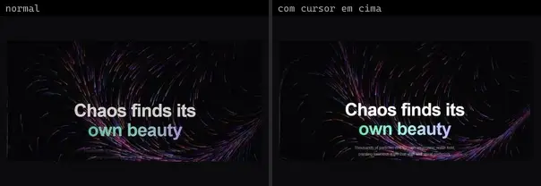 | **Flow Field** `kokonutui:flow-field` | Efeitos & Animação | kokonutui · MIT | clsx, motion, tailwind-merge |
| 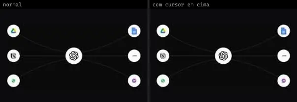 | **Animated Beam** `magicui:animated-beam-demo` | Efeitos & Animação | magicui · MIT | motion |
| 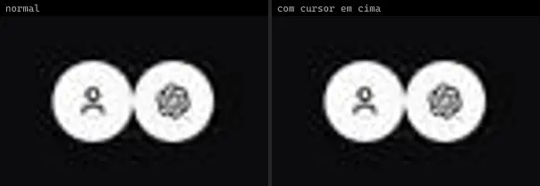 | **Animated Beam Bidirectional** `magicui:animated-beam-bidirectional` | Efeitos & Animação | magicui · MIT | motion |
| 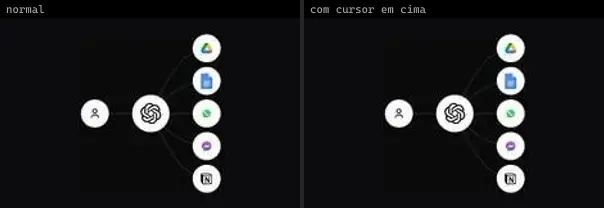 | **Animated Beam Multiple Outputs** `magicui:animated-beam-multiple-outputs` | Efeitos & Animação | magicui · MIT | motion |
| 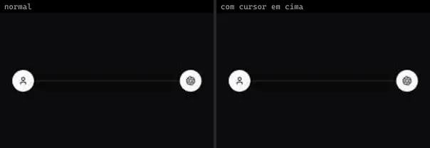 | **Animated Beam Unidirectional** `magicui:animated-beam-unidirectional` | Efeitos & Animação | magicui · MIT | motion |
| 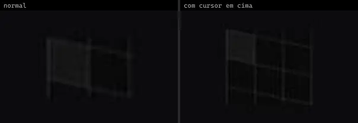 | **Animated Grid Pattern** `magicui:animated-grid-pattern-demo` | Efeitos & Animação | magicui · MIT | motion |
| 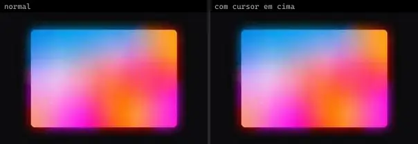 | **Backlight Image Demo** `magicui:backlight-image-demo` | Efeitos & Animação | magicui · MIT | — |
|  | **Backlight Svg Demo** `magicui:backlight-svg-demo` | Efeitos & Animação | magicui · MIT | — |
|  | **Bento Vertical** `magicui:bento-demo-vertical` | Efeitos & Animação | magicui · MIT · ⚠needs-network | @radix-ui/react-icons |
|  | **Border Beam** `magicui:border-beam-demo-2` | Efeitos & Animação | magicui · MIT | lucide-react, motion |
|  | **Border Beam** `magicui:border-beam-demo` | Efeitos & Animação | magicui · MIT | motion |
|  | **Border Beam 3** `magicui:border-beam-demo-3` | Efeitos & Animação | magicui · MIT | motion |
|  | **Border Beam 4** `magicui:border-beam-demo-4` | Efeitos & Animação | magicui · MIT | motion |
|  | **Cool Mode Custom** `magicui:cool-mode-custom` | Efeitos & Animação | magicui · MIT | — |
|  | **Dot Pattern** `magicui:dot-pattern-demo` | Efeitos & Animação | magicui · MIT | motion |
|  | **Dot Pattern Linear Gradient** `magicui:dot-pattern-linear-gradient` | Efeitos & Animação | magicui · MIT | motion |
|  | **Dot Pattern with glow effect** `magicui:dot-pattern-with-glow-effect` | Efeitos & Animação | magicui · MIT | motion |
|  | **Flickering Grid** `magicui:flickering-grid-demo` | Efeitos & Animação | magicui · MIT | — |
|  | **Flickering Grid Rounded** `magicui:flickering-grid-rounded-demo` | Efeitos & Animação | magicui · MIT | — |
|  | **Floating 3D Particles** `magicui:floating-3d-particles-demo` | Efeitos & Animação | magicui · MIT | lucide-react, next-themes |
|  | **Floating 3D Particles 2** `magicui:floating-3d-particles-demo-2` | Efeitos & Animação | magicui · MIT | next-themes |
|  | **Grid Pattern** `magicui:grid-pattern-demo` | Efeitos & Animação | magicui · MIT | — |
|  | **Grid Pattern Dashed** `magicui:grid-pattern-dashed` | Efeitos & Animação | magicui · MIT | — |
|  | **Grid Pattern Linear Gradient** `magicui:grid-pattern-linear-gradient` | Efeitos & Animação | magicui · MIT | — |
|  | **Hexagon Pattern** `magicui:hexagon-pattern-demo` | Efeitos & Animação | magicui · MIT | — |
|  | **Hexagon Pattern Dashed** `magicui:hexagon-pattern-dashed` | Efeitos & Animação | magicui · MIT | — |
|  | **Hexagon Pattern Linear Gradient** `magicui:hexagon-pattern-linear-gradient` | Efeitos & Animação | magicui · MIT | — |
|  | **Hexagon Pattern Spacing** `magicui:hexagon-pattern-spacing` | Efeitos & Animação | magicui · MIT | — |
|  | **Interactive Grid Pattern** `magicui:interactive-grid-pattern-demo` | Efeitos & Animação | magicui · MIT | — |
|  | **Interactive Grid Pattern 2** `magicui:interactive-grid-pattern-demo-2` | Efeitos & Animação | magicui · MIT | — |
|  | **Light Rays Demo** `magicui:light-rays-demo` | Efeitos & Animação | magicui · MIT | motion |
|  | **Meteors** `magicui:meteors-demo` | Efeitos & Animação | magicui · MIT | — |
|  | **Orbiting Circles** `magicui:orbiting-circles-demo` | Efeitos & Animação | magicui · MIT | — |
|  | **Particles** `magicui:particles-demo` | Efeitos & Animação | magicui · MIT | next-themes |
|  | **Retro Grid** `magicui:retro-grid-demo` | Efeitos & Animação | magicui · MIT | — |
|  | **Ripple** `magicui:ripple-demo` | Efeitos & Animação | magicui · MIT | — |
|  | **Striped Pattern** `magicui:striped-pattern-demo` | Efeitos & Animação | magicui · MIT | — |
|  | **Striped Pattern (Dashed)** `magicui:striped-pattern-dashed` | Efeitos & Animação | magicui · MIT | — |
|  | **Warp Background** `magicui:warp-background-demo` | Efeitos & Animação | magicui · MIT | motion |
|  | **Animated Card Background Hover** `motionprimitives:animated-background/animated-card-background-hover` | Efeitos & Animação | motionprimitives · MIT | motion |
|  | **Animated Tabs** `motionprimitives:animated-background/animated-tabs` | Efeitos & Animação | motionprimitives · MIT | lucide-react, motion |
|  | **Animated Tabs Hover** `motionprimitives:animated-background/animated-tabs-hover` | Efeitos & Animação | motionprimitives · MIT | motion |
|  | **Glow Effect Card Background** `motionprimitives:glow-effect/glow-effect-card-background` | Efeitos & Animação | motionprimitives · MIT | motion |
|  | **In View Images Grid** `motionprimitives:in-view/in-view-images-grid` | Efeitos & Animação | motionprimitives · MIT | motion |
|  | **Segmented Control** `motionprimitives:animated-background/segmented-control` | Efeitos & Animação | motionprimitives · MIT | motion |
|  | **Adaptive Safe Zone Grid** `motiq:adaptive-safe-zone-grid` | Efeitos & Animação | motiq · MIT | — |
|  | **Adaptive Safe Zone Grid** `motiq:catalog/adaptive-safe-zone-grid` | Efeitos & Animação | motiq · MIT | — |
|  | **Copperplate Hatch** `motiq:catalog/copperplate-hatch` | Efeitos & Animação | motiq · MIT | — |
|  | **Copperplate Hatch** `motiq:copperplate-hatch` | Efeitos & Animação | motiq · MIT | — |
|  | **Core Strata** `motiq:catalog/core-strata` | Efeitos & Animação | motiq · MIT | — |
|  | **Core Strata** `motiq:core-strata` | Efeitos & Animação | motiq · MIT | — |
|  | **Filters 1** `reui:filters/c-filters-1` | Efeitos & Animação | reui · MIT | class-variance-authority, cn, radix-ui |
|  | **Filters 3** `reui:filters/c-filters-3` | Efeitos & Animação | reui · MIT | class-variance-authority, cn, radix-ui |
|  | **Apple Invites** `smoothui:canvas/apple-invites` | Efeitos & Animação | smoothui · MIT | @docs/examples, @repo/smoothui, lucide-react, motion, popmotion |
|  | **Arcade Pixel** `smoothui:canvas/arcade-pixel` | Efeitos & Animação | smoothui · MIT | @repo/shadcn-ui, @repo/smoothui, motion |
|  | **Aurora Curtain** `smoothui:aurora-curtain` | Efeitos & Animação | smoothui · MIT | @radix-ui/react-slot, @repo/shadcn-ui, @repo/smoothui, class-variance-authority, motion |
|  | **Aurora Curtain** `smoothui:canvas/aurora-curtain` | Efeitos & Animação | smoothui · MIT | @repo/shadcn-ui, @repo/smoothui, motion |
|  | **Border Beam** `smoothui:border-beam` | Efeitos & Animação | smoothui · MIT | @radix-ui/react-slot, @repo/shadcn-ui, @repo/smoothui, class-variance-authority, lucide-react, motion |
|  | **Dither Image** `smoothui:dither-image` | Efeitos & Animação | smoothui · MIT | @repo/shadcn-ui, @repo/smoothui, @smoothui/data, motion |
|  | **Dynamic Island** `smoothui:canvas/dynamic-island` | Efeitos & Animação | smoothui · MIT | @repo/smoothui, lucide-react, motion |
|  | **Emoji Reaction** `smoothui:canvas/emoji-reaction` | Efeitos & Animação | smoothui · MIT | @repo/shadcn-ui, @repo/smoothui, lucide-react, motion |
|  | **Github Stars Animation** `smoothui:github-stars-animation` | Efeitos & Animação | smoothui · MIT · ⚠needs-network | @repo/shadcn-ui, @repo/smoothui, lucide-react, motion |
|  | **Gooey Filter** `smoothui:gooey-filter` | Efeitos & Animação | smoothui · MIT | @radix-ui/react-slot, @repo/shadcn-ui, @repo/smoothui, class-variance-authority, lucide-react, motion |
|  | **Gravity Stars** `smoothui:canvas/gravity-stars` | Efeitos & Animação | smoothui · MIT | @repo/shadcn-ui, @repo/smoothui, motion |
|  | **Gravity Stars** `smoothui:gravity-stars` | Efeitos & Animação | smoothui · MIT | @radix-ui/react-slot, @repo/shadcn-ui, @repo/smoothui, class-variance-authority, motion |
|  | **Grid Loader** `smoothui:grid-loader` | Efeitos & Animação | smoothui · MIT | @repo/shadcn-ui, @repo/smoothui, motion |
|  | **Holographic Foil** `smoothui:canvas/holographic-foil` | Efeitos & Animação | smoothui · MIT | @repo/shadcn-ui, @repo/smoothui, @smoothui/data, motion |
|  | **Holographic Foil** `smoothui:holographic-foil` | Efeitos & Animação | smoothui · MIT | @radix-ui/react-slot, @repo/shadcn-ui, @repo/smoothui, @smoothui/data, class-variance-authority, motion |
|  | **Liquid Metal** `smoothui:canvas/liquid-metal` | Efeitos & Animação | smoothui · MIT | @repo/shadcn-ui, @repo/smoothui, motion |
|  | **Liquid Metal** `smoothui:liquid-metal` | Efeitos & Animação | smoothui · MIT | @repo/shadcn-ui, @repo/smoothui, motion |
|  | **Pixel Brush Canvas** `smoothui:pixel-brush-canvas` | Efeitos & Animação | smoothui · MIT | @repo/shadcn-ui, @repo/smoothui, motion |
|  | **Pixel Flow Field** `smoothui:pixel-flow-field` | Efeitos & Animação | smoothui · MIT | @radix-ui/react-slot, @repo/shadcn-ui, @repo/smoothui, class-variance-authority, motion |
|  | **Power Off Slide** `smoothui:canvas/power-off-slide` | Efeitos & Animação | smoothui · MIT | @repo/smoothui, lucide-react, motion |
|  | **Sdf Blob Transition** `smoothui:sdf-blob-transition` | Efeitos & Animação | smoothui · MIT | @repo/shadcn-ui, @repo/smoothui, motion |
|  | **Siri Orb** `smoothui:canvas/siri-orb` | Efeitos & Animação | smoothui · MIT | @repo/shadcn-ui, @repo/smoothui, motion |
|  | **Warped Circle Transition** `smoothui:warped-circle-transition` | Efeitos & Animação | smoothui · MIT | @repo/smoothui |
|  | **Beam Card** `spectrumui:beam-card` | Efeitos & Animação | spectrumui · Apache-2.0 | border-beam, clsx, tailwind-merge |
|  | **Gradient Tiers** `spectrumui:blocks/pricing/gradient-tiers` | Efeitos & Animação | spectrumui · Apache-2.0 · ⚠needs-props | clsx, lucide-react, tailwind-merge |
|  | **Neural Grid Footer** `spectrumui:blocks/footers/neural-grid-footer` | Efeitos & Animação | spectrumui · Apache-2.0 | clsx, tailwind-merge |
|  | **Expandable Grid** `systaliko:ecommerce/expandable-grid` | Efeitos & Animação | systaliko · MIT | @radix-ui/react-slot, class-variance-authority, lucide-react |
|  | **Shader** `systaliko:blocks/shader` | Efeitos & Animação | systaliko · MIT | @radix-ui/react-switch, lucide-react, motion |
|  | **Shader Hurricane** `systaliko:blocks/shader-hurricane` | Efeitos & Animação | systaliko · MIT | lucide-react, motion |
|  | **Bookshelf** `threeui:bookshelf` | Efeitos & Animação | threeui · MIT | — |
|  | **Constellation Field · Connectivity Graph** `threeui:constellation-field/connectivity-graph` | Efeitos & Animação | threeui · MIT | — |
|  | **Constellation Field · Constellation Field** `threeui:constellation-field/constellation-field` | Efeitos & Animação | threeui · MIT | — |
|  | **Constellation Field · Defense Lines** `threeui:constellation-field/defense-lines` | Efeitos & Animação | threeui · MIT | — |
|  | **Constellation Field · Gateway Flow** `threeui:constellation-field/gateway-flow` | Efeitos & Animação | threeui · MIT | — |
|  | **Constellation Field · Interface Lines** `threeui:constellation-field/interface-lines` | Efeitos & Animação | threeui · MIT | — |
|  | **Constellation Field · Particle Drift** `threeui:constellation-field/particle-drift` | Efeitos & Animação | threeui · MIT | — |
|  | **Constellation Field · Particle Network** `threeui:constellation-field/particle-network` | Efeitos & Animação | threeui · MIT | — |
|  | **Constellation Field · Topo Field** `threeui:constellation-field/topo-field` | Efeitos & Animação | threeui · MIT | — |
|  | **Country Towers · Cambodia** `threeui:japanese-tower/cambodia` | Efeitos & Animação | threeui · MIT | — |
|  | **Country Towers · China** `threeui:japanese-tower/china` | Efeitos & Animação | threeui · MIT | — |
|  | **Country Towers · Japan** `threeui:japanese-tower/japan` | Efeitos & Animação | threeui · MIT | — |
|  | **Country Towers · Thailand** `threeui:japanese-tower/thailand` | Efeitos & Animação | threeui · MIT | — |
|  | **Country Towers · Turkey** `threeui:japanese-tower/turkey` | Efeitos & Animação | threeui · MIT | — |
|  | **Country Towers · Vietnam** `threeui:japanese-tower/vietnam` | Efeitos & Animação | threeui · MIT | — |
|  | **CRT · Blue Screen** `threeui:crt/blue-screen` | Efeitos & Animação | threeui · MIT | — |
|  | **CRT · Cinematic** `threeui:crt/cinematic` | Efeitos & Animação | threeui · MIT | — |
|  | **CRT · Nintendo** `threeui:crt/nintendo` | Efeitos & Animação | threeui · MIT | — |
|  | **CRT · Terminal** `threeui:crt/terminal` | Efeitos & Animação | threeui · MIT | — |
|  | **Elements · Condensation** `threeui:elements/condensation` | Efeitos & Animação | threeui · MIT | — |
|  | **Elements · Fire** `threeui:elements/elemental-flame` | Efeitos & Animação | threeui · MIT | — |
|  | **Elements · Generative Tree** `threeui:elements/generative-tree` | Efeitos & Animação | threeui · MIT | — |
|  | **Elements · Lightning** `threeui:elements/elemental-lightning` | Efeitos & Animação | threeui · MIT | — |
|  | **Elements · Water** `threeui:elements/elemental-water` | Efeitos & Animação | threeui · MIT | — |
|  | **Globe · Energy Orb** `threeui:energy-orb/energy-orb` | Efeitos & Animação | threeui · MIT | — |
|  | **Landscape · Night** `threeui:landscape/night` | Efeitos & Animação | threeui · MIT | — |
|  | **Landscape · Noon** `threeui:landscape/noon` | Efeitos & Animação | threeui · MIT | — |
|  | **Landscape · Rain** `threeui:landscape/rain` | Efeitos & Animação | threeui · MIT | — |
|  | **Landscape · Snow** `threeui:landscape/snow` | Efeitos & Animação | threeui · MIT | — |
|  | **Landscape · Storm** `threeui:landscape/storm` | Efeitos & Animação | threeui · MIT | — |
|  | **Landscape · Sunrise** `threeui:landscape/sunrise` | Efeitos & Animação | threeui · MIT | — |
|  | **Landscape · Sunset** `threeui:landscape/sunset` | Efeitos & Animação | threeui · MIT | — |
|  | **Laser · Atmospheric Blade** `threeui:matrix-field/atmospheric-blade` | Efeitos & Animação | threeui · MIT | — |
|  | **Laser · Halftone Relay** `threeui:matrix-field/halftone-relay` | Efeitos & Animação | threeui · MIT | — |
|  | **Laser · Matrix Junction** `threeui:matrix-field/matrix-field` | Efeitos & Animação | threeui · MIT | — |
|  | **Laser · Vanishing Array** `threeui:matrix-field/vanishing-array` | Efeitos & Animação | threeui · MIT | — |
|  | **Portal Field · Bell Field** `threeui:portal-field/bell-field` | Efeitos & Animação | threeui · MIT | — |
|  | **Portal Field · Cloud Field** `threeui:portal-field/cloud-field` | Efeitos & Animação | threeui · MIT | — |
|  | **Portal Field · Flow Field** `threeui:portal-field/flow-field` | Efeitos & Animação | threeui · MIT | — |
|  | **Portal Field · Portal Field** `threeui:portal-field/portal-field` | Efeitos & Animação | threeui · MIT · ⚠needs-network | — |
|  | **Portal Field · Stream Convergence** `threeui:portal-field/stream-convergence` | Efeitos & Animação | threeui · MIT | — |
|  | **Spark Badge · Badge** `threeui:spark-badge/badge` | Efeitos & Animação | threeui · MIT | — |
|  | **Structure Flow · Dot Matrix** `threeui:structure-flow/dot-matrix` | Efeitos & Animação | threeui · MIT | — |
|  | **Structure Flow · Ember Storm** `threeui:structure-flow/ember-storm` | Efeitos & Animação | threeui · MIT | — |
|  | **Structure Flow · Emerald Horizon** `threeui:structure-flow/emerald-horizon` | Efeitos & Animação | threeui · MIT | — |
|  | **Structure Flow · Flux Vortex** `threeui:structure-flow/flux-vortex` | Efeitos & Animação | threeui · MIT · ⚠needs-network | — |
|  | **Structure Flow · Logic Core** `threeui:structure-flow/logic-core` | Efeitos & Animação | threeui · MIT | — |
|  | **Structure Flow · Nebula** `threeui:structure-flow/nebula` | Efeitos & Animação | threeui · MIT | — |
|  | **Structure Flow · Orbital Sphere** `threeui:structure-flow/orbital-sphere` | Efeitos & Animação | threeui · MIT | — |
|  | **Structure Flow · Structure Flow** `threeui:structure-flow/structure-flow` | Efeitos & Animação | threeui · MIT | — |
|  | **Sylva Living World · Living Green** `threeui:sylva-living-world/living-green` | Efeitos & Animação | threeui · MIT | — |
|  | **Temple Night · Temple Night** `threeui:temple-night/temple-night` | Efeitos & Animação | threeui · MIT | — |
|  | **Woven Cloth · Atelier Flag** `threeui:woven-cloth/atelier` | Efeitos & Animação | threeui · MIT | — |
|  | **Woven Cloth · Iridescent Silk** `threeui:woven-cloth/iridescent` | Efeitos & Animação | threeui · MIT | — |
|  | **Woven Cloth · Washi Noren** `threeui:woven-cloth/washi` | Efeitos & Animação | threeui · MIT | — |
|  | **Woven Cloth · Woven Cloth** `threeui:woven-cloth/woven-cloth` | Efeitos & Animação | threeui · MIT | — |
|  | **Holographic Wall** `uitripled:motion-core/holographic-wall` | Efeitos & Animação | uitripled · MIT | framer-motion |
|  | **Reactive Background Grid** `uitripled:motion-core/reactive-background-grid` | Efeitos & Animação | uitripled · MIT | framer-motion |
