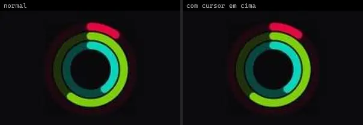
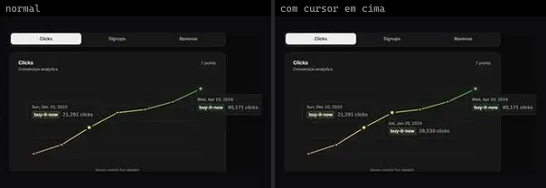
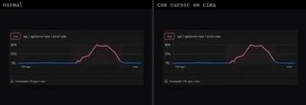
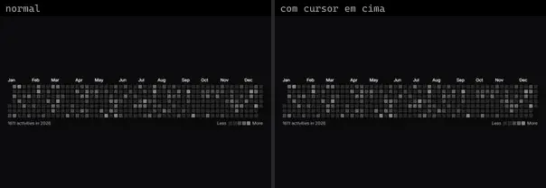
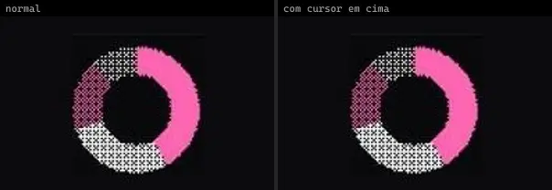
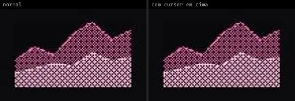
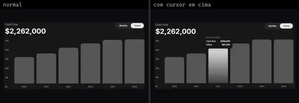

# Gráfico (17)

Prévia: estado normal | com o cursor em cima. Código: `node scripts/atlas-find.mjs code <uid>` ou os arquivos em `catalog.jsonl → files`.

| prévia | componente | tipo de aplicação | biblioteca · licença | dependências npm |
|---|---|---|---|---|
|  | **Bar Chart** `animata:graphs/bar-chart` | Dashboard & Admin | animata · MIT | — |
|  | **Donut Chart** `animata:graphs/donut-chart` | Dashboard & Admin | animata · MIT | — |
|  | **Gauge Chart** `animata:graphs/gauge-chart` | Dashboard & Admin | animata · MIT | — |
|  | **Ring Chart** `animata:graphs/ring-chart` | Dashboard & Admin | animata · MIT | — |
|  | **Analytics Chart** `cultui:analytics-chart-demo` | Dashboard & Admin | cultui · MIT | — |
|  | **Illustration Graph** `cultui:illustration-graph-demo` | Dashboard & Admin | cultui · MIT | — |
|  | **Contribution Graph** `kibo:contribution-graph` | Dashboard & Admin | kibo · MIT | @repo/contribution-graph, date-fns |
|  | **Chart Recorder** `motiq:catalog/chart-recorder` | Dashboard & Admin | motiq · MIT | — |
|  | **Chart Recorder** `motiq:chart-recorder` | Dashboard & Admin | motiq · MIT | — |
|  | **Contribution Graph** `smoothui:contribution-graph` | Dashboard & Admin | smoothui · MIT | @repo/smoothui, motion |
|  | **Dither Chart** `smoothui:canvas/dither-chart` | Dashboard & Admin | smoothui · MIT | @repo/shadcn-ui, @repo/smoothui, motion |
|  | **Dither Chart** `smoothui:dither-chart` | Dashboard & Admin | smoothui · MIT | @repo/shadcn-ui, @repo/smoothui, motion |
|  | **Performance Gauges · EV Power** `threeui:performance-gauges/power` | Dashboard & Admin | threeui · MIT | — |
|  | **Performance Gauges · Speedometer** `threeui:performance-gauges/speedometer` | Dashboard & Admin | threeui · MIT | — |
|  | **Performance Gauges · Tachometer** `threeui:performance-gauges/tachometer` | Dashboard & Admin | threeui · MIT | — |
|  | **Performance Gauges · Turbo Boost** `threeui:performance-gauges/boost` | Dashboard & Admin | threeui · MIT | — |
|  | **Cash Flow Chart** `uitripled:data/charts/cash-flow-chart` | Dashboard & Admin | uitripled · MIT | framer-motion |
