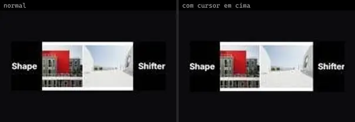
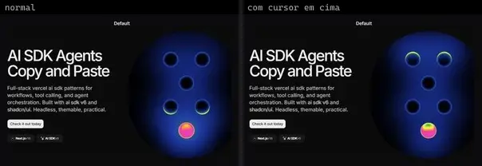
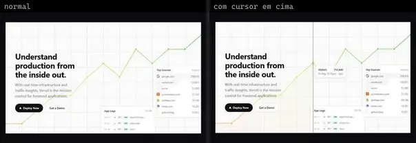
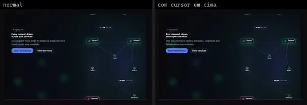
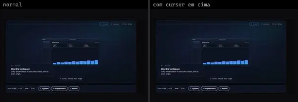
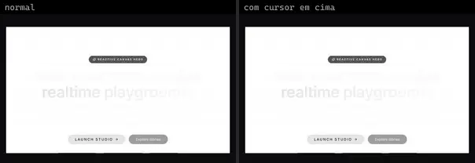

# Hero (30)

Prévia: estado normal | com o cursor em cima. Código: `node scripts/atlas-find.mjs code <uid>` ou os arquivos em `catalog.jsonl → files`.

| prévia | componente | tipo de aplicação | biblioteca · licença | dependências npm |
|---|---|---|---|---|
|  | **Hero Section** `animata:hero/hero-section` | Landing & Marketing | animata · MIT | — |
|  | **Hero Section Text Hover** `animata:hero/hero-section-text-hover` | Landing & Marketing | animata · MIT | lucide-react |
|  | **Product Features** `animata:hero/product-features` | Landing & Marketing | animata · MIT | motion |
|  | **Shape Shifter** `animata:hero/shape-shifter` | Landing & Marketing | animata · MIT | — |
|  | **Slack Intro** `animata:hero/slack-intro` | Landing & Marketing | animata · MIT | — |
|  | **Hero Color Panels** `cultui:hero-color-panels-demo` | Landing & Marketing | cultui · MIT | @paper-design/shaders-react |
|  | **Hero Heatmap** `cultui:hero-heatmap-demo` | Landing & Marketing | cultui · MIT | @paper-design/shaders-react |
|  | **Hero Liquid Metal** `cultui:hero-liquid-metal-demo` | Landing & Marketing | cultui · MIT | @paper-design/shaders-react |
|  | **Hero Static Radial Gradient** `cultui:hero-static-radial-gradient-demo` | Landing & Marketing | cultui · MIT | @paper-design/shaders-react |
|  | **Marketing Hero Analytics** `cultui:marketing-hero-analytics-demo` | Landing & Marketing | cultui · MIT | — |
|  | **Shape Hero** `kokonutui:shape-hero` | Landing & Marketing | kokonutui · MIT | clsx, motion, tailwind-merge |
|  | **Hero Video Dialog** `magicui:hero-video-dialog-demo` | Landing & Marketing | magicui · MIT | lucide-react, motion |
|  | **Hero Video Dialog Top In Bottom Out** `magicui:hero-video-dialog-demo-top-in-bottom-out` | Landing & Marketing | magicui · MIT | lucide-react, motion |
|  | **Collaborative Launch Hero** `motiq:catalog/collaborative-launch-hero` | Landing & Marketing | motiq · MIT | — |
|  | **Collaborative Launch Hero** `motiq:collaborative-launch-hero` | Landing & Marketing | motiq · MIT | — |
|  | **Deployment Control Hero** `motiq:catalog/deployment-control-hero` | Landing & Marketing | motiq · MIT | motion |
|  | **Deployment Control Hero** `motiq:deployment-control-hero` | Landing & Marketing | motiq · MIT | motion |
|  | **Live Data Command Hero** `motiq:catalog/live-data-command-hero` | Landing & Marketing | motiq · MIT | — |
|  | **Live Data Command Hero** `motiq:live-data-command-hero` | Landing & Marketing | motiq · MIT | — |
|  | **Runtime Signal Map Hero** `motiq:catalog/runtime-signal-map-hero` | Landing & Marketing | motiq · MIT | — |
|  | **Sticky Zoom Hero** `motiq:sticky-zoom-hero` | Landing & Marketing | motiq · MIT | — |
|  | **Bestsellers Book Showcase** `threeui:bestsellers-book-showcase` | Landing & Marketing | threeui · MIT · ⚠needs-files | — |
|  | **Complete Shelf** `threeui:complete-shelf-landing-page` | Landing & Marketing | threeui · MIT · ⚠needs-files | — |
|  | **Sylva · Living Green** `threeui:sylva-hero/living-green` | Landing & Marketing | threeui · MIT · ⚠needs-files | — |
|  | **Cta Hero Block** `uitripled:sections/cta-hero-block` | Landing & Marketing | uitripled · MIT | @radix-ui/react-slot, class-variance-authority, framer-motion, lucide-react |
|  | **Glowy Waves Hero** `uitripled:sections/glowy-waves-hero` | Landing & Marketing | uitripled · MIT | @radix-ui/react-slot, class-variance-authority, framer-motion, lucide-react |
|  | **Hero Block** `uitripled:sections/hero-block` | Landing & Marketing | uitripled · MIT | @radix-ui/react-slot, class-variance-authority, framer-motion, lucide-react |
|  | **Hero Section** `uitripled:sections/hero-section` | Landing & Marketing | uitripled · MIT | @radix-ui/react-slot, class-variance-authority, framer-motion, lucide-react |
|  | **New Hero Section** `uitripled:sections/new-hero-section` | Landing & Marketing | uitripled · MIT | @radix-ui/react-slot, class-variance-authority, framer-motion, lucide-react |
|  | **Staggered Text** `uitripled:page/hero/staggered-text` | Landing & Marketing | uitripled · MIT | framer-motion |
