# Ícone (467)

Prévia: estado normal | com o cursor em cima. Código: `node scripts/atlas-find.mjs code <uid>` ou os arquivos em `catalog.jsonl → files`.

| prévia | componente | tipo de aplicação | biblioteca · licença | dependências npm |
|---|---|---|---|---|
| 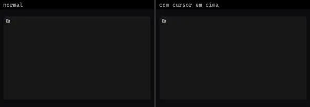 | **Folder Kanban** `lucideanimated:folder-kanban` | Dashboard & Admin | lucideanimated · MIT | clsx, motion, tailwind-merge |
| 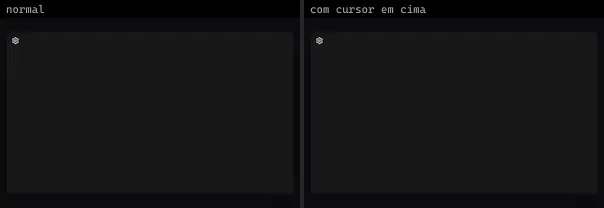 | **Settings** `lucideanimated:settings` | Dashboard & Admin | lucideanimated · MIT | clsx, motion, tailwind-merge |
| 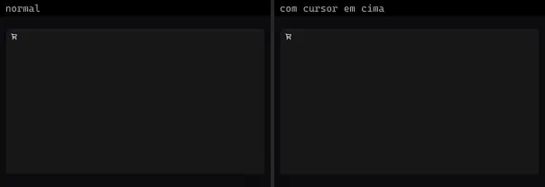 | **Cart** `lucideanimated:cart` | E-commerce | lucideanimated · MIT | clsx, motion, tailwind-merge |
|  | **Credit Card** `lucideanimated:credit-card` | E-commerce | lucideanimated · MIT | clsx, motion, tailwind-merge |
| 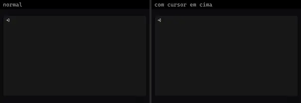 | **Login** `lucideanimated:login` | Login & Conta | lucideanimated · MIT | clsx, motion, tailwind-merge |
| 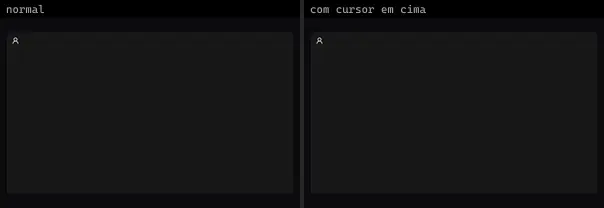 | **User** `lucideanimated:user` | Login & Conta | lucideanimated · MIT | clsx, motion, tailwind-merge |
|  | **User Check** `lucideanimated:user-check` | Login & Conta | lucideanimated · MIT | clsx, motion, tailwind-merge |
|  | **User Plus** `lucideanimated:user-plus` | Login & Conta | lucideanimated · MIT | clsx, motion, tailwind-merge |
|  | **User Round Check** `lucideanimated:user-round-check` | Login & Conta | lucideanimated · MIT | clsx, motion, tailwind-merge |
|  | **User Round Cog** `lucideanimated:user-round-cog` | Login & Conta | lucideanimated · MIT | clsx, motion, tailwind-merge |
|  | **User Round Plus** `lucideanimated:user-round-plus` | Login & Conta | lucideanimated · MIT | clsx, motion, tailwind-merge |
|  | **Phone** `lucideanimated:phone` | Mobile & App | lucideanimated · MIT | clsx, motion, tailwind-merge |
|  | **Phone Call** `lucideanimated:phone-call` | Mobile & App | lucideanimated · MIT | clsx, motion, tailwind-merge |
|  | **Phone Forwarded** `lucideanimated:phone-forwarded` | Mobile & App | lucideanimated · MIT | clsx, motion, tailwind-merge |
| 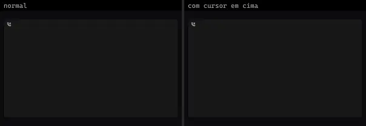 | **Phone Incoming** `lucideanimated:phone-incoming` | Mobile & App | lucideanimated · MIT | clsx, motion, tailwind-merge |
|  | **Phone Missed** `lucideanimated:phone-missed` | Mobile & App | lucideanimated · MIT | clsx, motion, tailwind-merge |
|  | **Phone Off** `lucideanimated:phone-off` | Mobile & App | lucideanimated · MIT | clsx, motion, tailwind-merge |
|  | **A Arrow Down** `lucideanimated:a-arrow-down` | UI base | lucideanimated · MIT | clsx, motion, tailwind-merge |
|  | **A Arrow Up** `lucideanimated:a-arrow-up` | UI base | lucideanimated · MIT | clsx, motion, tailwind-merge |
|  | **Accessibility** `lucideanimated:accessibility` | UI base | lucideanimated · MIT | clsx, motion, tailwind-merge |
| 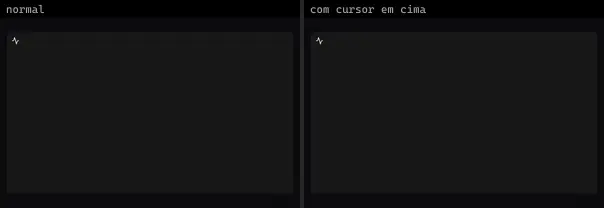 | **Activity** `lucideanimated:activity` | UI base | lucideanimated · MIT | clsx, motion, tailwind-merge |
|  | **Air Vent** `lucideanimated:air-vent` | UI base | lucideanimated · MIT | clsx, motion, tailwind-merge |
|  | **Airplane** `lucideanimated:airplane` | UI base | lucideanimated · MIT | clsx, motion, tailwind-merge |
|  | **Airplay** `lucideanimated:airplay` | UI base | lucideanimated · MIT | clsx, motion, tailwind-merge |
| 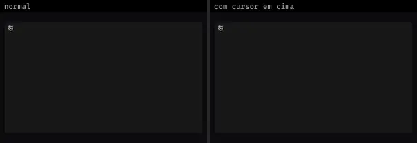 | **Alarm Clock** `lucideanimated:alarm-clock` | UI base | lucideanimated · MIT | clsx, motion, tailwind-merge |
|  | **Alarm Clock Check** `lucideanimated:alarm-clock-check` | UI base | lucideanimated · MIT | clsx, motion, tailwind-merge |
|  | **Alarm Clock Minus** `lucideanimated:alarm-clock-minus` | UI base | lucideanimated · MIT | clsx, motion, tailwind-merge |
| 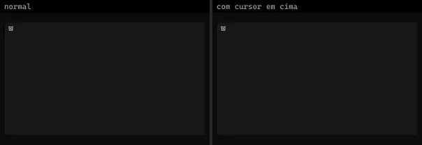 | **Alarm Clock Plus** `lucideanimated:alarm-clock-plus` | UI base | lucideanimated · MIT | clsx, motion, tailwind-merge |
| 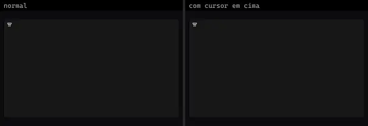 | **Alarm Smoke** `lucideanimated:alarm-smoke` | UI base | lucideanimated · MIT | clsx, motion, tailwind-merge |
| 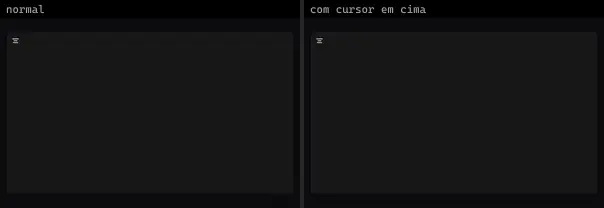 | **Align Center** `lucideanimated:align-center` | UI base | lucideanimated · MIT | clsx, motion, tailwind-merge |
|  | **Align Horizontal** `lucideanimated:align-horizontal` | UI base | lucideanimated · MIT | clsx, motion, tailwind-merge |
|  | **Align Left** `lucideanimated:align-left` | UI base | lucideanimated · MIT | clsx, motion, tailwind-merge |
|  | **Align Right** `lucideanimated:align-right` | UI base | lucideanimated · MIT | clsx, motion, tailwind-merge |
|  | **Align Vertical** `lucideanimated:align-vertical` | UI base | lucideanimated · MIT | clsx, motion, tailwind-merge |
|  | **Ambulance** `lucideanimated:ambulance` | UI base | lucideanimated · MIT | motion |
|  | **Angry** `lucideanimated:angry` | UI base | lucideanimated · MIT | clsx, motion, tailwind-merge |
| 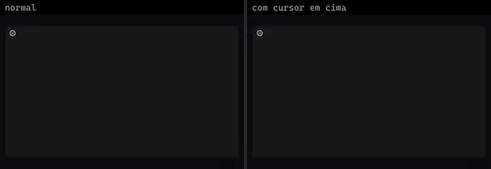 | **Annoyed** `lucideanimated:annoyed` | UI base | lucideanimated · MIT | clsx, motion, tailwind-merge |
| 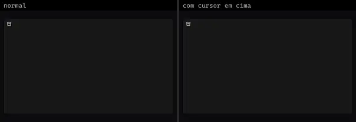 | **Archive** `lucideanimated:archive` | UI base | lucideanimated · MIT | clsx, motion, tailwind-merge |
|  | **Arrow Big Down** `lucideanimated:arrow-big-down` | UI base | lucideanimated · MIT | clsx, motion, tailwind-merge |
|  | **Arrow Big Down Dash** `lucideanimated:arrow-big-down-dash` | UI base | lucideanimated · MIT | clsx, motion, tailwind-merge |
|  | **Arrow Big Left** `lucideanimated:arrow-big-left` | UI base | lucideanimated · MIT | clsx, motion, tailwind-merge |
|  | **Arrow Big Left Dash** `lucideanimated:arrow-big-left-dash` | UI base | lucideanimated · MIT | clsx, motion, tailwind-merge |
|  | **Arrow Big Right** `lucideanimated:arrow-big-right` | UI base | lucideanimated · MIT | clsx, motion, tailwind-merge |
|  | **Arrow Big Right Dash** `lucideanimated:arrow-big-right-dash` | UI base | lucideanimated · MIT | clsx, motion, tailwind-merge |
|  | **Arrow Big Up** `lucideanimated:arrow-big-up` | UI base | lucideanimated · MIT | clsx, motion, tailwind-merge |
|  | **Arrow Big Up Dash** `lucideanimated:arrow-big-up-dash` | UI base | lucideanimated · MIT | clsx, motion, tailwind-merge |
|  | **Arrow Down** `lucideanimated:arrow-down` | UI base | lucideanimated · MIT | clsx, motion, tailwind-merge |
| 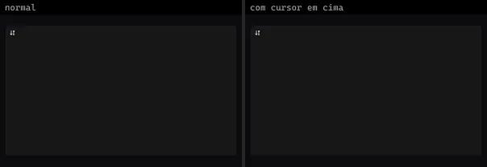 | **Arrow Down 0 1** `lucideanimated:arrow-down-0-1` | UI base | lucideanimated · MIT | clsx, motion, tailwind-merge |
|  | **Arrow Down 1 0** `lucideanimated:arrow-down-1-0` | UI base | lucideanimated · MIT | clsx, motion, tailwind-merge |
|  | **Arrow Down A Z** `lucideanimated:arrow-down-a-z` | UI base | lucideanimated · MIT | clsx, motion, tailwind-merge |
|  | **Arrow Down Left** `lucideanimated:arrow-down-left` | UI base | lucideanimated · MIT | clsx, motion, tailwind-merge |
|  | **Arrow Down Right** `lucideanimated:arrow-down-right` | UI base | lucideanimated · MIT | clsx, motion, tailwind-merge |
|  | **Arrow Down Z A** `lucideanimated:arrow-down-z-a` | UI base | lucideanimated · MIT | clsx, motion, tailwind-merge |
|  | **Arrow Left** `lucideanimated:arrow-left` | UI base | lucideanimated · MIT | clsx, motion, tailwind-merge |
|  | **Arrow Right** `lucideanimated:arrow-right` | UI base | lucideanimated · MIT | clsx, motion, tailwind-merge |
|  | **Arrow Up** `lucideanimated:arrow-up` | UI base | lucideanimated · MIT | clsx, motion, tailwind-merge |
|  | **Arrow Up Left** `lucideanimated:arrow-up-left` | UI base | lucideanimated · MIT | clsx, motion, tailwind-merge |
|  | **Arrow Up Right** `lucideanimated:arrow-up-right` | UI base | lucideanimated · MIT | clsx, motion, tailwind-merge |
| 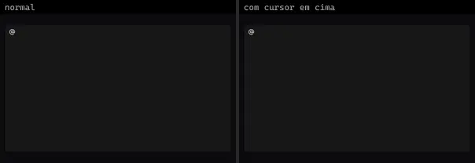 | **At Sign** `lucideanimated:at-sign` | UI base | lucideanimated · MIT | clsx, motion, tailwind-merge |
| 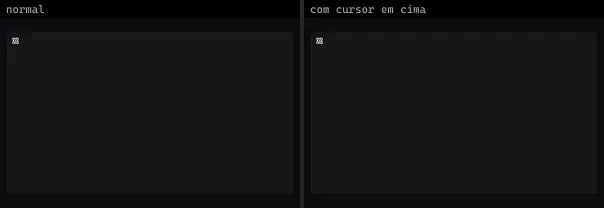 | **Atom** `lucideanimated:atom` | UI base | lucideanimated · MIT | clsx, motion, tailwind-merge |
| 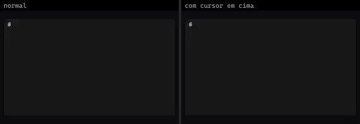 | **Attach File** `lucideanimated:attach-file` | UI base | lucideanimated · MIT | clsx, motion, tailwind-merge |
|  | **Audio Lines** `lucideanimated:audio-lines` | UI base | lucideanimated · MIT | clsx, motion, tailwind-merge |
|  | **Axe** `lucideanimated:axe` | UI base | lucideanimated · MIT | clsx, motion, tailwind-merge |
|  | **Badge Alert** `lucideanimated:badge-alert` | UI base | lucideanimated · MIT | clsx, motion, tailwind-merge |
| 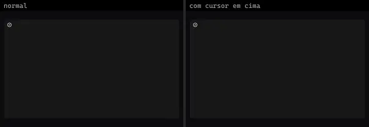 | **Badge Percent** `lucideanimated:badge-percent` | UI base | lucideanimated · MIT | clsx, motion, tailwind-merge |
|  | **Ban** `lucideanimated:ban` | UI base | lucideanimated · MIT | clsx, motion, tailwind-merge |
|  | **Banana** `lucideanimated:banana` | UI base | lucideanimated · MIT | clsx, motion, tailwind-merge |
|  | **Battery** `lucideanimated:battery` | UI base | lucideanimated · MIT | clsx, motion, tailwind-merge |
|  | **Battery Charging** `lucideanimated:battery-charging` | UI base | lucideanimated · MIT | clsx, motion, tailwind-merge |
|  | **Battery Full** `lucideanimated:battery-full` | UI base | lucideanimated · MIT | clsx, motion, tailwind-merge |
|  | **Battery Low** `lucideanimated:battery-low` | UI base | lucideanimated · MIT | clsx, motion, tailwind-merge |
|  | **Battery Medium** `lucideanimated:battery-medium` | UI base | lucideanimated · MIT | clsx, motion, tailwind-merge |
|  | **Battery Plus** `lucideanimated:battery-plus` | UI base | lucideanimated · MIT | clsx, motion, tailwind-merge |
|  | **Battery Warning** `lucideanimated:battery-warning` | UI base | lucideanimated · MIT | clsx, motion, tailwind-merge |
| 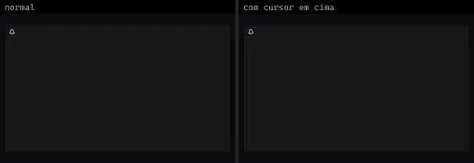 | **Bell** `lucideanimated:bell` | UI base | lucideanimated · MIT | clsx, motion, tailwind-merge |
| 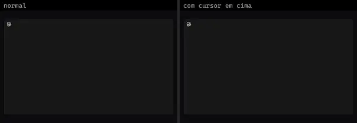 | **Bell Electric** `lucideanimated:bell-electric` | UI base | lucideanimated · MIT | clsx, motion, tailwind-merge |
| 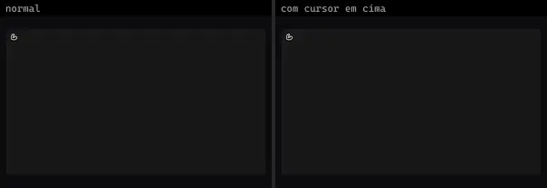 | **Biceps Flexed** `lucideanimated:biceps-flexed` | UI base | lucideanimated · MIT | clsx, motion, tailwind-merge |
|  | **Binary** `lucideanimated:binary` | UI base | lucideanimated · MIT | clsx, motion, tailwind-merge |
| 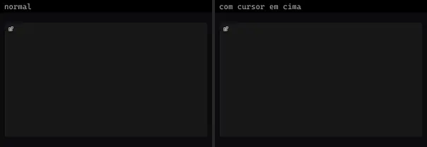 | **Blocks** `lucideanimated:blocks` | UI base | lucideanimated · MIT | clsx, motion, tailwind-merge |
|  | **Bluetooth** `lucideanimated:bluetooth` | UI base | lucideanimated · MIT | clsx, motion, tailwind-merge |
|  | **Bluetooth Connected** `lucideanimated:bluetooth-connected` | UI base | lucideanimated · MIT | clsx, motion, tailwind-merge |
|  | **Bluetooth Off** `lucideanimated:bluetooth-off` | UI base | lucideanimated · MIT | clsx, motion, tailwind-merge |
|  | **Bluetooth Searching** `lucideanimated:bluetooth-searching` | UI base | lucideanimated · MIT | clsx, motion, tailwind-merge |
| 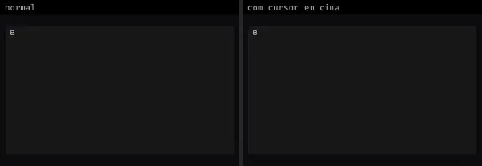 | **Bold** `lucideanimated:bold` | UI base | lucideanimated · MIT | clsx, motion, tailwind-merge |
| 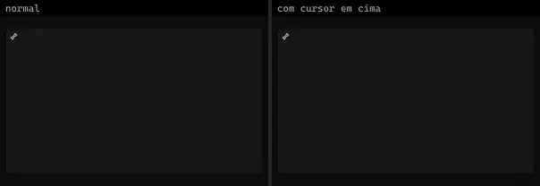 | **Bone** `lucideanimated:bone` | UI base | lucideanimated · MIT | clsx, motion, tailwind-merge |
|  | **Book Text** `lucideanimated:book-text` | UI base | lucideanimated · MIT | clsx, motion, tailwind-merge |
| 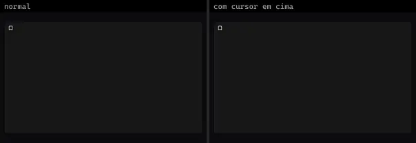 | **Bookmark** `lucideanimated:bookmark` | UI base | lucideanimated · MIT | clsx, motion, tailwind-merge |
| 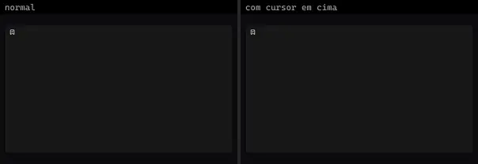 | **Bookmark Check** `lucideanimated:bookmark-check` | UI base | lucideanimated · MIT | clsx, motion, tailwind-merge |
|  | **Bookmark Minus** `lucideanimated:bookmark-minus` | UI base | lucideanimated · MIT | clsx, motion, tailwind-merge |
|  | **Bookmark Plus** `lucideanimated:bookmark-plus` | UI base | lucideanimated · MIT | clsx, motion, tailwind-merge |
|  | **Bookmark X** `lucideanimated:bookmark-x` | UI base | lucideanimated · MIT | clsx, motion, tailwind-merge |
|  | **Bot** `lucideanimated:bot` | UI base | lucideanimated · MIT | clsx, motion, tailwind-merge |
| 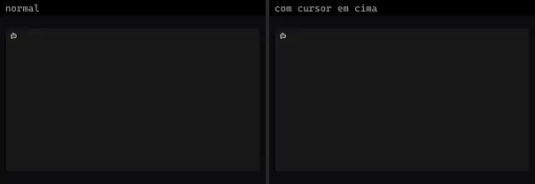 | **Bot Message Square** `lucideanimated:bot-message-square` | UI base | lucideanimated · MIT | clsx, motion, tailwind-merge |
|  | **Box** `lucideanimated:box` | UI base | lucideanimated · MIT | clsx, motion, tailwind-merge |
|  | **Boxes** `lucideanimated:boxes` | UI base | lucideanimated · MIT | clsx, motion, tailwind-merge |
| 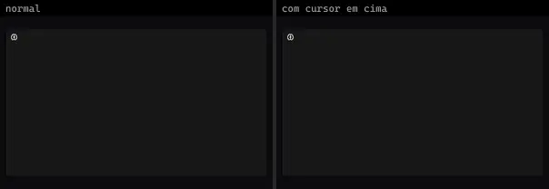 | **Brain** `lucideanimated:brain` | UI base | lucideanimated · MIT | clsx, motion, tailwind-merge |
| 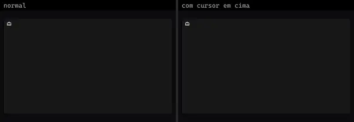 | **Briefcase Business** `lucideanimated:briefcase-business` | UI base | lucideanimated · MIT | clsx, motion, tailwind-merge |
| 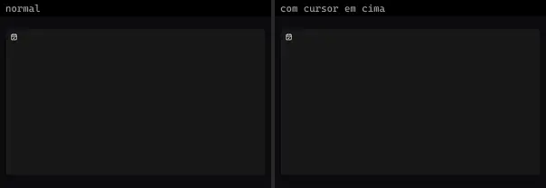 | **Calendar Check** `lucideanimated:calendar-check` | UI base | lucideanimated · MIT | clsx, motion, tailwind-merge |
|  | **Calendar Check 2** `lucideanimated:calendar-check-2` | UI base | lucideanimated · MIT | clsx, motion, tailwind-merge |
| 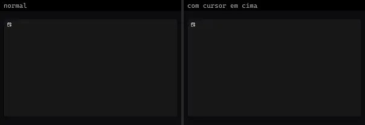 | **Calendar Cog** `lucideanimated:calendar-cog` | UI base | lucideanimated · MIT | clsx, motion, tailwind-merge |
| 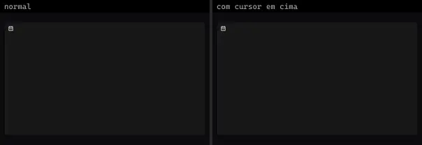 | **Calendar Days** `lucideanimated:calendar-days` | UI base | lucideanimated · MIT | clsx, motion, tailwind-merge |
|  | **Cast** `lucideanimated:cast` | UI base | lucideanimated · MIT | clsx, motion, tailwind-merge |
|  | **Cctv** `lucideanimated:cctv` | UI base | lucideanimated · MIT | clsx, motion, tailwind-merge |
|  | **Chart Bar Decreasing** `lucideanimated:chart-bar-decreasing` | UI base | lucideanimated · MIT | clsx, motion, tailwind-merge |
|  | **Chart Bar Increasing** `lucideanimated:chart-bar-increasing` | UI base | lucideanimated · MIT | clsx, motion, tailwind-merge |
| 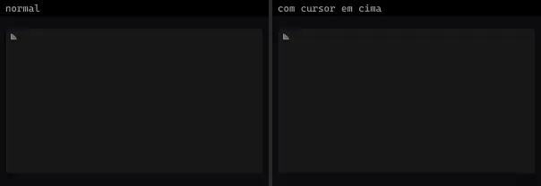 | **Chart Column Decreasing** `lucideanimated:chart-column-decreasing` | UI base | lucideanimated · MIT | clsx, motion, tailwind-merge |
| 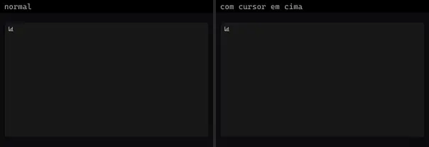 | **Chart Column Increasing** `lucideanimated:chart-column-increasing` | UI base | lucideanimated · MIT | clsx, motion, tailwind-merge |
|  | **Chart Line** `lucideanimated:chart-line` | UI base | lucideanimated · MIT | clsx, motion, tailwind-merge |
|  | **Chart No Axes Column Decreasing** `lucideanimated:chart-no-axes-column-decreasing` | UI base | lucideanimated · MIT | clsx, motion, tailwind-merge |
|  | **Chart No Axes Column Increasing** `lucideanimated:chart-no-axes-column-increasing` | UI base | lucideanimated · MIT | clsx, motion, tailwind-merge |
|  | **Chart Pie** `lucideanimated:chart-pie` | UI base | lucideanimated · MIT | clsx, motion, tailwind-merge |
|  | **Chart Scatter** `lucideanimated:chart-scatter` | UI base | lucideanimated · MIT | clsx, motion, tailwind-merge |
|  | **Chart Spline** `lucideanimated:chart-spline` | UI base | lucideanimated · MIT | clsx, motion, tailwind-merge |
|  | **Check** `lucideanimated:check` | UI base | lucideanimated · MIT | clsx, motion, tailwind-merge |
| 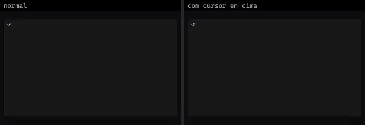 | **Check Check** `lucideanimated:check-check` | UI base | lucideanimated · MIT | clsx, motion, tailwind-merge |
| 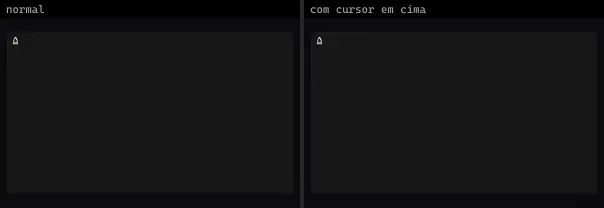 | **Chess Bishop** `lucideanimated:chess-bishop` | UI base | lucideanimated · MIT | clsx, motion, tailwind-merge |
|  | **Chess King** `lucideanimated:chess-king` | UI base | lucideanimated · MIT | clsx, motion, tailwind-merge |
| 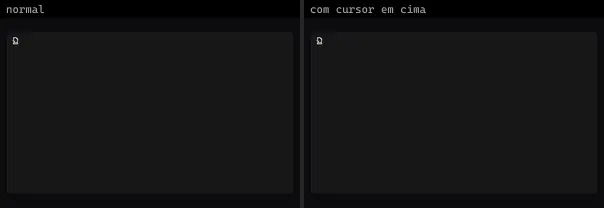 | **Chess Knight** `lucideanimated:chess-knight` | UI base | lucideanimated · MIT | clsx, motion, tailwind-merge |
|  | **Chess Pawn** `lucideanimated:chess-pawn` | UI base | lucideanimated · MIT | clsx, motion, tailwind-merge |
|  | **Chevron Down** `lucideanimated:chevron-down` | UI base | lucideanimated · MIT | clsx, motion, tailwind-merge |
|  | **Chevron First** `lucideanimated:chevron-first` | UI base | lucideanimated · MIT | clsx, motion, tailwind-merge |
|  | **Chevron Left** `lucideanimated:chevron-left` | UI base | lucideanimated · MIT | clsx, motion, tailwind-merge |
|  | **Chevron Right** `lucideanimated:chevron-right` | UI base | lucideanimated · MIT | clsx, motion, tailwind-merge |
|  | **Chevron Up** `lucideanimated:chevron-up` | UI base | lucideanimated · MIT | clsx, motion, tailwind-merge |
|  | **Chevrons Down Up** `lucideanimated:chevrons-down-up` | UI base | lucideanimated · MIT | clsx, motion, tailwind-merge |
|  | **Chevrons Left Right** `lucideanimated:chevrons-left-right` | UI base | lucideanimated · MIT | clsx, motion, tailwind-merge |
|  | **Chevrons Right Left** `lucideanimated:chevrons-right-left` | UI base | lucideanimated · MIT | clsx, motion, tailwind-merge |
|  | **Chevrons Up Down** `lucideanimated:chevrons-up-down` | UI base | lucideanimated · MIT | clsx, motion, tailwind-merge |
| 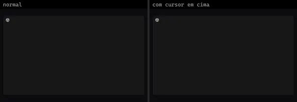 | **Chrome** `lucideanimated:chrome` | UI base | lucideanimated · MIT | clsx, motion, tailwind-merge |
|  | **Cigarette** `lucideanimated:cigarette` | UI base | lucideanimated · MIT | clsx, motion, tailwind-merge |
|  | **Cigarette Off** `lucideanimated:cigarette-off` | UI base | lucideanimated · MIT | clsx, motion, tailwind-merge |
|  | **Circle Check** `lucideanimated:circle-check` | UI base | lucideanimated · MIT | clsx, motion, tailwind-merge |
|  | **Circle Chevron Down** `lucideanimated:circle-chevron-down` | UI base | lucideanimated · MIT | clsx, motion, tailwind-merge |
|  | **Circle Chevron Left** `lucideanimated:circle-chevron-left` | UI base | lucideanimated · MIT | clsx, motion, tailwind-merge |
| 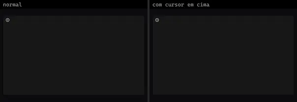 | **Circle Chevron Right** `lucideanimated:circle-chevron-right` | UI base | lucideanimated · MIT | clsx, motion, tailwind-merge |
| 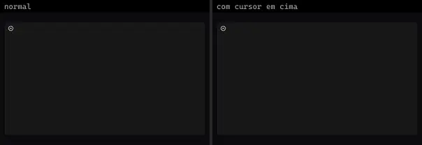 | **Circle Chevron Up** `lucideanimated:circle-chevron-up` | UI base | lucideanimated · MIT | clsx, motion, tailwind-merge |
|  | **Circle Dashed** `lucideanimated:circle-dashed` | UI base | lucideanimated · MIT | clsx, motion, tailwind-merge |
|  | **Circle Dollar Sign** `lucideanimated:circle-dollar-sign` | UI base | lucideanimated · MIT | clsx, motion, tailwind-merge |
|  | **Circle Gauge** `lucideanimated:circle-gauge` | UI base | lucideanimated · MIT | clsx, motion, tailwind-merge |
|  | **Circle Help** `lucideanimated:circle-help` | UI base | lucideanimated · MIT | clsx, motion, tailwind-merge |
|  | **Clap** `lucideanimated:clap` | UI base | lucideanimated · MIT | clsx, motion, tailwind-merge |
|  | **Clipboard Check** `lucideanimated:clipboard-check` | UI base | lucideanimated · MIT | clsx, motion, tailwind-merge |
|  | **Clock** `lucideanimated:clock` | UI base | lucideanimated · MIT | clsx, motion, tailwind-merge |
|  | **Cloud Backup** `lucideanimated:cloud-backup` | UI base | lucideanimated · MIT | clsx, motion, tailwind-merge |
| 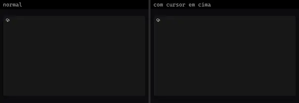 | **Cloud Cog** `lucideanimated:cloud-cog` | UI base | lucideanimated · MIT | clsx, motion, tailwind-merge |
|  | **Cloud Download** `lucideanimated:cloud-download` | UI base | lucideanimated · MIT | clsx, motion, tailwind-merge |
|  | **Cloud Lightning** `lucideanimated:cloud-lightning` | UI base | lucideanimated · MIT | clsx, motion, tailwind-merge |
| 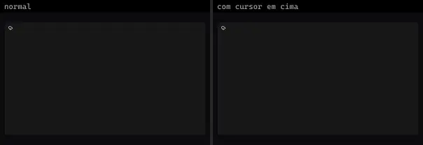 | **Cloud Rain** `lucideanimated:cloud-rain` | UI base | lucideanimated · MIT | clsx, motion, tailwind-merge |
|  | **Cloud Rain Wind** `lucideanimated:cloud-rain-wind` | UI base | lucideanimated · MIT | clsx, motion, tailwind-merge |
|  | **Cloud Snow** `lucideanimated:cloud-snow` | UI base | lucideanimated · MIT | clsx, motion, tailwind-merge |
|  | **Cloud Sun** `lucideanimated:cloud-sun` | UI base | lucideanimated · MIT | clsx, motion, tailwind-merge |
|  | **Cloud Sync** `lucideanimated:cloud-sync` | UI base | lucideanimated · MIT | clsx, motion, tailwind-merge |
|  | **Cloud Upload** `lucideanimated:cloud-upload` | UI base | lucideanimated · MIT | clsx, motion, tailwind-merge |
| 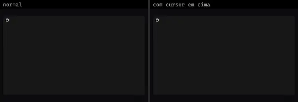 | **Coffee** `lucideanimated:coffee` | UI base | lucideanimated · MIT | clsx, motion, tailwind-merge |
|  | **Cog** `lucideanimated:cog` | UI base | lucideanimated · MIT | clsx, motion, tailwind-merge |
|  | **Compass** `lucideanimated:compass` | UI base | lucideanimated · MIT | clsx, motion, tailwind-merge |
|  | **Concierge Bell** `lucideanimated:concierge-bell` | UI base | lucideanimated · MIT | clsx, motion, tailwind-merge |
| 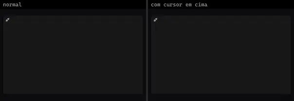 | **Connect** `lucideanimated:connect` | UI base | lucideanimated · MIT | clsx, motion, tailwind-merge |
|  | **Construction** `lucideanimated:construction` | UI base | lucideanimated · MIT | clsx, motion, tailwind-merge |
|  | **Contrast** `lucideanimated:contrast` | UI base | lucideanimated · MIT | clsx, motion, tailwind-merge |
|  | **Cooking Pot** `lucideanimated:cooking-pot` | UI base | lucideanimated · MIT | clsx, motion, tailwind-merge |
|  | **Copy** `lucideanimated:copy` | UI base | lucideanimated · MIT | clsx, motion, tailwind-merge |
|  | **Corner Down Left** `lucideanimated:corner-down-left` | UI base | lucideanimated · MIT | clsx, motion, tailwind-merge |
|  | **Corner Down Right** `lucideanimated:corner-down-right` | UI base | lucideanimated · MIT | clsx, motion, tailwind-merge |
|  | **Corner Left Down** `lucideanimated:corner-left-down` | UI base | lucideanimated · MIT | clsx, motion, tailwind-merge |
|  | **Corner Left Up** `lucideanimated:corner-left-up` | UI base | lucideanimated · MIT | clsx, motion, tailwind-merge |
|  | **Corner Right Down** `lucideanimated:corner-right-down` | UI base | lucideanimated · MIT | clsx, motion, tailwind-merge |
|  | **Corner Right Up** `lucideanimated:corner-right-up` | UI base | lucideanimated · MIT | clsx, motion, tailwind-merge |
|  | **Corner Up Left** `lucideanimated:corner-up-left` | UI base | lucideanimated · MIT | clsx, motion, tailwind-merge |
|  | **Corner Up Right** `lucideanimated:corner-up-right` | UI base | lucideanimated · MIT | clsx, motion, tailwind-merge |
| 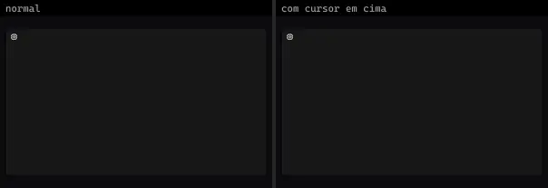 | **Cpu** `lucideanimated:cpu` | UI base | lucideanimated · MIT | clsx, motion, tailwind-merge |
|  | **Cup Soda** `lucideanimated:cup-soda` | UI base | lucideanimated · MIT | clsx, motion, tailwind-merge |
|  | **Cursor Click** `lucideanimated:cursor-click` | UI base | lucideanimated · MIT | clsx, motion, tailwind-merge |
| 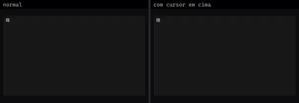 | **Database Backup** `lucideanimated:database-backup` | UI base | lucideanimated · MIT | clsx, motion, tailwind-merge |
|  | **Delete** `lucideanimated:delete` | UI base | lucideanimated · MIT | clsx, motion, tailwind-merge |
|  | **Disc 3** `lucideanimated:disc-3` | UI base | lucideanimated · MIT | clsx, motion, tailwind-merge |
|  | **Discord** `lucideanimated:discord` | UI base | lucideanimated · MIT | clsx, motion, tailwind-merge |
|  | **Dollar Sign** `lucideanimated:dollar-sign` | UI base | lucideanimated · MIT | clsx, motion, tailwind-merge |
|  | **Download** `lucideanimated:download` | UI base | lucideanimated · MIT | clsx, motion, tailwind-merge |
|  | **Downvote** `lucideanimated:downvote` | UI base | lucideanimated · MIT | clsx, motion, tailwind-merge |
| 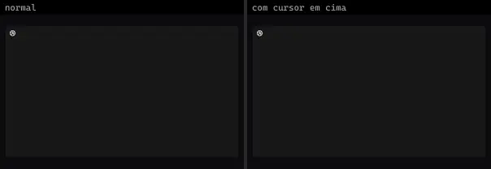 | **Dribbble** `lucideanimated:dribbble` | UI base | lucideanimated · MIT | clsx, motion, tailwind-merge |
|  | **Droplet** `lucideanimated:droplet` | UI base | lucideanimated · MIT | clsx, motion, tailwind-merge |
| 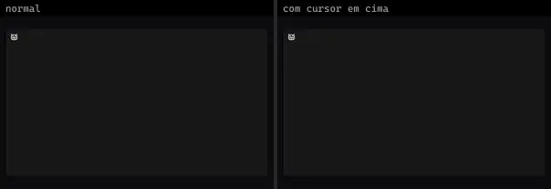 | **Drum** `lucideanimated:drum` | UI base | lucideanimated · MIT | clsx, motion, tailwind-merge |
| 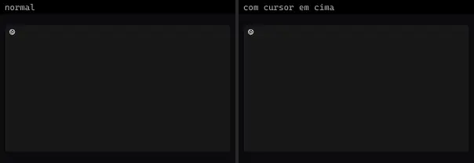 | **Earth** `lucideanimated:earth` | UI base | lucideanimated · MIT | clsx, motion, tailwind-merge |
|  | **Euro** `lucideanimated:euro` | UI base | lucideanimated · MIT | clsx, motion, tailwind-merge |
|  | **Ev Charger** `lucideanimated:ev-charger` | UI base | lucideanimated · MIT | clsx, motion, tailwind-merge |
| 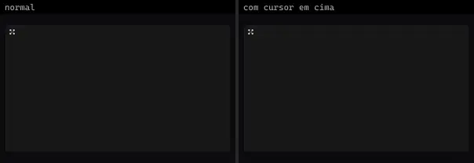 | **Expand** `lucideanimated:expand` | UI base | lucideanimated · MIT | clsx, motion, tailwind-merge |
|  | **External Link** `lucideanimated:external-link` | UI base | lucideanimated · MIT | clsx, motion, tailwind-merge |
|  | **Eye** `lucideanimated:eye` | UI base | lucideanimated · MIT | clsx, motion, tailwind-merge |
|  | **Eye Off** `lucideanimated:eye-off` | UI base | lucideanimated · MIT | clsx, motion, tailwind-merge |
|  | **Facebook** `lucideanimated:facebook` | UI base | lucideanimated · MIT | clsx, motion, tailwind-merge |
|  | **Fan** `lucideanimated:fan` | UI base | lucideanimated · MIT | clsx, motion, tailwind-merge |
|  | **Feather** `lucideanimated:feather` | UI base | lucideanimated · MIT | clsx, motion, tailwind-merge |
|  | **Figma** `lucideanimated:figma` | UI base | lucideanimated · MIT | clsx, motion, tailwind-merge |
|  | **File Chart Line** `lucideanimated:file-chart-line` | UI base | lucideanimated · MIT | clsx, motion, tailwind-merge |
|  | **File Check** `lucideanimated:file-check` | UI base | lucideanimated · MIT | clsx, motion, tailwind-merge |
|  | **File Check 2** `lucideanimated:file-check-2` | UI base | lucideanimated · MIT | clsx, motion, tailwind-merge |
|  | **File Cog** `lucideanimated:file-cog` | UI base | lucideanimated · MIT | clsx, motion, tailwind-merge |
|  | **File Pen Line** `lucideanimated:file-pen-line` | UI base | lucideanimated · MIT | clsx, motion, tailwind-merge |
|  | **File Stack** `lucideanimated:file-stack` | UI base | lucideanimated · MIT | clsx, motion, tailwind-merge |
|  | **File Text** `lucideanimated:file-text` | UI base | lucideanimated · MIT | clsx, motion, tailwind-merge |
|  | **Fingerprint** `lucideanimated:fingerprint` | UI base | lucideanimated · MIT | clsx, motion, tailwind-merge |
|  | **Fish Symbol** `lucideanimated:fish-symbol` | UI base | lucideanimated · MIT | clsx, motion, tailwind-merge |
|  | **Flame** `lucideanimated:flame` | UI base | lucideanimated · MIT | clsx, motion, tailwind-merge |
|  | **Flask** `lucideanimated:flask` | UI base | lucideanimated · MIT | clsx, motion, tailwind-merge |
|  | **Folder Archive** `lucideanimated:folder-archive` | UI base | lucideanimated · MIT | clsx, motion, tailwind-merge |
|  | **Folder Check** `lucideanimated:folder-check` | UI base | lucideanimated · MIT | clsx, motion, tailwind-merge |
|  | **Folder Clock** `lucideanimated:folder-clock` | UI base | lucideanimated · MIT | clsx, motion, tailwind-merge |
|  | **Folder Code** `lucideanimated:folder-code` | UI base | lucideanimated · MIT | clsx, motion, tailwind-merge |
|  | **Folder Cog** `lucideanimated:folder-cog` | UI base | lucideanimated · MIT | clsx, motion, tailwind-merge |
|  | **Folder Dot** `lucideanimated:folder-dot` | UI base | lucideanimated · MIT | clsx, motion, tailwind-merge |
|  | **Folder Down** `lucideanimated:folder-down` | UI base | lucideanimated · MIT | clsx, motion, tailwind-merge |
|  | **Folder Git** `lucideanimated:folder-git` | UI base | lucideanimated · MIT | clsx, motion, tailwind-merge |
|  | **Folder Git 2** `lucideanimated:folder-git-2` | UI base | lucideanimated · MIT | clsx, motion, tailwind-merge |
|  | **Folder Heart** `lucideanimated:folder-heart` | UI base | lucideanimated · MIT | clsx, motion, tailwind-merge |
|  | **Folder Input** `lucideanimated:folder-input` | UI base | lucideanimated · MIT | clsx, motion, tailwind-merge |
|  | **Folder Key** `lucideanimated:folder-key` | UI base | lucideanimated · MIT | clsx, motion, tailwind-merge |
|  | **Folder Lock** `lucideanimated:folder-lock` | UI base | lucideanimated · MIT | clsx, motion, tailwind-merge |
|  | **Folder Minus** `lucideanimated:folder-minus` | UI base | lucideanimated · MIT | clsx, motion, tailwind-merge |
|  | **Folder Open** `lucideanimated:folder-open` | UI base | lucideanimated · MIT | clsx, motion, tailwind-merge |
|  | **Folder Output** `lucideanimated:folder-output` | UI base | lucideanimated · MIT | clsx, motion, tailwind-merge |
|  | **Folder Plus** `lucideanimated:folder-plus` | UI base | lucideanimated · MIT | clsx, motion, tailwind-merge |
|  | **Folder Root** `lucideanimated:folder-root` | UI base | lucideanimated · MIT | clsx, motion, tailwind-merge |
|  | **Folder Sync** `lucideanimated:folder-sync` | UI base | lucideanimated · MIT | clsx, motion, tailwind-merge |
|  | **Folder Tree** `lucideanimated:folder-tree` | UI base | lucideanimated · MIT | clsx, motion, tailwind-merge |
|  | **Folder Up** `lucideanimated:folder-up` | UI base | lucideanimated · MIT | clsx, motion, tailwind-merge |
|  | **Folder X** `lucideanimated:folder-x` | UI base | lucideanimated · MIT | clsx, motion, tailwind-merge |
|  | **Folders** `lucideanimated:folders` | UI base | lucideanimated · MIT | clsx, motion, tailwind-merge |
|  | **Frame** `lucideanimated:frame` | UI base | lucideanimated · MIT | clsx, motion, tailwind-merge |
|  | **Frown** `lucideanimated:frown` | UI base | lucideanimated · MIT | clsx, motion, tailwind-merge |
|  | **Gallery Horizontal End** `lucideanimated:gallery-horizontal-end` | UI base | lucideanimated · MIT | clsx, motion, tailwind-merge |
|  | **Gallery Thumbnails** `lucideanimated:gallery-thumbnails` | UI base | lucideanimated · MIT | clsx, motion, tailwind-merge |
|  | **Gallery Vertical End** `lucideanimated:gallery-vertical-end` | UI base | lucideanimated · MIT | clsx, motion, tailwind-merge |
|  | **Gauge** `lucideanimated:gauge` | UI base | lucideanimated · MIT | clsx, motion, tailwind-merge |
|  | **Gavel** `lucideanimated:gavel` | UI base | lucideanimated · MIT | clsx, motion, tailwind-merge |
|  | **Georgian Lari** `lucideanimated:georgian-lari` | UI base | lucideanimated · MIT | clsx, motion, tailwind-merge |
|  | **Git Branch** `lucideanimated:git-branch` | UI base | lucideanimated · MIT | clsx, motion, tailwind-merge |
|  | **Git Commit Horizontal** `lucideanimated:git-commit-horizontal` | UI base | lucideanimated · MIT | clsx, motion, tailwind-merge |
|  | **Git Commit Vertical** `lucideanimated:git-commit-vertical` | UI base | lucideanimated · MIT | clsx, motion, tailwind-merge |
|  | **Git Compare** `lucideanimated:git-compare` | UI base | lucideanimated · MIT | clsx, motion, tailwind-merge |
|  | **Git Compare Arrows** `lucideanimated:git-compare-arrows` | UI base | lucideanimated · MIT | clsx, motion, tailwind-merge |
|  | **Git Fork** `lucideanimated:git-fork` | UI base | lucideanimated · MIT | clsx, motion, tailwind-merge |
|  | **Git Graph** `lucideanimated:git-graph` | UI base | lucideanimated · MIT | clsx, motion, tailwind-merge |
|  | **Git Merge** `lucideanimated:git-merge` | UI base | lucideanimated · MIT | clsx, motion, tailwind-merge |
|  | **Git Pull Request** `lucideanimated:git-pull-request` | UI base | lucideanimated · MIT | clsx, motion, tailwind-merge |
|  | **Git Pull Request Closed** `lucideanimated:git-pull-request-closed` | UI base | lucideanimated · MIT | clsx, motion, tailwind-merge |
|  | **Git Pull Request Create** `lucideanimated:git-pull-request-create` | UI base | lucideanimated · MIT | clsx, motion, tailwind-merge |
|  | **Github** `lucideanimated:github` | UI base | lucideanimated · MIT | clsx, motion, tailwind-merge |
|  | **Gitlab** `lucideanimated:gitlab` | UI base | lucideanimated · MIT | clsx, motion, tailwind-merge |
|  | **Graduation Cap** `lucideanimated:graduation-cap` | UI base | lucideanimated · MIT | clsx, motion, tailwind-merge |
|  | **Grip** `lucideanimated:grip` | UI base | lucideanimated · MIT | clsx, motion, tailwind-merge |
|  | **Grip Horizontal** `lucideanimated:grip-horizontal` | UI base | lucideanimated · MIT | clsx, motion, tailwind-merge |
|  | **Grip Vertical** `lucideanimated:grip-vertical` | UI base | lucideanimated · MIT | clsx, motion, tailwind-merge |
|  | **Hammer** `lucideanimated:hammer` | UI base | lucideanimated · MIT | clsx, motion, tailwind-merge |
|  | **Hand** `lucideanimated:hand` | UI base | lucideanimated · MIT | clsx, motion, tailwind-merge |
|  | **Hand Coins** `lucideanimated:hand-coins` | UI base | lucideanimated · MIT | clsx, motion, tailwind-merge |
|  | **Hand Fist** `lucideanimated:hand-fist` | UI base | lucideanimated · MIT | clsx, motion, tailwind-merge |
|  | **Hand Grab** `lucideanimated:hand-grab` | UI base | lucideanimated · MIT | clsx, motion, tailwind-merge |
|  | **Hand Heart** `lucideanimated:hand-heart` | UI base | lucideanimated · MIT | clsx, motion, tailwind-merge |
|  | **Hand Helping** `lucideanimated:hand-helping` | UI base | lucideanimated · MIT | clsx, motion, tailwind-merge |
|  | **Hand Metal** `lucideanimated:hand-metal` | UI base | lucideanimated · MIT | clsx, motion, tailwind-merge |
|  | **Hard Drive Download** `lucideanimated:hard-drive-download` | UI base | lucideanimated · MIT | clsx, motion, tailwind-merge |
|  | **Hard Drive Upload** `lucideanimated:hard-drive-upload` | UI base | lucideanimated · MIT | clsx, motion, tailwind-merge |
|  | **Hat Glasses** `lucideanimated:hat-glasses` | UI base | lucideanimated · MIT | clsx, motion, tailwind-merge |
|  | **Heart** `lucideanimated:heart` | UI base | lucideanimated · MIT | clsx, motion, tailwind-merge |
|  | **Heart Handshake** `lucideanimated:heart-handshake` | UI base | lucideanimated · MIT | clsx, motion, tailwind-merge |
|  | **Heart Pulse** `lucideanimated:heart-pulse` | UI base | lucideanimated · MIT | clsx, motion, tailwind-merge |
|  | **History** `lucideanimated:history` | UI base | lucideanimated · MIT | clsx, motion, tailwind-merge |
|  | **Home** `lucideanimated:home` | UI base | lucideanimated · MIT | clsx, motion, tailwind-merge |
|  | **Hourglass** `lucideanimated:hourglass` | UI base | lucideanimated · MIT | clsx, motion, tailwind-merge |
|  | **Id Card** `lucideanimated:id-card` | UI base | lucideanimated · MIT | clsx, motion, tailwind-merge |
|  | **Indian Rupee** `lucideanimated:indian-rupee` | UI base | lucideanimated · MIT | clsx, motion, tailwind-merge |
|  | **Instagram** `lucideanimated:instagram` | UI base | lucideanimated · MIT | clsx, motion, tailwind-merge |
|  | **Italic** `lucideanimated:italic` | UI base | lucideanimated · MIT | clsx, motion, tailwind-merge |
|  | **Japanese Yen** `lucideanimated:japanese-yen` | UI base | lucideanimated · MIT | clsx, motion, tailwind-merge |
|  | **Key** `lucideanimated:key` | UI base | lucideanimated · MIT | clsx, motion, tailwind-merge |
|  | **Key Circle** `lucideanimated:key-circle` | UI base | lucideanimated · MIT | clsx, motion, tailwind-merge |
|  | **Key Square** `lucideanimated:key-square` | UI base | lucideanimated · MIT | clsx, motion, tailwind-merge |
|  | **Keyboard** `lucideanimated:keyboard` | UI base | lucideanimated · MIT | clsx, motion, tailwind-merge |
|  | **Languages** `lucideanimated:languages` | UI base | lucideanimated · MIT | clsx, motion, tailwind-merge |
|  | **Laptop Minimal Check** `lucideanimated:laptop-minimal-check` | UI base | lucideanimated · MIT | clsx, motion, tailwind-merge |
|  | **Laugh** `lucideanimated:laugh` | UI base | lucideanimated · MIT | clsx, motion, tailwind-merge |
|  | **Layers** `lucideanimated:layers` | UI base | lucideanimated · MIT | clsx, motion, tailwind-merge |
|  | **Layout Grid** `lucideanimated:layout-grid` | UI base | lucideanimated · MIT | clsx, motion, tailwind-merge |
|  | **Layout Panel Top** `lucideanimated:layout-panel-top` | UI base | lucideanimated · MIT | clsx, motion, tailwind-merge |
|  | **Leaf** `lucideanimated:leaf` | UI base | lucideanimated · MIT | clsx, motion, tailwind-merge |
|  | **Leafy Green** `lucideanimated:leafy-green` | UI base | lucideanimated · MIT | clsx, motion, tailwind-merge |
|  | **Link** `lucideanimated:link` | UI base | lucideanimated · MIT | clsx, motion, tailwind-merge |
|  | **Link 2** `lucideanimated:link-2` | UI base | lucideanimated · MIT | clsx, motion, tailwind-merge |
|  | **Linkedin** `lucideanimated:linkedin` | UI base | lucideanimated · MIT | clsx, motion, tailwind-merge |
|  | **Loader** `lucideanimated:loader` | UI base | lucideanimated · MIT | clsx, motion, tailwind-merge |
|  | **Loader Circle** `lucideanimated:loader-circle` | UI base | lucideanimated · MIT | clsx, motion, tailwind-merge |
|  | **Loader Pinwheel** `lucideanimated:loader-pinwheel` | UI base | lucideanimated · MIT | clsx, motion, tailwind-merge |
|  | **Lock** `lucideanimated:lock` | UI base | lucideanimated · MIT | clsx, motion, tailwind-merge |
|  | **Lock Keyhole** `lucideanimated:lock-keyhole` | UI base | lucideanimated · MIT | clsx, motion, tailwind-merge |
|  | **Lock Keyhole Open** `lucideanimated:lock-keyhole-open` | UI base | lucideanimated · MIT | clsx, motion, tailwind-merge |
|  | **Lock Open** `lucideanimated:lock-open` | UI base | lucideanimated · MIT | clsx, motion, tailwind-merge |
|  | **Logout** `lucideanimated:logout` | UI base | lucideanimated · MIT | clsx, motion, tailwind-merge |
|  | **Mail Check** `lucideanimated:mail-check` | UI base | lucideanimated · MIT | clsx, motion, tailwind-merge |
|  | **Mailbox** `lucideanimated:mailbox` | UI base | lucideanimated · MIT | clsx, motion, tailwind-merge |
|  | **Map Pin** `lucideanimated:map-pin` | UI base | lucideanimated · MIT | clsx, motion, tailwind-merge |
|  | **Map Pin Check** `lucideanimated:map-pin-check` | UI base | lucideanimated · MIT | clsx, motion, tailwind-merge |
|  | **Map Pin Check Inside** `lucideanimated:map-pin-check-inside` | UI base | lucideanimated · MIT | clsx, motion, tailwind-merge |
|  | **Map Pin House** `lucideanimated:map-pin-house` | UI base | lucideanimated · MIT | clsx, motion, tailwind-merge |
|  | **Map Pin Minus** `lucideanimated:map-pin-minus` | UI base | lucideanimated · MIT | clsx, motion, tailwind-merge |
|  | **Map Pin Minus Inside** `lucideanimated:map-pin-minus-inside` | UI base | lucideanimated · MIT | clsx, motion, tailwind-merge |
|  | **Map Pin Off** `lucideanimated:map-pin-off` | UI base | lucideanimated · MIT | clsx, motion, tailwind-merge |
|  | **Map Pin Plus** `lucideanimated:map-pin-plus` | UI base | lucideanimated · MIT | clsx, motion, tailwind-merge |
|  | **Map Pin Plus Inside** `lucideanimated:map-pin-plus-inside` | UI base | lucideanimated · MIT | clsx, motion, tailwind-merge |
|  | **Map Pin X Inside** `lucideanimated:map-pin-x-inside` | UI base | lucideanimated · MIT | clsx, motion, tailwind-merge |
|  | **Maximize** `lucideanimated:maximize` | UI base | lucideanimated · MIT | clsx, motion, tailwind-merge |
|  | **Maximize 2** `lucideanimated:maximize-2` | UI base | lucideanimated · MIT | clsx, motion, tailwind-merge |
|  | **Meh** `lucideanimated:meh` | UI base | lucideanimated · MIT | clsx, motion, tailwind-merge |
|  | **Menu** `lucideanimated:menu` | UI base | lucideanimated · MIT | clsx, motion, tailwind-merge |
|  | **Message Circle** `lucideanimated:message-circle` | UI base | lucideanimated · MIT | clsx, motion, tailwind-merge |
|  | **Message Circle Check** `lucideanimated:message-circle-check` | UI base | lucideanimated · MIT | clsx, motion, tailwind-merge |
|  | **Message Circle Dashed** `lucideanimated:message-circle-dashed` | UI base | lucideanimated · MIT | clsx, motion, tailwind-merge |
|  | **Message Circle More** `lucideanimated:message-circle-more` | UI base | lucideanimated · MIT | clsx, motion, tailwind-merge |
|  | **Message Circle Plus** `lucideanimated:message-circle-plus` | UI base | lucideanimated · MIT | clsx, motion, tailwind-merge |
|  | **Message Circle X** `lucideanimated:message-circle-x` | UI base | lucideanimated · MIT | clsx, motion, tailwind-merge |
|  | **Message Square** `lucideanimated:message-square` | UI base | lucideanimated · MIT | clsx, motion, tailwind-merge |
|  | **Message Square Check** `lucideanimated:message-square-check` | UI base | lucideanimated · MIT | clsx, motion, tailwind-merge |
|  | **Message Square Dashed** `lucideanimated:message-square-dashed` | UI base | lucideanimated · MIT | clsx, motion, tailwind-merge |
|  | **Message Square More** `lucideanimated:message-square-more` | UI base | lucideanimated · MIT | clsx, motion, tailwind-merge |
|  | **Message Square Plus** `lucideanimated:message-square-plus` | UI base | lucideanimated · MIT | clsx, motion, tailwind-merge |
|  | **Message Square X** `lucideanimated:message-square-x` | UI base | lucideanimated · MIT | clsx, motion, tailwind-merge |
|  | **Mic** `lucideanimated:mic` | UI base | lucideanimated · MIT | clsx, motion, tailwind-merge |
|  | **Mic Off** `lucideanimated:mic-off` | UI base | lucideanimated · MIT | clsx, motion, tailwind-merge |
|  | **Minimize** `lucideanimated:minimize` | UI base | lucideanimated · MIT | clsx, motion, tailwind-merge |
|  | **Monitor Check** `lucideanimated:monitor-check` | UI base | lucideanimated · MIT | clsx, motion, tailwind-merge |
|  | **Monitor Cog** `lucideanimated:monitor-cog` | UI base | lucideanimated · MIT | clsx, motion, tailwind-merge |
|  | **Moon** `lucideanimated:moon` | UI base | lucideanimated · MIT | clsx, motion, tailwind-merge |
|  | **Nfc** `lucideanimated:nfc` | UI base | lucideanimated · MIT | clsx, motion, tailwind-merge |
|  | **Palette** `lucideanimated:palette` | UI base | lucideanimated · MIT | clsx, motion, tailwind-merge |
|  | **Panel Left Close** `lucideanimated:panel-left-close` | UI base | lucideanimated · MIT | clsx, motion, tailwind-merge |
|  | **Panel Left Open** `lucideanimated:panel-left-open` | UI base | lucideanimated · MIT | clsx, motion, tailwind-merge |
|  | **Panel Right Open** `lucideanimated:panel-right-open` | UI base | lucideanimated · MIT | clsx, motion, tailwind-merge |
|  | **Party Popper** `lucideanimated:party-popper` | UI base | lucideanimated · MIT | clsx, motion, tailwind-merge |
|  | **Pause** `lucideanimated:pause` | UI base | lucideanimated · MIT | clsx, motion, tailwind-merge |
|  | **Pen Tool** `lucideanimated:pen-tool` | UI base | lucideanimated · MIT | clsx, motion, tailwind-merge |
|  | **Philippine Peso** `lucideanimated:philippine-peso` | UI base | lucideanimated · MIT | clsx, motion, tailwind-merge |
|  | **Pickaxe** `lucideanimated:pickaxe` | UI base | lucideanimated · MIT | clsx, motion, tailwind-merge |
|  | **Plane Landing** `lucideanimated:plane-landing` | UI base | lucideanimated · MIT | clsx, motion, tailwind-merge |
|  | **Plane Takeoff** `lucideanimated:plane-takeoff` | UI base | lucideanimated · MIT | clsx, motion, tailwind-merge |
|  | **Play** `lucideanimated:play` | UI base | lucideanimated · MIT | clsx, motion, tailwind-merge |
|  | **Plug Zap** `lucideanimated:plug-zap` | UI base | lucideanimated · MIT | clsx, motion, tailwind-merge |
|  | **Plus** `lucideanimated:plus` | UI base | lucideanimated · MIT | clsx, motion, tailwind-merge |
|  | **Pound Sterling** `lucideanimated:pound-sterling` | UI base | lucideanimated · MIT | clsx, motion, tailwind-merge |
|  | **Projector** `lucideanimated:projector` | UI base | lucideanimated · MIT | clsx, motion, tailwind-merge |
|  | **Rabbit** `lucideanimated:rabbit` | UI base | lucideanimated · MIT | clsx, motion, tailwind-merge |
|  | **Radio** `lucideanimated:radio` | UI base | lucideanimated · MIT | clsx, motion, tailwind-merge |
|  | **Radio Tower** `lucideanimated:radio-tower` | UI base | lucideanimated · MIT | clsx, motion, tailwind-merge |
|  | **Receipt** `lucideanimated:receipt` | UI base | lucideanimated · MIT | clsx, motion, tailwind-merge |
|  | **Receipt Cent** `lucideanimated:receipt-cent` | UI base | lucideanimated · MIT | clsx, motion, tailwind-merge |
|  | **Receipt Euro** `lucideanimated:receipt-euro` | UI base | lucideanimated · MIT | clsx, motion, tailwind-merge |
|  | **Receipt Indian Rupee** `lucideanimated:receipt-indian-rupee` | UI base | lucideanimated · MIT | clsx, motion, tailwind-merge |
|  | **Receipt Japanese Yen** `lucideanimated:receipt-japanese-yen` | UI base | lucideanimated · MIT | clsx, motion, tailwind-merge |
|  | **Receipt Pound Sterling** `lucideanimated:receipt-pound-sterling` | UI base | lucideanimated · MIT | clsx, motion, tailwind-merge |
|  | **Receipt Russian Ruble** `lucideanimated:receipt-russian-ruble` | UI base | lucideanimated · MIT | clsx, motion, tailwind-merge |
|  | **Receipt Swiss Franc** `lucideanimated:receipt-swiss-franc` | UI base | lucideanimated · MIT | clsx, motion, tailwind-merge |
|  | **Receipt Text** `lucideanimated:receipt-text` | UI base | lucideanimated · MIT | clsx, motion, tailwind-merge |
|  | **Receipt Turkish Lira** `lucideanimated:receipt-turkish-lira` | UI base | lucideanimated · MIT | clsx, motion, tailwind-merge |
|  | **Redo** `lucideanimated:redo` | UI base | lucideanimated · MIT | clsx, motion, tailwind-merge |
|  | **Redo Dot** `lucideanimated:redo-dot` | UI base | lucideanimated · MIT | clsx, motion, tailwind-merge |
|  | **Refresh Ccw** `lucideanimated:refresh-ccw` | UI base | lucideanimated · MIT | clsx, motion, tailwind-merge |
|  | **Refresh Ccw Dot** `lucideanimated:refresh-ccw-dot` | UI base | lucideanimated · MIT | clsx, motion, tailwind-merge |
|  | **Refresh Cw** `lucideanimated:refresh-cw` | UI base | lucideanimated · MIT | clsx, motion, tailwind-merge |
|  | **Refresh Cw Off** `lucideanimated:refresh-cw-off` | UI base | lucideanimated · MIT | clsx, motion, tailwind-merge |
|  | **Rocket** `lucideanimated:rocket` | UI base | lucideanimated · MIT | clsx, motion, tailwind-merge |
|  | **Rocking Chair** `lucideanimated:rocking-chair` | UI base | lucideanimated · MIT | clsx, motion, tailwind-merge |
|  | **Roller Coaster** `lucideanimated:roller-coaster` | UI base | lucideanimated · MIT | clsx, motion, tailwind-merge |
|  | **Rotate Ccw** `lucideanimated:rotate-ccw` | UI base | lucideanimated · MIT | clsx, motion, tailwind-merge |
|  | **Rotate Cw** `lucideanimated:rotate-cw` | UI base | lucideanimated · MIT | clsx, motion, tailwind-merge |
|  | **Route** `lucideanimated:route` | UI base | lucideanimated · MIT | clsx, motion, tailwind-merge |
|  | **Router** `lucideanimated:router` | UI base | lucideanimated · MIT | clsx, motion, tailwind-merge |
|  | **Russian Ruble** `lucideanimated:russian-ruble` | UI base | lucideanimated · MIT | clsx, motion, tailwind-merge |
|  | **Satellite Dish** `lucideanimated:satellite-dish` | UI base | lucideanimated · MIT | clsx, motion, tailwind-merge |
|  | **Saudi Riyal** `lucideanimated:saudi-riyal` | UI base | lucideanimated · MIT | clsx, motion, tailwind-merge |
|  | **Scan Face** `lucideanimated:scan-face` | UI base | lucideanimated · MIT | clsx, motion, tailwind-merge |
|  | **Scan Text** `lucideanimated:scan-text` | UI base | lucideanimated · MIT | clsx, motion, tailwind-merge |
|  | **Search** `lucideanimated:search` | UI base | lucideanimated · MIT | clsx, motion, tailwind-merge |
|  | **Send** `lucideanimated:send` | UI base | lucideanimated · MIT | clsx, motion, tailwind-merge |
|  | **Server** `lucideanimated:server` | UI base | lucideanimated · MIT | clsx, motion, tailwind-merge |
|  | **Server Cog** `lucideanimated:server-cog` | UI base | lucideanimated · MIT | clsx, motion, tailwind-merge |
|  | **Server Crash** `lucideanimated:server-crash` | UI base | lucideanimated · MIT | clsx, motion, tailwind-merge |
|  | **Shield Check** `lucideanimated:shield-check` | UI base | lucideanimated · MIT | clsx, motion, tailwind-merge |
|  | **Ship** `lucideanimated:ship` | UI base | lucideanimated · MIT | clsx, motion, tailwind-merge |
|  | **Ship Wheel** `lucideanimated:ship-wheel` | UI base | lucideanimated · MIT | clsx, motion, tailwind-merge |
|  | **Shower Head** `lucideanimated:shower-head` | UI base | lucideanimated · MIT | clsx, motion, tailwind-merge |
|  | **Shredder** `lucideanimated:shredder` | UI base | lucideanimated · MIT | clsx, motion, tailwind-merge |
|  | **Shrink** `lucideanimated:shrink` | UI base | lucideanimated · MIT | clsx, motion, tailwind-merge |
|  | **Sliders Horizontal** `lucideanimated:sliders-horizontal` | UI base | lucideanimated · MIT | clsx, motion, tailwind-merge |
|  | **Smartphone Charging** `lucideanimated:smartphone-charging` | UI base | lucideanimated · MIT | clsx, motion, tailwind-merge |
|  | **Smartphone Nfc** `lucideanimated:smartphone-nfc` | UI base | lucideanimated · MIT | clsx, motion, tailwind-merge |
|  | **Smile** `lucideanimated:smile` | UI base | lucideanimated · MIT | clsx, motion, tailwind-merge |
|  | **Smile Plus** `lucideanimated:smile-plus` | UI base | lucideanimated · MIT | clsx, motion, tailwind-merge |
|  | **Snowflake** `lucideanimated:snowflake` | UI base | lucideanimated · MIT | clsx, motion, tailwind-merge |
|  | **Soup** `lucideanimated:soup` | UI base | lucideanimated · MIT | clsx, motion, tailwind-merge |
|  | **Sparkles** `lucideanimated:sparkles` | UI base | lucideanimated · MIT | clsx, motion, tailwind-merge |
|  | **Spray Can** `lucideanimated:spray-can` | UI base | lucideanimated · MIT | clsx, motion, tailwind-merge |
|  | **Square Activity** `lucideanimated:square-activity` | UI base | lucideanimated · MIT | clsx, motion, tailwind-merge |
|  | **Square Arrow Down** `lucideanimated:square-arrow-down` | UI base | lucideanimated · MIT | clsx, motion, tailwind-merge |
|  | **Square Arrow Left** `lucideanimated:square-arrow-left` | UI base | lucideanimated · MIT | clsx, motion, tailwind-merge |
|  | **Square Arrow Right** `lucideanimated:square-arrow-right` | UI base | lucideanimated · MIT | clsx, motion, tailwind-merge |
|  | **Square Arrow Up** `lucideanimated:square-arrow-up` | UI base | lucideanimated · MIT | clsx, motion, tailwind-merge |
|  | **Square Chevron Down** `lucideanimated:square-chevron-down` | UI base | lucideanimated · MIT | clsx, motion, tailwind-merge |
|  | **Square Chevron Left** `lucideanimated:square-chevron-left` | UI base | lucideanimated · MIT | clsx, motion, tailwind-merge |
|  | **Square Chevron Right** `lucideanimated:square-chevron-right` | UI base | lucideanimated · MIT | clsx, motion, tailwind-merge |
|  | **Square Chevron Up** `lucideanimated:square-chevron-up` | UI base | lucideanimated · MIT | clsx, motion, tailwind-merge |
|  | **Square Pen** `lucideanimated:square-pen` | UI base | lucideanimated · MIT | clsx, motion, tailwind-merge |
|  | **Square Stack** `lucideanimated:square-stack` | UI base | lucideanimated · MIT | clsx, motion, tailwind-merge |
|  | **Stamp** `lucideanimated:stamp` | UI base | lucideanimated · MIT | clsx, motion, tailwind-merge |
|  | **Stethoscope** `lucideanimated:stethoscope` | UI base | lucideanimated · MIT | clsx, motion, tailwind-merge |
|  | **Sun** `lucideanimated:sun` | UI base | lucideanimated · MIT | clsx, motion, tailwind-merge |
|  | **Sun Dim** `lucideanimated:sun-dim` | UI base | lucideanimated · MIT | clsx, motion, tailwind-merge |
|  | **Sun Medium** `lucideanimated:sun-medium` | UI base | lucideanimated · MIT | clsx, motion, tailwind-merge |
|  | **Sun Moon** `lucideanimated:sun-moon` | UI base | lucideanimated · MIT | clsx, motion, tailwind-merge |
|  | **Sunset** `lucideanimated:sunset` | UI base | lucideanimated · MIT | clsx, motion, tailwind-merge |
|  | **Swiss Franc** `lucideanimated:swiss-franc` | UI base | lucideanimated · MIT | clsx, motion, tailwind-merge |
|  | **Switch Camera** `lucideanimated:switch-camera` | UI base | lucideanimated · MIT | clsx, motion, tailwind-merge |
|  | **Syringe** `lucideanimated:syringe` | UI base | lucideanimated · MIT | clsx, motion, tailwind-merge |
|  | **Telescope** `lucideanimated:telescope` | UI base | lucideanimated · MIT | clsx, motion, tailwind-merge |
|  | **Terminal** `lucideanimated:terminal` | UI base | lucideanimated · MIT | clsx, motion, tailwind-merge |
|  | **Thermometer** `lucideanimated:thermometer` | UI base | lucideanimated · MIT | clsx, motion, tailwind-merge |
|  | **Ticket** `lucideanimated:ticket` | UI base | lucideanimated · MIT | clsx, motion, tailwind-merge |
|  | **Timer** `lucideanimated:timer` | UI base | lucideanimated · MIT | clsx, motion, tailwind-merge |
|  | **Tornado** `lucideanimated:tornado` | UI base | lucideanimated · MIT | clsx, motion, tailwind-merge |
|  | **Train Track** `lucideanimated:train-track` | UI base | lucideanimated · MIT | clsx, motion, tailwind-merge |
|  | **Tree Deciduous** `lucideanimated:tree-deciduous` | UI base | lucideanimated · MIT | clsx, motion, tailwind-merge |
|  | **Tree Pine** `lucideanimated:tree-pine` | UI base | lucideanimated · MIT | clsx, motion, tailwind-merge |
|  | **Trending Down** `lucideanimated:trending-down` | UI base | lucideanimated · MIT | clsx, motion, tailwind-merge |
|  | **Trending Up** `lucideanimated:trending-up` | UI base | lucideanimated · MIT | clsx, motion, tailwind-merge |
|  | **Trending Up Down** `lucideanimated:trending-up-down` | UI base | lucideanimated · MIT | clsx, motion, tailwind-merge |
|  | **Truck** `lucideanimated:truck` | UI base | lucideanimated · MIT | motion |
|  | **Turkish Lira** `lucideanimated:turkish-lira` | UI base | lucideanimated · MIT | clsx, motion, tailwind-merge |
|  | **Twitch** `lucideanimated:twitch` | UI base | lucideanimated · MIT | clsx, motion, tailwind-merge |
|  | **Twitter** `lucideanimated:twitter` | UI base | lucideanimated · MIT | clsx, motion, tailwind-merge |
|  | **Underline** `lucideanimated:underline` | UI base | lucideanimated · MIT | clsx, motion, tailwind-merge |
|  | **Undo** `lucideanimated:undo` | UI base | lucideanimated · MIT | clsx, motion, tailwind-merge |
|  | **Undo Dot** `lucideanimated:undo-dot` | UI base | lucideanimated · MIT | clsx, motion, tailwind-merge |
|  | **Upload** `lucideanimated:upload` | UI base | lucideanimated · MIT | clsx, motion, tailwind-merge |
|  | **Upvote** `lucideanimated:upvote` | UI base | lucideanimated · MIT | clsx, motion, tailwind-merge |
|  | **Users** `lucideanimated:users` | UI base | lucideanimated · MIT | clsx, motion, tailwind-merge |
|  | **Users Round** `lucideanimated:users-round` | UI base | lucideanimated · MIT | clsx, motion, tailwind-merge |
|  | **Vibrate** `lucideanimated:vibrate` | UI base | lucideanimated · MIT | clsx, motion, tailwind-merge |
|  | **Volume** `lucideanimated:volume` | UI base | lucideanimated · MIT | clsx, motion, tailwind-merge |
|  | **Wallet** `lucideanimated:wallet` | UI base | lucideanimated · MIT | clsx, motion, tailwind-merge |
|  | **Washing Machine** `lucideanimated:washing-machine` | UI base | lucideanimated · MIT | clsx, motion, tailwind-merge |
|  | **Waves** `lucideanimated:waves` | UI base | lucideanimated · MIT | clsx, motion, tailwind-merge |
|  | **Waves Arrow Down** `lucideanimated:waves-arrow-down` | UI base | lucideanimated · MIT | clsx, motion, tailwind-merge |
|  | **Waves Arrow Up** `lucideanimated:waves-arrow-up` | UI base | lucideanimated · MIT | clsx, motion, tailwind-merge |
|  | **Waves Ladder** `lucideanimated:waves-ladder` | UI base | lucideanimated · MIT | clsx, motion, tailwind-merge |
|  | **Waypoints** `lucideanimated:waypoints` | UI base | lucideanimated · MIT | clsx, motion, tailwind-merge |
|  | **Webhook** `lucideanimated:webhook` | UI base | lucideanimated · MIT | clsx, motion, tailwind-merge |
|  | **Wifi** `lucideanimated:wifi` | UI base | lucideanimated · MIT | clsx, motion, tailwind-merge |
|  | **Wifi Cog** `lucideanimated:wifi-cog` | UI base | lucideanimated · MIT | clsx, motion, tailwind-merge |
|  | **Wifi Low** `lucideanimated:wifi-low` | UI base | lucideanimated · MIT | clsx, motion, tailwind-merge |
|  | **Wifi Pen** `lucideanimated:wifi-pen` | UI base | lucideanimated · MIT | clsx, motion, tailwind-merge |
|  | **Wifi Sync** `lucideanimated:wifi-sync` | UI base | lucideanimated · MIT | clsx, motion, tailwind-merge |
|  | **Wind** `lucideanimated:wind` | UI base | lucideanimated · MIT | clsx, motion, tailwind-merge |
|  | **Wind Arrow Down** `lucideanimated:wind-arrow-down` | UI base | lucideanimated · MIT | clsx, motion, tailwind-merge |
|  | **Workflow** `lucideanimated:workflow` | UI base | lucideanimated · MIT | clsx, motion, tailwind-merge |
|  | **Wrench** `lucideanimated:wrench` | UI base | lucideanimated · MIT | clsx, motion, tailwind-merge |
|  | **X** `lucideanimated:x` | UI base | lucideanimated · MIT | clsx, motion, tailwind-merge |
|  | **Youtube** `lucideanimated:youtube` | UI base | lucideanimated · MIT | clsx, motion, tailwind-merge |
|  | **Zap** `lucideanimated:zap` | UI base | lucideanimated · MIT | clsx, motion, tailwind-merge |
|  | **Zap Off** `lucideanimated:zap-off` | UI base | lucideanimated · MIT | clsx, motion, tailwind-merge |
