# Input (92)

Prévia: estado normal | com o cursor em cima. Código: `node scripts/atlas-find.mjs code <uid>` ou os arquivos em `catalog.jsonl → files`.

| prévia | componente | tipo de aplicação | biblioteca · licença | dependências npm |
|---|---|---|---|---|
|  | **Auth Form** `smoothui:auth-form` | Login & Conta | smoothui · MIT | @repo/shadcn-ui, @repo/smoothui, lucide-react, motion |
| 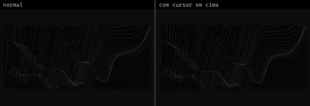 | **Structure Flow · Data Field** `threeui:structure-flow/data-field` | Login & Conta | threeui · MIT | — |
| 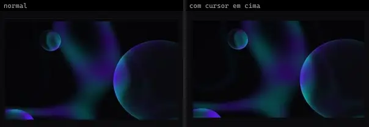 | **Structure Flow · Dimensional Field** `threeui:structure-flow/dimensional-field` | Login & Conta | threeui · MIT | — |
| 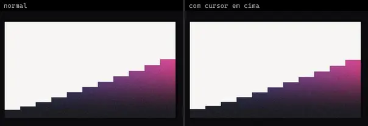 | **Structure Flow · Expanse Field** `threeui:structure-flow/expanse-field` | Login & Conta | threeui · MIT · ⚠needs-network | — |
|  | **Structure Flow · Fluid Field** `threeui:structure-flow/fluid-field` | Login & Conta | threeui · MIT | — |
| 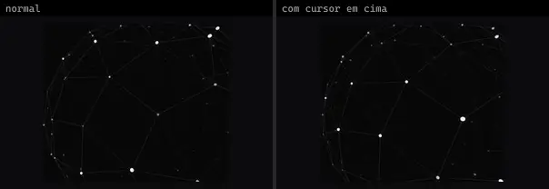 | **Structure Flow · Topology Field** `threeui:structure-flow/topology-field` | Login & Conta | threeui · MIT | — |
| 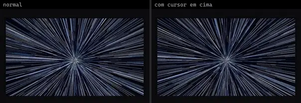 | **Warp Field · Hyperspace** `threeui:warp-field/hyperspace` | Login & Conta | threeui · MIT | — |
| 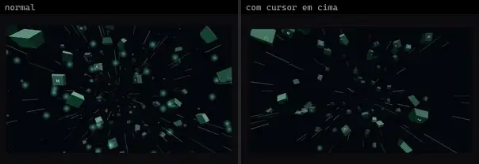 | **Warp Field · Keycap Drift** `threeui:warp-field/keycaps` | Login & Conta | threeui · MIT | — |
| 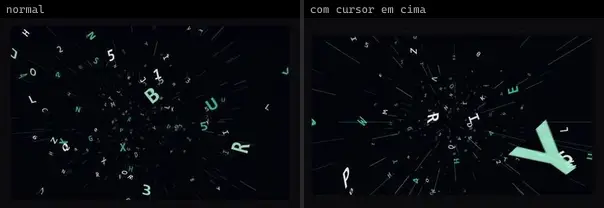 | **Warp Field · Letter Storm** `threeui:warp-field/letters` | Login & Conta | threeui · MIT | — |
| 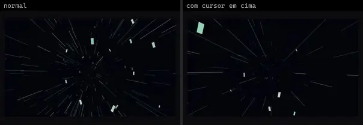 | **Warp Field · Warp Field** `threeui:warp-field/streaks` | Login & Conta | threeui · MIT | — |
|  | **Password Input** `uitripled:inputs/password-input` | Login & Conta | uitripled · MIT | framer-motion, lucide-react |
|  | **RubberBandSlider** `atlas:Inputs/RubberBandSlider` | UI base | atlas (própria) · Proprietária (Atlas) | motion |
| 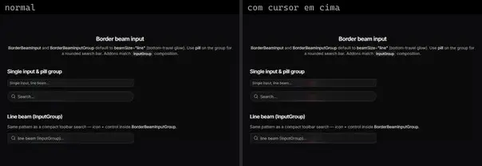 | **Border Beam Input** `cultui:border-beam-input-demo` | UI base | cultui · MIT | @base-ui/react, border-beam, lucide-react |
| 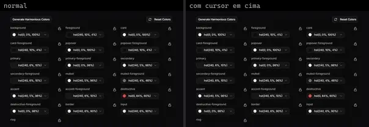 | **Color Picker** `cultui:color-picker-demo` | UI base | cultui · MIT | lucide-react, motion, poline |
|  | **Dither Image Demo Upload** `cultui:dither-image-demo-upload` | UI base | cultui · MIT | — |
|  | **Halo Dropzone** `cultui:halo-dropzone-demo` | UI base | cultui · MIT | lucide-react, motion |
|  | **Halo Field** `cultui:halo-field-demo` | UI base | cultui · MIT | @base-ui/react, lucide-react, motion |
| 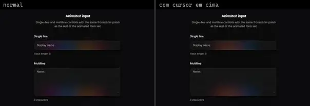 | **Halo Input** `cultui:halo-input-demo` | UI base | cultui · MIT | @base-ui/react, motion |
|  | **Halo Search** `cultui:halo-search-demo` | UI base | cultui · MIT | @paper-design/shaders-react, motion |
| 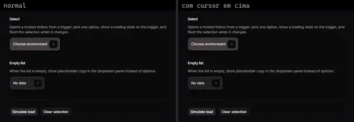 | **Halo Select** `cultui:halo-select-demo` | UI base | cultui · MIT | @base-ui/react, lucide-react, motion |
|  | **Popover Form** `cultui:popover-form-demo` | UI base | cultui · MIT | lucide-react, motion |
|  | **Calendar** `kibo:calendar` | UI base | kibo · MIT | @faker-js/faker, @repo/calendar, date-fns, jotai, lucide-react |
| 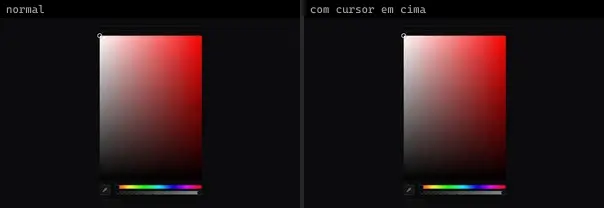 | **Color Picker** `kibo:color-picker` | UI base | kibo · MIT | @repo/color-picker, color, lucide-react, radix-ui |
|  | **Dropzone** `kibo:dropzone` | UI base | kibo · MIT | @repo/dropzone, lucide-react, react-dropzone |
| 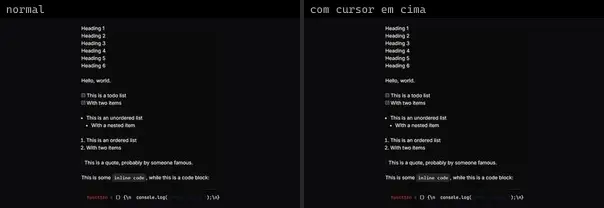 | **Editor** `kibo:editor` | UI base | kibo · MIT | @repo/editor, @tiptap/core, @tiptap/extension-code-block-lowlight, @tiptap/extension-list, @tiptap/extension-subscript, @tiptap/extension-superscript, @tiptap/extension-table, @tiptap/extension-text-style, @tiptap/extension-typography, @tiptap/extensions, @tiptap/pm, @tiptap/react, @tiptap/starter-kit, @tiptap/suggestion, fuse.js, lowlight, lucide-react, tippy.js |
|  | **Mini Calendar** `kibo:mini-calendar` | UI base | kibo · MIT | @radix-ui/react-use-controllable-state, @repo/mini-calendar, date-fns, lucide-react, radix-ui |
|  | **Action Search Bar** `kokonutui:action-search-bar` | UI base | kokonutui · MIT | lucide-react, motion |
|  | **Avatar Picker** `kokonutui:avatar-picker` | UI base | kokonutui · MIT | @radix-ui/react-slot, class-variance-authority, clsx, lucide-react, motion, tailwind-merge |
|  | **File Upload** `kokonutui:file-upload` | UI base | kokonutui · MIT | clsx, lucide-react, motion, tailwind-merge |
| 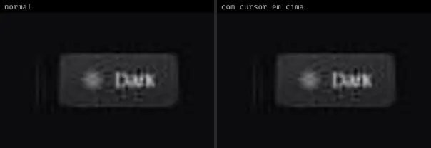 | **Switch Button** `kokonutui:switch-button` | UI base | kokonutui · MIT | @radix-ui/react-slot, class-variance-authority, clsx, lucide-react, next-themes, tailwind-merge |
|  | **Team Selector** `kokonutui:team-selector` | UI base | kokonutui · MIT | lucide-react, motion |
| 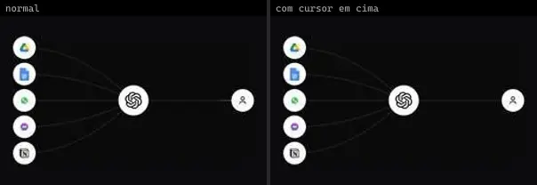 | **Animated Beam Multiple Inputs** `magicui:animated-beam-multiple-inputs` | UI base | magicui · MIT | motion |
| 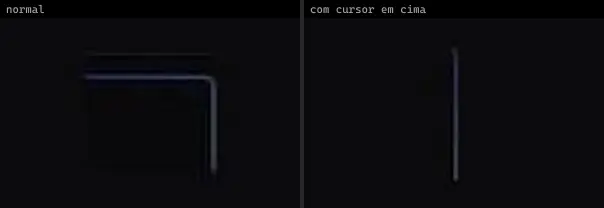 | **Border Trail Textarea** `motionprimitives:border-trail/border-trail-textarea` | UI base | motionprimitives · MIT | motion |
|  | **Image Comparison Custom Slider** `motionprimitives:image-comparison/image-comparison-custom-slider` | UI base | motionprimitives · MIT | motion |
|  | **Infinite Slider Basic** `motionprimitives:infinite-slider/infinite-slider-basic` | UI base | motionprimitives · MIT | motion, react-use-measure |
| 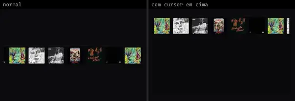 | **Infinite Slider Hover Speed** `motionprimitives:infinite-slider/infinite-slider-hover-speed` | UI base | motionprimitives · MIT | motion, react-use-measure |
|  | **Infinite Slider Vertical** `motionprimitives:infinite-slider/infinite-slider-vertical` | UI base | motionprimitives · MIT | motion, react-use-measure |
|  | **Morphing Popover Textarea** `motionprimitives:morphing-popover/morphing-popover-textarea` | UI base | motionprimitives · MIT | lucide-react, motion |
| 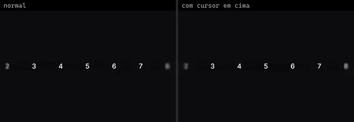 | **Progressive Blur Slider** `motionprimitives:progressive-blur/progressive-blur-slider` | UI base | motionprimitives · MIT | motion, react-use-measure |
|  | **Sliding Slider** `motionprimitives:sliding-number/sliding-slider` | UI base | motionprimitives · MIT | motion, react-use-measure |
|  | **Text Morph Input** `motionprimitives:text-morph/text-morph-input` | UI base | motionprimitives · MIT | motion |
|  | **File Upload Pipeline** `motiq:catalog/file-upload-pipeline` | UI base | motiq · MIT | motion |
|  | **File Upload Pipeline** `motiq:file-upload-pipeline` | UI base | motiq · MIT | motion |
|  | **Workflow Topology Field** `motiq:catalog/workflow-topology-field` | UI base | motiq · MIT | — |
|  | **Workflow Topology Field** `motiq:workflow-topology-field` | UI base | motiq · MIT | — |
|  | **Attachment 1** `reui:attachment/c-attachment-1` | UI base | reui · MIT | class-variance-authority, cn, radix-ui |
|  | **File Upload 1** `reui:file-upload/c-file-upload-1` | UI base | reui · MIT | class-variance-authority, cn, radix-ui |
| 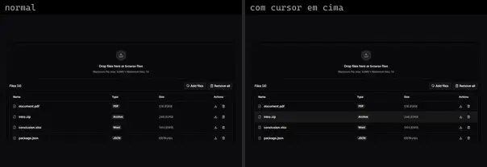 | **File Upload 6** `reui:file-upload/c-file-upload-6` | UI base | reui · MIT | class-variance-authority, cn, radix-ui |
|  | **Signature Pad 1** `reui:signature-pad/c-signature-pad-1` | UI base | reui · MIT | cn |
|  | **Animated File Upload** `smoothui:animated-file-upload` | UI base | smoothui · MIT | @repo/shadcn-ui, @repo/smoothui, motion |
| 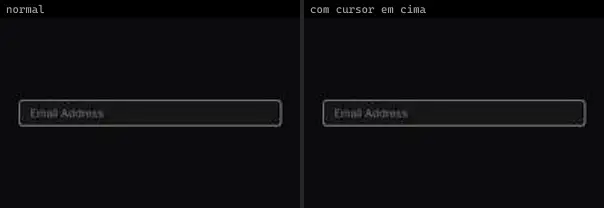 | **Animated Input** `smoothui:animated-input` | UI base | smoothui · MIT | @repo/smoothui, lucide-react, motion |
| 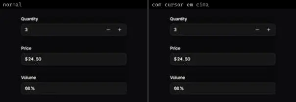 | **Animated Number Input** `smoothui:animated-number-input` | UI base | smoothui · MIT | @repo/shadcn-ui, @repo/smoothui, lucide-react, motion |
|  | **Animated O T P Input** `smoothui:animated-o-t-p-input` | UI base | smoothui · MIT | @radix-ui/react-slot, @repo/shadcn-ui, @repo/smoothui, class-variance-authority, input-otp, lucide-react, motion |
|  | **Checkbox** `smoothui:checkbox` | UI base | smoothui · MIT | @repo/shadcn-ui, @repo/smoothui, motion, radix-ui |
| 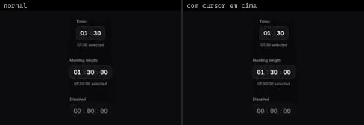 | **Duration Picker** `smoothui:duration-picker` | UI base | smoothui · MIT | @repo/shadcn-ui, @repo/smoothui, motion |
|  | **Exposure Slider** `smoothui:exposure-slider` | UI base | smoothui · MIT | @repo/shadcn-ui, @repo/smoothui, motion |
| 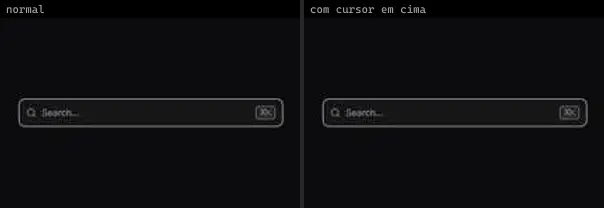 | **Favicon Search** `smoothui:favicon-search` | UI base | smoothui · MIT | @repo/shadcn-ui, @repo/smoothui, lucide-react, motion |
|  | **Form** `smoothui:form` | UI base | smoothui · MIT | @radix-ui/react-slot, @repo/shadcn-ui, @repo/smoothui, class-variance-authority, lucide-react, motion, radix-ui |
| 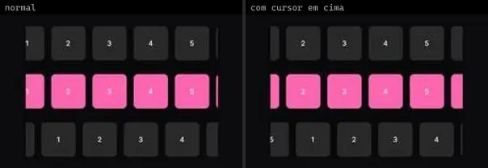 | **Infinite Slider** `smoothui:infinite-slider` | UI base | smoothui · MIT | @repo/shadcn-ui, @repo/smoothui, motion, react-use-measure |
|  | **Interactive Image Selector** `smoothui:interactive-image-selector` | UI base | smoothui · MIT | @repo/smoothui, @smoothui/data, lucide-react, motion |
| 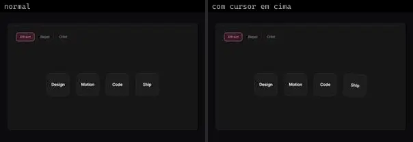 | **Magnetic Field** `smoothui:magnetic-field` | UI base | smoothui · MIT | @repo/shadcn-ui, @repo/smoothui, motion |
|  | **Radio Group** `smoothui:radio-group` | UI base | smoothui · MIT | @repo/shadcn-ui, @repo/smoothui, motion, radix-ui |
|  | **Searchable Dropdown** `smoothui:searchable-dropdown` | UI base | smoothui · MIT | @repo/smoothui, lucide-react, motion |
| 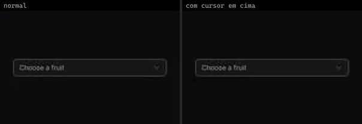 | **Select** `smoothui:select` | UI base | smoothui · MIT | @repo/shadcn-ui, @repo/smoothui, lucide-react, motion |
|  | **Social Selector** `smoothui:social-selector` | UI base | smoothui · MIT | @repo/smoothui, motion |
| 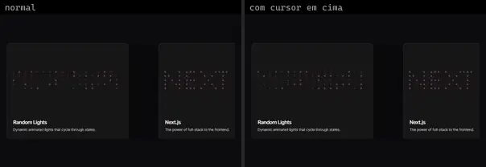 | **Switchboard Card** `smoothui:switchboard-card` | UI base | smoothui · MIT | @repo/shadcn-ui, @repo/smoothui |
| 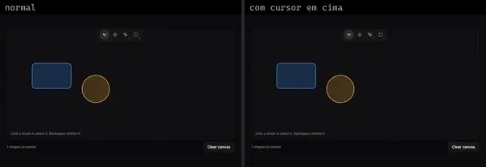 | **Vector Editor Toolbar** `smoothui:vector-editor-toolbar` | UI base | smoothui · MIT | @radix-ui/react-slot, @repo/shadcn-ui, @repo/smoothui, class-variance-authority, lucide-react, motion |
|  | **Animated Switch** `spectrumui:animated-switch` | UI base | spectrumui · Apache-2.0 | clsx, framer-motion, tailwind-merge |
|  | **Beam Search** `spectrumui:beam-search` | UI base | spectrumui · Apache-2.0 | border-beam, clsx, lucide-react, tailwind-merge |
| 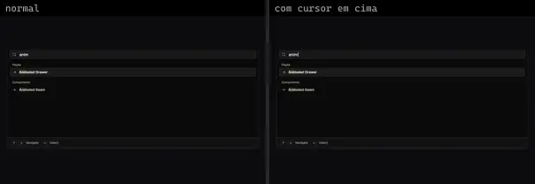 | **Command Search** `spectrumui:command-search` | UI base | spectrumui · Apache-2.0 | clsx, lucide-react, motion, tailwind-merge |
| 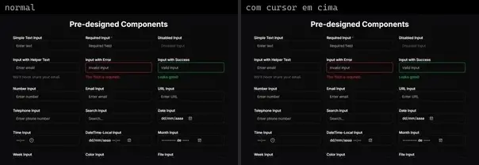 | **Form** `spectrumui:form` | UI base | spectrumui · Apache-2.0 | @radix-ui/react-checkbox, @radix-ui/react-label, @radix-ui/react-radio-group, @radix-ui/react-slider, class-variance-authority, emoji-picker-react, lucide-react |
|  | **Link Search Footer** `spectrumui:blocks/footers/link-search-footer` | UI base | spectrumui · Apache-2.0 · ⚠needs-props | clsx, tailwind-merge |
|  | **Region Picker Footer** `spectrumui:blocks/footers/region-picker-footer` | UI base | spectrumui · Apache-2.0 · ⚠needs-props | @radix-ui/react-popover, clsx, tailwind-merge |
| 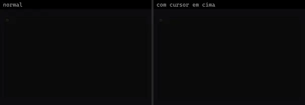 | **Task Checkbox** `spectrumui:task-checkbox` | UI base | spectrumui · Apache-2.0 | clsx, framer-motion, tailwind-merge |
|  | **Checkbox Field** `systaliko:components/checkbox-field` | UI base | systaliko · MIT | class-variance-authority, lucide-react, radix-ui |
|  | **Engraved Certificate** `threeui:engraved-certificate` | UI base | threeui · MIT | — |
|  | **Cards Slider** `uitripled:components/sliders/cards-slider` | UI base | uitripled · MIT | @radix-ui/react-avatar, class-variance-authority, framer-motion, lucide-react |
|  | **Drag To Confirm Slider** `uitripled:motion-core/drag-to-confirm-slider` | UI base | uitripled · MIT | framer-motion, lucide-react |
|  | **Image Slider Card** `uitripled:components/cards/image-slider-card` | UI base | uitripled · MIT | framer-motion, lucide-react |
|  | **Mac Searchbar** `uitripled:search/mac-searchbar` | UI base | uitripled · MIT | framer-motion, lucide-react |
|  | **Volume Component** `uitripled:components/sliders/volume-component` | UI base | uitripled · MIT | framer-motion |
|  | **Black Impala · JaydipPrajapati1910** `uiverse:Inputs/JaydipPrajapati1910_black-impala-70` | UI base | uiverse · MIT | — |
|  | **Calm Baboon · 0xnihilism** `uiverse:Inputs/0xnihilism_calm-baboon-55` | UI base | uiverse · MIT | — |
|  | **Cold Goose · Spacious74** `uiverse:Inputs/Spacious74_cold-goose-63` | UI base | uiverse · MIT | — |
|  | **Curvy Earwig · Lakshay-art** `uiverse:Inputs/Lakshay-art_curvy-earwig-22` | UI base | uiverse · MIT | — |
|  | **Grumpy Eel · marcelodolza** `uiverse:Inputs/marcelodolza_grumpy-eel-20` | UI base | uiverse · MIT | — |
|  | **Grumpy Horse · MijailVillegas** `uiverse:Inputs/MijailVillegas_grumpy-horse-85` | UI base | uiverse · MIT | — |
|  | **Shaggy Husky · MijailVillegas** `uiverse:Inputs/MijailVillegas_shaggy-husky-62` | UI base | uiverse · MIT | — |
|  | **Silly Dragonfly · LeonKohli** `uiverse:Inputs/LeonKohli_silly-dragonfly-82` | UI base | uiverse · MIT | — |
|  | **Silly Quail · 0xnihilism** `uiverse:Inputs/0xnihilism_silly-quail-9` | UI base | uiverse · MIT | — |
| 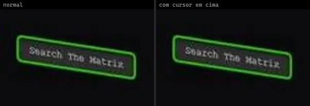 | **Smart Turtle · absoluteSTrange** `uiverse:Inputs/absoluteSTrange_smart-turtle-82` | UI base | uiverse · MIT | — |
|  | **Swift Warthog · PhanDangKhoa96** `uiverse:Inputs/PhanDangKhoa96_swift-warthog-78` | UI base | uiverse · MIT | — |
